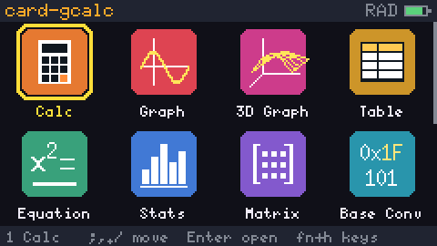

# card-gcalc User Manual

[日本語](../doc_ja/README.md)

card-gcalc is firmware that turns the M5Stack Cardputer-Adv into a graphing calculator. This manual covers calculator operation, each app, the Python scripting API, writing plugins, and working with a PC.

## Contents

### Getting started

- [Basics](basics.md): the keyboard, the screen, the home screen, menus and input fields, typing math

### Apps

| # | App | What it does |
|---|---|---|
| 1 | [Calc](apps/calc.md) | 15-digit decimal arithmetic, variables, exact results with fractions, √ and π, complex numbers |
| 2 | [Graph](apps/graph.md) | y=f(x), polar and parametric graphs, trace, analysis (roots, extrema, intersections, integrals) |
| 3 | [3D Graph](apps/graph3d.md) | Surfaces, lines, planes, spheres and more in 3D; cross sections, intersections and relative positions |
| 4 | [Table](apps/table.md) | Tables of function values |
| 5 | [Equation](apps/equation.md) | Polynomials, systems of linear equations, solver |
| 6 | [Stats](apps/stats.md) | One- and two-variable statistics, regression, statistical plots, probability distributions |
| 7 | [Matrix](apps/matrix.md) | Matrix arithmetic (det, inverse, RREF, Ax=b and more) |
| 8 | [Base Conv](apps/basen.md) | Binary, octal, decimal and hexadecimal conversion and bit operations |
| 9 | [Python](apps/python.md) | Create, edit and run scripts |
| 10 | [Shell](apps/shell.md) | Interactive Python (REPL) |
| 11 | [Files](apps/files.md) | File management on flash and SD card |
| 12 | [GPIO](apps/gpio.md) | Input and output on the Grove port and expansion header, I2C scan |
| 13 | [Settings](apps/settings.md) | Angle unit, number format, language, plugin management and more |

### Programming

- [cardgcalc module API](api.md): use the screen, keyboard and GPIO from Python scripts (plus turtle, matplotlib and ulab)
- [Plugins](plugins.md): add apps without reflashing the firmware
- [BASIC](basic.md): the structured BASIC sample plugin

### Working with a PC

- [Working with a PC](pc.md): USB connection, transferring and backing up files, flashing firmware, installing plugins

## Conventions

- Keys are written like `fn` or `;`. `fn`+`;` means "hold `fn` and press `;`" (you can also tap the modifier first and then the key; see [Basics](basics.md#modifier-keys)).
- ↑ ↓ ← → are the arrow keys (`fn`+`;` `.` `,` `/`).
- ESC is `fn`+`` ` ``.
- F1–F6 are the soft keys at the bottom of the screen, pressed with `fn`+`1`–`6`.
- Screenshots show the English display (Settings → Language / 言語 → English).
