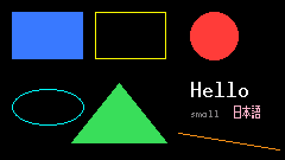
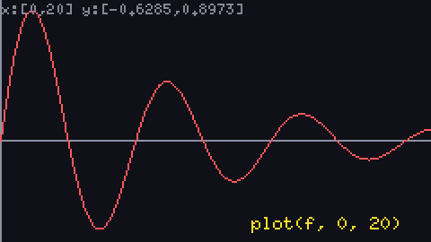
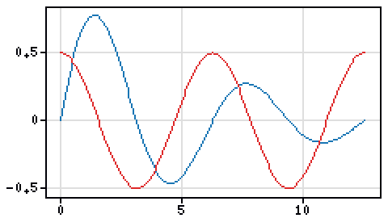

# cardgcalc module API

[← Contents](README.md)

The `cardgcalc` module gives Python scripts access to the screen, keyboard, GPIO and more. To create and run scripts, see [Python](apps/python.md).

```python
import cardgcalc

cardgcalc.cls()
cardgcalc.text("Hello", 10, 10, cardgcalc.YELLOW, font="large")
cardgcalc.circle(120, 80, 20, "red", fill=True)
cardgcalc.show()
k = cardgcalc.wait_key()
```

Available modules:

| Module | Contents |
|---|---|
| `cardgcalc` | Screen, keyboard, time, graphs, GPIO, RGB LED (this page) |
| `turtle` | Turtle graphics ([turtle](#turtle)) |
| `matplotlib.pyplot` | Line plots, scatter plots, bar charts, histograms ([matplotlib.pyplot](#matplotlibpyplot)) |
| `ulab` | numpy / scipy compatible arrays ([ulab](#ulab)) |
| `math`, `time`, `random`, `machine`, `os` … | Standard MicroPython modules |

## How scripts run

- `print()` and `input()` use the on-screen console.
- Press ESC (`fn`+`` ` ``) or `ctrl`+`c` to interrupt a script, even a loop like `while True: pass`.
- Drawing is copied to the display automatically while the script runs. Call `show()` to update it immediately.
- When a script that drew graphics ends, its last picture stays on the screen until you press a key.
- Your own modules imported by the script are unloaded when it ends.

## Screen

The screen is 240×135 pixels with the origin (0, 0) at the top left; x grows to the right and y grows downward.



```python
import cardgcalc as cg   # a short name for the module
cg.cls()
cg.fill_rect(10, 10, 60, 40, cg.BLUE)
cg.rect(80, 10, 60, 40, "yellow")
cg.circle(180, 30, 20, cg.RED, fill=True)
cg.ellipse(40, 90, 30, 15, "cyan")
cg.poly([(100, 70), (140, 120), (60, 120)], cg.GREEN, fill=True)
cg.text("Hello", 160, 66, cg.WHITE, font="large")
cg.text("small", 160, 92, "gray", font="small")
cg.text("日本語", 196, 90, (255, 180, 200))
cg.line(150, 112, 235, 126, cg.ORANGE)
cg.show()
cg.wait_key()
```

| API | Description |
|---|---|
| `W` / `width`, `H` / `height` | Screen width (240) and height (135) |
| `cls(c=BLACK)` / `clear(c=BLACK)` | Fill the whole screen with color c |
| `pixel(x, y)` | Return a pixel's color (internal color value) |
| `pixel(x, y, c)` / `set_pixel(x, y, c)` | Draw a pixel |
| `get_pixel(x, y)` | Return a pixel's color as `(r, g, b)` |
| `line(x0, y0, x1, y1, c=WHITE)` | Line |
| `hline(x, y, w, c=WHITE)`, `vline(x, y, h, c=WHITE)` | Horizontal and vertical lines |
| `rect(x, y, w, h, c=WHITE)` | Rectangle outline |
| `fill_rect(x, y, w, h, c=WHITE)` | Filled rectangle |
| `circle(x, y, r, c=WHITE, fill=False)` | Circle (center x, y, radius r) |
| `ellipse(x, y, rx, ry, c=WHITE, fill=False)` | Ellipse |
| `poly(points, c=WHITE, fill=False)` | Polygon; points is `[(x, y), ...]` |
| `text(s, x, y, c=WHITE, bg=None, font="normal")` | Draw a string and return the x coordinate where it ends. bg=None means a transparent background |
| `text_width(s, font="normal")` | Width of a string in pixels |
| `draw_string(s, x, y, c=(0,0,0), bg=(255,255,255))` | Draw a string in the "medium" font with a background |
| `show()`, `wait_vblank()` | Copy what has been drawn to the display now |
| `brightness(pct)` | Backlight brightness (0–100 %) |

### Fonts

Pass these as `font=` to `text()` and friends. Japanese characters (kanji and kana) are drawn at 8×12 in every font.

| Name | Size (width×height) |
|---|---|
| `"small"` | 5×8 |
| `"normal"` | 6×10 |
| `"medium"` | 6×13 |
| `"large"` | 10×20 |

### Colors

Any argument that takes a color accepts any of these:

- A value returned by `color(r, g, b)` (r, g, b from 0 to 255)
- An `(r, g, b)` tuple
- A color name: `"black"` `"white"` `"red"` `"green"` `"blue"` `"yellow"` `"cyan"` `"magenta"` `"orange"` `"gray"` `"grey"` `"purple"` `"brown"` `"pink"`
- A constant: `BLACK` `WHITE` `RED` `GREEN` `BLUE` `YELLOW` `CYAN` `MAGENTA` `ORANGE` `GRAY` `GREY`

`color()` also accepts a tuple or a name: `color((r, g, b))`, `color("red")`.

## Keyboard

| API | Description |
|---|---|
| `get_key()` | Return the pressed key as a string, or `None` if no key was pressed (does not wait) |
| `wait_key()` | Wait for a key press and return the key as a string |
| `key_down(name)` / `keydown(name)` | `True` if that key is held down right now |
| `keys_down()` | The set of names of the keys held down right now |

`get_key()` / `wait_key()` return the character typed; `key_down()` checks the physical key. Use `key_down()` in games to detect held or simultaneous keys.

Strings returned by `get_key()` / `wait_key()`:

| Key pressed | String returned |
|---|---|
| Character keys | The character typed (`"a"`, `"A"`, `"1"`, `"!"`, `" "` …) |
| Enter, BS, Tab | `"ENTER"` `"BS"` `"TAB"` |
| With `fn` | `"UP"` `"DOWN"` `"LEFT"` `"RIGHT"` `"ESC"` `"DEL"` `"F1"`–`"F10"` `"HOME"` `"END"` `"PGUP"` `"PGDN"` |

Names for `key_down()`:

| Name | Key |
|---|---|
| `"a"`, `"1"`, `";"` … | The character on the key top (lowercase, unshifted) |
| `"ENTER"` `"BS"` `"TAB"` `"SPACE"` | Enter, BS, Tab, Space |
| `"ESC"` | The `` ` `` key |
| `"UP"` `"DOWN"` `"LEFT"` `"RIGHT"` | The `;` `.` `,` `/` keys |
| `"SHIFT"` `"FN"` `"CTRL"` `"OPT"` `"ALT"` | Modifier keys |

There are also key-name constants `KEY_*`: `KEY_UP` `KEY_DOWN` `KEY_LEFT` `KEY_RIGHT` (arrows), `KEY_OK` / `KEY_EXE` (Enter), `KEY_BACK` (`` ` ``), `KEY_BACKSPACE`, `KEY_SHIFT`, `KEY_ALPHA` (alt), `KEY_ZERO`–`KEY_NINE`, `KEY_PLUS`, `KEY_MINUS` and more.

Example: move a dot with the arrow keys

```python
import cardgcalc as cg
x, y = 120, 67
while not cg.key_down("ENTER"):
    if cg.key_down("LEFT"):  x -= 2
    if cg.key_down("RIGHT"): x += 2
    if cg.key_down("UP"):    y -= 2
    if cg.key_down("DOWN"):  y += 2
    cg.cls()
    cg.circle(x, y, 5, "yellow", True)
    cg.text("arrows: move  Enter: quit", 2, 2, "gray", font="small")
    cg.show()
    cg.sleep_ms(20)
```

`key_down("LEFT")` and the other arrows respond to the `;` `.` `,` `/` keys without `fn`.

## Time and power

| API | Description |
|---|---|
| `sleep(s)`, `sleep_ms(ms)` | Wait; the break key and screen updates keep working while waiting |
| `ticks_ms()` | Millisecond counter (take differences with `time.ticks_diff()`) |
| `battery()` | Battery level (%) |

## Graphs

| API | Description |
|---|---|
| `plot(f, xmin=-10, xmax=10, ymin=None, ymax=None, c=None, wait=True)` | Draw y=f(x) over the whole screen |

- If `ymin` / `ymax` are omitted, the vertical range is chosen automatically.
- With `wait=True` it waits for a key press after drawing. With `wait=False` it returns at once, so you can draw on top of the graph.



```python
import math
import cardgcalc
cardgcalc.plot(lambda x: math.sin(x) * math.exp(-x / 8), 0, 20, wait=False)
cardgcalc.text("plot(f, 0, 20)", 140, 120, cardgcalc.YELLOW)
cardgcalc.show()
cardgcalc.wait_key()
```

## GPIO

You can use the pins on the Grove port and the expansion header (EXT). See [GPIO](apps/gpio.md) for the pin layout.

The Cardputer has no EXT header: there `PINS` is `(1, 2)`. G3–G6, G13 and G15 read its keyboard; using them from a script stops the keyboard until the device restarts.

| API | Description |
|---|---|
| `G1` `G2` (Grove), `G3` `G4` `G5` `G6` `G13` `G15` (EXT), `PINS` | Pin number constants and a list of them |
| `pin_out(p, v=None)` | Make p an output and write v (0 / 1). Returns a `machine.Pin` |
| `pin_in(p, pull=None)` | Make p an input and return its value (0 / 1). pull is `None`, `"up"` or `"down"` |
| `analog(p)` | Voltage on p (V, 0 to about 3.1) |
| `pwm(p, freq=1000, duty=50)` | PWM output (frequency in Hz, duty in %). `duty=None` stops it |
| `tone(p, freq, ms)` | Play a tone for ms milliseconds on a piezo buzzer or similar connected to p |
| `i2c_grove(freq=100000)` | I2C on the Grove port (SDA=G2, SCL=G1) as a `machine.SoftI2C` |

Example: blink an LED on G1 and print the voltage on G2

```python
import cardgcalc
n = 0
while True:
    cardgcalc.pin_out(cardgcalc.G1, n % 2)
    print("G2 = %.2f V" % cardgcalc.analog(cardgcalc.G2))
    n += 1
    cardgcalc.sleep_ms(500)
```

Example: scan for I2C devices

```python
import cardgcalc
i2c = cardgcalc.i2c_grove()
print([hex(a) for a in i2c.scan()])
```

> Caution: never apply more than 3.3 V to a pin. G40, G14 and G39 are used by the SD card, G8 and G9 by the internal keyboard (I2C), and G21 by the RGB LED; do not drive them directly with the `machine` module.

## RGB LED

You can light the built-in RGB (full-colour) LED. It works on both the Cardputer-Adv and the Cardputer.

| API | Description |
|---|---|
| `led(r, g, b)` | Light the LED in colour r, g, b (0–255) |
| `led(c)` | Light it in colour c: an `(r, g, b)` tuple, a colour name (`"red"` ...), a constant such as `RED`, or a `color()` value |
| `led(None)` / `led_off()` | Turn it off (`led(0, 0, 0)` and `led("black")` do the same) |
| `led()` | Return the current colour as `(r, g, b)` |
| `led_brightness(pct=None)` | Brightness (0–100 %), applied to every colour. Returns the current value |

- When the script ends, the LED is turned off and the brightness goes back to 100 % (in the shell: when you leave the shell).
- At full brightness the LED is very bright; about `led_brightness(10)` is usually enough.
- The colour constants (`RED` ...) are screen values, so on the LED they are slightly off. Use `(r, g, b)` for exact colours.

Example: fade the LED from red to green

```python
import cardgcalc as cg
cg.led_brightness(20)
for i in range(256):
    cg.led(255 - i, i, 0)   # red -> green
    cg.sleep_ms(10)
cg.wait_key()
```

## turtle

Turtle graphics. The origin is the center of the screen, y points up, and angles are in degrees. Heading 0 is to the right (east).

```python
from turtle import *
speed(8)
colors = ["red", "orange", "green", "blue", "purple"]
for i in range(36):
    color(colors[i % 5])
    forward(55)
    left(170)
hideturtle()
```

| Function | Description |
|---|---|
| `forward(d)`, `backward(d)` | Move forward / backward |
| `left(a)`, `right(a)` | Turn left / right |
| `goto(x, y)`, `home()`, `setheading(a)` | Set position and heading |
| `position()`, `xcor()`, `ycor()`, `heading()`, `towards(x, y)`, `distance(x, y)` | Query position and heading |
| `penup()`, `pendown()`, `isdown()`, `pensize(s)` | Pen up / down and width |
| `color(c)`, `bgcolor(c)` | Pen color and background color (a name or `(r, g, b)`) |
| `speed(s)` | Speed (0–10) |
| `circle(r, extent=360)`, `dot(size, c)`, `write(text)` | Circle, dot, text |
| `hideturtle()`, `showturtle()`, `clear()`, `reset()`, `done()` | Display control |

## matplotlib.pyplot

A small implementation of the most used matplotlib functions, sized for this screen. `show()` draws the plot and waits for a key press.



```python
from ulab import numpy as np
import matplotlib.pyplot as plt
x = np.linspace(0, 4 * np.pi, 200)
plt.plot(x, np.sin(x) * np.exp(-x / 6))
plt.plot(x, np.cos(x) * 0.5, "r")
plt.grid(True)
plt.show()
```

| Function | Description |
|---|---|
| `plot(x, y, fmt)`, `plot(y)` | Line plot. fmt is a color (`"r"` `"b"` `"g"` `"k"` `"y"` `"c"` `"m"` or a color name); with `"o"` it draws points. If y is a 2-D array, each column is drawn as a separate line |
| `scatter(x, y, color)` | Scatter plot |
| `bar(x, height, width=0.8)` | Bar chart |
| `hist(data, bins=10)` | Histogram (returns the counts and bin edges) |
| `text(x, y, s)`, `arrow(x, y, dx, dy)` | Text, arrow |
| `axis([xmin, xmax, ymin, ymax])`, `axis("off")`, `xlim()`, `ylim()` | Plot range and axes |
| `grid(True)`, `title(s)` | Grid lines, title |
| `show()`, `clf()` | Draw, clear |

`xlabel()`, `ylabel()` and `legend()` are accepted but do nothing. Data can be lists, tuples, ranges or ulab arrays.

## ulab

[ulab](https://github.com/v923z/micropython-ulab) is a numpy / scipy compatible array module (version 6.12.1, double precision, up to 2 dimensions).

```python
from ulab import numpy as np
from ulab import scipy

a = np.array([[2, 1], [1, 3]])
b = np.array([3, 5])
print(np.linalg.inv(a))
print(np.dot(np.linalg.inv(a), b))
x = np.linspace(0, 1, 5)
print(np.mean(x), np.std(x))
```

- Array creation: `array`, `linspace`, `arange`, `zeros`, `ones`, `eye` …
- Element-wise operations and math functions: `+ - * /`, `np.sin`, `np.exp`, `np.sqrt` …
- Statistics: `mean`, `std`, `min`, `max`, `sum`, `argmax`, `sort` …
- Linear algebra `np.linalg`: `inv`, `det`, `dot`, `eig`, `norm` …
- Also: `fft`, `polyfit` / `polyval`, `scipy.optimize`, `scipy.integrate`

## Memory

Python has about 176KB of RAM (heap). Large arrays or lists can run out of memory (`MemoryError`).

- For large data, ulab arrays and the `array` module take less memory than lists.
- Delete large variables you no longer need with `del` and call `import gc; gc.collect()` to free memory.
- Free memory is shown under "Memory & storage" in [Settings](apps/settings.md).
