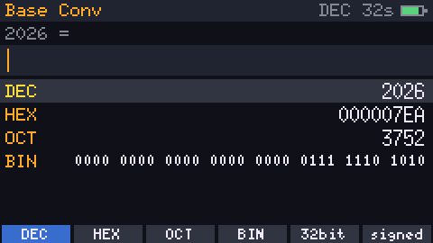
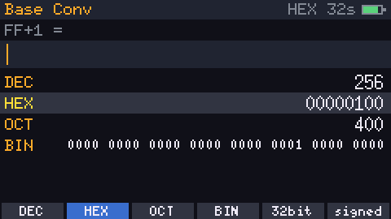
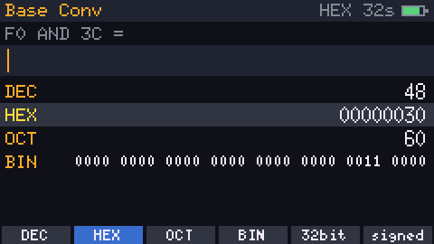
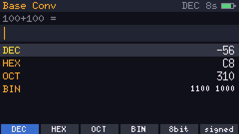
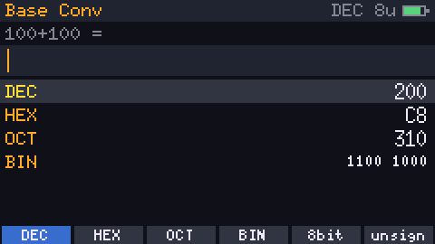

# Base Conv

Base Conv is an integer calculator for programmers. It shows every result in decimal, hexadecimal, octal and binary at once, with a fixed word size (8, 16, 32 or 64 bits), signed or unsigned, and supports bit operations (AND, OR, XOR, NOT, shifts).

Open it from the home screen with `8`.

## Screen layout

| Area | What it shows |
|---|---|
| Status bar (top) | "Base Conv" and the current setting, for example `DEC 32s`: input base, word size, and `s` (signed) or `u` (unsigned) |
| Previous line | The last expression followed by `=` (for example `2026 =`), or an error message in red |
| Input field | The expression you are typing |
| DEC / HEX / OCT / BIN | The current value in each base. The row of the input base is highlighted and its label is yellow |
| Soft keys (bottom) | F1 DEC, F2 HEX, F3 OCT, F4 BIN, F5 word size (`32bit`), F6 `signed` / `unsign`. The key of the input base is highlighted |

How each base is shown:

| Row | Format |
|---|---|
| DEC | Signed decimal (e.g. `-56`) in signed mode, unsigned decimal (e.g. `200`) in unsigned mode |
| HEX | Two's complement, zero-padded to the word size (8 digits for 32 bits), capital letters |
| OCT | Two's complement, without leading zeros |
| BIN | All bits of the word, in groups of 4. 64-bit values use two lines of 32 bits |

## Operations

Arrows ↑ ↓ ← → are `fn`+`;` `.` `,` `/`. Base Conv has a text input field, so the plain `;` `.` `,` `/` keys type characters here (see [Basic operation](../basics.md)). ESC is `fn`+`` ` ``. F1–F6 are `fn`+`1`…`6`.

### Keys

| Key | Action |
|---|---|
| Characters | Type the expression |
| Enter | Evaluate. The result replaces the current value and the field is cleared. On an empty field, Enter evaluates the previous expression again |
| ↑ | Copy the previous expression into the field for editing |
| ← / → | Move the cursor |
| `BS` / DEL (`fn`+`BS`) | Delete before / after the cursor |
| `fn`+`-` / `fn`+`=` | Start / end of the line |
| `ctrl`+`u` | Clear the line |
| ESC | Clear the field (and the error). On an empty field, return to the home screen |
| F1 (DEC) / F2 (HEX) / F3 (OCT) / F4 (BIN) | Choose the input base |
| F5 (`8bit` … `64bit`) | Change the word size: 8 → 16 → 32 → 64 → 8 |
| F6 (`signed` / `unsign`) | Switch between signed and unsigned |

Changing the input base changes only how new numbers are read; the current value stays the same. Changing the word size or the sign cuts the current value to the new word (for example, 0x1234 becomes 0x34 in 8 bits).

### Operator shortcuts

`opt` (or `alt`) with these keys inserts an operator word with spaces around it:

| Key | Inserts |
|---|---|
| `opt`+`a` | ` AND ` |
| `opt`+`o` | ` OR ` |
| `opt`+`x` | ` XOR ` |
| `opt`+`n` | `NOT ` |
| `opt`+`l` | ` SHL ` |
| `opt`+`r` | ` SHR ` |
| `opt`+`m` | ` MOD ` |

### Numbers

- Numbers are read in the input base: in HEX mode `FF` is 255, in BIN mode `101` is 5. Letters can be upper or lower case.
- A prefix chooses the base for one number: `0x` (hex) and `0o` (octal) in every mode, `0b` (binary) and `0d` (decimal) in every mode except HEX (where `0B…` and `0D…` are hex numbers).
- `ans` is the current value.
- A number is cut to the word size as soon as it is read: in 8-bit signed mode `200` is read as -56.

### Operators

From lowest to highest priority:

| Priority | Operators | Meaning |
|---|---|---|
| 1 | `OR` `\|`, `NOR` | Bitwise OR, NOT of OR |
| 2 | `XOR` `^`, `XNOR` | Bitwise XOR, NOT of XOR |
| 3 | `AND` `&`, `NAND` | Bitwise AND, NOT of AND |
| 4 | `SHL` `<<`, `SHR` `>>` | Shift left, shift right |
| 5 | `+` `-` | Add, subtract |
| 6 | `*` `/` `MOD` `%` | Multiply, integer divide, remainder |
| 7 | `-` `+` `NOT` `~` (prefix) | Negate, NOT (invert all bits) |

- Parentheses `(` `)` group. A missing `)` at the end is allowed.
- Operator words are not case sensitive. Separate them from numbers with spaces (`F0 AND 3C`, not `F0AND3C`). Symbols need no spaces.
- `^` is XOR, not a power.
- `/` divides and drops the fraction toward zero (`-7/2` is -3). `MOD` / `%` gives the remainder with the sign of the left number (`-7 MOD 2` is -1).
- `SHR` is a logical shift: zeros come in from the left even in signed mode. Shifting by 128 or more gives 0. A negative shift count is an error.
- Every step is cut to the word size, so results wrap around (in 8-bit signed mode `100+100` is -56).
- Shift has lower priority than `+`: `1 SHL 2+1` is `1 SHL 3` = 8.

### Error messages

| Message | Cause |
|---|---|
| `Syntax error` | Missing number or operator, unbalanced parentheses |
| `Syntax error: '.'` | A character that is not allowed (here `.`) |
| `Invalid HEX number: 12G` | A digit not valid in the base (also DEC / OCT / BIN) |
| `Math error: ÷0` | Division or MOD by zero |
| `Negative shift` | Shift count below 0 |

## Examples

### 1. Convert a number

1. On the home screen press `8`. (If the status bar does not show `DEC`, press F1.)
2. Type `2026` and press Enter.

DEC 2026 is HEX `000007EA`, OCT `3752` and BIN `0111 1110 1010`.

3. Press F2 (HEX). Type `FF+1` and press Enter.

HEX FF+1 is `00000100`, which is DEC 256.

### 2. A bit operation

Mask 0xF0 with 0x3C, then shift the result left by 4.

1. Press F2 (HEX).
2. Type `F0`, press `opt`+`a`, type `3C`. The field shows `F0 AND 3C`.
3. Press Enter. The result is HEX `00000030` (DEC 48, BIN `0011 0000`).

4. Type `ans`, press `opt`+`l`, type `4`, and press Enter (`ans SHL 4`). The result is HEX `00000300` (DEC 768).

### 3. Signed and unsigned in 8 bits

1. Press F1 (DEC).
2. Press F5 until the key shows `8bit` (from 32bit: twice). Check that F6 shows `signed`.
3. Type `100+100` and press Enter. The sum overflows 8 bits: DEC shows `-56`, HEX `C8`, BIN `1100 1000`.

4. Press F6. It changes to `unsign` and DEC shows `200`. The bits (`C8`) are the same; only the DEC reading changes.

5. Type `-1` and press Enter. In 8-bit unsigned mode this is `255` (HEX `FF`, BIN `1111 1111`).

### 4. Count with Enter

1. In DEC mode, type `ans+1` and press Enter.
2. Press Enter again (on the empty field) to repeat `ans+1`. Each press adds 1.

## Notes and limits

- Integers only. There are no fractions, and division drops the remainder.
- The word size is 8, 16, 32 or 64 bits. Every result wraps around within it.
- There is no power operator. Use `SHL` for powers of 2 (`1 SHL 10` = 1024).
- The input base, word size, sign, current value and last expression are saved in `/data/basen.json` and restored next time.
- Base Conv does not use the decimal number engine of the other calculator apps and does not share their variables or Ans.

---

[← Contents](../README.md) · Common keys: [Basic operation](../basics.md)
