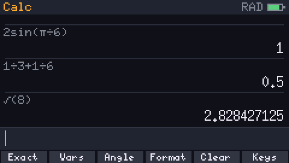
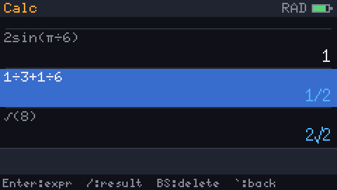
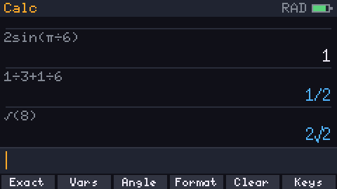
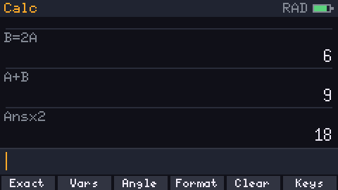
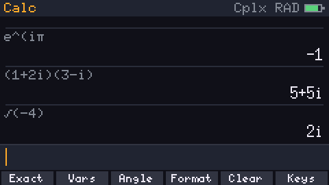

# Calc

Calc is the main calculation screen. Type an expression, press `Enter`, and the expression and its result are added to the history above the input line. It handles variables, the previous answer (`Ans`), exact display of fractions, π and √, angle units, display formats and complex numbers.

Open it from the home screen with the **Calc** icon, or press `1` on the home screen.

Arrows are written ↑ ↓ ← → on this page. They are `fn`+`;` `.` `,` `/`. ESC is `fn`+`` ` `` (a plain `` ` `` types a backtick). F1–F6 are `fn`+`1`…`6`. See [Basic operation](../basics.md) for the common keys and the full `opt` / `alt` math key table.

## Screen layout

| Area | Contents |
|---|---|
| Status bar (top) | Title "Calc", modifier latches, and on the right the mode: `Cplx` when complex numbers are on, `FIX3` / `SCI5` / `ENG4` and so on when the format is not Norm, and the angle unit (RAD / DEG / GRA), then the battery |
| History | Past calculations, newest at the bottom. Each entry shows the expression on the left (gray) and the result on the right. Exact forms are shown in blue, errors in red |
| Input line | The expression you are typing, with the cursor |
| Soft keys (bottom) | F1 Exact, F2 Vars, F3 Angle, F4 Format, F5 Clear, F6 Keys |

While you browse the history, the soft keys are replaced by a hint line: `` Enter:expr  /:result  BS:delete  `:back `` (`` ` `` here means ESC).

## Operations

### Input line

| Key | Action |
|---|---|
| Characters, digits | Type into the input line. `*` types `×` and `/` types `÷` |
| `opt` / `alt` + key | Insert a math token, for example `opt`+`s` sin(, `opt`+`q` √(, `opt`+`p` π, `opt`+`=` → |
| ← → | Move the cursor (tokens such as `sin(` count as one character) |
| `BS` / `fn`+`BS` | Delete left / right of the cursor (a token is deleted as a whole) |
| `fn`+`-` / `fn`+`=` | Start / end of the line |
| `ctrl`+`u` | Clear the line |
| `Enter` | Evaluate. On an empty line, evaluate the last expression again |
| ↑ | Select the newest history entry (history mode, below) |
| ESC | Clear the line. On an empty line, go back to the home screen |
| `fn`+`h` | Key map help (same as F6) |

If the line is empty and you start with an operator (`+` `-` `×` `÷` `^` `²` `³` `!` `⁻¹` `→` `%`), `Ans` is inserted first. Typing `×2` right after a result calculates `Ans×2`.

### Soft keys

| Key | Label | Action |
|---|---|---|
| F1 | Exact | Switch the newest result between decimal and exact form (fraction, multiple of π, or (p/q)√n). Only results that have an exact form change |
| F2 | Vars | List the stored variables and their values ("Variables (Enter: insert)"). `Enter` inserts the selected name into the input line |
| F3 | Angle | Change the angle unit: RAD → DEG → GRA → RAD. This is the same setting as Settings → Angle unit |
| F4 | Format | Open the "Display format" menu (below) |
| F5 | Clear | Delete the whole history (asks "Clear history?"; `Enter` = yes) |
| F6 | Keys | Show the key map for `opt` / `alt` / `fn` |

The **Display format** menu (F4):

| Item | Meaning |
|---|---|
| Norm | Up to 10 significant digits. Very large or small numbers switch to E notation |
| Fix | A fixed number of decimal places. Asks "Digits (0-9)" |
| Sci | Scientific notation. Asks "Significant digits (1-10)" |
| Eng | Engineering notation (exponent a multiple of 3). Asks "Significant digits (1-10)" |
| Complex: on / off | Turn complex-number results on or off |

The format also applies to Equation, Stats and Matrix results.

### History mode

Press ↑ on the input line to select a history entry. The selected entry is highlighted.

| Key | Action |
|---|---|
| ↑ ↓ | Select an older / newer entry. ↓ past the newest entry returns to the input line |
| `Enter` | Insert the entry's expression into the input line |
| → or `/` | Insert the entry's result (as shown, decimal or exact) into the input line |
| F1 | Switch the selected entry between decimal and exact form |
| `BS` / `fn`+`BS` | Delete the entry |
| ESC or ← | Back to the input line |
| Any other key | Back to the input line and handle the key there |

In history mode the plain `;` `.` `,` `/` keys work as arrows too.

## Examples

### Arithmetic and exact display

1. Type `1+2*3` and press `Enter`. The result is `7` (the screen shows `1+2×3`).
2. Type `2`, press `opt`+`s` (sin(), `opt`+`p` (π), then type `/6)` and press `Enter`. `2sin(π÷6)` is `1` (in RAD).
3. Type `1/3+1/6` and press `Enter`. The result is `0.5`.
4. Press `opt`+`q` (√(), type `8)` and press `Enter`. The result is `2.828427125`.
5. Press F1. The last result changes to `2√2`.
6. Press ↑ ↑ to select `1÷3+1÷6`, then press F1. It shows `1/2`.

7. Press ESC to go back to the input line. Exact results stay blue.

### Variables and Ans

1. Type `3`, press `opt`+`=` (→), type `A`, and press `Enter`. `3→A` stores 3 in A.
2. Type `A(A+1)` and press `Enter`. The result is `12` (implicit multiplication).
3. Type `B=2A` and press `Enter`. `B=…` also stores a value: B is 6.
4. Type `A+B` and press `Enter`: `9`.
5. Type `*2` and press `Enter`. The line starts with an operator, so it becomes `Ans×2`: `18`.

6. Press F2 to see A, Ans and B with their values. Select one and press `Enter` to insert its name, or press ESC to close the list.

### Complex numbers

1. Press F4, then `5` (Complex: off). Complex mode is now on, and `Cplx` appears in the status bar.
2. Press `opt`+`e` (e^(), `opt`+`i` (i), `opt`+`p` (π) and `Enter`. `e^(iπ)` is `-1`.
3. Type `(1+2`, `opt`+`i`, `)(3-`, `opt`+`i`, `)` and press `Enter`: `5+5i`.
4. Press `opt`+`q`, type `-4)` and press `Enter`. `√(-4)` is `2i`.

With Complex off, results that are not real numbers, such as `√(-4)`, give `Non-real error`.

## Writing expressions

- Implicit multiplication: `2x`, `3(x+1)`, `(a)(b)`, `2sin(x)`.
- Closing parentheses at the end can be left out: `√(8` is the same as `√(8)`.
- Numbers: `12`, `3.5`, `.5`, and `1.2E-3` (`E` is `opt`+`0`).
- Operators: `+ - × ÷ ^`, postfix `%` `!` `²` `³` `⁻¹`.
- Constants: `π` (`opt`+`p`), `e`, `i` (`opt`+`i`), `Ans` (`opt`+`a`).
- Special functions: `∫(x²,0,3)`, `d/dx(x³,2)`, `Σ(k²,k,1,10)`, `∏(k,k,1,5)`, `solve(x²-2,1)`.
- Comparisons such as `2<3` give 1 (true) or 0 (false).

## Notes and limits

- **Precision**: numbers are decimal with a 15-digit mantissa and exponents up to ±99. Every operation rounds to 15 digits, so `0.1+0.2-0.3` is exactly 0. Functions are computed to 18 digits and rounded to 15. Results smaller than 1E-99 become 0; larger than the range give `Math error`.
- **Trigonometry**: in DEG and GRA the period is reduced exactly, so `sin(180)` is 0. In RAD, arguments written as multiples of π (`sin(π)`, `cos(π/2)`) are exact.
- **Display**: Norm shows up to 10 significant digits. The full 15 digits are kept for later calculations.
- **Exact forms**: fractions with denominators up to 10000, multiples of π (denominator up to 1000), and (p/q)√n. Integers and complex results have no exact form, and F1 does nothing for them.
- **Variables**: a single letter except `e` and `i` (A–Z, x, y, θ …). Letters written together multiply: `AB` is A×B. `A=…` stores only when the left side is one letter; otherwise `=` is a comparison. Variables not yet set are 0. Variables are shared with the other calculator apps (Graph, Table, Equation …) and saved in `/data/vars.json`.
- **Errors**: `Syntax error`, `Math error`, `Math error: ÷0`, `Non-real error`, `Argument error` are shown in red in place of the result.
- **History**: the last 40 entries are kept and saved in `/data/calc_hist.json` when you leave the app.
- **Settings**: angle unit, display format and complex mode are saved with the other settings and are also available in the Settings app.

---

[← Contents](../README.md) · [Basic operation](../basics.md)
