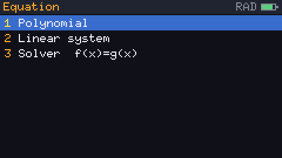
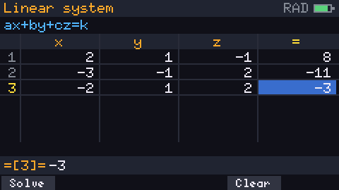
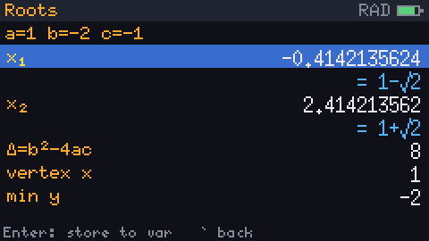
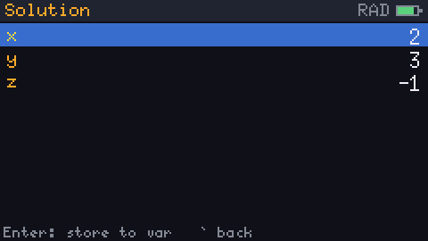
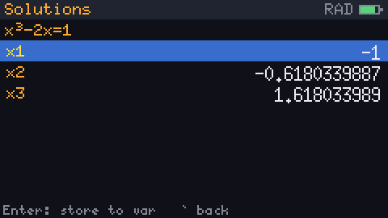

# Equation

Equation solves three kinds of problems: polynomial equations of degree 2 to 4 (including complex roots), systems of 2 to 4 linear equations, and general equations f(x)=g(x), for which the solver finds every solution in a range.

Open it from the home screen with the **Equation** icon, or press `5` on the home screen.

Arrows are written ↑ ↓ ← → on this page. They are `fn`+`;` `.` `,` `/`. ESC is `fn`+`` ` ``. F1–F6 are `fn`+`1`…`6`. See [Basic operation](../basics.md) for the common keys.

## Screen layout

The app starts with a menu of three items. Choose one with ↑ ↓ and `Enter`, or press `1`–`3`. ESC returns to the home screen.

| Item | Screen |
|---|---|
| 1 Polynomial | Choose the degree, then enter the coefficients in a one-row grid |
| 2 Linear system | Choose the number of unknowns, then enter the coefficients in a grid |
| 3 Solver  f(x)=g(x) | Enter the equation and the range in a form |

### Coefficient grid (Polynomial, Linear system)

| Area | Contents |
|---|---|
| Status bar (top) | "Polynomial" or "Linear system" |
| Header line (blue) | The form of the equation: `ax²+bx+c=0`, `ax³+bx²+cx+d=0`, `ax+by+cz=k` … |
| Column titles | Polynomial: `a` `b` `c` …; Linear system: `x` `y` (`z` `t`) and `=` for the constant on the right side |
| Row numbers | Linear system only: one row per equation |
| Bottom bar | The selected cell and its value (such as `b=-2` or `y[2]=-1`), or the cell being edited |
| Soft keys (bottom) | F1 Solve, F5 Clear |

### Result list

Results are listed with a label on the left and the value on the right. When a value has an exact form (fraction, π, √), it appears in blue on the next line, such as `= 1-√2`. The bottom line reads `` Enter: store to var   ` back ``.

## Operations

### Coefficient grid

| Key | Action |
|---|---|
| ↑ ↓ ← → | Move between cells (the plain `;` `.` `,` `/` work too) |
| Digit, `-`, letter or `opt` / `alt` key | Start entering a new value in the cell |
| `Enter` | Edit the current value. While editing, `Enter` stores it and moves right (at the end of a row, to the start of the next row) |
| ↑ ↓ while editing | Store the value and move up / down |
| ESC while editing | Cancel the edit |
| `BS` / `fn`+`BS` | Set the cell to 0 |
| `fn`+`-` / `fn`+`=` | First / last row |
| `ctrl`+`s` or `ctrl`+`e` | Show values as fractions where possible (toggle) |
| F1 (Solve) | Solve and show the results |
| F5 (Clear) | Set all coefficients to 0 |
| ESC | Back to the Equation menu |

A cell can hold any expression, such as `1/3`, `√(2)` or a variable `A`. It is evaluated when you store it; `Ans` is not changed. Because `.` moves the cursor, start decimals with `0`, as in `0.5`.

### Result list

| Key | Action |
|---|---|
| ↑ ↓ | Select a line |
| `Enter` on a value | Store the value in a variable. Type one letter (A–Z, x, y …, not `e` or `i`) and press `Enter`; "Stored" confirms it |
| ESC or ← | Back to the grid or form |

### Solver form

| Key | Action |
|---|---|
| ↑ ↓ | Move between the fields Equation, Lower x and Upper x |
| Typing | Edit the field (`ctrl`+`u` clears it) |
| `Enter` | Move to the next field. On Upper x, solve |
| F1 (Solve) | Solve |
| ESC | Back to the Equation menu |

## Examples

### A quadratic equation: x²−2x−1=0

1. Press `1` (Polynomial), then `1` (Degree 2  ax²+bx+c=0). The cursor is on `a`.
2. Type `1` and press `Enter`; type `-2` and press `Enter`; type `-1` and press `Enter`.
3. Press F1 (Solve).

The result shows x₁ = -0.4142135624 (= 1-√2) and x₂ = 2.414213562 (= 1+√2). For degree 2 the list also shows the discriminant `Δ=b²-4ac` (8), `vertex x` (1) and `min y` (-2) (`max y` when a<0). See the screenshot under [Result list](#result-list).

Complex roots are shown as well, even when complex mode is off: for x²+2x+5=0 the roots are `-1+2i` and `-1-2i`.

### A system of three linear equations

Solve
2x + y − z = 8,
−3x − y + 2z = −11,
−2x + y + 2z = −3.

1. From the Equation menu press `2` (Linear system), then `2` (3 unknowns (x, y, z)).
2. Type the 12 numbers row by row, pressing `Enter` after each: `2` `1` `-1` `8`, `-3` `-1` `2` `-11`, `-2` `1` `2` `-3`. `Enter` moves right, then to the next row.
3. Press F1 (Solve).

If the system has no solution, "No solution" appears; if it has infinitely many, "Infinitely many solutions".

### The solver: x³−2x=1 between −3 and 3

1. From the Equation menu press `3` (Solver  f(x)=g(x)). The form shows Equation, Lower x and Upper x.
2. Press `ctrl`+`u` to clear the Equation field. Type `x`, press `opt`+`3` (³), type `-2x=1` and press `Enter`.
3. Press `ctrl`+`u`, type `-3` and press `Enter` (Lower x).
4. Press `ctrl`+`u`, type `3` and press `Enter` (Upper x). The solver runs.

All three solutions are listed: -1, -0.6180339887 and 1.618033989. If there is none in the range, "No solution in [-3, 3]" appears.

## Notes and limits

- **Polynomial**: the leading coefficient `a` must not be 0 ("Leading coefficient must not be 0"). Roots are found to 15 digits. For degree 2, exact roots such as `1+√2` are shown; for degree 3 and 4, exact forms are shown for real roots that are fractions, multiples of π or (p/q)√n.
- **Linear system**: 2 to 4 unknowns named x, y, z, t. Exact forms (fractions) are shown under the values.
- **Solver**: the equation is in x. Write `f(x)=g(x)`, or only `f(x)` to solve f(x)=0. The range is split into 400 parts; the solver looks for sign changes and for points where the curve touches zero (double roots). Up to 12 solutions are found. Two solutions closer together than 1/400 of the range can be missed; narrow the range if you expect them. Lower x must be less than Upper x ("Need lower < upper").
- **Number format**: results follow the display format set in Calc (F4 Format).
- **Saving**: the coefficients for each degree and each system size, and the solver's equation and range, are saved in `/data/equation.json`. Complex coefficients are saved as 0.

---

[← Contents](../README.md) · [Basic operation](../basics.md)
