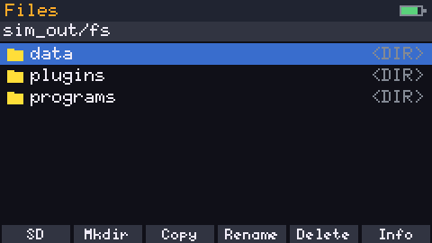
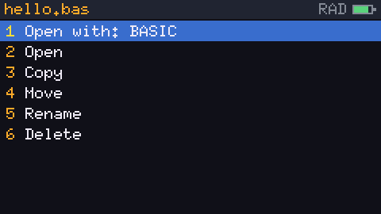
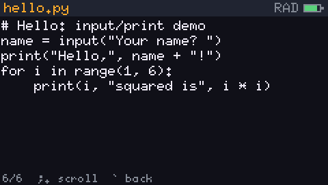
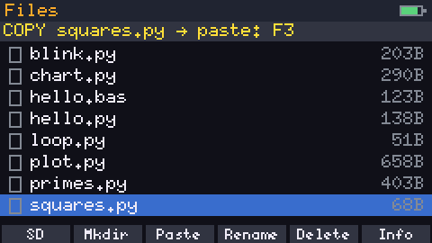
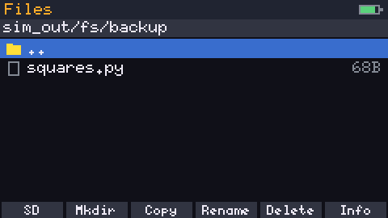

# Files

Files is a file manager for the internal flash and the microSD card. You can browse folders, view files, copy, move, rename and delete files and folders, make folders, mount and unmount the SD card, and open files with a plugin.

Open it from the home screen with the **Files** icon (the 11th app; move to it with the arrows and press `Enter`).

Arrows are written ↑ ↓ ← → on this page. They are `fn`+`;` `.` `,` `/`; in the file list the plain `;` `.` `,` `/` keys work as arrows too. F1–F6 are `fn`+`1`…`6`. See [Basic operation](../basics.md) for the common keys.

The screenshots on this page come from the PC simulator, where the top folder is shown as `sim_out/fs`. On the device it is `/`.

## Screen layout

| Area | Contents |
|---|---|
| Status bar (top) | Title "Files", `SD` while the SD card is mounted, battery |
| Path line | The current folder. While a copy or move is pending it shows, in yellow, `COPY name → paste: F3` (or `MOVE …`) |
| List | `..` (parent folder, not shown at the top folder), then folders (yellow folder icon, `<DIR>`), then files with their size (B, K, M). An empty folder shows "(empty)" |
| Soft keys (bottom) | F1 SD, F2 Mkdir, F3 Copy (Paste while a copy or move is pending), F4 Rename, F5 Delete, F6 Info |

The top folder `/` holds the flash folders (`data`, `programs`, `plugins` …) and, while the card is mounted, `sd` (the SD card).

## Operations

### List keys

| Key | Action |
|---|---|
| ↑ ↓ | Select (wraps around) |
| `fn`+`[` / `fn`+`]` | Move 8 rows up / down |
| `Enter` or → | Open a folder, or show the file menu for a file. On `..`, go up |
| ← or `BS` | Go to the parent folder |
| F1 (SD) | Mount or unmount the SD card |
| F2 (Mkdir) | Make a folder here ("New directory") |
| F3 (Copy / Paste) | Copy the selected file or folder; after moving to another folder, paste it |
| F4 (Rename) | Rename the selected file or folder |
| F5 (Delete) or `fn`+`BS` | Delete the selected file or folder (with its contents) |
| F6 (Info) | Show free space and the current folder ("Storage") |
| ESC (`fn`+`` ` ``) | Cancel a pending copy or move; otherwise back to the home screen |

### File menu

Press `Enter` on a file to get a menu titled with its name. The items depend on the file:

| Item | Shown for | Action |
|---|---|---|
| **Open with: *plugin*** | Files a plugin handles (e.g. `.bas` with the BASIC plugin) | Open the file in that plugin |
| **Open** | All files | View the file (below) |
| **Run** | `.py` | Run it as a Python script (same as in the [Python](python.md) app) |
| **Edit** | `.py` and text files: `.txt` `.json` `.csv` `.md` `.cfg` `.ini` `.log` | Open it in the editor (see [Python](python.md#editor-keys)). `ctrl`+`r` in the editor runs the file as Python |
| **Copy** | All files | Same as F3: remember the file for pasting |
| **Move** | All files | Remember the file for moving; paste with F3 |
| **Rename** | All files | Rename ("Rename" dialog with the old name filled in) |
| **Delete** | All files | Delete after "Delete name?" (`Enter` = yes) |

**Open with** appears only for enabled plugins that list the file's extension in their `files` entry. See [Plugins](../plugins.md) and [BASIC](../basic.md).

### Viewing a file

**Open** shows the file in a read-only viewer:

- Text files: the first 16 KB, wrapped to the screen width.
- Binary files (with a zero byte in the first 512 bytes, or not valid UTF-8): a hex dump of the first 1024 bytes, 8 bytes per line with offset, hex and ASCII. The title ends with "(hex)".

In the viewer, ↑ ↓ scroll one line, ← → (or `fn`+`[` / `fn`+`]`) one page. ESC or `Enter` closes it. The bottom line shows the position, e.g. `6/6`.

### Copy, move and paste

1. Select a file or folder and press F3 (Copy), or choose **Copy** or **Move** in the file menu. The path line turns yellow: `COPY name → paste: F3`.
2. Go to the target folder.
3. Press F3 (Paste). "Copying..." (or "Moving...") appears and the item is copied there under the same name.

- If the target already has that name, you are asked "Overwrite name?".
- Pasting into the folder the item came from does nothing and clears the pending copy.
- Folders are copied with all their contents.
- A move within one file system is a rename; between flash and SD the item is copied and then deleted.
- ESC cancels a pending copy or move.

### Rename, delete, make a folder

- **Rename** (F4): edit the name and press `Enter`. Names with `/` are refused.
- **Delete** (F5): asks "Delete name?"; for a folder, "Delete name (and contents)?". `Enter` (or `y`) deletes, any other key cancels.
- **Mkdir** (F2): type the name in "New directory" and press `Enter`.

### SD card

- F1 (SD) with no card mounted: "Mounting SD..." and, on success, the list moves to `/sd`. Without a card: "No SD card / mount failed".
- F1 with the card mounted: unmounts it ("SD card: Unmounted"). If you were inside `/sd`, the list goes back to `/`.
- Unmount the card before you remove it.
- The card can also be mounted at startup (Settings → SD auto-mount) or from Settings → SD card. See [Settings](settings.md).

### Storage info

F6 (Info) shows a "Storage" box with the free and total space of the flash and the SD card ("SD: not mounted" if there is no card), the free RAM, and the current folder.

## Examples

### Copy a script to the SD card

1. Insert a microSD card. If the status bar does not show `SD`, press F1 (SD) and then go back up with ← until you are at `/`.
2. Select `programs` and press `Enter`.
3. Select the script (for example `squares.py`) and press F3 (Copy). The path line shows `COPY squares.py → paste: F3`.

   

4. Press ← to go up to `/`, select `sd` and press `Enter`.
5. To put the script in the SD script folder, open `programs` (make it first with F2 (Mkdir) if it does not exist).
6. Press F3 (Paste). The script is copied. Scripts in `/sd/programs` also appear in the [Python](python.md) app.

### Make a backup folder on the flash

1. In `/programs`, select `squares.py` and press F3 (Copy).
2. Press ← to go up to `/`.
3. Press F2 (Mkdir), type `backup` and press `Enter`.
4. Select `backup` and press `Enter`, then press F3 (Paste):

   

### Open a BASIC program with the BASIC plugin

1. Install the BASIC plugin (see [BASIC](../basic.md)) and put a `.bas` file in `/programs`.
2. Select the `.bas` file and press `Enter`.
3. Choose **Open with: BASIC**. The plugin starts with the file.

## Notes and limits

- Folders used by card-gcalc:

  | Folder | Contents |
  |---|---|
  | `/programs` | Python scripts (and BASIC programs) on flash |
  | `/sd/programs` | Scripts on the SD card |
  | `/data` | Settings and calculator data (`*.json`) |
  | `/plugins`, `/sd/plugins` | Plugins, one folder each |
  | `/sd` | The SD card (only while mounted) |

- Deleting files in `/data` resets settings or calculator data. Use Settings → Reset all data to clear it all at once.
- The flash file system is about 4.9 MB. Check free space with F6 (Info).
- A folder cannot be pasted into itself or into one of its own subfolders; you get "Cannot paste a folder into itself".
- To transfer files to and from a PC over USB, see [PC connection](../pc.md).

---

[← Contents](../README.md) · [Basic operation](../basics.md)
