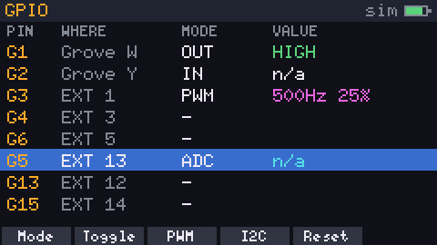
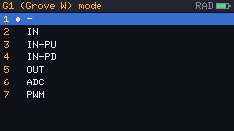
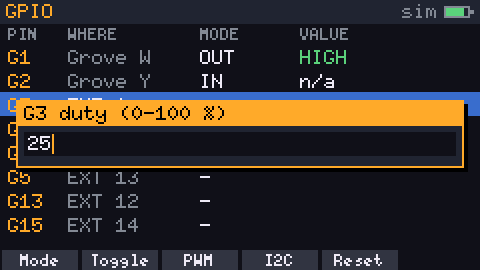

# GPIO

GPIO is a pin panel for the Grove port and the EXT expansion header. Set each pin to input, output, analog input (ADC) or PWM, watch its value live, toggle outputs, and scan the I2C buses for devices — all without writing code.

Open it from the home screen with the **GPIO** icon (the 12th app; move to it with the arrows and press `Enter`).

Arrows are written ↑ ↓ ← → on this page. They are `fn`+`;` `.` `,` `/`; on this screen the plain `;` `.` `,` `/` keys work as arrows too. F1–F6 are `fn`+`1`…`6`. See [Basic operation](../basics.md) for the common keys.

## Screen layout

| Area | Contents |
|---|---|
| Status bar (top) | Title "GPIO", battery. In the PC simulator it also shows `sim` |
| Header | PIN, WHERE, MODE, VALUE |
| Pin rows | One row per pin (table below). MODE is `-` while the pin is not used |
| VALUE | IN modes: `HIGH` (green) or `LOW`. OUT: the output level. ADC: the voltage, e.g. `1.234 V`, with a bar on the right (full at 3.1 V). PWM: frequency and duty, e.g. `500Hz 25%` |
| Soft keys (bottom) | F1 Mode, F2 Toggle, F3 PWM, F4 I2C, F5 Reset |

Values are read again every 0.1 s, so inputs update while you watch.

### Pins

| PIN | WHERE | Connector |
|---|---|---|
| G1 | Grove W | Grove port, white wire (also I2C SCL) |
| G2 | Grove Y | Grove port, yellow wire (also I2C SDA) |
| G3 | EXT 1 | EXT header pin 1 |
| G4 | EXT 3 | EXT header pin 3 |
| G6 | EXT 5 | EXT header pin 5 |
| G5 | EXT 13 | EXT header pin 13 |
| G13 | EXT 12 | EXT header pin 12 |
| G15 | EXT 14 | EXT header pin 14 |

The other EXT pins are used inside the device (G40/G14/G39 by the SD card, G8/G9 by the internal I2C bus) and are not listed.

### Modes

| Mode | Meaning |
|---|---|
| `-` | Not used. The pin is released (left as an input with no pull resistor) |
| `IN` | Digital input, no pull resistor |
| `IN-PU` | Digital input with the internal pull-up (reads HIGH when open) |
| `IN-PD` | Digital input with the internal pull-down (reads LOW when open) |
| `OUT` | Digital output, HIGH (3.3 V) or LOW (0 V) |
| `ADC` | Analog input, about 0–3.1 V |
| `PWM` | PWM output. Default 1000 Hz, 50 % |

## Operations

| Key | Action |
|---|---|
| ↑ ↓ | Select a pin (wraps around) |
| `Enter` or F1 (Mode) | Choose the mode ("G1 (Grove W) mode"). The current mode has a dot. Press `1`–`7` or select and press `Enter` |
| `Space` or F2 (Toggle) | Switch the output between HIGH and LOW. A pin that is not in OUT mode is set to OUT and goes HIGH |
| F3 (PWM) | Set PWM: enter the frequency ("G1 PWM frequency (Hz)", 1 – 40000000) and then the duty ("G1 duty (0-100 %)"). The pin is set to PWM |
| `+` (or `=`) / `-` | In PWM mode: duty +5 % / −5 % |
| F4 (I2C) | Scan the I2C buses (below) |
| F5 (Reset) | Release all pins (all modes back to `-`) |
| ESC (`fn`+`` ` ``) or ← | Back to the home screen. All pins are released |

The frequency and duty fields accept calculator expressions, so `2^10` or `100/3` work. ESC in either field cancels.

### I2C scan

F4 (I2C) scans two buses and lists the addresses that answer:

- **Grove (SDA=G2, SCL=G1)**, at 100 kHz. "no devices" if nothing answers. G1 and G2 are left as inputs after the scan.
- **Internal (SDA=G8, SCL=G9)**: the built-in devices, such as the keyboard controller at 0x34.

Known addresses are labeled, for example 0x3C OLED, 0x76/0x77 BME280/BMP, 0x44 SHT3x, 0x38 AHT20, 0x29 VL53L0X/TCS, 0x48 ADS1115, 0x23 BH1750, 0x70 TCA9548A, 0x68/0x69 BMI270 IMU. The list opens in a viewer; ESC closes it. In the PC simulator the scan shows "n/a in the simulator".

## Examples

### Turn an LED on and off

Connect an LED with a series resistor (about 330 Ω) between Grove G1 (white) and GND.

1. G1 is selected when the app opens. Press `Space`. G1 becomes `OUT` `HIGH` and the LED lights.
2. Press `Space` again. The value is `LOW` and the LED goes out.
3. Press ESC to leave. G1 is released.

To blink the LED automatically, run the sample script `blink.py` in the [Python](python.md) app.

### Read a push button

Connect a push button between Grove G2 (yellow) and GND.

1. Press ↓ to select G2.
2. Press `Enter` and then `3` (`IN-PU`). The value is `HIGH`.
3. Press the button. The value changes to `LOW` while it is held.

### Dim an LED with PWM

With the LED from the first example on G1:

1. Select G1 and press F3 (PWM).
2. Type `500` and press `Enter` (frequency).
3. Type `25` and press `Enter` (duty).

   

4. The row shows `PWM` `500Hz 25%`. Press `+` or `-` to change the duty in 5 % steps.

### Measure a voltage

1. Select a pin, for example G3 (EXT 1), press `Enter` and then `6` (`ADC`).
2. The voltage on the pin is shown and the bar fills up to 3.1 V.

## Notes and limits

- The pins work at 3.3 V. Do not connect 5 V signals directly, and keep the current per pin small (use a resistor with LEDs).
- The ADC reads about 0–3.1 V. Use a voltage divider for higher voltages.
- The panel does not keep its settings: leaving the app (ESC), or F5, releases every pin.
- From scripts, use `cardgcalc.pin_out()`, `pin_in()`, `analog()`, `pwm()`, `tone()` and `i2c_grove()`. See the [cardgcalc module API](../api.md).
- In the PC simulator there is no hardware: the modes can be set, but IN and ADC show `n/a`.

---

[← Contents](../README.md) · [Basic operation](../basics.md)
