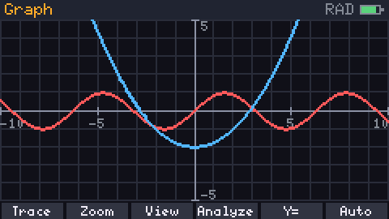
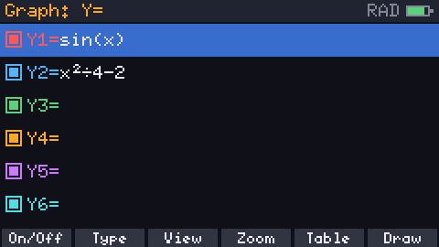
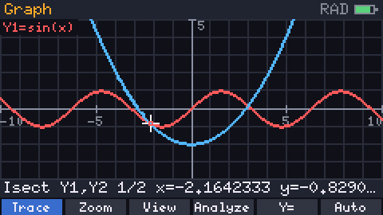
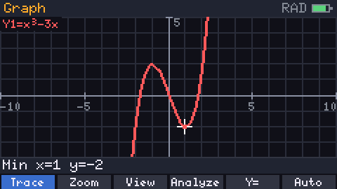
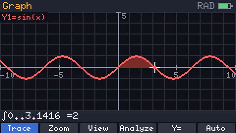
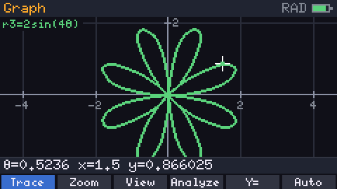

# Graph

Graph plots up to six functions, Y1–Y6, at once. Each one can be y=f(x), a polar curve r=f(θ) or a parametric curve x(t), y(t). You can pan, zoom and trace the graphs, and the Analysis menu finds roots, minima and maxima, intersections, slopes and integrals.

Open it from the home screen with the **Graph** icon, or press `2` on the home screen.

Arrows are written ↑ ↓ ← → on this page. They are `fn`+`;` `.` `,` `/`. On screens without a text field, the plain `;` `.` `,` `/` keys work as arrows too. F1–F6 are `fn`+`1`…`6`. See [Basic operation](../basics.md) for the common keys.

## Screen layout

The app has two screens: the function list (**Graph: Y=**) and the graph screen (**Graph**).

### Function list (Y=)

| Area | Contents |
|---|---|
| Status bar (top) | Title "Graph: Y=", modifier latches, angle unit (RAD / DEG / GRA), battery |
| Rows Y1–Y6 | One row per function. The box on the left is filled when the function is drawn. Each function has its own color (Y1 red, Y2 blue, Y3 green, Y4 orange, Y5 purple, Y6 cyan) |
| Row label | `Y1=` for y=f(x), `r1=` for polar, `X1= … Y1= …` for parametric |
| Soft keys (bottom) | F1 On/Off, F2 Type, F3 View, F4 Zoom, F5 Table, F6 Draw |

While you edit a row, the bottom line shows a key hint instead of the soft keys.

### Graph screen

| Area | Contents |
|---|---|
| Status bar (top) | Title "Graph", angle unit, battery |
| Plot area | Grid, axes with labels, and the curves in their colors |
| Top left (trace / Analysis) | The current function, such as `Y1=sin(x)`, in its color |
| Info line (above the soft keys) | Trace coordinates or the Analysis result |
| Soft keys (bottom) | F1 Trace, F2 Zoom, F3 View, F4 Analyze, F5 Y=, F6 Auto. F1 is highlighted while tracing |

## Operations

### Function list keys

| Key | Action |
|---|---|
| ↑ ↓ | Select a row |
| `Enter` or → | Edit the selected function |
| Any character, or an `opt` / `alt` math key | Start a new expression in the row (replaces the old one) |
| `Space` or F1 (On/Off) | Turn drawing on or off for the row |
| F2 (Type) | Change the type: y=f(x) → r=f(θ) → x(t),y(t) → y=f(x) |
| F3 (View) | Open the view window settings |
| F4 (Zoom) | Open the Zoom menu, then draw the graph |
| F5 (Table) | Open the Table app with the same functions ([Table](../apps/table.md)) |
| F6 (Draw) | Draw the graph |
| `BS` or `fn`+`BS` | Clear the row's expression (asks "Clear Y1?"; `Enter` = yes) |
| `fn`+`h` | Keymap help |
| ESC (`fn`+`` ` ``) or ← | Back to the home screen |

While you edit a y=f(x) or r=f(θ) row:

- `Enter` confirms. ↑ / ↓ confirm and move to the previous / next row. ESC cancels.
- `opt` / `alt` insert math tokens: `opt`+`s` sin(, `opt`+`2` ², `opt`+`h` θ, `opt`+`p` π and so on. `fn`+`h` shows the full list.
- The expression is checked when you confirm. On a syntax error an error box appears and the old expression is kept.
- A row whose expression you change is turned on automatically.

A parametric row opens two dialogs, `X1(t) =` and then `Y1(t) =`. Use the variable `t` in both.

Variables: use `x` in y=f(x), `θ` (`opt`+`h`) in r=f(θ), and `t` in parametric functions. θ and t are in the current angle unit (Settings → Angle unit). Variables stored in Calc (A–Z) can be used in expressions.

### Graph screen keys

| Key | Action |
|---|---|
| ← → ↑ ↓ | Pan the view by 1/8 of its width or height |
| `=` or `+` | Zoom in ×2 around the center |
| `-` or `_` | Zoom out ×2 around the center. While tracing, `-` starts a negative number for "Go to x", so use `_` (`shift`+`-`) |
| F1 (Trace) | Start or stop tracing |
| F2 (Zoom) | Zoom menu |
| F3 (View) | View window settings |
| F4 (Analyze) | Analysis menu |
| F5 (Y=) or ESC | Back to the function list |
| F6 (Auto) | Auto fit (same as Zoom → Auto fit) |

The pan and zoom position is kept when you go back to the list.

### Trace

Press F1 on the graph screen. A cross cursor appears on a curve and the info line shows its coordinates.

| Key | Action |
|---|---|
| ← → | Move one pixel column (y=f(x)) or one T step (polar, parametric). Off the edge, the view pans by 1/4 |
| `shift` + ← → | Move 10 steps at once (`shift`+`fn`+`,` / `shift`+`fn`+`/`) |
| ↑ ↓ | Switch to the previous / next drawn function |
| A digit or `-` | Jump: opens "Go to x" (or "Go to t" for polar and parametric) with that character already typed |
| `Enter` | Center the view on the cursor |
| ESC or F1 | Stop tracing |

The info line shows `Y1 x=… y=…` for y=f(x), and `θ=… x=… y=…` or `t=… x=… y=…` for polar and parametric curves (up to 7 significant digits). "undef" means the function has no real value there.

### Zoom menu (F2)

Select an item with ↑ ↓ and `Enter`, or press its number.

| # | Item | Effect |
|---|---|---|
| 1 | Zoom in | Halve the window. While tracing, centers on the cursor |
| 2 | Zoom out | Double the window. While tracing, centers on the cursor |
| 3 | Standard | x −10…10, y −5…5, scales 1 |
| 4 | Trig | x −2π…2π (scale π/2) in radians, −360…360 (scale 90) in degrees, −400…400 (scale 100) in grads; y −1.6…1.6 (scale 0.5). Also resets the T range |
| 5 | Integer | One pixel = 1 in both directions, around the current center (scales 10) |
| 6 | Square | Changes the y range so that one unit is the same length on both axes |
| 7 | Auto fit | Sets the y range from the values of the y=f(x) functions in the current x range. If only polar or parametric curves are drawn, sets both ranges with a square aspect ratio. Isolated extreme values are ignored and an 8 % margin is added |

### View window (F3)

A list of the window values. Select one and type a new value (an expression such as `2π` is fine). The title shows the current value, for example "Xmin (now -10)".

| Item | Meaning | Default (radians) |
|---|---|---|
| Xmin, Xmax | x range | −10, 10 |
| Xscale | Distance between vertical grid lines (0 = no grid) | 1 |
| Ymin, Ymax | y range | −5, 5 |
| Yscale | Distance between horizontal grid lines (0 = no grid) | 1 |
| Tmin/θmin, Tmax/θmax | Range of t or θ for polar and parametric curves | 0, 2π |
| Tstep/θstep | Step of t or θ | π/60 |
| Reset to default | Restore all the defaults | |

In degrees the T range defaults to 0…360 step 3, in grads to 0…400 step 3. Values that would make min ≥ max, a step ≤ 0 or a negative scale are refused with "Invalid range". Press ESC to close the list.

### Analysis menu (F4)

Analysis works on the current function: the one selected with ↑ ↓ while tracing. Until you change it, this is the first drawn function. It works only on y=f(x) functions ("Only for y=f(x) functions" otherwise). The menu title shows the function, for example "Analysis Y1".

| # | Item | What it does |
|---|---|---|
| 1 | Root | Finds every x in the visible range where f(x)=0, including points where the curve only touches the axis |
| 2 | Min | Finds every local minimum in the visible range |
| 3 | Max | Finds every local maximum in the visible range |
| 4 | Intersect | Finds the intersections with another y=f(x) function. If more than one other function is drawn, choose it from "Intersect with" |
| 5 | y at x | Asks for x, moves the cursor there and shows y (10 digits) |
| 6 | x at y | Asks for y and finds every x in the visible range where f(x)=y |
| 7 | dy/dx | Shows the derivative at the cursor position (starts tracing at the center if needed) |
| 8 | ∫dx | Asks for the lower and upper bound, shows the definite integral and shades the area between the curve and the x axis |

- Root, Min, Max, Intersect and x at y search only the visible x range. Pan or zoom first if a solution is off screen. When nothing is found the info line says, for example, "Root: none in view".
- With several solutions the info line shows `Root 2/3 x=… y=…`. Press ← → to step through them. The first one shown is the one nearest to the cursor.
- Results are shown with up to 8 significant digits (∫dx and y at x with 10).
- Any other key leaves the result and continues tracing from that point. ESC just clears the result.

## Examples

### Example 1: Intersection of two functions

The first time you open Graph, Y1=sin(x) and Y2=x²÷4-2 are already entered.

1. On the home screen press `2` to open Graph.
2. To type them yourself: select Y1, type `opt`+`s` `x` `)` `Enter`; select Y2, type `x` `opt`+`2` `/4-2` `Enter` (`/` is entered as ÷).
3. Press F6 (Draw).
4. Press F4 (Analyze), then `4` (Intersect). With only two functions, Y2 is chosen automatically.
5. The info line shows `Isect Y1,Y2 1/2 x=-2.1642333 y=-0.829…`. Press → for the second intersection, x=2.9560183.

### Example 2: Roots and a local minimum

1. In the function list select Y1 and type `x` `opt`+`3` `-3x` `Enter` (Y1=x³-3x).
2. Select Y2 and press `Space` to turn it off.
3. Press F6 (Draw).
4. Press F4, then `1` (Root). The cursor goes to the root nearest to it, `Root 2/3 x=0 y=0`. Press ← → to see x=-1.7320508 and x=1.7320508.
5. Press F4, then `2` (Min). The info line shows `Min x=1 y=-2`.

### Example 3: Shaded integral

Find the area under sin(x) from 0 to π.

1. Start from Y1=sin(x). Select Y2 and press `Space` to turn it off. (Y1 is the first drawn function, so it is the current one.)
2. Press F6 (Draw), then F4 and `8` (∫dx).
3. "∫dx lower bound": type `0` `Enter`.
4. "∫dx upper bound": type `opt`+`p` (π) `Enter`.
5. The area is shaded and the info line shows `∫0..3.1416 =2`.

### Example 4: Polar curve

Draw the rose r=2sin(4θ).

1. Turn off Y1 and Y2 with `Space`.
2. Select Y3 and press F2 (Type) once. The label changes to `r3=`.
3. Type `2` `opt`+`s` `4` `opt`+`h` `)` `Enter`.
4. Press F6 (Draw). The curve is small in the standard window, so press F6 (Auto). For polar and parametric curves, Auto fit keeps the axes square.
5. Press F1 (Trace) and `shift`+→ to move 10 steps: the info line shows `θ=0.5236 x=1.5 y=0.866025`.

A parametric curve works the same way: press F2 twice so that the row shows `X4=`, press `Enter`, and enter for example `3cos(t)` and `2sin(t)` for an ellipse.

## Notes and limits

- **Numbers**: the view window, trace positions and Analysis results are 15-digit decimal numbers, so x steps such as 0.1 stay exact. Pixels are mapped with ordinary floats.
- **Pixel resolution**: y=f(x) curves are computed once per pixel column (240 columns). Root, Min, Max, Intersect and x at y look for sign changes or turning points between neighbouring columns and then refine them. Two solutions closer than one pixel can be missed; zoom in to separate them.
- **Discontinuities**: jumps such as tan(x) at π/2 are not joined by a line.
- **Polar and parametric**: at most 720 points per curve. If Tstep is smaller than (Tmax−Tmin)/719, the step is enlarged.
- **Undefined values**: points where a function has no real value (such as √(x) for x<0) are left out.
- **Saving**: the functions, the view window and the Table start and step are saved in `/data/funcs.json`. They are kept after a restart.
- **Table**: the Table app uses the same Y1–Y6. F5 in the function list opens it; see [Table](../apps/table.md).
- **Angle unit**: polar θ, parametric t and the trig functions follow Settings → Angle unit. The Trig zoom and the default T range follow it too.

---

[← Contents](../README.md) · [Basic operation](../basics.md)
