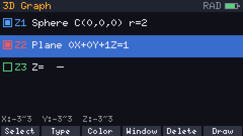
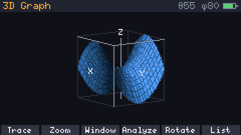
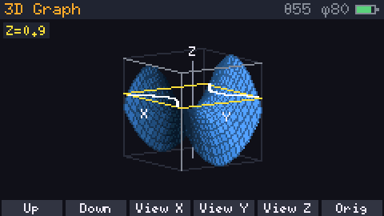
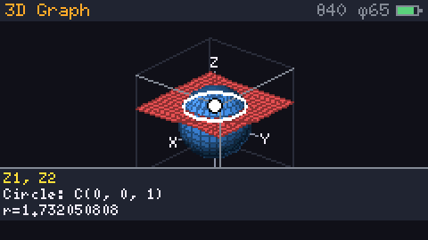
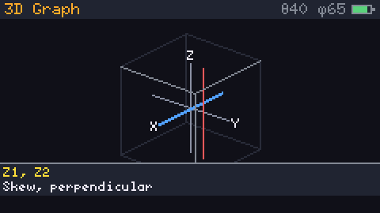
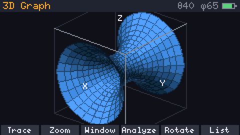

# 3D Graph

3D Graph draws up to three graphs, Z1–Z3, in a 3D box. You can draw surfaces z=f(x,y), parametric surfaces, lines, planes, spheres, cylinders, cones and solids of revolution. You can rotate and zoom the view, trace points, and analyze cross sections, intersections and the relative position of lines and planes.

Open it from the home screen with `3`.

## Screen layout

The app has two main screens: the **list** of Z1–Z3 and the **graph screen**.

### List

| Area | What it shows |
|---|---|
| Status bar (top) | App name "3D Graph" and the angle unit (RAD / DEG / GRA) |
| Rows Z1–Z3 | A color box, the name and a description of each graph. A filled box means the graph is set and will be drawn. Graphs turned off are shown dimmed. An empty graph shows its type and "—" |
| Range line | The view box, for example `X:-3~3  Y:-3~3  Z:-3~3` |
| Soft keys (bottom) | F1 Select, F2 Type, F3 Color, F4 Window, F5 Delete, F6 Draw |

The descriptions look like this:

| Type | Example in the list |
|---|---|
| Z= | `Z=(x²-y²)÷3` |
| Param | `Param: X=sin(s)cos(t), Y=…, Z=…` |
| Line | `Line (0,0,0)+t(1,1,1)` or `Line (-2,-2,-2)-(2,2,2)` |
| Plane | `Plane 1X+1Y+1Z=1`, `Plane (0,0,0)+s(1,0,0)+t(0,1,0)` or `Plane (1,0,0),(0,1,0),(0,0,1)` |
| Sphere | `Sphere C(0,0,0) r=2` or `Sphere X²+Y²+Z²+0X+0Y+0Z+-4=0` |
| Cylinder / Cone | `Cylinder r=1 Z:-2~2 C(0,0)` |
| Rot X / Rot Y | `Rot X: y=1+x²÷5` |

### Graph screen

| Area | What it shows |
|---|---|
| Status bar (top) | "3D Graph" and the current view angles, for example `θ55 φ80` |
| Graph area | The view box (back edges faint, front edges brighter), the X/Y/Z axes through the origin, the axis labels X, Y, Z, and the graphs |
| Soft keys (bottom) | F1 Trace, F2 Zoom, F3 Window, F4 Analyze, F5 Rotate, F6 List. While tracing, this line shows the coordinates instead |

- Surfaces are filled in the graph's color and shaded by their orientation. Mesh lines are drawn in a darker shade.
- Everything is clipped to the view box (Xmin–Xmax, Ymin–Ymax, Zmin–Zmax). The box is always drawn as a cube, so each axis is scaled separately.
- Lines are drawn as thick lines.
- The axes are drawn only when the origin is inside the box. Otherwise the labels are placed from the box corner.
- θ is the horizontal angle around the Z axis and φ is the angle from the Z axis (φ=0 looks straight down). The default view is θ=40, φ=65.

## Operations

Arrows ↑ ↓ ← → are `fn`+`;` `.` `,` `/`. On the list, the menus and the graph screen there is no text input, so the plain `;` `.` `,` `/` keys also work as arrows (see [Basic operation](../basics.md)). ESC (`fn`+`` ` ``) goes back. F1–F6 are `fn`+`1`…`6`.

### List keys

| Key | Action |
|---|---|
| ↑ / ↓ | Select Z1–Z3 (wraps around) |
| Enter or → | Edit the selected graph (expression or values) |
| F1 (Select) or Space | Turn drawing of the graph on or off |
| F2 (Type) | Choose the graph type. When you pick a different type, its input starts at once |
| F3 (Color) | Choose the color: Blue, Red, Green, Magenta, Cyan, Yellow, Orange, White |
| F4 (Window) | Open the view window (see below) |
| F5 (Delete), `BS` or DEL (`fn`+`BS`) | Clear the graph after "Clear Z1?" (Enter or `y`: yes, ESC: no). The color is kept and the type returns to Z= |
| F6 (Draw) | Draw all graphs that are on and set. "No graph" is shown if there are none |
| ESC or ← | Return to the home screen |

### Graph types and input

Press F2 and choose a type with ↑ ↓ and Enter, or with its number key.

| # | Type | Input |
|---|---|---|
| 1 | Z= | One expression `Z1 = f(x,y)` in x and y |
| 2 | Param | Three expressions `X1(s,t) =`, `Y1(s,t) =`, `Z1(s,t) =` in s and t. The ranges are Smin–Smax and Tmin–Tmax in the view window |
| 3 | Line | Form: **Point & vector** (X0, Y0, Z0, Vector l, Vector m, Vector n) or **Two points** (X1, Y1, Z1, X2, Y2, Z2) |
| 4 | Plane | Form: **aX+bY+cZ=d** (a, b, c, d), **Point & 2 vectors** (X0, Y0, Z0, u1, u2, u3, v1, v2, v3) or **Three points** (X1 … Z3) |
| 5 | Sphere | Form: **(X-a)²+(Y-b)²+(Z-c)²=r²** (a, b, c, r) or **X²+Y²+Z²+aX+bY+cZ+d=0** (a, b, c, d) |
| 6 | Cylinder | Radius, Zmin, Zmax, Center X, Center Y. The axis is parallel to the Z axis; top and bottom are closed |
| 7 | Cone | Radius, Base Z, Apex Z, Center X, Center Y. The axis is parallel to the Z axis; the base is closed |
| 8 | Rot X | `Rot X: y = f(x)`: the curve y=f(x) for x from Xmin to Xmax, rotated about the X axis |
| 9 | Rot Y | `Rot Y: y = f(x)`: the same curve rotated about the Y axis (each point at distance \|x\| from the Y axis) |

Expressions (Z=, Param, Rot X/Y):

- Type in a one-line dialog. Enter accepts, ESC cancels. Math tokens work as in other apps: `opt`+`s` inserts `sin(`, `opt`+`2` inserts `²`, `opt`+`x` / `opt`+`y` insert x / y, `*` becomes × and `/` becomes ÷ (see `src/cardgcalc/keymap.py` or `fn`+`h`).
- The expression is checked when you press Enter. A syntax error is shown at once.
- Points where the expression cannot be computed or is not real are left out.
- Trigonometric functions use the angle unit from Settings.

Templates (Line, Plane, Sphere, Cylinder, Cone):

1. If the type has more than one form, choose the form first.
2. A menu lists the values with their current numbers and **Set** at the end. Select a value (↑ ↓ and Enter, or its number key) and type a number or an expression (`π`, `√(2)`, `1/3` …). After each value the cursor moves to the next one.
3. Choose **Set** to store it. If the values do not define a shape, "Invalid setting" is shown and you stay in the menu. This happens for a zero direction vector, points on one line, a zero normal vector, a radius of 0 or less, Zmin = Zmax, or a sphere equation with no real points.

New templates start from these values: line (0,0,0)+t(1,1,1) or (-2,-2,-2)–(2,2,2); plane X+Y+Z=1 (or the XY plane, or the points (1,0,0), (0,1,0), (0,0,1)); sphere at the origin with r=2; cylinder r=1, Z -2 to 2; cone r=2, base Z -2, apex Z 2.

### View window (F4 in the list, F3 on the graph screen)

The menu "3D View Window" lists these items. Select one to type a new value, or to toggle on/off.

| Item | Default | Meaning |
|---|---|---|
| Xmin, Xmax | -3, 3 | X range of the box. Also the x range of Rot X / Rot Y |
| Xgrid | 20 | Number of mesh divisions along x (Z=, Rot X, Rot Y) |
| Ymin, Ymax | -3, 3 | Y range of the box |
| Ygrid | 20 | Number of mesh divisions along y (Z=) |
| Zmin, Zmax | -3, 3 | Z range of the box |
| Smin, Smax, Sgrid | 0, π, 20 | Range and divisions of s (Param) |
| Tmin, Tmax, Tgrid | 0, 2π, 24 | Range and divisions of t (Param) |
| Angle θ | 40 | Horizontal view angle (-180 to 180) |
| Angle φ | 65 | Angle from the Z axis (0 to 360) |
| Label | on | Show the X/Y/Z labels |
| Axes | on | Show the axes |
| Box | on | Show the view box |
| Mesh | on | Show mesh lines on surfaces |
| Reset to default | | Set all ranges, grids and angles back to the defaults (Label, Axes, Box and Mesh are not changed) |

- Each min must be smaller than its max. Grids must be whole numbers from 2 to 50. Otherwise "Invalid range" is shown and the old value is kept.
- More grid divisions give a smoother surface but take longer to draw.
- Templates use a fixed mesh (line 20 segments, plane 16×16, sphere 16×24, 24 segments around cylinders, cones and solids of revolution).

### Graph screen keys

| Key | Action |
|---|---|
| ← / → | Rotate horizontally (θ −15° / +15°) |
| ↑ / ↓ | Tilt (φ −15° / +15°): ↑ looks more from above, ↓ more from below |
| `+` (`shift`+`=`) / `-` | Zoom in / out (×1.5) |
| F1 (Trace) | Trace (below) |
| F2 (Zoom) | Zoom menu (below) |
| F3 (Window) | View window. Angle θ / φ show the current view. If you change something, the graphs are drawn again |
| F4 (Analyze) | Analysis menu (below) |
| F5 (Rotate) | Auto-rotate (below) |
| F6 (List) or ESC | Back to the list. The view angles are saved and used next time; the zoom is reset |

### Zoom menu (F2)

| # | Item | Action |
|---|---|---|
| 1 | Zoom in | Zoom in ×1.5 |
| 2 | Zoom out | Zoom out ÷1.5 |
| 3 | View along X | Look along the X axis (θ=0, φ=90) |
| 4 | View along Y | Look along the Y axis (θ=90, φ=90) |
| 5 | View along Z | Look down the Z axis (θ=-90, φ=0); X points right and Y up |
| 6 | Original view | θ=40, φ=65, zoom 1 |

### Trace (F1)

A yellow cross marks a mesh point, and the bottom line shows `Z1  X=… Y=… Z=…`. The coordinates are computed in decimal and shown with up to 7 significant digits (`?` where the value is undefined).

| Key | Action |
|---|---|
| ← / → | Move along the first mesh direction (x for Z= and Rot X/Y, s for Param) |
| ↑ / ↓ | Move along the second direction (y, t, or around the surface). Lines have only ← → |
| F2 / F3 | Next / previous graph (the point starts in the middle of the mesh) |
| Enter (or `=`, `x`, `s`) | Type coordinates: X and Y for Z=, S and T for Param. Z is computed exactly at that point. Other types ignore this key |
| F1 or ESC | End trace |

### Analysis menu (F4)

| # | Item | What it does |
|---|---|---|
| 1 | Cross section | Cut the graphs with the plane X=c, Y=c or Z=c |
| 2 | Intersection | Intersection of lines, planes and spheres |
| 3 | Relation | Relative position of lines and planes |

**Cross section.** Choose `X = c`, `Y = c` or `Z = c`. The cutting plane is drawn as a yellow outline, the cut curves in white, and lines crossing the plane as white dots. The value is shown at the top left, for example `Z=0.9`. It starts at 0 (or at the middle of the range if 0 is outside).

| Key | Action |
|---|---|
| F1 (Up) / F2 (Down) | Move the plane by 1/20 of the range (rounded to 2 digits). It stops at the box |
| F3 / F4 / F5 (View X / View Y / View Z) | View along an axis |
| F6 (Orig) | Original view |
| Enter, or a digit, `-`, `.` | Type the value of c. A value outside the box gives "Out of range" |
| ← → ↑ ↓ | Rotate |
| ESC | End |

**Intersection.** Uses the lines, planes and spheres that are currently drawn. The result panel shows the pair (for example `Z1, Z2`) and the result; points and lines are also marked on the graph in white.

| Pair | Result |
|---|---|
| Line and line | `Point: (x, y, z)`, `Infinite (same line)` or `Not found` (parallel or skew) |
| Line and plane | `Point: (x, y, z)`, `Infinite (on the plane)` or `Not found` |
| Plane and plane | `Line: (point)+t(direction)`, `Infinite (same plane)` or `Not found` |
| Line and sphere | One or two `Point:` lines, or `Not found` |
| Plane and sphere | `Circle: C(center)` and `r=radius`, a single `Point:` if the plane touches the sphere, or `Not found` |
| Sphere and sphere | `Not supported` |

Results are computed in decimal and shown with up to 10 significant digits.

**Relation.** Uses the lines and planes that are currently drawn.

| Pair | Possible results |
|---|---|
| Line and line | `Intersecting`, `Perpendicular, intersecting`, `Parallel`, `Same line`, `Skew`, `Skew, perpendicular` |
| Line and plane | `Intersecting`, `Perpendicular`, `Parallel`, `On the plane` |
| Plane and plane | `Intersecting`, `Perpendicular`, `Parallel`, `Same plane` |

Keys for both result screens:

| Key | Action |
|---|---|
| F1 (Next) / F2 (Back) | Next / previous pair (shown only when there are several pairs, in the order Z1-Z2, Z1-Z3, Z2-Z3) |
| ← → ↑ ↓ | Rotate |
| Enter or ESC | Close |

If there are fewer than two suitable graphs, "Need two lines/planes/spheres" (Intersection) or "Need two lines/planes" (Relation) is shown.

### Auto-rotate (F5)

Choose a direction: `Left → right`, `Right → left`, `Top → bottom` or `Bottom → top`. The view turns in 15° steps for two full turns. Mesh lines are left out while it turns. Press any key to stop.

## Examples

### 1. Draw a surface and rotate it

Draw z=(x²−y²)/3 (a saddle) and look at it from another angle.

1. On the home screen press `3`.
2. With Z1 selected, press Enter.
3. Type `(x` `opt`+`2` `-y` `opt`+`2` `)/3`. The field shows `(x²-y²)÷3`.
4. Press Enter, then F6 (Draw).
5. Press → once and ↓ once. The status bar shows `θ55 φ80`.

To see where the surface has height 0.9, continue:

6. Press F4 (Analyze), `1` (Cross section), `3` (`Z = c`).
7. Press F1 (Up) three times. The plane moves to `Z=0.9` and the cut is drawn in white.

Press ESC to leave the cross section. To trace, press F1, then Enter and type X `1`, Enter, Y `2`, Enter: the bottom line shows `Z1  X=1 Y=2 Z=-1`.

### 2. A sphere, a plane and their intersection circle

Find where the sphere x²+y²+z²=4 meets the plane z=1.

1. In the list, select Z1 and press F2 (Type), `5` (Sphere).
2. Press Enter to choose `(X-a)²+(Y-b)²+(Z-c)²=r²`. The defaults a=b=c=0, r=2 are what we want, so press `5` (Set).
3. Press ↓ to select Z2, then F2 (Type), `4` (Plane), Enter (`aX+bY+cZ=d`).
4. Press `1`, type `0`, Enter (a=0). Press Enter, type `0`, Enter (b=0). c and d are already 1. Press `5` (Set). The list shows `Sphere C(0,0,0) r=2` and `Plane 0X+0Y+1Z=1`.
5. Press F6 (Draw), then F4 (Analyze), `2` (Intersection).

The result is `Circle: C(0, 0, 1)` and `r=1.732050808` (√3). The circle and its center are drawn in white.

### 3. Relative position of two lines

Line 1 is the X axis; line 2 goes through (0,1,−2) and (0,1,2).

1. In the list (Z1 selected, or press F5 first to clear it), press F2 (Type), `3` (Line), Enter (Point & vector).
2. Press `5`, type `0`, Enter (Vector m = 0). Press Enter, type `0`, Enter (Vector n = 0). Press `7` (Set). The list shows `Line (0,0,0)+t(1,0,0)`.
3. Press ↓, F2 (Type), `3` (Line), `2` (Two points).
4. Press `1`, type `0`, Enter (X1). Press Enter, type `1`, Enter (Y1). Z1 stays −2.
5. Press `4`, type `0`, Enter (X2). Press Enter, type `1`, Enter (Y2). Z2 stays 2. Press `7` (Set).
6. Press F6 (Draw), F4 (Analyze), `3` (Relation).

The result is `Skew, perpendicular`. Press ESC, then F4, `2` (Intersection): the result is `Not found`, because skew lines do not meet.

### 4. A solid of revolution

Rotate y=1+x²/5 about the X axis for x from −3 to 3.

1. In the list, select an empty graph and press F2 (Type), `8` (Rot X).
2. Type `1+x` `opt`+`2` `/5` and press Enter. The list shows `Rot X: y=1+x²÷5`.
3. Press F6 (Draw).
4. Press F2 (Zoom), `1` (Zoom in).

To rotate about the Y axis instead, choose `9` (Rot Y). For Rot Y, set Xmin to 0 in the view window if you want only the part with x ≥ 0.

### 5. A parametric surface

Draw the unit sphere with X=sin(s)cos(t), Y=sin(s)sin(t), Z=cos(s) (s from 0 to π, t from 0 to 2π: the default S and T ranges).

1. In the list, press F2 (Type), `2` (Param).
2. `X1(s,t) =`: type `opt`+`s` `s)` `opt`+`c` `t)`, Enter.
3. `Y1(s,t) =`: type `opt`+`s` `s)` `opt`+`s` `t)`, Enter.
4. `Z1(s,t) =`: type `opt`+`c` `s)`, Enter.
5. Press F6 (Draw).

The angle unit must be Rad for this example (the default S and T ranges are in radians).

## Notes and limits

- At most three graphs (Z1–Z3).
- The graphs, the view window and the last view angles are saved in `/data/graph3d.json` and restored next time. The zoom is not saved.
- Coordinates, trace values and analysis results are decimal numbers. The meshes are drawn with single-precision floats, so the picture itself is approximate.
- Intersection and Relation work only with Line, Plane and Sphere templates (Relation: Line and Plane only). Surfaces, cylinders, cones and solids of revolution are not analyzed, and two spheres give "Not supported".
- Cylinders and cones always have their axis parallel to the Z axis.
- The cross section works on the drawn mesh, so its curves are only as accurate as the grid.
- If a graph cannot be drawn, a message such as `Z2: Invalid setting` is shown and the other graphs are still drawn.
- Drawing large grids (up to 50×50) takes time and memory. Lower Xgrid/Ygrid if drawing is slow.

---

[← Contents](../README.md) · Common keys: [Basic operation](../basics.md)
