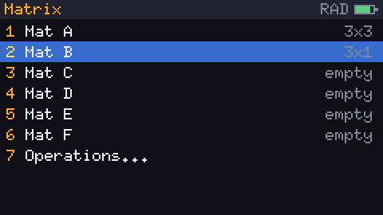
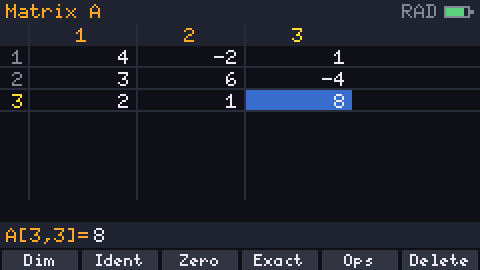
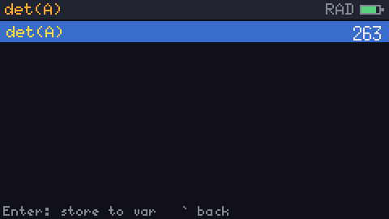
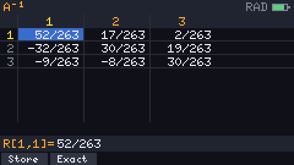
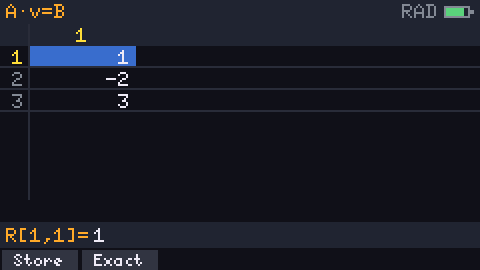

# Matrix

Matrix stores up to six matrices, A to F, each up to 6×6, and calculates with them: determinant, inverse, transpose, rank, RREF, sums and products, powers, trace, and the solution of X·v = Y.

Open it from the home screen with the **Matrix** icon, or press `7` on the home screen.

Arrows are written ↑ ↓ ← → on this page. They are `fn`+`;` `.` `,` `/`; in lists and matrix grids the plain `;` `.` `,` `/` work too. ESC is `fn`+`` ` ``. F1–F6 are `fn`+`1`…`6`. See [Basic operation](../basics.md) for the common keys.

## Screen layout

### Matrix list

| Item | Contents |
|---|---|
| 1–6 Mat A … Mat F | The matrix and its size on the right (`3×3`, or `empty`) |
| 7 Operations... | The operations menu |

Select with ↑ ↓ and `Enter`, or press the number. ESC returns to the home screen.

### Matrix editor

| Area | Contents |
|---|---|
| Status bar (top) | "Matrix A" etc. |
| Column titles / row numbers | 1–6. Up to 4 columns fit; the grid scrolls sideways for more. An orange mark at the edge shows that there are more columns |
| Cells | The values, shortened to fit. The selected cell is highlighted |
| Bottom bar | The cell name and full value, such as `A[3,3]=8`, or the cell being edited |
| Soft keys (bottom) | F1 Dim, F2 Ident, F3 Zero, F4 Exact, F5 Ops, F6 Delete |

### Result matrix

Results that are matrices are shown in a read-only grid. Its title names the operation (`A⁻¹`, `A transposed`, `rref(A)`, `A×B`, `A·v=B` …) and its cells are named `R[1,1]` and so on. Exact display (fractions) is on.

## Operations

### Matrix list

| Key | Action |
|---|---|
| `Enter` on Mat A–F | Open the editor. For an empty matrix, you are first asked for "Rows (1-6)" and "Columns (1-6)". The hint "Enter = 2" means that pressing `Enter` on an empty field keeps that size |
| `Enter` on Operations... | Open the operations menu |

### Matrix editor

| Key | Action |
|---|---|
| ↑ ↓ ← → | Move between cells |
| Digit, `-`, letter or `opt` / `alt` key | Start entering a new value |
| `Enter` | Edit the current value. While editing, `Enter` stores it and moves right, then to the start of the next row |
| ↑ ↓ while editing | Store and move up / down |
| ESC while editing | Cancel the edit |
| `BS` / `fn`+`BS` | Set the cell to 0 |
| `fn`+`-` / `fn`+`=` | First / last row |
| `ctrl`+`s` or `ctrl`+`e` | Toggle exact display (same as F4) |
| ESC | Save and go back to the list |

| Key | Label | Action |
|---|---|---|
| F1 | Dim | Change the size. Values that still fit are kept; new cells are 0 |
| F2 | Ident | Replace with the identity matrix. If the matrix is not square, asks "Make square 3×3?" first (rows × rows) |
| F3 | Zero | Set all cells to 0 (asks "Clear A?") |
| F4 | Exact | Show values as fractions, π or √ where possible |
| F5 | Ops | Open the operations menu |
| F6 | Delete | Delete the matrix (asks "Delete matrix A?"). It becomes empty |

Cells can hold expressions such as `1/3`, `√(2)` or a variable; `Ans` is not changed. Because `.` moves the cursor, start decimals with `0`, as in `0.5`.

### Operations menu

Choose the operation, then the matrix X (menu "X = ?") and, for two-matrix operations, Y ("Y = ?"). The menus list the matrices that are not empty and, once you have calculated something, **Result**, the last result matrix.

| # | Operation | Result |
|---|---|---|
| 1 | det(X) | Determinant (number). X must be square |
| 2 | Inverse X⁻¹ | Inverse matrix. "Singular matrix" if det = 0 |
| 3 | Transpose XT | Transposed matrix |
| 4 | Rank | Rank (number) |
| 5 | RREF | Reduced row echelon form |
| 6 | X + Y | Sum (same size) |
| 7 | X - Y | Difference (same size) |
| 8 | X × Y | Product (columns of X = rows of Y) |
| 9 | k × X | Asks for k, multiplies every element |
| — | X ^ n | Asks for an integer n. n=0 gives the identity; negative n uses the inverse |
| — | Solve X·v = Y | Solves X·v = Y. Y must be a column vector (n×1) with as many rows as X. X need not be square |
| — | Trace | Sum of the diagonal (number). X must be square |

Items 10–12 have no number key; select them with ↑ ↓ (↑ from the first item wraps to Trace).

Number results (det, rank, trace) appear in a result list. Press `Enter` there to store the value in a variable (one letter, A–Z, x, y …), or ESC to go back.

In a result matrix:

| Key | Action |
|---|---|
| ↑ ↓ ← → | Move between cells; the bottom bar shows the full value |
| F1 (Store) | Copy the result into one of A–F ("Store result to"). The target is overwritten without asking |
| F2 (Exact) | Switch between exact and decimal display |
| ESC | Back to the operations menu |

## Examples

### Enter a matrix and find det and the inverse

A = [[4, −2, 1], [3, 6, −4], [2, 1, 8]]

1. Press `1` (Mat A). Type `3` `Enter` for the rows and `3` `Enter` for the columns.
2. Type the nine values row by row, pressing `Enter` after each: `4` `-2` `1` `3` `6` `-4` `2` `1` `8`. The editor fills one row after another (see the screenshot above).
3. Press F5 (Ops), then `1` (det(X)) and `1` (Mat A). det(A) is `263`.

4. Press ESC to go back to the operations menu. Press `2` (Inverse X⁻¹), then `1` (Mat A).

The inverse is shown with fractions, such as `52/263`. Press F2 (Exact) to see decimals, or F1 (Store) to keep it in another matrix.

### Solve A·v = b

Solve 4x − 2y + z = 11, 3x + 6y − 4z = −21, 2x + y + 8z = 24 with the matrix A from the previous example.

1. Press ESC until the matrix list appears, then press `2` (Mat B). Type `3` `Enter` (rows) and `1` `Enter` (columns).
2. Type `11` `Enter` `-21` `Enter` `24` `Enter`, then press ESC.
3. Press `7` (Operations...). Press ↑ twice to select "Solve X·v = Y" and press `Enter`.
4. Press `1` (Mat A) for X, then `2` (Mat B) for Y.

The solution is x = 1, y = −2, z = 3. If there is no solution, "No solution" appears. If there are infinitely many, "Infinitely many solutions" appears and then the RREF of the augmented matrix [X|Y] is shown.

## Notes and limits

- **Size**: up to 6 rows and 6 columns. Six matrices (A–F) plus the last result.
- **Precision**: elements are 15-digit decimals. In sums, differences, k × X and Solve results, tiny leftovers from rounding (below 1E-13) are set to 0.
- **Errors**: "Dimension error" when the sizes do not fit the operation; "Singular matrix" for the inverse of a matrix with det = 0; "Argument error" when n in X ^ n is not an integer; "Y must be a column vector (n×1)" for Solve.
- **Number format**: number results follow the display format set in Calc (F4 Format).
- **Saving**: A–F and the last result are saved in `/data/matrix.json` when you leave the editor or the app.

---

[← Contents](../README.md) · [Basic operation](../basics.md)
