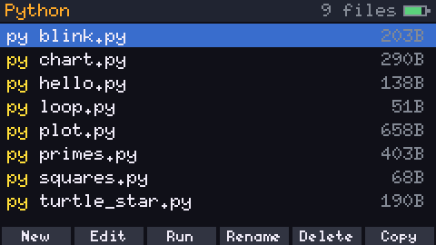
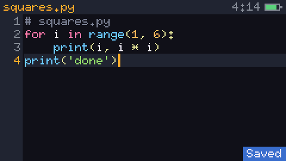
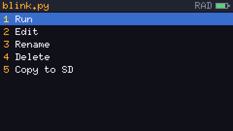
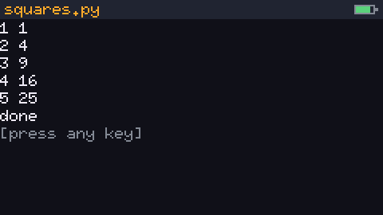
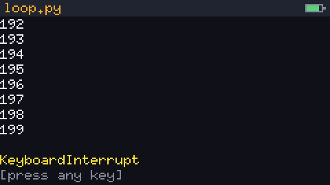

# Python

The Python app lists your Python scripts and lets you create, edit, run, rename, delete and copy them. Scripts run on the device with double-precision floats, and they can use the screen, keyboard and GPIO through the `cardgcalc` module.



Open it from the home screen with the **Python** icon, or press `9` on the home screen.

Arrows are written ↑ ↓ ← → on this page. They are `fn`+`;` `.` `,` `/`. On screens without a text field (the script list and menus), the plain `;` `.` `,` `/` keys work as arrows too. F1–F6 are `fn`+`1`…`6`. See [Basic operation](../basics.md) for the common keys.

## Screen layout

### Script list

| Area | Contents |
|---|---|
| Status bar (top) | Title "Python", number of scripts ("9 files"), battery |
| List | One row per script: `py`, the file name, and the size on the right. Scripts on the SD card show `SD` before the size |
| Soft keys (bottom) | F1 New, F2 Edit, F3 Run, F4 Rename, F5 Delete, F6 Copy |

The list shows the `.py` files in `/programs` (internal flash) followed by those in `/sd/programs` (SD card, only while the card is mounted). With no scripts, the list says "No scripts. F1: new script".

### Editor



| Area | Contents |
|---|---|
| Status bar (top) | File name (with `*` in front while there are unsaved changes), cursor position `line:column`, battery |
| Gutter (left) | Line numbers (last 3 digits). The current line number is highlighted |
| Text | The script with syntax colors: keywords pink, built-in functions blue, strings green, numbers orange, comments gray. The current line has a lighter background. A thin bar on the left edge means the text is scrolled sideways |
| Message (bottom right) | Short notices such as "Saved", "Nothing to undo", "Cut 1 line(s)", "Not found: …" |

The editor has no soft keys; everything is on `ctrl` and `opt` keys.

### Output console

When a script runs, the screen becomes a console titled with the script name. `print()` output appears here and `input()` reads a line here. When the script ends, "[press any key]" appears at the bottom.

## Operations

### Script list keys

| Key | Action |
|---|---|
| ↑ ↓ | Select a script (wraps around) |
| `Enter` or → | Actions menu for the script (below) |
| F1 (New) or `ctrl`+`n` | Create a new script and open it in the editor |
| F2 (Edit) or `e` | Open the script in the editor |
| F3 (Run), `r` or `ctrl`+`r` | Run the script |
| F4 (Rename) | Rename the script |
| F5 (Delete), `BS` or `fn`+`BS` | Delete the script (asks "Delete hello.py?"; `Enter` = yes) |
| F6 (Copy) | Copy a flash script to the SD card, or an SD script to flash |
| ESC (`fn`+`` ` ``) or ← | Back to the home screen |



The actions menu (`Enter`) has **Run**, **Edit**, **Rename**, **Delete** and **Copy to SD** (for a script on the SD card: **Copy to flash**). Press the item's number or select it and press `Enter`.

- **New** asks for a name ("New script name"). Use letters, digits, `_`, `-` and `.`; `.py` is added if you leave it out. New scripts are always created in `/programs` and start with one comment line, `# name.py`. An existing name gives "name.py exists".
- **Rename** uses the same rules and keeps the script in its folder.
- **Copy to SD** mounts the card if needed, creates `/sd/programs` and copies the script there. **Copy to flash** copies into `/programs`. If the target exists you are asked "Overwrite …?". "Copied → path" confirms the copy.

### Editor keys

| Key | Action |
|---|---|
| ↑ ↓ ← → | Move the cursor. ← at the start of a line goes to the end of the previous line, → at the end goes to the next line |
| `fn`+`-` | Start of line. Pressed again, it toggles between the first non-space character and column 1 |
| `fn`+`=` | End of line |
| `ctrl`+`a` / `ctrl`+`e` | Column 1 / end of line |
| `fn`+`[` / `fn`+`]` | Page up / page down |
| `Enter` | New line with auto-indent (below) |
| `BS` | Delete the character before the cursor. In leading spaces it deletes back to the previous indent level (multiple of 4). At column 1 it joins the line to the previous one |
| `fn`+`BS` | Delete the character at the cursor (at the end of a line, joins the next line) |
| `Tab` | Insert spaces up to the next multiple of 4 |
| `shift`+`Tab` | Remove one indent level (up to 4 spaces) from the start of the line |
| `ctrl`+`s` | Save |
| `ctrl`+`r` | Save (if changed) and run. When the script ends you come back to the editor |
| `ctrl`+`f` | Find: type the text and press `Enter`. The search starts at the cursor, wraps around the end and is case-sensitive. The last search text is filled in |
| `ctrl`+`n` | Find next (asks for the text if there is none yet) |
| `ctrl`+`g` | Go to line: type a line number (the prompt shows the range, e.g. "1-24") |
| `ctrl`+`k` | Cut the current line. Repeated `ctrl`+`k` presses collect several lines |
| `ctrl`+`u` | Paste the cut lines above the current line |
| `ctrl`+`d` | Duplicate the current line |
| `ctrl`+`z` | Undo (up to 40 steps; typing on one line counts as one step) |
| `opt`+letter | Insert a snippet (below) |
| `fn`+`h` | Show the editor key list ("Editor keys") |
| ESC | Close the editor. If there are unsaved changes it asks "Save changes?": **Save**, **Discard** or **Cancel** |

**Auto-indent.** `Enter` keeps the indentation of the current line. After a line that ends with `:` (such as `for …:` or `def …:`) it indents 4 more spaces. Trailing spaces before the cursor are removed. To end a block, press `BS` once at the start of the new line: it removes one indent level.

**Snippets** (`opt`+key inserts the text):

| Key | Text | Key | Text | Key | Text |
|---|---|---|---|---|---|
| `d` | `def ` | `f` | `for i in range(` | `w` | `while ` |
| `i` | `if ` | `l` | `elif ` | `e` | `else:` |
| `r` | `return ` | `p` | `print(` | `m` | `import ` |
| `n` | `cardgcalc` | `t` | `True` | `a` | `False` |
| `c` | `class ` | `x` | `except ` | `y` | `try:` |

The cut-line clipboard is shared by all files you open in the editor, so you can cut lines in one script and paste them into another.

### Running a script

| Situation | What happens |
|---|---|
| `print()` | Text goes to the console. The last 200 lines are kept |
| `input("prompt")` | Shows the prompt and reads a line. ESC on an empty line stops the script |
| ESC or `ctrl`+`c` while running | Stops the script, even a loop like `while True: pass`. "KeyboardInterrupt" appears in yellow |
| An error | The traceback is shown in red |
| The script draws on the screen | The picture stays until you press a key. If the script also printed text, the console then appears |
| The script ends | "[press any key]". ↑ ↓ scroll back one line, `fn`+`[` / `fn`+`]` one page. Any other key returns |

The script's folder is put on `sys.path` while it runs, so a script in `/programs` can `import` another module in `/programs`. Modules that the script imported are unloaded when it ends.

### Sample scripts

The first time you open the Python app with an empty `/programs`, these samples are created:

| Script | What it shows |
|---|---|
| `hello.py` | `input()` and `print()`: asks your name and prints squares |
| `primes.py` | Sieve of Eratosthenes up to 2000, with the time taken in ms |
| `plot.py` | `cardgcalc.plot()` of a damped sine, then a bouncing ball animation (ESC stops it) |
| `turtle_star.py` | A colored star with the `turtle` module |
| `blink.py` | Blinks an LED on Grove G1 every 0.5 s (ESC stops it) |
| `chart.py` | `matplotlib.pyplot`: a line, a scatter plot and a bar chart |
| `ulab_demo.py` | `ulab` arrays with pyplot: a damped sine and a histogram |

For the functions that scripts can use (`cardgcalc`, `turtle`, `matplotlib.pyplot`, `ulab`), see the [cardgcalc module API](../api.md).

## Examples

### Create, save and run a script

1. In the script list, press F1 (New).
2. Type `squares` and press `Enter`. The editor opens with the line `# squares.py`.
3. Press ↓ to go to line 2.
4. Press `opt`+`f` (inserts `for i in range(`), type `1, 6):` and press `Enter`. The next line is indented by 4 spaces.
5. Press `opt`+`p` (inserts `print(`), type `i, i * i)` and press `Enter`.
6. Press `BS` to remove the indent, press `opt`+`p` and type `'done')`.
7. Press `ctrl`+`s`. "Saved" appears and the `*` before the file name disappears.

   

8. Press `ctrl`+`r`. The script runs:

   

9. Press any key to return to the editor, then ESC to return to the list.

### Stop a script that runs forever

1. Press F1, type `loop` and press `Enter`, then ↓.
2. Type these lines (`Enter` after each; the indent after `while True:` is automatic):
   ```python
   n = 0
   while True:
       n += 1
       print(n)
   ```
3. Press `ctrl`+`r`. The script saves and starts counting.
4. Press ESC (or `ctrl`+`c`). The script stops:

   

5. Press any key to return to the editor.

### Copy a script to the SD card

1. Insert a microSD card.
2. Select the script in the list and press F6 (Copy), or press `Enter` and choose **Copy to SD**.
3. "Copied → /sd/programs/squares.py" appears. The SD copy now shows in the list with `SD` next to its size.

## Notes and limits

- Scripts are stored in `/programs` (flash) and `/sd/programs` (SD card). Only `.py` files are listed. Use the [Files](files.md) app for other folders.
- The RAM heap is about 176 KB. Large lists or big scripts can raise `MemoryError`; split the work into smaller pieces or use `ulab` arrays.
- Python numbers are ordinary double-precision floats, not the calculator's 15-digit decimals.
- Japanese text can be shown with `print()` but cannot be typed on the keyboard.
- The editor indents with spaces (4 per level). `Tab` inserts spaces, not a tab character.
- To copy scripts from a PC, see [PC connection](../pc.md). For apps written as plugins, see [Plugins](../plugins.md).

---

[← Contents](../README.md) · [Basic operation](../basics.md)
