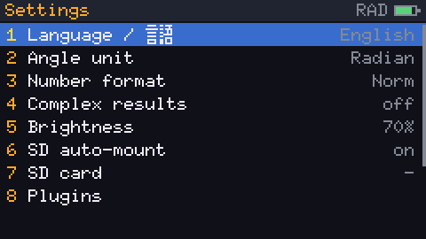
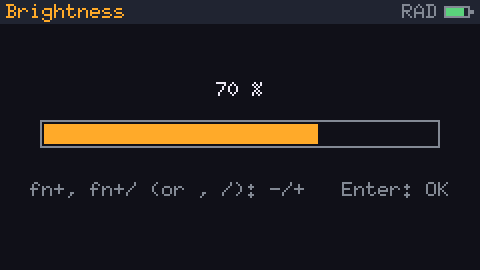
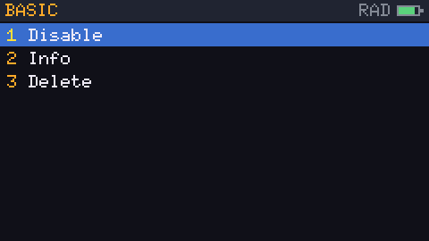
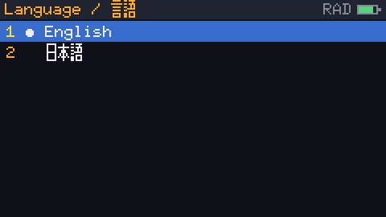
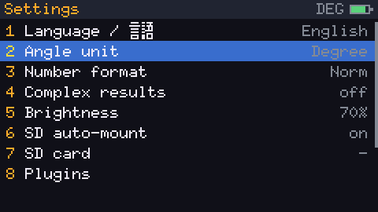

# Settings

Settings holds the options shared by all apps: display language, angle unit, number format, complex results, screen brightness and the SD card. It also manages plugins, shows memory and version information, and can reset all saved data.

Open it from the home screen with the **Settings** icon (the 13th app; move to it with the arrows and press `Enter`).

Arrows are written ↑ ↓ ← → on this page. They are `fn`+`;` `.` `,` `/`; in menus the plain `;` `.` `,` `/` keys work as arrows too. See [Basic operation](../basics.md) for the common keys.

## Screen layout

Settings is a numbered menu. Each row shows the item on the left and its current value on the right. The list has 11 items and scrolls; a bar on the right edge shows the position. There are no soft keys. The status bar shows the title "Settings", the angle unit (RAD / DEG / GRA) and the battery.

## Operations

| Key | Action |
|---|---|
| ↑ ↓ | Select an item (wraps around) |
| `fn`+`[` / `fn`+`]` | Page up / down |
| `1`–`9` | Open item 1–9 directly |
| `Enter` or → | Open the selected item (or switch it, for on/off items) |
| ESC (`fn`+`` ` ``) or ← | Back (in a sub-menu: cancel without changing) |

Choice lists mark the current value with a dot (●). Press the number of a choice or select it and press `Enter`. Changes are saved at once in `/data/settings.json` and kept after power-off.

### Items

| # | Item | Values | What it does |
|---|---|---|---|
| 1 | Language / 言語 | English, 日本語 | Display language of menus and screens. Takes effect at once |
| 2 | Angle unit | Radian, Degree, Gradian | Unit for trigonometric functions in the calculator apps (Calc, Graph, Table, Equation, 3D Graph …). Shown as RAD / DEG / GRA in the status bar. Python's `math` module always uses radians |
| 3 | Number format | Norm, Fix *n*, Sci *n*, Eng *n* | How the calculator apps display numbers (below) |
| 4 | Complex results | on, off | `Enter` switches it. When on, results can be complex (`√(-4)` gives `2i`); when off, a non-real result gives "Non-real error" |
| 5 | Brightness | 5–100 % | Backlight brightness (below) |
| 6 | SD auto-mount | on, off | `Enter` switches it. When on, the SD card is mounted at `/sd` at startup |
| 7 | SD card | mounted, - | Mount or unmount the SD card now |
| 8 | Plugins | | Enable, disable, inspect and delete plugins (below) |
| 9 | Memory & storage | | RAM and storage information (below) |
| 10 | About | | Version information (below) |
| 11 | Reset all data | | Delete all saved settings and calculator data (below) |

The factory settings are: English, Radian, Norm, complex off, 70 %, SD auto-mount on.

### Number format

| Format | Display | Digits asked |
|---|---|---|
| Norm | Normal display, up to 10 digits | none |
| Fix | Fixed number of decimal places | "Digits (0-9)" |
| Sci | Scientific notation (mantissa × 10ⁿ) | "Significant digits (1-10)" |
| Eng | Engineering notation (exponent a multiple of 3) | "Significant digits (1-10)" |

After you choose Fix, Sci or Eng, a box asks for the number of digits; values outside the range are clipped. Press ESC there to keep the previous format. The menu then shows, for example, `Fix 2`. The Format soft key in [Calc](calc.md) changes the same setting.

### Brightness

| Key | Action |
|---|---|
| ← or `-` | Darker (5 % steps, minimum 5 %) |
| → or `+` (`=`) | Brighter (up to 100 %) |
| `Enter` | Keep the new brightness |
| ESC | Go back to the previous brightness |

The screen changes as you press the keys. On this screen the plain `,` and `/` keys work as ← and →.

### SD card

- **SD card** shows "mounted" while a card is mounted, otherwise "-".
- Not mounted: `Enter` shows "Mounting SD..." and then "SD card: Mounted at /sd", or "No SD card / mount failed".
- Mounted: `Enter` unmounts it ("SD card: Unmounted"). Unmount the card before you remove it.
- The [Files](files.md) app has the same function on F1 (SD).

### Plugins

**Plugins** lists the installed plugins (in `/plugins` and, while the card is mounted, `/sd/plugins`). The right column shows `on`, `off`, or `API` for a plugin that needs a newer firmware. With no plugins, a box says "No plugins installed." and shows the folder to use.

Select a plugin and press `Enter` for its menu:

| Item | Action |
|---|---|
| Disable / Enable | A disabled plugin is hidden from the home screen and from "Open with" in Files. It stays installed. Not offered for a plugin that needs newer firmware (shown as `API`) |
| Info | Name and version, description, Folder, Module (`module.run()`), API version ("needs newer firmware" if too new), and Opens (file extensions it handles) |
| Delete | Asks "Delete plugin?" with the folder path; `Enter` deletes the whole plugin folder |

How to write and install plugins: see [Plugins](../plugins.md).

### Memory & storage

A text view with:

- RAM: free and used heap
- Flash fs: free / total space of the internal file system
- SD card: free / total space, or "not mounted"
- Scripts: number of `.py` files in `/programs`
- Battery: estimated level in %

### About

Shows the firmware name and version (`card-gcalc 0.2`), "Graphing calculator for M5Stack Cardputer-Adv" (or "M5Stack Cardputer"), the MicroPython version, the board name, the font credits and the CPU clock.

### Reset all data

Asks "Reset all data?" ("Settings, variables, functions, lists, matrices, history"; `Enter`: yes, ESC: no). On yes, every file in `/data` is deleted and "All data cleared." appears:

- all settings go back to the factory settings (including the language, which returns to English, and disabled plugins, which are enabled again)
- calculator variables and Ans, the Calc history, graph functions, Stats lists, matrices and the data of the other calculator apps are cleared

Scripts in `/programs`, plugins and files on the SD card are not touched.

## Examples

### Switch the language to Japanese

1. Press `1` (Language / 言語).

   

2. Press `2` (日本語). The menu appears in Japanese at once, and all apps use Japanese from now on.
3. To switch back, press `1` (Language / 言語) and then `1` (English).

### Use degrees

1. Press `2` (Angle unit).
2. Press `2` (Degree). The row shows Degree and the status bar shows DEG.

   

3. Press ESC and open Calc: `sin(30)` now gives 0.5.

### Show results with two decimal places

1. Press `3` (Number format), then `2` (Fix).
2. In "Digits (0-9)", type `2` and press `Enter`. The row shows `Fix 2`. In Calc, `1÷3` now shows `0.33`.
3. To go back, choose Number format → Norm.

### Turn off a plugin

1. Press `8` (Plugins).
2. Select the plugin (for example BASIC) and press `Enter`.
3. Press `1` (Disable). The list shows `off` and the plugin's icon disappears from the home screen. Choose Enable to bring it back.

## Notes and limits

- Settings are stored in `/data/settings.json`; the calculator data is in other `/data/*.json` files.
- Brightness 0 is not available (the minimum is 5 %), so the screen never goes completely dark.
- The angle unit and number format apply to the calculator apps only. Python scripts compute in radians and print numbers with Python's own formatting.

---

[← Contents](../README.md) · [Basic operation](../basics.md)
