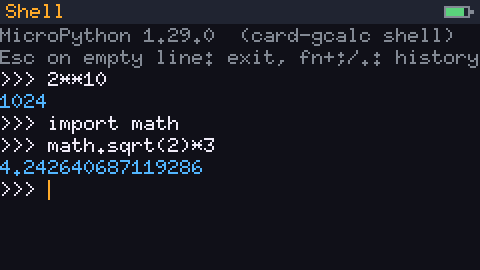
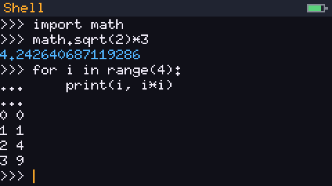

# Shell

Shell is an interactive Python prompt (REPL). Type a Python statement or expression and it runs at once, so you can try out code, use Python as a calculator or test the `cardgcalc` functions without writing a script.

Open it from the home screen with the **Shell** icon, or press `0` on the home screen (the 10th app).

Arrows are written ↑ ↓ ← → on this page. They are `fn`+`;` `.` `,` `/`. The Shell always has a text field, so the plain `;` `.` `,` `/` keys type characters; use `fn` for the arrows. See [Basic operation](../basics.md) for the common keys.

## Screen layout

| Area | Contents |
|---|---|
| Status bar (top) | Title "Shell", battery |
| First lines | The MicroPython version and a hint: "Esc on empty line: exit, fn+;/.: history" |
| Console | Your input after the `>>>` prompt (`...` for continuation lines), results in blue, errors in red, "KeyboardInterrupt" in yellow |
| Input line | The last line, after the prompt, with the cursor |
| Scroll mark (top right) | `-N-` while you look at older output, N lines above the bottom |

There are no soft keys. The console keeps the last 200 lines.

## Operations

| Key | Action |
|---|---|
| `Enter` | Run the line. If it is an expression, its value is shown (and stored in `_`) |
| ↑ / ↓ | Previous / next line from the history |
| ← / → | Move the cursor in the line |
| `fn`+`-` / `fn`+`=` | Start / end of the line |
| `BS` / `fn`+`BS` | Delete before / at the cursor |
| `ctrl`+`u` | Clear the line |
| `fn`+`[` / `fn`+`]` | Scroll the output up / down one page. New output (for example after `Enter`) jumps back to the bottom |
| ESC (`fn`+`` ` ``) | With text on the line: clear it. On an empty line: leave the Shell |
| `ctrl`+`d` on an empty line | Leave the Shell |
| `ctrl`+`c` at the prompt | Cancel the line (prints "KeyboardInterrupt") |
| ESC or `ctrl`+`c` while a command runs | Interrupt it ("KeyboardInterrupt") |

### Multi-line blocks

A line that ends with `:` (such as `for`, `while`, `if`, `def`) or with `\` starts a block.

- The prompt changes to `...` and the next line is already indented: 4 spaces more than the line that started the block.
- After a line that ends with `:` the indent grows by 4. Otherwise the next line keeps the same indent. Use `BS` to remove spaces (one at a time).
- Press `Enter` on a line with nothing but spaces to end the block and run it.
- `ctrl`+`c` cancels the whole block without running it.

### History

- The last 30 entries are kept while the Shell is open. Leaving the Shell clears the history and all variables.
- For a block, only its first line is saved in the history. Recalling it starts a new block; type the body again.

### Output and graphics

- `print()` output and tracebacks appear in the console.
- `input()` reads a line in the console.
- If a command draws on the screen (for example `cardgcalc.plot(...)` or `cardgcalc.circle(...)`), the drawing stays until you press a key, then the console comes back.

## Examples

### Calculate

1. Type `2**10` and press `Enter`. `1024` appears.
2. Type `import math` and press `Enter`.
3. Type `math.sqrt(2)*3` and press `Enter`. `4.242640687119286` appears.

4. Type `_ * 2` and press `Enter` to use the last result again.

### Run a for loop

1. Type `for i in range(4):` and press `Enter`. The prompt becomes `...` and the line is indented 4 spaces.
2. Type `print(i, i*i)` and press `Enter`. The next `...` line is indented the same way.
3. Press `Enter` again on that empty line. The block runs:

4. Press ↑ twice to bring back `math.sqrt(2)*3`, edit it and press `Enter`.

### Try the graphics API

1. Type `import cardgcalc` and press `Enter`.
2. Type `cardgcalc.plot(lambda x: x*x, -3, 3)` and press `Enter`. The graph fills the screen.
3. Press any key to return to the Shell.

## Notes and limits

- Numbers are Python floats (double precision), not the calculator's decimals: `0.1+0.2` gives `0.30000000000000004`.
- `Tab` inserts 4 spaces. Continuation lines are indented for you; adjust them with `Tab`, `Space` and `BS`.
- The RAM heap is about 176 KB. Large objects stay in memory until you leave the Shell.
- For longer programs, write a script in the [Python](python.md) app. The functions you can use are listed in the [cardgcalc module API](../api.md).

---

[← Contents](../README.md) · [Basic operation](../basics.md)
