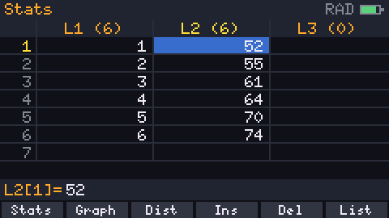
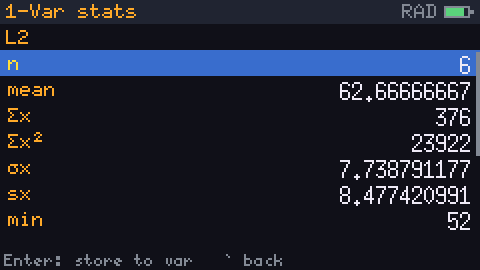
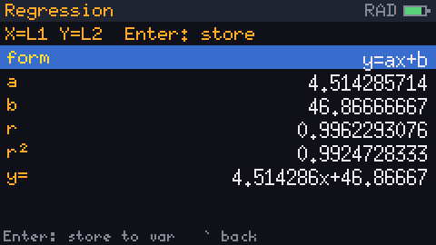
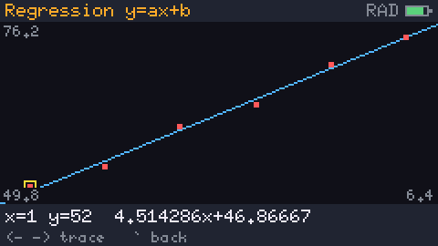
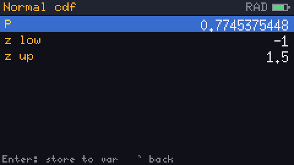

# Stats

Stats keeps up to three data lists, L1–L3, and computes one- and two-variable statistics and regressions. It also draws scatter plots, histograms and box plots, and calculates normal, binomial and Poisson probabilities.

Open it from the home screen with the **Stats** icon, or press `6` on the home screen.

Arrows are written ↑ ↓ ← → on this page. They are `fn`+`;` `.` `,` `/`. On screens without a text field, the plain `;` `.` `,` `/` keys work as arrows too. F1–F6 are `fn`+`1`…`6`. See [Basic operation](../basics.md) for the common keys.

## Screen layout

| Area | Contents |
|---|---|
| Status bar (top) | Title "Stats", modifier latches, angle unit, battery |
| Column headers | `L1 (6)`, `L2 (6)`, `L3 (0)`: list name and number of items. The current column is yellow |
| Rows | Row numbers on the left, one item per cell. There is always one empty row after the longest list for new data |
| Bottom bar | The current cell and its full value, for example `L2[1]=52`. While you edit, the input line is shown here |
| Soft keys (bottom) | F1 Stats, F2 Graph, F3 Dist, F4 Ins, F5 Del, F6 List |

## Operations

### List editor keys

| Key | Action |
|---|---|
| ↑ ↓ ← → | Move between cells |
| `fn`+`[` / `fn`+`]` | Page up / down |
| `fn`+`-` / `fn`+`=` | First row / last row |
| Any character (a digit, `-`, a variable letter …) or an `opt` / `alt` math key | Start entering a new value in the cell |
| `Enter` | Edit the current value |
| `BS` or `fn`+`BS` | Delete the item (the items below move up) |
| `ctrl`+`s` or `ctrl`+`e` | Toggle exact display (fractions, √, π) |
| `fn`+`h` | Keymap help |
| ESC (`fn`+`` ` ``) | Back to the home screen |

While you enter a value:

- `Enter` stores it and moves down. ↑ / ↓ store it and move up / down. ESC cancels.
- A cell can hold an expression such as `1/3`, `2π` or `√(2)` (`opt`+`q`). It is evaluated when you store it. Only real numbers are accepted.
- Entering a value below the end of a list fills the gap with 0.
- Start a decimal with 0, as in `0.5`: a plain `.` moves the cursor down when no value is being entered.

### Soft keys

| Key | Action |
|---|---|
| F1 Stats | Statistics menu: 1-Var stats, 2-Var stats, Regression |
| F2 Graph | Graph menu: Scatter plot, Scatter + regression, Histogram, Box plot (all lists) |
| F3 Dist | Distributions menu (normal, binomial, Poisson) |
| F4 Ins | Insert a 0 at the cursor; the items below move down |
| F5 Del | Delete the item at the cursor |
| F6 List | List menu for the current column |

In every menu, select an item with ↑ ↓ and `Enter`, or press its number. ESC or ← goes back.

### F1 Stats

**1-Var stats**: choose the data list, then the frequency list ("None (all 1)" or L1–L3).

| Result | Meaning |
|---|---|
| n | Number of data (sum of the frequencies) |
| mean | Mean |
| Σx, Σx² | Sum, sum of squares |
| σx | Population standard deviation |
| sx | Sample standard deviation (n>1) |
| min, max | Smallest, largest value |
| Q1, median, Q3 | Quartiles and median |
| IQR | Q3−Q1 |
| range | max−min |
| mode | Most frequent value (up to 3) |

- Q1 and Q3 are the medians of the lower and upper halves, excluding the median when n is odd.
- Q1, median, Q3 and IQR are shown only when all frequencies are integers.
- mode is not shown when every value occurs equally often.
- Frequencies must be 0 or more ("Frequency < 0"). Items with frequency 0 are ignored. The frequency list must be at least as long as the data list ("Dimension error").

**2-Var stats**: choose the X list and the Y list. If they have different lengths, the shorter length is used.

| Result | Meaning |
|---|---|
| n | Number of pairs |
| mean x, mean y | Means |
| Σx, Σy, Σx², Σy², Σxy | Sums |
| σx, σy | Population standard deviations |
| sx, sy | Sample standard deviations (n>1) |
| r | Correlation coefficient |

**Regression**: choose the X list, the Y list and a model.

| # | Model | Condition |
|---|---|---|
| 1 | Linear  y=ax+b | 2 or more points |
| 2 | Quadratic  y=ax²+bx+c | 3 or more points |
| 3 | Exponential  y=a·e^(bx) | y>0 |
| 4 | Logarithmic  y=a+b·ln(x) | x>0 |
| 5 | Power  y=a·x^b | x>0, y>0 |

The result shows form, the coefficients a, b (and c), r, r² and the equation `y=` with rounded coefficients. r is not shown for the quadratic model. The exponential, logarithmic and power models are fitted as straight lines on ln(x) and/or ln(y), and their r is for that transformed data. r² is computed from the fitted curve and the original data.

**Result screens**: ↑ ↓ select a row, `fn`+`[` / `]` page. `Enter` on a number opens "Store a to variable": type a letter (A–Z, x, y, θ …; not e or i) and press `Enter`. You can then use the value in Calc or in Graph functions. ESC or ← goes back.

### F2 Graph

| # | Item | Steps |
|---|---|---|
| 1 | Scatter plot | Choose the X and Y lists |
| 2 | Scatter + regression | Choose the X and Y lists and a model. The regression curve is drawn over the points |
| 3 | Histogram | Choose the data list and the frequency list, then enter the bin width |
| 4 | Box plot (all lists) | Draws a box plot for each list that has data, one under the other |

On the plot screens:

- ← → move the yellow highlight to the previous / next point, bin or box (↑ ↓ also work for box plots). The info line shows its values:
  - Scatter: `x=… y=…`, followed by the regression equation if there is one
  - Histogram: the bin `[start, end)` and its count `n=…`
  - Box plot: `L1 min|Q1|median|Q3|max`
- ESC or `Enter` goes back.
- Small labels show the top and bottom of the y range (left) and the right end of the x range (bottom right).

Histogram: the "Bin width" dialog shows the start (the smallest value) and a suggested width, based on about log₂(n)+1 bins. Type another width or press `Enter`. Each bin includes its start and excludes its end; the largest value goes into the last bin. At most 120 bins.

### F3 Dist

Choose a distribution. A form opens with default values. ↑ ↓ move between fields; `Enter` moves to the next field and calculates on the last one. F1 (Calc) calculates at any time. Fields accept expressions. `BS` deletes characters and `ctrl`+`u` clears the whole field.

| # | Distribution | Fields (defaults) | Result |
|---|---|---|---|
| 1 | Normal pdf | x (0), μ (0), σ (1) | p(x): probability density |
| 2 | Normal cdf | Lower (−1), Upper (1), μ (0), σ (1) | P: probability Lower ≤ X ≤ Upper; z low, z up: standardized bounds |
| 3 | Inverse normal | Area (0.95), μ (0), σ (1), Tail L/R/C (L) | x with P(X<x)=Area (L), P(X>x)=Area (R), or x1, x2 centered on μ with P(x1<X<x2)=Area (C) |
| 4 | Binomial pdf | x (3), n (10), p (0.5) | P(X=x) |
| 5 | Binomial cdf | x (3), n (10), p (0.5) | P(X≤x) |
| 6 | Poisson pdf | x (2), λ (3) | P(X=x) |
| 7 | Poisson cdf | x (2), λ (3) | P(X≤x) |

- ESC on the result goes back to the form; the values you entered stay there while the app is open. ESC on the form goes back to the menu.
- σ and λ must be greater than 0, p must be between 0 and 1, and n must be a non-negative integer. Area must be between 0 and 1.
- For an open bound in Normal cdf, type `∞` with `alt`+`8`: Lower `-∞` or Upper `∞`. Clear the field first with `ctrl`+`u`.

### F6 List

Acts on the list of the current column (the title shows, for example, "List L2").

| # | Item | Action |
|---|---|---|
| 1 | Sort ascending | Sort the list from smallest to largest |
| 2 | Sort descending | Sort from largest to smallest |
| 3 | Clear L2 | Delete all items of the list (asks first) |
| 4 | Clear all lists | Delete all items of L1–L3 (asks first) |
| 5 | Fill sequence... | Replace the list with values of an expression: Expr in x (x), x start (1), x end (10), step (1). F1 (Fill) runs it |
| 6 | Copy L2 to... | Copy the list to another list (replaces its contents) |

Example: Fill sequence with `x²`, 1, 5, 1 makes 1, 4, 9, 16, 25. Up to about 1000 items.

## Examples

### Example 1: Enter data and get 1-variable statistics

Six students' study hours (L1) and test scores (L2):

| L1 | 1 | 2 | 3 | 4 | 5 | 6 |
|---|---|---|---|---|---|---|
| L2 | 52 | 55 | 61 | 64 | 70 | 74 |

1. On the home screen press `6` to open Stats. The cursor is on L1, row 1.
2. Type `1` `Enter` `2` `Enter` `3` `Enter` `4` `Enter` `5` `Enter` `6` `Enter`.
3. Press → to move to L2, then `fn`+`-` to go to row 1.
4. Type `52` `Enter` `55` `Enter` `61` `Enter` `64` `Enter` `70` `Enter` `74` `Enter`.
5. Press F1 (Stats), `1` (1-Var stats), `2` (L2), `1` (None (all 1)).
6. The result shows n=6, mean=62.66666667, σx=7.738791177, sx=8.477420991, and so on. Press ↓ to scroll to Q1, median (62.5), Q3 and max.

### Example 2: Linear regression and scatter plot

Using the data from Example 1:

1. Press F1 (Stats), `3` (Regression).
2. X list: `1` (L1). Y list: `2` (L2). Model: `1` (Linear  y=ax+b).
3. The result shows a=4.514285714, b=46.86666667, r=0.9962293076, r²=0.9924728333 and y=4.514286x+46.86667.

   

4. To store the slope, select the `a` row and press `Enter`, type `A` and press `Enter`.
5. Press ESC to go back. Press F2 (Graph), `2` (Scatter + regression), then `1` `2` `1` (L1, L2, Linear).
6. The points and the regression line are drawn. Press ← → to step through the points.

### Example 3: Normal distribution probability

Scores are normally distributed with mean 60 and standard deviation 10. Find P(50 ≤ X ≤ 75).

1. Press F3 (Dist), `2` (Normal cdf).
2. Lower: `ctrl`+`u` `50` `Enter`.
3. Upper: `ctrl`+`u` `75` `Enter`.
4. μ: `ctrl`+`u` `60` `Enter`.
5. σ: `ctrl`+`u` `10` `Enter`. Enter on the last field calculates.
6. P=0.7745375448, with z low=−1 and z up=1.5.

To go the other way, use Inverse normal: Area `0.9`, μ `60`, σ `10`, Tail `L` gives the score below which 90 % of the students fall (x≈72.8).

## Notes and limits

- **Numbers**: list data and all statistics are 15-digit decimal numbers, so sums of decimal data are exact. Only the normal cdf and inverse normal (and very large binomial or Poisson terms) use double-precision floats internally; their results are rounded to 15 digits.
- **Data**: real numbers only. Each list can be as long as memory allows; Fill sequence makes up to about 1000 items.
- **Saving**: the lists are saved in `/data/stats.json` when you leave the app and after each List menu action. They are kept after a restart.
- **Display format**: values in the lists and results follow Settings → Number format (Norm / Fix / Sci / Eng).
- **Graphs of functions**: to plot a regression equation together with other functions, type it into the [Graph](../apps/graph.md) app, for example `Ax+B` after storing a and b in A and B.

---

[← Contents](../README.md) · [Basic operation](../basics.md)
