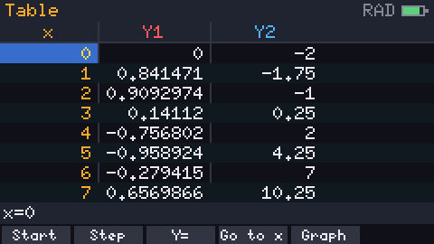
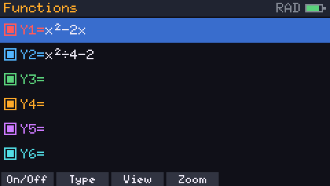
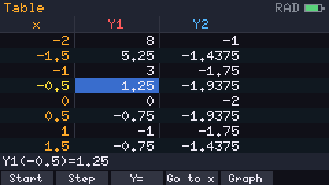
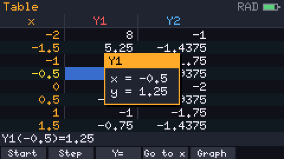

# Table

Table lists the values of your y=f(x) functions for a sequence of x values. It uses the same functions Y1–Y6 as the Graph app. You choose the start value and the step, and the table scrolls without limit in both directions.

Open it from the home screen with the **Table** icon, or press `4` on the home screen. You can also open it with F5 (Table) in Graph's function list.

Arrows are written ↑ ↓ ← → on this page. They are `fn`+`;` `.` `,` `/`. On the table itself, the plain `;` `.` `,` `/` keys work as arrows too. ESC is `fn`+`` ` ``. F1–F6 are `fn`+`1`…`6`. See [Basic operation](../basics.md) for the common keys.

## Screen layout

| Area | Contents |
|---|---|
| Status bar (top) | Title "Table", modifier latches, angle unit, battery |
| Header row | `x`, then one column per function (`Y1`, `Y2` …) in the function's color. `◀` / `▶` appear when there are more function columns to the left / right |
| Rows | x values on the left (orange), function values to the right. Every other row is shaded. The selected cell is highlighted |
| Info line | The full value of the selected cell, such as `x=0` or `Y1(-0.5)=1.25` |
| Soft keys (bottom) | F1 Start, F2 Step, F3 Y=, F4 Go to x, F5 Graph |

Three function columns fit on the screen at once. Values are shortened to fit the column; the info line shows the value with up to 10 digits. `undef` means the function has no real value at that x (for example √(x) for x<0, or division by zero).

Only functions that are turned on, are not empty and have the type y=f(x) appear. Polar and parametric functions are not shown.

## Operations

| Key | Action |
|---|---|
| ↑ ↓ | Move one row. Moving past the top or bottom keeps scrolling (also to x values before the start) |
| ← → | Move between the x column and the function columns |
| `fn`+`[` / `fn`+`]` | Move one page up / down |
| `fn`+`-` | Back to the first row (x = start) |
| `Enter` on the x column | Go to x (same as F4) |
| `Enter` on a function cell | Show x and y in a message box |
| A digit or `-` on the x column | Open "Go to x" and restart the table at the value you type |
| ESC | Back to the home screen (or to Graph, if you came from there) |

### Soft keys

| Key | Label | Action |
|---|---|---|
| F1 | Start | Set the first x value ("Table start (now 0)"). The table goes back to the first row |
| F2 | Step | Set the step between rows ("Table step (now 1)"). The step can be negative but not 0 |
| F3 | Y= | Open the function list ("Functions") to edit Y1–Y6 (below) |
| F4 | Go to x | Ask for an x value. If it lies on the table (start + n × step), the cursor jumps to that row. Otherwise the table restarts at that x |
| F5 | Graph | Draw the graph of the functions. ESC returns to the table. This key is blank when you opened Table from Graph |

Start, step and x values can be expressions such as `π/6` or `2^10`.

### Function list (F3)

This is the same list as in Graph, titled "Functions".

| Key | Action |
|---|---|
| ↑ ↓ | Select Y1–Y6 |
| `Enter` or → | Edit the selected expression. `Enter` confirms, ESC cancels |
| Any character or `opt` / `alt` key | Start a new expression in the row |
| F1 (On/Off) or `Space` | Show or hide the function in the table |
| F2 (Type) | Change the type (only y=f(x) is used in the table) |
| F3 (View) / F4 (Zoom) | Change Graph's view window |
| `BS` | Clear the expression (asks "Clear Y1?") |
| ESC or ← | Back to the table |

See [Graph](graph.md) for details of this list.

## Examples

### Table of a function with a new start and step

1. Press F3 (Y=). The function list opens with Y1 selected.
2. Type `x`, press `opt`+`2` (²), type `-2x` and press `Enter`. Y1 is now `x²-2x`.

3. Press ESC to go back to the table.
4. Press F1 (Start), type `-2` and press `Enter`.
5. Press F2 (Step), type `0.5` and press `Enter`. The x column now reads -2, -1.5, -1 …
6. Press → to move to the Y1 column, then ↓ three times to x = -0.5. The info line shows `Y1(-0.5)=1.25`.

7. Press `Enter`. A box shows `x = -0.5` and `y = 1.25`. Press any key to close it.

### Jump to an x value

1. Press F4 (Go to x), type `10` and press `Enter`.
2. 10 lies on the table (-2 + 24 × 0.5), so the cursor jumps to the row x = 10 and the table scrolls there. Y1(10) is 80.
3. Press F4 again and enter `0.3`. 0.3 is not on the table, so the table restarts at x = 0.3 (start becomes 0.3, step stays 0.5).
4. Press `fn`+`-` to go back to the first row at any time.

## Notes and limits

- **Exact x values**: x values are 15-digit decimals and are computed as start + row × step, so a step of 0.1 gives exactly 0.1, 0.2, 0.3 … without accumulated error.
- **Shared functions**: Table and Graph use the same Y1–Y6. Changes in either app appear in the other.
- **Errors**: if a function has a syntax error, a message lists it when Table opens and the function is left out.
- **Angle unit**: trig functions follow the angle unit (Settings, or F3 in Calc).
- **Variables**: functions may use variables such as `A`; their current values are used.
- **Saving**: the functions and the table start and step are saved in `/data/funcs.json`.

---

[← Contents](../README.md) · [Basic operation](../basics.md)
