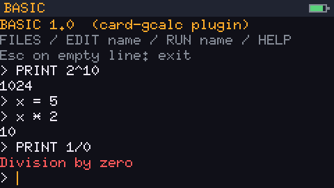
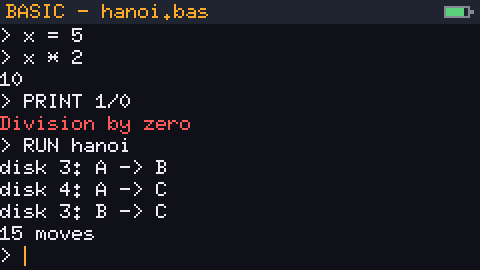
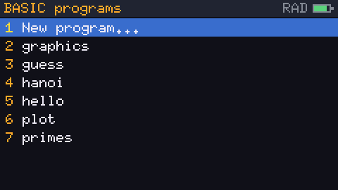
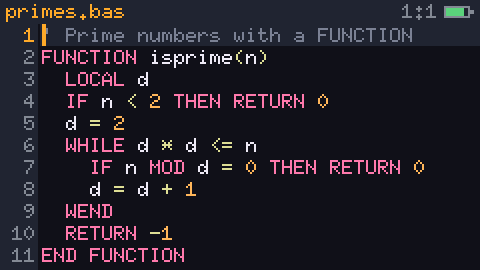
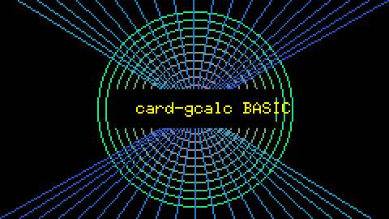

# BASIC

[← Contents](README.md)

The BASIC sample plugin is an interpreter for a structured BASIC without line numbers. It has IF…END IF, FOR, WHILE, DO…LOOP, SELECT CASE, recursive SUB / FUNCTION and graphics statements. GOTO / GOSUB with labels or line numbers also work.

| Direct mode | Running a program |
|---|---|
|  |  |

## Installing

BASIC is a plugin, so it is installed separately from the firmware.

- From a PC with the repository tool: `tools/plugin.sh install plugins/basic`
- Or unpack a release's `basic-plugin-*.zip` and copy the `basic` folder to `/plugins/` on the SD card or on the device

See [Working with a PC](pc.md#installing-plugins) for details. Once installed, "BASIC" appears on the home screen after Settings.

## Starting and direct mode

Select "BASIC" on the home screen and press Enter to start in direct mode. Type a statement or an expression after `>` and press Enter to run it at once.

```
> PRINT 2^10
1024
> x = 5
> x * 2
10
```

- An expression on its own prints its value (`x * 2` is the same as `PRINT x * 2`).
- Variables, SUBs and FUNCTIONs of the loaded program are available, which is handy for checking variables after a run.
- ↑ ↓ recall previous lines.
- Press ESC (`fn`+`` ` ``) on an empty line, or type `BYE`, to quit.

### Commands

| Command | Action |
|---|---|
| `FILES` (`DIR`) | Open the program list: run, edit, delete or create programs |
| `EDIT name` | Open a program in the editor (created if missing). Without a name, the loaded program |
| `RUN [name]` | Run a program. Without a name, the loaded program |
| `LOAD name` | Load a program without running it |
| `LIST` | Show the loaded program with line numbers |
| `NEW` | Clear the loaded program and variables |
| `HELP` | Show a summary of the language |
| `BYE` (`QUIT`, `EXIT`) | Quit BASIC |

You can leave out the `.bas` extension. A name without `/` refers to a file in `/programs`; for programs on the SD card write `/sd/programs/name`.

## Writing and running programs

### Program list (FILES)



- "New program..." asks for a name and opens the editor.
- Choosing a program offers Run, Edit and Delete.
- Programs in `/sd/programs` on the SD card are marked "SD" on the right.

### Editor

`EDIT name` or Edit in the program list opens the editor with BASIC syntax highlighting, auto-indent and snippets.



| Key | Action |
|---|---|
| `ctrl`+`r` | Save and run. Press a key afterwards to return to the editor |
| `ctrl`+`s` | Save |
| ESC | Close the editor and return to direct mode (the program is loaded) |
| Enter | New line. After lines starting with `FOR`, `WHILE`, `DO`, `SUB`, `FUNCTION`, `SELECT`, `CASE`, `ELSE`, `ELSEIF`, or `IF … THEN`, the next line is indented |

Other editor operations (find, go to line, undo …) are the same as in the [Python](apps/python.md) editor.

Snippets (insert with `opt`+key):

| Key | Inserts | Key | Inserts |
|---|---|---|---|
| `p` | `PRINT ` | `w` | `WHILE ` |
| `i` | `IF  THEN` | `o` | `DO` |
| `l` | `ELSE` | `c` | `SELECT CASE ` |
| `e` | `END IF` | `s` | `SUB ` |
| `f` | `FOR i = 1 TO ` | `u` | `FUNCTION ` |
| `n` | `NEXT` | `r` | `RETURN ` |
| `d` | `DIM ` | `g` | `GOSUB ` |
| `t` | `INPUT ` | | |

### Running and stopping

- Press ESC or `ctrl`+`c` to stop a running program. The line where it stopped is shown, e.g. "Break in line 12".
- Errors are shown with the line number, e.g. "Line 3: Division by zero".
- When a program drew graphics, its picture stays on the screen after it ends until you press a key.
- `STOP` acts like a break and shows the line where it stopped. `END` ends quietly.

### Where programs are saved, and the samples

Programs are saved as `/programs/*.bas` (and `/sd/programs/*.bas` on the SD card). The first time BASIC starts, it copies these samples to `/programs`:

| Name | Contents |
|---|---|
| `hello` | PRINT and INPUT |
| `primes` | Counts primes with a FUNCTION |
| `guess` | Number guessing game (INPUT, IF, DO…LOOP) |
| `hanoi` | Tower of Hanoi (a recursive SUB) |
| `graphics` | Shapes and a bouncing ball (INKEY$) |
| `plot` | A function graph (PSET) |

You can also run or edit a `.bas` file selected in the [Files](apps/files.md) app with "Open with: BASIC".



## Language reference

### Syntax

- Upper and lower case are the same (`print` = `PRINT`), including variable names.
- `:` separates statements on one line.
- `'` or `REM` starts a comment that runs to the end of the line.
- A line may start with a line number or a label (`name:`). Neither is required.

### Values and variables

- There are two kinds of values: numbers (integers or double-precision reals) and strings.
- `+ - *` on integers stay integers, with no limit on the number of digits. `/` gives a real.
- Reals are shown with 10 significant digits (`0.1+0.2` shows `0.3`, `1/3` shows `0.3333333333`).
- Hexadecimal, binary and octal numbers are written `&HFF`, `&B101`, `&O17`.
- Strings are enclosed in `"..."`.
- Variables need no declaration. A variable whose name ends in `$` starts as `""`; others start as 0.
- True is -1 and false is 0. Conditions treat any non-zero value as true.
- All variables are global. Only SUB / FUNCTION parameters and variables declared with `LOCAL` are local.

### Arrays

```basic
DIM a(10), m(3, 3), name$(5)
a(0) = 1: m(3, 3) = 9: name$(2) = "Bob"
```

- Indices run from 0 to the number given in DIM (`DIM a(10)` has 11 elements).
- Going out of range gives "Subscript out of range".
- DIM an array before using it; otherwise you get "Array not dimensioned".

### Operators

From highest to lowest precedence:

| Level | Operator | Meaning |
|---|---|---|
| 1 | `^` | Power (`-2^2` is -4) |
| 2 | `-` `+` (unary) | Sign |
| 3 | `*` `/` | Multiply, divide |
| 4 | `\` | Integer division (truncates toward 0: `-7\2` is -3) |
| 5 | `MOD` | Remainder (same sign as the dividend: `-7 MOD 3` is -1) |
| 6 | `+` `-` | Add, subtract. `+` also joins two strings |
| 7 | `&` | Join as text (numbers are converted: `"a" & 1` is `"a1"`) |
| 8 | `=` `<>` `<` `>` `<=` `>=` | Comparison (strings can be compared too) |
| 9 | `NOT` | Bitwise not |
| 10 | `AND` | Bitwise and |
| 11 | `OR` `XOR` | Bitwise or, exclusive or |

Adding a number and a string with `+` gives "Type mismatch"; use `&` instead.

### PRINT and INPUT

```basic
PRINT "x ="; x          ' ; continues on the same line
PRINT 1, 2, 3           ' , moves to the next column (every 10 characters)
PRINT "no newline";     ' a trailing ; suppresses the newline
PRINT TAB(10); "*"; SPC(3); "*"
? "short for PRINT"
INPUT "Name"; n$        ' shows "Name? " and reads a string
INPUT a, b              ' type values separated by commas, e.g. "1, 2"
```

### Control structures

```basic
IF x > 0 THEN
  PRINT "plus"
ELSEIF x < 0 THEN
  PRINT "minus"
ELSE
  PRINT "zero"
END IF

IF x = 0 THEN PRINT "zero" ELSE PRINT "non-zero"   ' single-line IF

FOR i = 1 TO 10 STEP 2     ' STEP is optional (1) and may be negative
  PRINT i;
NEXT                       ' NEXT i also works

WHILE n > 0
  n = n \ 2
WEND

DO
  k$ = INKEY$
LOOP UNTIL k$ <> ""        ' DO WHILE c / DO UNTIL c / LOOP WHILE c also work

SELECT CASE score
  CASE 100: PRINT "perfect"
  CASE 80 TO 99: PRINT "good"
  CASE IS < 30: PRINT "try again"
  CASE 50, 60: PRINT "50 or 60"
  CASE ELSE: PRINT "ok"
END SELECT
```

- If a FOR range is empty (`FOR i = 3 TO 1`), the body does not run at all.
- Leave a loop early with `EXIT FOR`, `EXIT WHILE` or `EXIT DO`.

### SUB and FUNCTION

```basic
SUB greet(name$, times)
  LOCAL i
  FOR i = 1 TO times
    PRINT "Hello, "; name$
  NEXT
END SUB

FUNCTION fact(n)
  IF n <= 1 THEN RETURN 1
  RETURN n * fact(n - 1)
END FUNCTION

greet "Bob", 2           ' call (CALL greet("Bob", 2) also works)
PRINT fact(10)
```

- A FUNCTION returns its value with `RETURN expr` or `name = expr`.
- `EXIT SUB` and `EXIT FUNCTION` return early.
- Recursion works, up to about 19 levels for FUNCTION and about 40 for SUB (limited by the device's stack).
- SUBs and FUNCTIONs can be placed anywhere in the program.

### Labels, GOTO and GOSUB

```basic
start:
  INPUT "number"; n
  IF n < 0 THEN GOTO done
  GOSUB show
  GOTO start
show:
  PRINT n * n
  RETURN
done:
  PRINT "bye"
```

Line numbers (`10 PRINT ...`, `GOTO 10`) can be used instead of labels.

### Other statements

| Statement | Description |
|---|---|
| `LET x = 1` | Assignment (`LET` is optional) |
| `DATA 1, "a", 2.5` / `READ x, s$` / `RESTORE [label]` | Read data embedded in the program, in order |
| `CONST N = 10` | Define a constant |
| `SWAP a, b` | Exchange two variables |
| `RANDOMIZE [n]` | Seed the random numbers (a given n repeats the same sequence) |
| `SLEEP seconds` | Wait (fractions allowed: `SLEEP 0.5`) |
| `CLS` | Clear the text screen |
| `END` | End the program |
| `STOP` | Break (shows the line where it stopped) |

### Graphics

The screen is 240×135 pixels with (0, 0) at the top left. Colors are `RGB(r, g, b)` or a name such as `"red"` (the same names as in the [cardgcalc module API](api.md#colors)).

| Statement | Description |
|---|---|
| `GCLS [c]` | Clear the screen (fill with color c) |
| `COLOR c` | Set the color for later drawing |
| `PSET x, y[, c]` | Point |
| `LINE x1, y1, x2, y2[, c]` | Line |
| `BOX x, y, w, h[, c[, fill]]` | Rectangle; filled if fill is non-zero |
| `CIRCLE x, y, r[, c[, fill]]` | Circle |
| `GPRINT x, y, text[, c]` | Text |

```basic
GCLS
FOR i = 0 TO 11
  CIRCLE 120, 67, 5 + i * 5, RGB(255 - i * 20, 80 + i * 14, 120)
NEXT
GPRINT 84, 62, "card-gcalc BASIC", "yellow"
k$ = WAITKEY$
```

### Key input

| Function | Description |
|---|---|
| `INKEY$` | The key pressed, or `""` if none (does not wait) |
| `WAITKEY$` | Wait for a key and return it |
| `KEYDOWN("a")` | -1 if that key is held down now, otherwise 0 |

Key names are the same as for `get_key()` in the [cardgcalc module API](api.md#keyboard): `"a"`, `"ENTER"`, `"UP"`, `"F1"` and so on. `KEYDOWN("LEFT")` and the other arrows respond to `,` and friends without `fn`.

### Functions

| Kind | Functions |
|---|---|
| Math | `ABS(x)` `INT(x)` (largest integer ≤ x) `FIX(x)` (truncate toward 0) `SGN(x)` `SQR(x)` `EXP(x)` `LOG(x)` (natural log) `LOG10(x)` `SIN(x)` `COS(x)` `TAN(x)` `ATN(x)` `ATAN2(y, x)` `PI` |
| Rounding, comparison | `ROUND(x[, n])` (round to n decimal places) `MIN(a, b, ...)` `MAX(a, b, ...)` |
| Random | `RND` (0 ≤ RND < 1) |
| Bits | `BAND(a, b)` `BOR(a, b)` `BXOR(a, b)` |
| Strings | `LEN(s$)` `LEFT$(s$, n)` `RIGHT$(s$, n)` `MID$(s$, start[, n])` `INSTR([start,] s$, t$)` (0 if not found) `UCASE$(s$)` `LCASE$(s$)` `TRIM$(s$)` `LTRIM$(s$)` `RTRIM$(s$)` |
| Conversion | `STR$(x)` `VAL(s$)` (0 if not a number) `CHR$(n)` `ASC(s$)` `HEX$(n)` `BIN$(n)` |
| Building strings | `SPACE$(n)` `STRING$(n, c$)` |
| For PRINT | `SPC(n)` (n spaces) `TAB(n)` (spaces up to column n) |
| Time | `TIMER` (seconds, with fractions) `TICKS` (milliseconds) |
| Graphics | `RGB(r, g, b)` |

String positions count from 1 (`MID$("hello", 2, 3)` is `"ell"`). Trigonometric functions use radians.

### Common errors

| Message | Cause |
|---|---|
| Division by zero | Divided by 0 |
| Type mismatch | Mixed numbers and strings in a calculation |
| Subscript out of range | Array index outside its size |
| Array not dimensioned | Used an array without DIM |
| Label not found | GOTO / GOSUB target does not exist |
| Out of DATA | No DATA left to READ |
| Wrong number of arguments | Wrong argument count for a function or SUB |
| Too many nested calls | Recursion too deep |
| Syntax error | Statement written incorrectly |

With the Japanese display, error messages are shown in Japanese.

## Differences from other BASICs

- No line numbers are needed; programs are plain text written in the editor.
- There is no `PRINT USING`, no file I/O (`OPEN` …) and no `ON ... GOTO`.
- A variable's type follows its value. There are no type suffixes such as `%` or `!` (`$` only means "starts as `""`").
- The interpreter core (`plugins/basic/baslang.py`) does not depend on the screen, so it can be tested with MicroPython on a PC (`tests/test_basic.py`).
