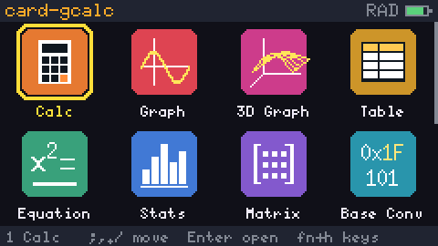
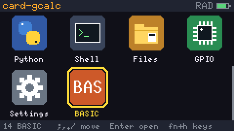
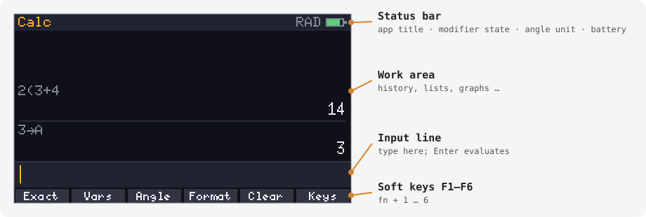
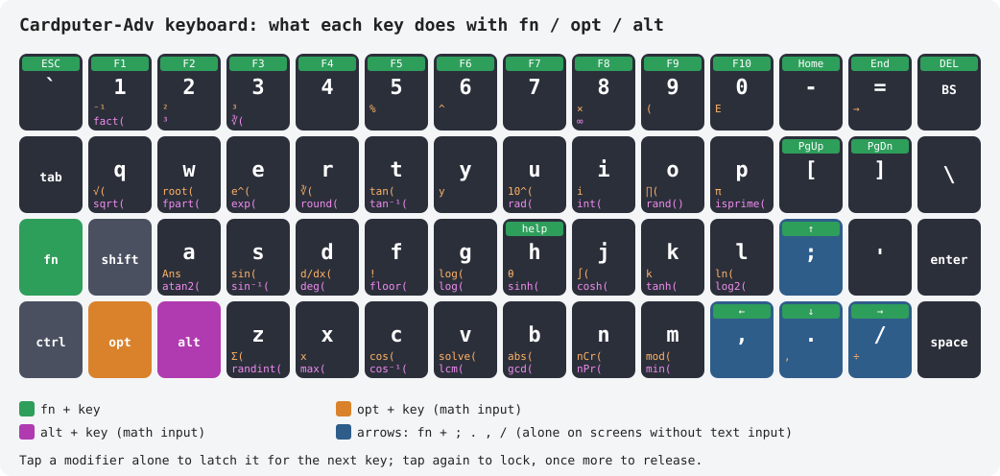
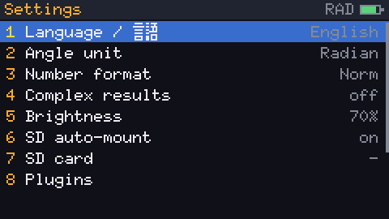
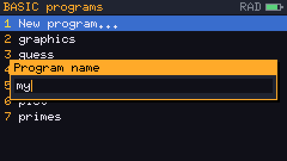
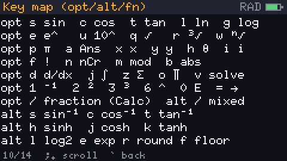

# Basics

[← Contents](README.md)

This page covers operations shared by all apps.

## Startup and the home screen

When you turn the device on, the "card-gcalc" logo appears briefly, followed by the home screen.

| Key | Action |
|---|---|
| ↑ ↓ ← → | Select an app (plain `;` `.` `,` `/` also work) |
| Enter / Space | Open the selected app |
| `1`–`9`, `0` | Open the app with that number right away (`0` is app 10, Shell) |
| `fn`+`h` | Show the key assignments |

- The bottom line shows the number and name of the selected app.
- Eight apps fit on one screen. Press ↓ to scroll to the next rows; the thin bar on the right shows the scroll position.
- Installed plugins appear after Settings ([Plugins](plugins.md)).
- To leave an app, press ESC (`fn`+`` ` ``) on the app's first screen. You return to the home screen.

## The screen

The screen is 240×135 pixels. Most apps use these four areas:

| Area | Contents |
|---|---|
| Status bar | The app name on the left; modifier state, angle unit (RAD / DEG / GRA) and battery level on the right |
| Work area | The app's content: history, lists, graphs … |
| Input line | Where you type expressions or values (on some screens) |
| Soft keys | The bottom row. F1–F6 (`fn`+`1`–`6`) run the functions shown there |

## The keyboard

### Keys used with fn

| Key | Function |
|---|---|
| `fn`+`;` `.` `,` `/` | ↑ ↓ ← → |
| `fn`+`` ` `` | ESC (back / cancel) |
| `fn`+`1`–`6` | F1–F6 (soft keys) |
| `fn`+`7`–`0` | F7–F10 (only in apps that use them) |
| `fn`+`BS` | DEL (delete the character right of the cursor) |
| `fn`+`-` / `fn`+`=` | Start / end of line (HOME / END) |
| `fn`+`[` / `fn`+`]` | Page up / page down |
| `fn`+`h` | Key assignments (on the home screen and elsewhere) |

- On screens without text input (home screen, menus, graphs …), plain `;` `.` `,` `/` also act as arrows.
- In text fields, `;` `.` `,` `/` type those characters. Use `fn` for the arrows.
- A plain `` ` `` types a backtick in text fields. ESC is always `fn`+`` ` ``.

### Modifier keys

Besides holding `shift` `ctrl` `opt` `alt` `fn` while pressing another key, you can tap them:

| Action | State | Shown in the status bar as |
|---|---|---|
| Tap and release | Latched: applies to the next key only | Colored text (e.g. `opt`) |
| Tap again | Locked: applies until released | Black text on a colored band |
| Tap once more | Released | Indicator disappears |

The status bar shows `fn`, `SFT` (shift), `ctl` (ctrl), `opt` and `alt`. Latching is handy for typing `opt`+`s` and similar keys with one hand.

## Menus

Every list you choose from works the same way.

| Key | Action |
|---|---|
| ↑ ↓ | Select an item (wraps around at the ends) |
| Enter / → | Choose |
| ESC / ← | Go back without choosing |
| `1`–`9` | Choose the item with that number right away |
| `fn`+`[` / `fn`+`]` | Move one page |

The text on the right of an item is its current value.

## Input fields and dialogs

These keys work wherever you type an expression or a name.

| Key | Action |
|---|---|
| ← → | Move the cursor (tokens such as `sin(` count as one character) |
| `fn`+`-` / `fn`+`=` | Start / end of line |
| `BS` | Delete left of the cursor |
| `fn`+`BS` | Delete right of the cursor |
| `ctrl`+`u` | Clear the input |
| Enter | Confirm |
| ESC | Cancel |

- In math fields, `*` types `×` and `/` types `÷`.
- If a field already holds a value, typing replaces it. Press ← or → first to edit the value instead.

### Messages and confirmations

- A message closes when you press any key.
- In a confirmation ("Delete …?"), Enter (or `y`) proceeds and ESC cancels.

### Text viewer

Long text such as help or error details is shown in a text viewer.

| Key | Action |
|---|---|
| ↑ ↓ | Scroll one line |
| ← → / `fn`+`[` `fn`+`]` | Scroll one page |
| Enter / ESC | Close |

The bottom left shows "last line shown / total lines".

## Typing math

In fields that take math (Calc, Graph, Table, Equation …), `opt` and `alt` insert functions and symbols. In the keyboard diagram, orange is `opt` and purple is `alt`.

| Key | `opt` | `alt` |
|---|---|---|
| `s` / `c` / `t` | sin( cos( tan( | sin⁻¹( cos⁻¹( tan⁻¹( |
| `l` / `g` / `e` | ln( log( e^( | log2( log( exp( |
| `q` / `r` / `w` | √( ∛( root( | sqrt( round( fpart( |
| `u` | 10^( | rad( |
| `h` / `j` / `k` | θ ∫( k | sinh( cosh( tanh( |
| `p` / `a` / `x` / `y` / `i` | π Ans x y i | isprime( atan2( max( — int( |
| `f` / `n` / `m` / `b` | ! nCr( mod( abs( | floor( nPr( min( gcd( |
| `d` / `z` / `o` / `v` | d/dx( Σ( ∏( solve( | deg( randint( rand() lcm( |
| `1` / `2` / `3` / `6` / `0` | ⁻¹ ² ³ ^ E (×10ⁿ) | fact( ³ ∛( |
| `8` | × | ∞ (Stats distribution bounds) |
| `=` / `8` / `/` / `5` / `9` / `.` | → × ÷ % ( , (`/` is a fraction on the Calc screen) | — ∞ mixed number (Calc screen) — — — |

Press `fn`+`h` to see this list on the device.

Writing expressions:

- The multiplication sign can be omitted: `2x`, `3(x+1)`, `(a)(b)`, `2sin(π/6)`
- Closing parentheses at the end can be omitted: `√(2` means `√(2)`.
- Store to a variable with `→` (`opt`+`=`): `3→A`. `A=…` also works.
- Powers use `^` (`opt`+`6`) or `²` `³` `⁻¹`; powers of ten use `E` (`opt`+`0`): `1.5E-3`
- Integrals, derivatives, sums: `∫(x²,0,3)`, `d/dx(x³,2)`, `Σ(k²,k,1,10)`, `solve(x²-2,1)`
- `Ans` (`opt`+`a`) is the previous answer.

The calculator apps compute with 15 decimal digits, so `0.1+0.2-0.3` is 0 and `sin(π)` is 0. See [Calc](apps/calc.md) for details.

## Saved data

| What | Where |
|---|---|
| Settings, variables, graph functions, statistics lists, matrices … | `/data` on the device (saved automatically) |
| Python and BASIC programs | `/programs` on the device, `/sd/programs` on the SD card |
| Plugins | `/plugins` on the device, `/sd/plugins` on the SD card |

Everything stays when the power is off. To back up to a PC, see [Working with a PC](pc.md#backup-and-restore). To clear `/data`, use "Reset all data" in [Settings](apps/settings.md).

## Safe mode

Hold the `G0` button or the `` ` `` key while the logo is shown at startup to stop in the MicroPython REPL (over USB) instead of starting the calculator. Use this if a program keeps the device from starting ([Working with a PC](pc.md#safe-mode-and-main_userpy)).
