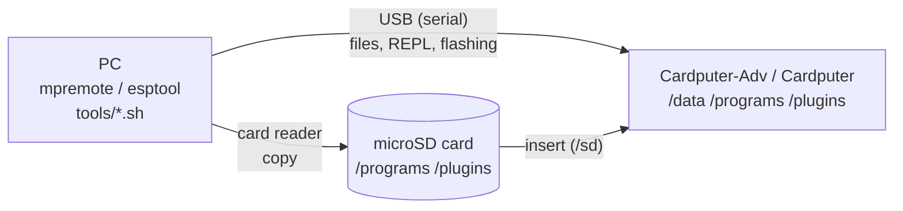

# Working with a PC

[← Contents](README.md)

Connect the device to a PC with a USB cable, or exchange files on an SD card.



| To … | Use |
|---|---|
| Write a program on the PC and run it on the device | [mpremote](#transferring-files-with-mpremote) to `/programs`, or an [SD card](#using-an-sd-card) |
| Back up your data | [Copy /data with mpremote](#backup-and-restore) |
| Install a plugin | [Installing plugins](#installing-plugins) |
| Update the firmware | [Flash with esptool](#flashing-firmware) |
| Try scripts from the PC | The [REPL](#repl) or the [simulator](#simulator) |

## Connecting over USB

Connect the device's USB-C port to the PC. It shows up as a USB serial port (the ESP32-S3's built-in USB-Serial/JTAG); no driver is needed.

| OS | Example device name |
|---|---|
| macOS | `/dev/cu.usbmodem1101` |
| Linux | `/dev/ttyACM0` |
| Windows | `COM3` |

### Software you need

Install Python 3, then:

```sh
pip install mpremote esptool
```

- [mpremote](https://docs.micropython.org/en/latest/reference/mpremote.html): file transfer, REPL, running scripts
- [esptool](https://docs.espressif.com/projects/esptool/): flashing firmware

## Transferring files with mpremote

`mpremote` finds the connected device automatically. With several devices, name the port: `mpremote connect /dev/cu.usbmodem1101 ...`.

```sh
mpremote ls :/                         # list files on the device
mpremote ls :/programs
mpremote cp hello.py :/programs/       # PC → device
mpremote cp :/programs/hello.py .      # device → PC
mpremote cp -r mydir :/programs/       # a whole folder
mpremote rm :/programs/old.py          # delete
mpremote mkdir :/programs/lib          # make a folder
mpremote soft-reset                    # restart the calculator
```

- Paths starting with `:` are on the device.
- Connecting with mpremote stops the running calculator. When you are done, run `mpremote soft-reset` or power-cycle the device. You can chain commands with `+` (`mpremote cp a.py :/programs/ + soft-reset`).
- Changes show up in the [Files](apps/files.md) app right away.

### Files on the device

| Path | Contents |
|---|---|
| `/programs` | Python (`.py`) and BASIC (`.bas`) programs, listed in the [Python](apps/python.md) app |
| `/data` | Settings, variables, graph functions, statistics lists, matrices and other data (JSON) |
| `/plugins` | Plugins |
| `/sd` | The SD card (when inserted and mounted) |
| `/boot.py` | MicroPython's boot script (do not change it) |
| `/main_user.py` | If present, runs instead of the calculator ([below](#safe-mode-and-main_userpy)) |

The flash file system is about 4.9MB.

### Transfer a program and run it

1. Write a script on the PC.

   ```python
   # hello2.py
   import cardgcalc
   cardgcalc.cls()
   cardgcalc.text("Hello from PC", 10, 60, "yellow", font="large")
   cardgcalc.wait_key()
   ```

2. Copy it to the device and restart the calculator.

   ```sh
   mpremote cp hello2.py :/programs/ + soft-reset
   ```

3. On the device, open the [Python](apps/python.md) app, choose `hello2` and run it.

BASIC programs (`.bas`) copied to `/programs` the same way appear in BASIC's `FILES`.

## Backup and restore

Calculator data is in `/data` and programs are in `/programs`.

```sh
# back up into a folder named backup on the PC
mkdir backup
mpremote cp -r :/data :/programs backup/

# restore
mpremote cp -r backup/data backup/programs :/ + soft-reset
```

Flashing firmware does not touch the file system. Files are lost only when the whole flash is erased (`esptool erase-flash`). "Reset all data" in [Settings](apps/settings.md) clears only `/data`; programs and plugins remain.

## Using an SD card

Format the microSD card as FAT (FAT32).

- When inserted, it is mounted at `/sd` (if "SD auto-mount" is on in Settings). Mount and unmount it by hand in [Settings](apps/settings.md) or the [Files](apps/files.md) app.
- Programs in `/sd/programs` are listed just like those in `/programs` on the device.
- Plugins in `/sd/plugins` work too.
- Unmount the card in Files or Settings before removing it.

On the PC, make folders like these with a card reader and copy files into them:

```
(SD card)
  programs/
    hello2.py
    game.bas
  plugins/
    basic/
      plugin.json
      ...
```

## Installing plugins

A plugin works once its folder (containing `plugin.json`) is in `/plugins/` on the device or `/sd/plugins/` on the SD card. After installing, reopen the home screen or restart.

**Method 1: the repository's `tools/plugin.sh` (USB)**

Use this if you have cloned the repository and run `tools/setup.sh`.

```sh
tools/plugin.sh install plugins/basic      # compile to .mpy, copy and restart
tools/plugin.sh install-py plugins/basic   # copy the .py sources (for debugging)
tools/plugin.sh build plugins/basic        # only build .mpy files in build/plugins/basic
tools/plugin.sh remove basic               # delete from the device
```

It uses the first `/dev/cu.usbmodem*` port. For another port, set `PORT`: `PORT=/dev/ttyACM0 tools/plugin.sh install ...`.

**Method 2: mpremote (USB)**

After unpacking a release's `basic-plugin-*.zip` or similar:

```sh
mpremote mkdir :/plugins               # first time only (an error if it exists is harmless)
mpremote cp -r basic :/plugins/ + soft-reset
```

**Method 3: SD card**

On the PC, copy the `basic` folder to `/plugins/` on the SD card and insert the card.

**Method 4: the Files app**

Copy a plugin folder from the SD card to `/plugins` on the device with the [Files](apps/files.md) app.

To delete a plugin, use Plugins in [Settings](apps/settings.md).

## REPL

`mpremote` (or `mpremote repl`) connects to MicroPython's REPL (`>>>`) on the device. The calculator stops.

```
$ mpremote
Connected to MicroPython at /dev/cu.usbmodem1101
>>> 1 + 2
3
>>> import os; os.listdir("/programs")
['hello.py', 'primes.py', ...]
```

- `ctrl`+`]` (or `ctrl`+`x`) quits mpremote.
- `ctrl`+`d` restarts the calculator.

The `cardgcalc` module also works from the REPL and `mpremote run`; it initializes the screen and keyboard on first use:

```python
import cardgcalc
cardgcalc.cls("blue")
cardgcalc.text("from PC", 10, 10, "yellow", font="large")
cardgcalc.show()     # the REPL does not refresh the screen automatically
```

You can also run a script from the PC on the device without copying it:

```sh
mpremote run myscript.py
```

`print()` output appears in the PC's terminal. Run `mpremote soft-reset` afterwards to return to the calculator.

## Flashing firmware

Download the complete firmware for your model from the [releases](https://github.com/MinoruInachi/card-gcalc/releases) and write it at address 0x0:

| Model | File |
|---|---|
| Cardputer-Adv | `card-gcalc-adv-vX.Y.bin` |
| Cardputer | `card-gcalc-cardputer-vX.Y.bin` |

```sh
python3 -m esptool --chip esp32s3 --baud 921600 write-flash 0x0 card-gcalc-adv-vX.Y.bin
```

- Releases up to 0.3 were for the Cardputer-Adv only (`card-gcalc-vX.Y.bin`).
- The firmware for the wrong model does not work: the keyboard does not respond. The Cardputer-Adv firmware shows "wrong model" on the splash screen when written to a Cardputer. Write the right one again.

- A device already running card-gcalc can be flashed as is (esptool puts it into download mode).
- If other firmware is installed or flashing fails, enter download mode by hand: turn the power off, unplug USB, hold the `G0` button and plug USB back in. Power-cycle the device when flashing is done.
- The file system (FAT) area is not written, so your data, programs and plugins remain.
- To build from source, see the repository [README](../README.md#building-and-flashing).

Flash layout:

| Address | Contents |
|---|---|
| 0x0 | Bootloader |
| 0x8000 | Partition table |
| 0x10000 | App (MicroPython and card-gcalc, 3MB) |
| (rest) | File system (FAT, about 4.9MB) |

## Safe mode and /main_user.py

- **Safe mode**: hold the `G0` button or the `` ` `` key while the logo is shown at startup to stop in the REPL instead of starting the calculator. If a broken `/main_user.py` or plugin locks you out, start in safe mode and fix or delete the file with mpremote.
- **/main_user.py**: if this file exists, it runs at startup instead of the calculator. Use it to start your own app automatically. Delete it to get the calculator back (`mpremote rm :/main_user.py`).

## Developer tools

The repository ([README](../README.md#development)) includes development tools.

| Tool | Description |
|---|---|
| `tools/dev.sh push [files]` | Copy `src/cardgcalc` (or the given files) to `/cardgcalc` on the device. These take precedence over the built-in copies, so you can test changes without rebuilding |
| `tools/dev.sh clean` | Remove those copies |
| `tools/dev.sh reset` / `repl` / `run file.py` | Restart, REPL, run a script |
| `tools/plugin.sh` | Build and copy plugins (above) |
| `tools/devsim.py` | Feed a key script to the device and capture the screen as PNG |
| `tools/sim.py`, `tools/simshot.py` | The PC simulator (below) |

### Simulator

The calculator's screen and keys can be reproduced with MicroPython's unix port on a PC, using the build made by `tools/setup.sh`.

```sh
M=deps/micropython/ports/unix/build-standard/micropython
$M tools/sim.py cardgcalc.app:main '1 "1+2×3" ENTER @calc' sim_out
python3 tools/simshot.py sim_out 3     # writes sim_out/calc.png
```

- The second argument is a key script: `"..."` types text; `ENTER` `ESC` `UP` `F1` `opt+s` and so on press keys; `@name` saves the screen (see the top of `tools/sim.py`).
- Long key scripts can also be read from a file: pass `@@file`.
- The simulator's file system is `sim_out/fs`. Copy a plugin into it with `tools/plugin.sh sim plugins/basic`.
- The screenshots in this manual were made with the simulator.
