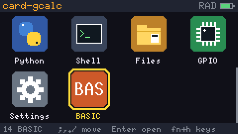
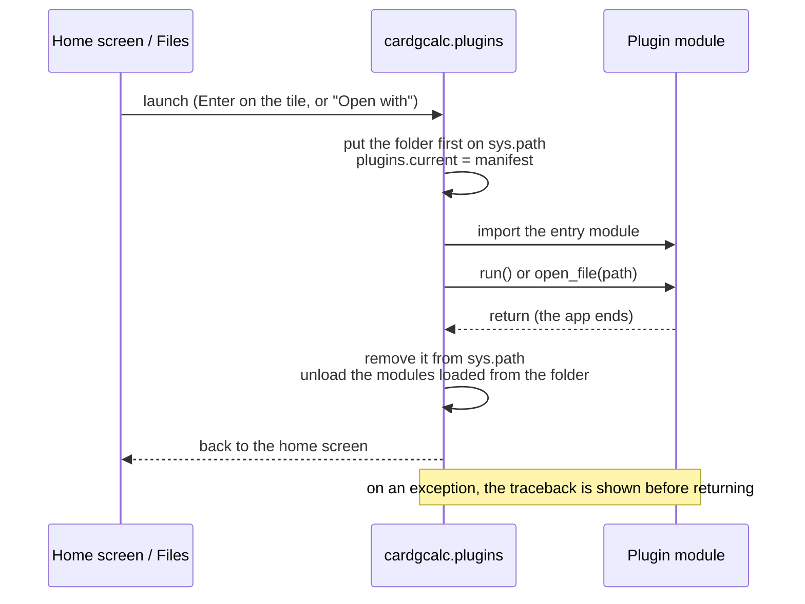
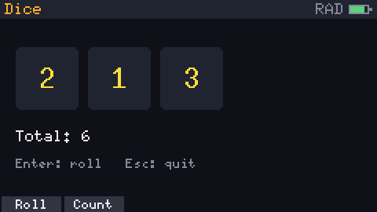
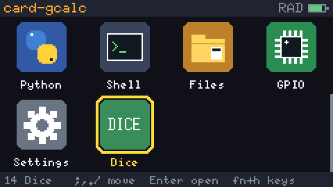
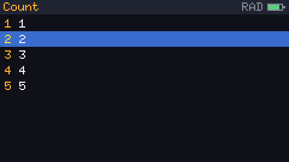

# Plugins

[← Contents](README.md)

Plugins add apps without reflashing the firmware. You write them in Python and simply place them as files on the device or the SD card. [BASIC](basic.md) is included as a sample.



## How plugins work

A plugin is a folder holding `plugin.json` (the manifest) and Python modules.

```
/plugins/                   on the device's flash
  dice/                     ← the folder name is the plugin ID
    plugin.json             manifest
    dice.py (.mpy)          entry module (defines run())
    ...                     other modules and data
/sd/plugins/                on the SD card (same layout)
```

- Each time the home screen is shown, card-gcalc looks in `/plugins` and `/sd/plugins`. If both hold a plugin with the same ID, the one on the device wins.
- Plugins appear on the home screen after the built-in apps (after Settings).
- If `plugin.json` lists file extensions in `files`, the [Files](apps/files.md) app offers the plugin under "Open with" for those files.
- In [Settings](apps/settings.md) → Plugins you can enable or disable plugins, show their info and delete them.

What happens when a plugin starts:



## Tutorial: Dice

Let's write a tiny plugin that rolls dice. Enter rolls again, F2 changes the number of dice and ESC quits.



### 1. Folder and manifest

On your PC, make a folder named `dice` containing `plugin.json`:

```json
{
  "api": 1,
  "name": "Dice",
  "name_ja": "サイコロ",
  "version": "1.0",
  "glyph": "DICE",
  "color": [60, 140, 90],
  "files": [".dice"],
  "description": "Roll dice",
  "description_ja": "サイコロを振る"
}
```

There is no `module` key, so the entry module has the folder's name, `dice`.

### 2. Entry module

Put `dice.py` in the same folder:

```python
# Dice: a minimal card-gcalc plugin.
import random
from cardgcalc import hal, gfx, ui, plugins

T = plugins.translator({
    "Dice": "サイコロ",
    "Roll": "振る",
    "Count": "個数",
    "Total": "合計",
    "Enter: roll   Esc: quit": "Enter: 振る   Esc: 終了",
})


def draw(values):
    gfx.fill()
    ui.status_bar(T("Dice"))
    f = gfx.font("large")
    x = 10
    for v in values:
        gfx.round_rect(x, 30, 40, 40, gfx.PANEL)
        f.text(str(v), x + 15, 40, gfx.YELLOW)
        x += 46
    gfx.font("normal").text("%s: %d" % (T("Total"), sum(values)), 10, 82, gfx.FG)
    gfx.font("small").text(T("Enter: roll   Esc: quit"), 10, 100, gfx.DIM)
    ui.softkeys([T("Roll"), T("Count")])
    gfx.show()


def roll(n):
    return [random.randint(1, 6) for _ in range(n)]


def run(n=2):
    values = roll(n)
    while True:
        draw(values)
        k = hal.wait_key()
        if k.key == hal.ESC:
            return
        if k.key in (hal.ENTER, " ", "F1"):
            values = roll(n)
        elif k.key == "F2":
            i = ui.menu(T("Count"), ["1", "2", "3", "4", "5"], n - 1)
            if i is not None:
                n = i + 1
                values = roll(n)


def open_file(path):
    # A .dice file holds the number of dice, e.g. "3".
    try:
        with open(path) as f:
            n = int(f.read().strip())
    except (OSError, ValueError):
        ui.error("Bad file: " + path)
        return
    run(max(1, min(5, n)))
```

Key points:

- `run()` is the app. Return from it when ESC is pressed to go back to the home screen.
- Draw with `gfx` and call `gfx.show()` at the end.
- `ui.status_bar()` and `ui.softkeys()` give the same look as the built-in apps.
- `hal.wait_key()` waits for a key press and returns a `Key` object; `k.key` holds `"a"`, `"ENTER"`, `"ESC"`, `"F2"` and so on.
- `ui.menu()` shows the standard menu and returns the chosen index (`None` on ESC).
- `open_file(path)` is called when you open a `.dice` file from the Files app.

### 3. Install

Use any of these:

| Method | Steps |
|---|---|
| USB (repository tool) | `tools/plugin.sh install path/to/dice` (compiles to .mpy, copies, restarts) |
| USB (mpremote) | `mpremote mkdir :/plugins` (first time only), then `mpremote cp -r dice :/plugins/` and `mpremote soft-reset` |
| SD card | On the PC, copy the `dice` folder to `/plugins/` on the SD card, then insert the card |

See [Working with a PC](pc.md#installing-plugins) for details. When the home screen is shown again, "Dice" appears after Settings.

| Home screen | Choosing the count |
|---|---|
|  |  |

## plugin.json

| Key | Description |
|---|---|
| `api` | Plugin API version the plugin targets (default 1). If it is newer than the firmware's version (`cardgcalc.plugins.API`, currently 1), the plugin is not loaded and the plugin list in Settings shows "API" |
| `name` | Home-screen label. Defaults to the folder name |
| `name_ja` | Label used when the display language is Japanese |
| `version` | Version, shown on the info screen in Settings |
| `module` | Entry module name. Defaults to the folder name |
| `icon` | A built-in icon: `calc` `graph` `graph3d` `table` `equation` `stats` `matrix` `basen` `python` `editor` `shell` `files` `gpio` `settings` `sequence` `units`. Takes precedence over `glyph` |
| `glyph` | 1–4 characters drawn on the tile. Defaults to the first 3 letters of the folder name in uppercase |
| `color` | Tile color `[r, g, b]` |
| `files` | List of file extensions the plugin opens (e.g. `[".bas"]`), case-insensitive |
| `description` / `description_ja` | Description shown on the info screen in Settings |

All keys are optional. Folders without `plugin.json`, or whose `plugin.json` is not valid JSON, are ignored.

## Rules for the entry module

| Item | Description |
|---|---|
| `run()` | Called when the plugin is opened from the home screen. Return when the app is done |
| `open_file(path)` | Called from "Open with" in the Files app (needed only if you set `files`) |
| `sys.path` | While the plugin runs, its folder is first on `sys.path`, so modules in the same folder can be imported directly |
| `cardgcalc.plugins.current` | The plugin's own manifest (a dict). `current["dir"]` is the folder path and `current["id"]` the folder name |
| After it returns | Modules loaded from the plugin's folder are removed from `sys.modules` |
| Exceptions | An uncaught exception shows its traceback on the screen, then you return to the home screen |
| Modifier keys | Latched or locked modifiers are released when the plugin returns |

Read data files from the plugin's folder with `current["dir"]`:

```python
from cardgcalc import plugins
d = plugins.current["dir"]
with open(d + "/data.txt") as f:
    ...
```

## Firmware modules

Plugins can use the firmware's own modules directly. The main ones:

| Module | Main features |
|---|---|
| `cardgcalc` | The script API ([cardgcalc module API](api.md)) for quick drawing and key input |
| `cardgcalc.hal` | Hardware: `W`, `H` (240, 135), `wait_key(timeout_ms=-1)` (returns a `Key`, or `None` on timeout), `keyboard`, `display`, `rgb(r, g, b)`, key names `UP` `DOWN` `LEFT` `RIGHT` `ENTER` `ESC` `BS` `DEL` `TAB`, modifier bits `SHIFT` `CTRL` `OPT` `ALT` `FN`, `IS_DEVICE` |
| `cardgcalc.gfx` | Drawing: `fill(c)`, `fb()` (the MicroPython FrameBuffer), `font(name)` (`.text(s, x, y, fg, bg)`, `.width(s)`, `.clip(s, w)`, `.h`), `rect`, `line`, `round_rect`, `show()`. Colors `BG` `PANEL` `FG` `DIM` `ACCENT` `SEL` `OK` `ERR` `YELLOW` … |
| `cardgcalc.ui` | Screen parts: `status_bar(title)`, `softkeys(labels)`, `menu(title, items, sel)`, `choose(title, options, current)`, `message(title, lines)`, `error(msg)`, `confirm(title)`, `input_line(title, text, math)`, `input_number(title, value)`, `text_view(title, lines)`, `busy(msg)`. Content area bounds `TOP` (12) and `BOT` (124) |
| `cardgcalc.console` | `Console(title)`: a scrolling text screen with `print()`, `write(s, color)`, `input(prompt)`, `readline(prompt, history)`, `clear()`, `draw()`, `wait_end()` |
| `cardgcalc.editor` | `edit(path, syntax=None)`: open a file in the editor; returns `"run"` if the user left with ctrl+r |
| `cardgcalc.runner` | `start(con)` / `stop()`: break-key watch and automatic screen refresh. `check()`: raise KeyboardInterrupt if the break key was pressed |
| `cardgcalc.storage` | `PROGRAMS`, `PLUGINS`, `SD`, `sd_mounted()`, `exists(p)`, `isdir(p)`, `load_json(name)`, `save_json(name, obj)` (stored in `/data`) |
| `cardgcalc.settings` | `get(key)`, `set(key, value)`. `get("lang")` is `"en"` or `"ja"` |
| `cardgcalc.plugins` | `current`, `translator(table)`, `API` |

`ui` functions translate the strings you pass them automatically (see [Translation](#translation)).

### Long computations and the break key

For long computations, wrap the work in `runner.start(con)` and `runner.stop()` so that ESC or `ctrl`+`c` can interrupt it (on the device this raises `KeyboardInterrupt`).

```python
from cardgcalc import runner
from cardgcalc.console import Console

con = Console("Work")
runner.start(con)
try:
    for i in range(1000000):
        ...
        if i % 1000 == 0:
            runner.check()   # cooperative check (needed in the simulator)
except KeyboardInterrupt:
    con.print("stopped")
finally:
    runner.stop()
con.wait_end()
```

Between `runner.start()` and `runner.stop()`, `print()` output goes to `con`, and drawing done through the `cardgcalc` module is copied to the display automatically.

## Translation

`cardgcalc.plugins.translator(table)` makes a translation function for your plugin. `table` is a `{English: Japanese}` dictionary.

```python
from cardgcalc import plugins
T = plugins.translator({"Roll": "振る", "Line %d: %s": "%d 行目: %s"})
T("Roll")          # "振る" in Japanese display, "Roll" in English
```

- Strings not in your table are looked up in the firmware's table; if not found there either, the English text is returned.
- For a string containing `": "`, such as `"Bad file: /x.dice"`, the part before it (`"Bad file"`) is translated if it is in the table.
- Strings passed to `ui.menu()` and friends are translated with the firmware's table automatically. Pass your plugin's own words through `T()` first.

## Using the editor for another language

Pass an object with the attributes below as `syntax` to `cardgcalc.editor.edit(path, syntax)` to change syntax highlighting, snippets and auto-indent for a language other than Python. The BASIC plugin does this.

| Attribute | Description |
|---|---|
| `highlight(line, state)` | Split a line into `([(text, color), ...], state carried to the next line)` |
| `multiline` | `True` if state carries over to the next line (multi-line strings or comments) |
| `snippets` | `{key: text}` inserted with `opt`+key |
| `indent_after(line)` | `True` to indent the line after `line` |

Use the colors `C_KW` (keywords), `C_BI` (built-ins), `C_STR` (strings), `C_NUM` (numbers), `C_COM` (comments), `C_OP` (operators) and `C_TXT` (other) from `cardgcalc.editor` to match Python's highlighting. You can also subclass `cardgcalc.editor.Syntax` and override only what you need.

```python
from cardgcalc import editor

class MySyntax(editor.Syntax):
    multiline = False
    snippets = {"p": "print "}

    def highlight(self, line, state=None):
        if line.lstrip().startswith("#"):
            return [(line, editor.C_COM)], None
        return [(line, editor.C_TXT)], None

    def indent_after(self, line):
        return line.rstrip().endswith("{")

r = editor.edit("/programs/test.my", MySyntax())
```

## Compiling to .mpy

Plugins run as `.py` files, but compiled `.mpy` files load faster and use less RAM. The RAM heap is only about 176KB, so compile large plugins to `.mpy`.

```sh
tools/plugin.sh build path/to/dice     # writes .mpy files to build/plugins/dice
```

`.mpy` files are made with the MicroPython v1.29 `mpy-cross` (built by `tools/setup.sh`). If the firmware's MicroPython version changes, you may need to rebuild them.

## Development tips

- Try plugins in the PC simulator: `tools/plugin.sh sim path/to/dice` copies the plugin into the simulator's file system; run it with `tools/sim.py` ([Working with a PC](pc.md#simulator)).
- On the device, `tools/plugin.sh install-py path/to/dice` installs the `.py` sources, so error line numbers are easy to follow.
- Tracebacks are shown both on the screen and on the USB serial port (REPL).
- `print()` output goes to the USB serial port, which is handy for debugging.
