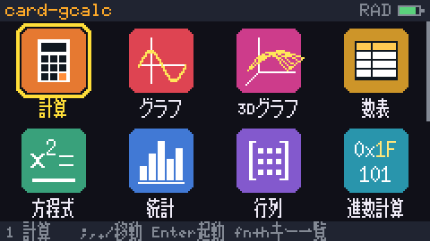

# card-gcalc 取扱説明書

[English](../doc/README.md)

card-gcalc は、M5Stack Cardputer-Adv と Cardputer をグラフ電卓にするファームウェアです。ファームウェアは機種ごとに分かれています。使える GPIO のピン (Cardputer には拡張ヘッダ EXT がない) のほかは、どちらも同じように使えます。この説明書では、電卓の操作、各アプリの使い方、Python スクリプトの API、プラグインの作り方、PC との連携を説明します。

## 目次

### はじめに

- [基本操作](basics.md): キーボード、画面の見方、ホーム画面、メニューと入力欄、数式の入力

### アプリ

| # | アプリ | 内容 |
|---|---|---|
| 1 | [計算](apps/calc.md) | 10 進 15 桁の計算、分数・帯分数の入力と計算、変数、√・π の厳密表示、複素数 |
| 2 | [グラフ](apps/graph.md) | y=f(x)・極座標・媒介変数のグラフ、トレース、解析 (根・極値・交点・積分) |
| 3 | [3Dグラフ](apps/graph3d.md) | 曲面・直線・平面・球などの 3D 表示、断面、交わりと位置関係 |
| 4 | [数表](apps/table.md) | 関数の数表 |
| 5 | [方程式](apps/equation.md) | 多項式、連立 1 次方程式、ソルバ |
| 6 | [統計](apps/stats.md) | 1 変数・2 変数統計、回帰、統計グラフ、確率分布 |
| 7 | [行列](apps/matrix.md) | 行列の計算 (det、逆行列、RREF、Ax=b など) |
| 8 | [進数計算](apps/basen.md) | 2・8・10・16 進の変換とビット演算 |
| 9 | [Python](apps/python.md) | スクリプトの作成・編集・実行 |
| 10 | [シェル](apps/shell.md) | Python の対話環境 (REPL) |
| 11 | [ファイル](apps/files.md) | フラッシュと SD カードのファイル操作 |
| 12 | [GPIO](apps/gpio.md) | Grove・拡張ヘッダの入出力、I2C スキャン |
| 13 | [設定](apps/settings.md) | 角度単位、表示形式、言語、プラグインの管理など |

### プログラミング

- [cardgcalc モジュール API](api.md): Python スクリプトから画面・キーボード・GPIO を使う (turtle、matplotlib、ulab も)
- [プラグイン](plugins.md): ファームウェアを書き直さずにアプリを追加する方法
- [BASIC](basic.md): サンプルプラグインの構造化 BASIC

### PC との連携

- [PC との連携](pc.md): USB 接続、ファイルの転送とバックアップ、ファームウェアの書き込み、プラグインのインストール

## 表記について

- キーは `fn`、`;` のように表します。`fn`+`;` は「`fn` を押しながら `;`」です (修飾キーは先に押して離してもかまいません。[基本操作](basics.md#修飾キー)を参照)。
- ↑ ↓ ← → は矢印キー (`fn`+`;` `.` `,` `/`) です。
- ESC は `fn`+`` ` `` です。
- F1〜F6 は画面下のソフトキーで、`fn`+`1`〜`6` で押します。
- 画面の表示は、設定の「Language / 言語」で日本語にしたときのものです。
