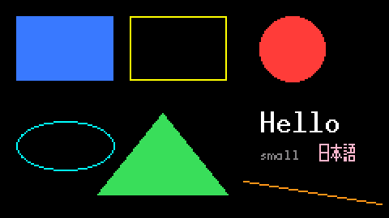
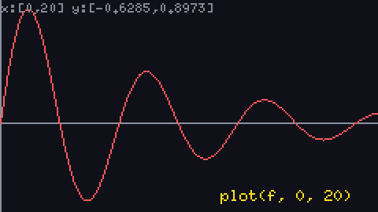
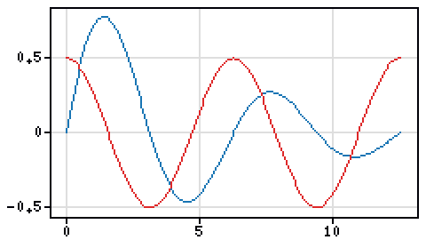

# cardgcalc モジュール API

[← 目次](README.md)

Python スクリプトから、画面・キーボード・GPIO などを使うためのモジュールです。スクリプトの作り方と実行のしかたは [Python](apps/python.md) を参照してください。

```python
import cardgcalc

cardgcalc.cls()
cardgcalc.text("Hello", 10, 10, cardgcalc.YELLOW, font="large")
cardgcalc.circle(120, 80, 20, "red", fill=True)
cardgcalc.show()
k = cardgcalc.wait_key()
```

使えるモジュールの全体:

| モジュール | 内容 |
|---|---|
| `cardgcalc` | 画面、キーボード、時間、グラフ、GPIO、RGB LED (この章) |
| `turtle` | タートルグラフィックス ([turtle](#turtle)) |
| `matplotlib.pyplot` | 折れ線・散布図・棒グラフ・ヒストグラム ([matplotlib.pyplot](#matplotlibpyplot)) |
| `ulab` | numpy / scipy 互換の配列計算 ([ulab](#ulab)) |
| `math`、`time`、`random`、`machine`、`os` など | MicroPython の標準モジュール |

## スクリプトの実行について

- `print()` と `input()` は、画面のコンソールにつながります。
- 実行中に ESC (`fn`+`` ` ``) か `ctrl`+`c` を押すと、スクリプトを中断します。`while True: pass` のようなループも止まります。
- 描いた内容は、実行中に自動で画面に反映されます。すぐに反映したいときは `show()` を呼びます。
- グラフィックスを使ったスクリプトが終わると、最後の画面を表示したままキー入力を待ちます。
- スクリプトが import した自作のモジュールは、終了時に解放されます。

## 画面

画面は 240×135 ドットで、原点 (0, 0) は左上です。x は右、y は下に向かって増えます。



```python
import cardgcalc as cg   # 短い名前で使う例
cg.cls()
cg.fill_rect(10, 10, 60, 40, cg.BLUE)
cg.rect(80, 10, 60, 40, "yellow")
cg.circle(180, 30, 20, cg.RED, fill=True)
cg.ellipse(40, 90, 30, 15, "cyan")
cg.poly([(100, 70), (140, 120), (60, 120)], cg.GREEN, fill=True)
cg.text("Hello", 160, 66, cg.WHITE, font="large")
cg.text("small", 160, 92, "gray", font="small")
cg.text("日本語", 196, 90, (255, 180, 200))
cg.line(150, 112, 235, 126, cg.ORANGE)
cg.show()
cg.wait_key()
```

| API | 内容 |
|---|---|
| `W` / `width`、`H` / `height` | 画面の幅 (240) と高さ (135) |
| `cls(c=BLACK)` / `clear(c=BLACK)` | 画面全体を色 c で塗りつぶす |
| `pixel(x, y)` | 点の色を返す (内部の色値) |
| `pixel(x, y, c)` / `set_pixel(x, y, c)` | 点を描く |
| `get_pixel(x, y)` | 点の色を `(r, g, b)` で返す |
| `line(x0, y0, x1, y1, c=WHITE)` | 直線 |
| `hline(x, y, w, c=WHITE)`、`vline(x, y, h, c=WHITE)` | 水平線、垂直線 |
| `rect(x, y, w, h, c=WHITE)` | 長方形の枠 |
| `fill_rect(x, y, w, h, c=WHITE)` | 塗りつぶした長方形 |
| `circle(x, y, r, c=WHITE, fill=False)` | 円 (中心 x, y、半径 r) |
| `ellipse(x, y, rx, ry, c=WHITE, fill=False)` | 楕円 |
| `poly(points, c=WHITE, fill=False)` | 多角形。points は `[(x, y), ...]` |
| `text(s, x, y, c=WHITE, bg=None, font="normal")` | 文字列を描き、描き終えた位置の x 座標を返す。bg=None なら背景は透明 |
| `text_width(s, font="normal")` | 文字列の幅 (ドット) |
| `draw_string(s, x, y, c=(0,0,0), bg=(255,255,255))` | "medium" フォントで、背景付きで描く |
| `show()`、`wait_vblank()` | 描いた内容をすぐ画面に反映する |
| `brightness(pct)` | バックライトの明るさ (0〜100 %) |

### フォント

`text()` などの `font=` に指定します。日本語 (漢字・仮名) は、どのフォントでも 8×12 ドットで表示されます。

| 名前 | 大きさ (幅×高さ) |
|---|---|
| `"small"` | 5×8 |
| `"normal"` | 6×10 |
| `"medium"` | 6×13 |
| `"large"` | 10×20 |

### 色

色を受け取る引数には、次のどれでも渡せます。

- `color(r, g, b)` が返す値 (r, g, b は 0〜255)
- `(r, g, b)` のタプル
- 色名の文字列: `"black"` `"white"` `"red"` `"green"` `"blue"` `"yellow"` `"cyan"` `"magenta"` `"orange"` `"gray"` `"grey"` `"purple"` `"brown"` `"pink"`
- 定数: `BLACK` `WHITE` `RED` `GREEN` `BLUE` `YELLOW` `CYAN` `MAGENTA` `ORANGE` `GRAY` `GREY`

`color()` は `color((r, g, b))` や `color("red")` も受け付けます。

## キーボード

| API | 内容 |
|---|---|
| `get_key()` | 押されたキーを文字列で返す。押されていなければ `None` (待たない) |
| `wait_key()` | キーが押されるまで待ち、そのキーを文字列で返す |
| `key_down(name)` / `keydown(name)` | そのキーが今押されていれば `True` |
| `keys_down()` | 今押されているキーの名前の集合 |

`get_key()` / `wait_key()` は「入力された文字」を返し、`key_down()` は「キーそのもの」を調べます。ゲームなどで同時押しや押しっぱなしを調べるときは `key_down()` を使います。

`get_key()` / `wait_key()` が返す文字列:

| 押したキー | 返る文字列 |
|---|---|
| 文字キー | 入力される文字 (`"a"`、`"A"`、`"1"`、`"!"`、`" "` など) |
| Enter、BS、Tab | `"ENTER"` `"BS"` `"TAB"` |
| `fn` との組み合わせ | `"UP"` `"DOWN"` `"LEFT"` `"RIGHT"` `"ESC"` `"DEL"` `"F1"`〜`"F10"` `"HOME"` `"END"` `"PGUP"` `"PGDN"` |

`key_down()` に渡す名前:

| 名前 | キー |
|---|---|
| `"a"`、`"1"`、`";"` など | キートップの文字 (小文字、シフトしない文字) |
| `"ENTER"` `"BS"` `"TAB"` `"SPACE"` | Enter、BS、Tab、Space |
| `"ESC"` | `` ` `` キー |
| `"UP"` `"DOWN"` `"LEFT"` `"RIGHT"` | `;` `.` `,` `/` キー |
| `"SHIFT"` `"FN"` `"CTRL"` `"OPT"` `"ALT"` | 修飾キー |

キー名の定数 `KEY_*` もあります: `KEY_UP` `KEY_DOWN` `KEY_LEFT` `KEY_RIGHT` (矢印)、`KEY_OK` / `KEY_EXE` (Enter)、`KEY_BACK` (`` ` ``)、`KEY_BACKSPACE`、`KEY_SHIFT`、`KEY_ALPHA` (alt)、`KEY_ZERO`〜`KEY_NINE`、`KEY_PLUS`、`KEY_MINUS` など。

例: 矢印キーで点を動かす

```python
import cardgcalc as cg
x, y = 120, 67
while not cg.key_down("ENTER"):
    if cg.key_down("LEFT"):  x -= 2
    if cg.key_down("RIGHT"): x += 2
    if cg.key_down("UP"):    y -= 2
    if cg.key_down("DOWN"):  y += 2
    cg.cls()
    cg.circle(x, y, 5, "yellow", True)
    cg.text("arrows: move  Enter: quit", 2, 2, "gray", font="small")
    cg.show()
    cg.sleep_ms(20)
```

`key_down("LEFT")` などは `fn` を押さなくても `;` `.` `,` `/` キーで反応します。

## 時間・電源

| API | 内容 |
|---|---|
| `sleep(s)`、`sleep_ms(ms)` | 待つ。待っている間も中断キーと画面の更新が効く |
| `ticks_ms()` | ミリ秒単位のカウンタ (差は `time.ticks_diff()` で求める) |
| `battery()` | 電池残量 (%) |

## グラフ

| API | 内容 |
|---|---|
| `plot(f, xmin=-10, xmax=10, ymin=None, ymax=None, c=None, wait=True)` | y=f(x) のグラフを画面全体に描く |

- `ymin` / `ymax` を省略すると、縦の範囲を自動で決めます。
- `wait=True` なら、描いたあとキーが押されるまで待ちます。`wait=False` なら、すぐに戻るので、続けて文字などを描き足せます。



```python
import math
import cardgcalc
cardgcalc.plot(lambda x: math.sin(x) * math.exp(-x / 8), 0, 20, wait=False)
cardgcalc.text("plot(f, 0, 20)", 140, 120, cardgcalc.YELLOW)
cardgcalc.show()
cardgcalc.wait_key()
```

## GPIO

Grove ポートと拡張ヘッダ (EXT) のピンを使えます。配置は [GPIO](apps/gpio.md) を参照してください。

Cardputer には拡張ヘッダがなく、`PINS` は `(1, 2)` です。G3〜G6・G13・G15 はキーボードの読み取りに使っています。スクリプトでこれらを使うと、再起動するまでキーボードが効かなくなります。

| API | 内容 |
|---|---|
| `G1` `G2` (Grove)、`G3` `G4` `G5` `G6` `G13` `G15` (EXT)、`PINS` | ピン番号の定数と、その一覧 |
| `pin_out(p, v=None)` | p を出力にし、v (0 / 1) を出力する。`machine.Pin` を返す |
| `pin_in(p, pull=None)` | p を入力にして値 (0 / 1) を返す。pull は `None`、`"up"`、`"down"` |
| `analog(p)` | p の電圧 (V、0〜約 3.1) |
| `pwm(p, freq=1000, duty=50)` | PWM 出力 (周波数 Hz、デューティ %)。`duty=None` で停止 |
| `tone(p, freq, ms)` | p につないだ圧電ブザーなどで、音を ms ミリ秒鳴らす |
| `i2c_grove(freq=100000)` | Grove ポート (SDA=G2、SCL=G1) の I2C (`machine.SoftI2C`) |

例: G1 につないだ LED を点滅させ、G2 の電圧を表示する

```python
import cardgcalc
n = 0
while True:
    cardgcalc.pin_out(cardgcalc.G1, n % 2)
    print("G2 = %.2f V" % cardgcalc.analog(cardgcalc.G2))
    n += 1
    cardgcalc.sleep_ms(500)
```

例: I2C 機器を探す

```python
import cardgcalc
i2c = cardgcalc.i2c_grove()
print([hex(a) for a in i2c.scan()])
```

> 注意: ピンには 3.3V を超える電圧をかけないでください。G40・G14・G39 は SD カード、G8・G9 は内蔵のキーボード (I2C)、G21 は RGB LED が使っているので、`machine` モジュールで直接触らないでください。

## RGB LED

本体の RGB LED (フルカラー LED) を点灯できます。Cardputer-Adv と Cardputer のどちらでも使えます。

| API | 内容 |
|---|---|
| `led(r, g, b)` | LED を r, g, b (0〜255) の色で点灯する |
| `led(c)` | 色 c で点灯する。c は `(r, g, b)`、色名 (`"red"` など)、`RED` などの定数、`color()` の値 |
| `led(None)` / `led_off()` | 消灯する (`led(0, 0, 0)`、`led("black")` も同じ) |
| `led()` | 今の色を `(r, g, b)` で返す |
| `led_brightness(pct=None)` | 明るさ (0〜100 %)。どの色にもこの割合がかかる。今の値を返す |

- スクリプトが終わると、LED は消え、明るさは 100 % に戻ります (シェルでは、シェルを終えたとき)。
- LED は最大の明るさだととてもまぶしいので、`led_brightness(10)` 程度に下げて使うのがおすすめです。
- 定数の色 (`RED` など) は画面用の値なので、LED では少しずれた色になります。正確な色は `(r, g, b)` で指定します。

例: LED の色をゆっくり変える

```python
import cardgcalc as cg
cg.led_brightness(20)
for i in range(256):
    cg.led(255 - i, i, 0)   # 赤 → 緑
    cg.sleep_ms(10)
cg.wait_key()
```

## turtle

タートルグラフィックスです。原点は画面の中央、y は上向き、角度は度です。向き 0 は右 (東) です。

```python
from turtle import *
speed(8)
colors = ["red", "orange", "green", "blue", "purple"]
for i in range(36):
    color(colors[i % 5])
    forward(55)
    left(170)
hideturtle()
```

| 関数 | 内容 |
|---|---|
| `forward(d)`、`backward(d)` | 前・後ろに進む |
| `left(a)`、`right(a)` | 左・右に回る |
| `goto(x, y)`、`home()`、`setheading(a)` | 位置・向きを指定する |
| `position()`、`xcor()`、`ycor()`、`heading()`、`towards(x, y)`、`distance(x, y)` | 位置と向きを調べる |
| `penup()`、`pendown()`、`isdown()`、`pensize(s)` | ペンの上げ下げと太さ |
| `color(c)`、`bgcolor(c)` | ペンの色、背景色 (色名か `(r, g, b)`) |
| `speed(s)` | 速さ (0〜10) |
| `circle(r, extent=360)`、`dot(size, c)`、`write(text)` | 円、点、文字 |
| `hideturtle()`、`showturtle()`、`clear()`、`reset()`、`done()` | 表示の制御 |

## matplotlib.pyplot

matplotlib のよく使う関数を、画面に合わせて小さく実装したものです。`show()` でグラフを描き、キーが押されるまで待ちます。



```python
from ulab import numpy as np
import matplotlib.pyplot as plt
x = np.linspace(0, 4 * np.pi, 200)
plt.plot(x, np.sin(x) * np.exp(-x / 6))
plt.plot(x, np.cos(x) * 0.5, "r")
plt.grid(True)
plt.show()
```

| 関数 | 内容 |
|---|---|
| `plot(x, y, fmt)`、`plot(y)` | 折れ線。fmt は色 (`"r"` `"b"` `"g"` `"k"` `"y"` `"c"` `"m"` か色名)。`"o"` を含むと点で描く。y が 2 次元配列なら列ごとに線を描く |
| `scatter(x, y, color)` | 散布図 |
| `bar(x, height, width=0.8)` | 棒グラフ |
| `hist(data, bins=10)` | ヒストグラム (度数と区切りを返す) |
| `text(x, y, s)`、`arrow(x, y, dx, dy)` | 文字、矢印 |
| `axis([xmin, xmax, ymin, ymax])`、`axis("off")`、`xlim()`、`ylim()` | 表示範囲と軸 |
| `grid(True)`、`title(s)` | 目盛り線、タイトル |
| `show()`、`clf()` | 描画、消去 |

`xlabel()`、`ylabel()`、`legend()` は、呼んでもエラーにはなりませんが何もしません。データにはリスト、タプル、range、ulab の配列を使えます。

## ulab

[ulab](https://github.com/v923z/micropython-ulab) は numpy / scipy 互換の配列計算モジュールです (6.12.1、倍精度、2 次元まで)。

```python
from ulab import numpy as np
from ulab import scipy

a = np.array([[2, 1], [1, 3]])
b = np.array([3, 5])
print(np.linalg.inv(a))
print(np.dot(np.linalg.inv(a), b))
x = np.linspace(0, 1, 5)
print(np.mean(x), np.std(x))
```

- 配列の生成: `array`、`linspace`、`arange`、`zeros`、`ones`、`eye` など
- 要素ごとの演算と数学関数: `+ - * /`、`np.sin`、`np.exp`、`np.sqrt` など
- 統計: `mean`、`std`、`min`、`max`、`sum`、`argmax`、`sort` など
- 線形代数 `np.linalg`: `inv`、`det`、`dot`、`eig`、`norm` など
- そのほか: `fft`、`polyfit` / `polyval`、`scipy.optimize`、`scipy.integrate`

## メモリについて

Python が使える RAM (ヒープ) は約 176KB です。大きな配列やリストを作るとメモリ不足 (`MemoryError`) になることがあります。

- 大きなデータは、リストより `ulab` の配列や `array` モジュールを使うと小さくなります。
- 使い終わった大きな変数は `del` で消し、`import gc; gc.collect()` を呼ぶと、メモリが空きます。
- 空きメモリは [設定](apps/settings.md) の「メモリと容量」で確認できます。
