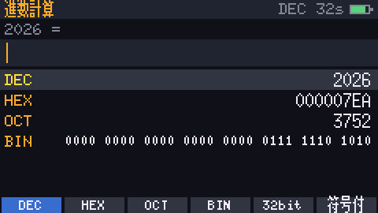
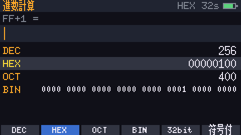
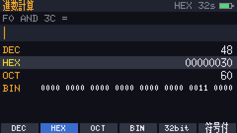
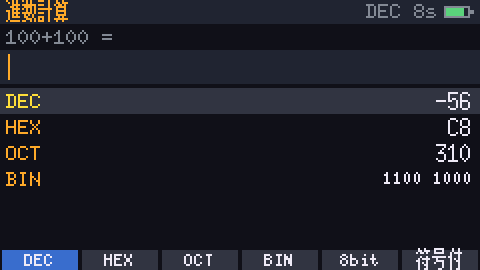
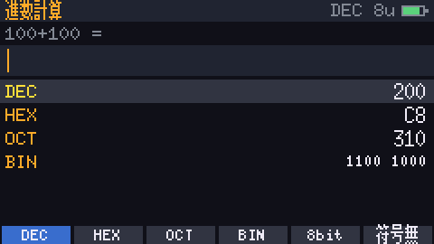

# 進数計算

進数計算は、プログラマー向けの整数計算アプリです。結果を 10 進・16 進・8 進・2 進で同時に表示します。語長 (8・16・32・64 bit) と符号の有無を固定して計算し、ビット演算 (AND、OR、XOR、NOT、シフト) も使えます。

ホーム画面で `8` を押すと開きます。

## 画面構成

| 部分 | 表示内容 |
|---|---|
| ステータスバー (上端) | 「進数計算」と現在の設定 (例: `DEC 32s`)。入力の進数、語長、`s` (符号付) または `u` (符号無) |
| 前の式の行 | 直前の式と `=` (例: `2026 =`)。エラーのときは赤でメッセージ |
| 入力欄 | 入力中の式 |
| DEC / HEX / OCT / BIN | 現在の値を各進数で表示。入力の進数の行は強調され、ラベルが黄色になります |
| ソフトキー (下端) | F1 DEC、F2 HEX、F3 OCT、F4 BIN、F5 語長 (`32bit`)、F6 `符号付` / `符号無`。入力の進数のキーが強調されます |

各行の表示形式:

| 行 | 形式 |
|---|---|
| DEC | 符号付では符号付きの 10 進 (例: `-56`)、符号無では符号なしの 10 進 (例: `200`) |
| HEX | 2 の補数。語長に合わせて 0 で埋めます (32 bit なら 8 桁)。英字は大文字 |
| OCT | 2 の補数。先頭の 0 は付けません |
| BIN | 語のすべてのビットを 4 桁ずつ区切って表示。64 bit は 32 bit ずつ 2 行 |

## 操作

矢印 ↑ ↓ ← → は `fn`+`;` `.` `,` `/` です。進数計算には入力欄があるので、`;` `.` `,` `/` だけを押すと文字の入力になります ([基本操作](../basics.md) を参照)。ESC は `fn`+`` ` `` です。F1〜F6 は `fn`+`1`〜`6` です。

### キー

| キー | 動作 |
|---|---|
| 文字キー | 式を入力 |
| Enter | 計算する。結果が現在の値になり、入力欄は空になる。入力欄が空のときは、直前の式をもう一度計算する |
| ↑ | 直前の式を入力欄に戻して編集 |
| ← / → | カーソル移動 |
| `BS` / DEL (`fn`+`BS`) | カーソルの前 / 後ろを削除 |
| `fn`+`-` / `fn`+`=` | 行頭 / 行末 |
| `ctrl`+`u` | 行を消去 |
| ESC | 入力欄 (とエラー) を消す。入力欄が空ならホーム画面に戻る |
| F1 (DEC) / F2 (HEX) / F3 (OCT) / F4 (BIN) | 入力の進数を選ぶ |
| F5 (`8bit`〜`64bit`) | 語長を変える: 8 → 16 → 32 → 64 → 8 |
| F6 (`符号付` / `符号無`) | 符号付と符号無を切り替える |

入力の進数を変えても、変わるのは新しく入力する数の読み方だけで、現在の値はそのままです。語長や符号を変えると、現在の値を新しい語に切り詰めます (例: 0x1234 は 8 bit で 0x34)。

### 演算子の入力

`opt` (または `alt`) と次のキーで、前後に空白を付けた演算子を入力します。

| キー | 入力される文字 |
|---|---|
| `opt`+`a` | ` AND ` |
| `opt`+`o` | ` OR ` |
| `opt`+`x` | ` XOR ` |
| `opt`+`n` | `NOT ` |
| `opt`+`l` | ` SHL ` |
| `opt`+`r` | ` SHR ` |
| `opt`+`m` | ` MOD ` |

### 数の入力

- 数は入力の進数で読みます。HEX では `FF` が 255、BIN では `101` が 5 です。英字は大文字・小文字のどちらでもかまいません。
- 接頭辞を付けると、その数だけ進数を指定できます。`0x` (16 進) と `0o` (8 進) はすべてのモードで、`0b` (2 進) と `0d` (10 進) は HEX 以外のモードで使えます (HEX では `0B…`、`0D…` は 16 進数です)。
- `ans` は現在の値です。
- 数は読んだ時点で語長に切り詰めます。8 bit 符号付では `200` は -56 になります。

### 演算子

優先順位の低い順:

| 順位 | 演算子 | 意味 |
|---|---|---|
| 1 | `OR` `\|`、`NOR` | ビットごとの OR、OR の否定 |
| 2 | `XOR` `^`、`XNOR` | ビットごとの XOR、XOR の否定 |
| 3 | `AND` `&`、`NAND` | ビットごとの AND、AND の否定 |
| 4 | `SHL` `<<`、`SHR` `>>` | 左シフト、右シフト |
| 5 | `+` `-` | 加算、減算 |
| 6 | `*` `/` `MOD` `%` | 乗算、整数の除算、余り |
| 7 | `-` `+` `NOT` `~` (前置) | 符号反転、NOT (全ビット反転) |

- 括弧 `(` `)` でまとめられます。末尾の `)` は省略できます。
- 演算子の単語は大文字・小文字を区別しません。数とは空白で区切ります (`F0AND3C` ではなく `F0 AND 3C`)。記号には空白は要りません。
- `^` は XOR で、べき乗ではありません。
- `/` は 0 の方向に切り捨てる整数の除算です (`-7/2` は -3)。`MOD` / `%` の余りは左の数と同じ符号です (`-7 MOD 2` は -1)。
- `SHR` は論理シフトです。符号付でも左から 0 が入ります。128 以上シフトすると 0 になります。負のシフト量はエラーです。
- 計算の各段階で語長に切り詰めるので、結果は桁あふれして折り返します (8 bit 符号付では `100+100` は -56)。
- シフトは `+` より優先順位が低いので、`1 SHL 2+1` は `1 SHL 3` = 8 です。

### エラーメッセージ

| メッセージ | 原因 |
|---|---|
| `構文エラー` | 数や演算子が足りない、括弧の対応が合わない |
| `構文エラー: '.'` | 使えない文字 (この例では `.`) |
| `不正な16進数: 12G` | その進数で使えない数字 (10進数・8進数・2進数も同様) |
| `計算エラー: 0除算` | 0 による除算・MOD |
| `負のシフト量` | シフト量が 0 未満 |

## 使用例

### 1. 数を変換する

1. ホーム画面で `8` を押します (ステータスバーが `DEC` でなければ F1 を押します)。
2. `2026` と入力し、Enter を押します。

10 進の 2026 は、HEX `000007EA`、OCT `3752`、BIN `0111 1110 1010` です。

3. F2 (HEX) を押します。`FF+1` と入力し、Enter を押します。

16 進の FF+1 は `00000100`、10 進では 256 です。

### 2. ビット演算

0xF0 を 0x3C でマスクし、結果を 4 ビット左にシフトします。

1. F2 (HEX) を押します。
2. `F0` と入力し、`opt`+`a` を押し、`3C` と入力します。入力欄は `F0 AND 3C` になります。
3. Enter を押します。結果は HEX `00000030` (DEC 48、BIN `0011 0000`) です。

4. `ans` と入力し、`opt`+`l` を押し、`4` と入力して Enter を押します (`ans SHL 4`)。結果は HEX `00000300` (DEC 768) です。

### 3. 8 bit の符号付と符号無

1. F1 (DEC) を押します。
2. キーの表示が `8bit` になるまで F5 を押します (32bit からなら 2 回)。F6 が `符号付` であることを確かめます。
3. `100+100` と入力し、Enter を押します。和は 8 bit からあふれ、DEC は `-56`、HEX は `C8`、BIN は `1100 1000` になります。

4. F6 を押します。表示が `符号無` に変わり、DEC は `200` になります。ビット (`C8`) は同じで、10 進での読み方だけが変わります。

5. `-1` と入力し、Enter を押します。8 bit 符号無では `255` (HEX `FF`、BIN `1111 1111`) です。

### 4. Enter で数える

1. DEC で `ans+1` と入力し、Enter を押します。
2. 入力欄が空のまま Enter を押すと、`ans+1` を繰り返します。押すたびに 1 増えます。

## 注意と制限

- 整数だけを扱います。小数はなく、除算の余りは切り捨てます。
- 語長は 8・16・32・64 bit です。結果はすべてその範囲で折り返します。
- べき乗の演算子はありません。2 のべき乗は `SHL` で求めます (`1 SHL 10` = 1024)。
- 入力の進数、語長、符号、現在の値、直前の式は `/data/basen.json` に保存し、次回に復元します。
- 進数計算は他の電卓アプリの 10 進演算を使わず、変数や Ans も共有しません。

---

[← 目次](../README.md) ・ 共通のキー: [基本操作](../basics.md)
