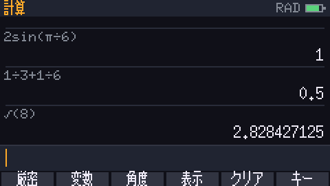
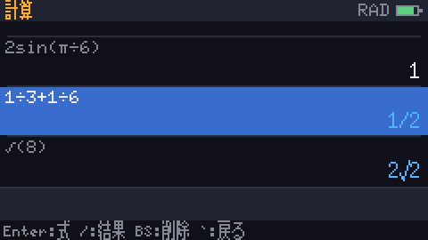
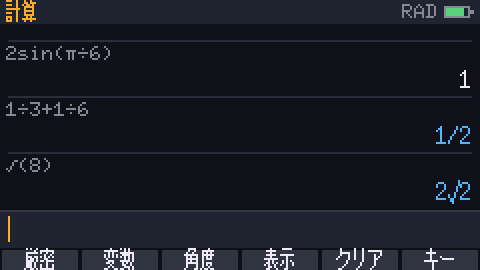
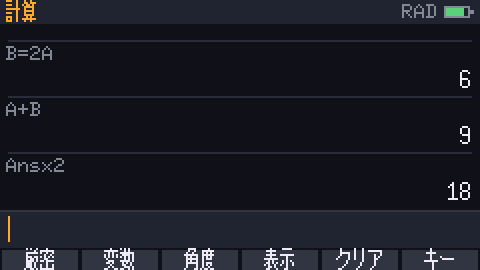
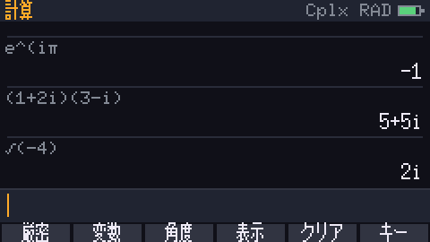

# 計算

計算は、基本の計算画面です。式を入力して `Enter` を押すと、式と結果が入力行の上の履歴に追加されます。変数、前の答え (`Ans`)、分数・π・√ の厳密表示、角度単位、表示形式、複素数を扱えます。

ホーム画面で「計算」のアイコンを選ぶか、`1` を押すと起動します。

このページでは矢印を ↑ ↓ ← → と書きます。`fn`+`;` `.` `,` `/` のことです。ESC は `fn`+`` ` `` です (`` ` `` だけではバッククォートが入力されます)。F1〜F6 は `fn`+`1`〜`6` です。共通のキーと、`opt` / `alt` の数式キーの一覧は [基本操作](../basics.md) を参照してください。

## 画面の見方

| 部分 | 内容 |
|---|---|
| ステータスバー (上) | タイトル「計算」、修飾キーの状態。右側にモードを表示します。複素数がオンなら `Cplx`、表示形式が Norm 以外なら `FIX3` `SCI5` `ENG4` など、角度単位 (RAD / DEG / GRA)、電池残量 |
| 履歴 | これまでの計算。新しいものが下です。左に式 (灰色)、右に結果を表示します。厳密表示は青、エラーは赤で表示します |
| 入力行 | 入力中の式とカーソル |
| ソフトキー (下) | F1 厳密、F2 変数、F3 角度、F4 表示、F5 クリア、F6 キー |

履歴を選んでいる間は、ソフトキーの代わりに `` Enter:式 /:結果 BS:削除 `:戻る `` というヒントを表示します (`` ` `` は ESC のことです)。

## 操作

### 入力行

| キー | 動作 |
|---|---|
| 文字、数字 | 入力行に入力します。`*` は `×`、`/` は `÷` になります |
| `opt` / `alt` + キー | 数式の記号を入力します。例: `opt`+`s` sin(、`opt`+`q` √(、`opt`+`p` π、`opt`+`=` → |
| ← → | カーソルを動かします (`sin(` などは 1 文字として扱います) |
| `BS` / `fn`+`BS` | カーソルの左 / 右を消します (記号はまとめて消えます) |
| `fn`+`-` / `fn`+`=` | 行頭 / 行末 |
| `ctrl`+`u` | 入力行を消します |
| `Enter` | 計算します。入力行が空のときは、最後の式をもう一度計算します |
| ↑ | いちばん新しい履歴を選びます (後述の履歴モード) |
| ESC | 入力行を消します。空のときはホーム画面に戻ります |
| `fn`+`h` | キー割り当ての一覧 (F6 と同じ) |

入力行が空のときに演算子 (`+` `-` `×` `÷` `^` `²` `³` `!` `⁻¹` `→` `%`) から入力すると、先頭に `Ans` が入ります。結果が出た直後に `×2` と打てば `Ans×2` を計算します。

### ソフトキー

| キー | 表示 | 動作 |
|---|---|---|
| F1 | 厳密 | いちばん新しい結果を、小数と厳密表示 (分数、π の倍数、(p/q)√n) で切り替えます。厳密表示できる結果だけが変わります |
| F2 | 変数 | 代入済みの変数と値の一覧 (「変数 (Enter: 挿入)」) を表示します。`Enter` で、選んだ変数名を入力行に入れます |
| F3 | 角度 | 角度単位を RAD → DEG → GRA → RAD と切り替えます。設定アプリの角度単位と同じ設定です |
| F4 | 表示 | 「表示形式」メニューを開きます (下表) |
| F5 | クリア | 履歴をすべて消します (「履歴を消去しますか?」で `Enter` を押すと消去) |
| F6 | キー | `opt` / `alt` / `fn` のキー割り当てを表示します |

**表示形式** メニュー (F4):

| 項目 | 内容 |
|---|---|
| Norm | 有効数字 10 桁まで。とても大きい数や小さい数は E 表記になります |
| Fix | 小数点以下の桁数を固定します。「小数点以下の桁数 (0-9)」を入力します |
| Sci | 指数表記。「有効桁数 (1-10)」を入力します |
| Eng | 工学表記 (指数が 3 の倍数)。「有効桁数 (1-10)」を入力します |
| 複素数: オン / オフ | 複素数の結果を使うかどうかを切り替えます |

表示形式は、方程式・統計・行列の結果にも使われます。

### 履歴モード

入力行で ↑ を押すと、履歴を選べます。選んだ履歴は色が付きます。

| キー | 動作 |
|---|---|
| ↑ ↓ | 古い / 新しい履歴を選びます。いちばん新しい履歴で ↓ を押すと入力行に戻ります |
| `Enter` | 選んだ履歴の式を入力行に入れます |
| → または `/` | 選んだ履歴の結果 (表示中の小数または厳密表示) を入力行に入れます |
| F1 | 選んだ履歴を、小数と厳密表示で切り替えます |
| `BS` / `fn`+`BS` | 選んだ履歴を消します |
| ESC または ← | 入力行に戻ります |
| その他のキー | 入力行に戻り、そのキーを入力行で処理します |

履歴モードでは、`;` `.` `,` `/` だけでも矢印になります。

## 使用例

### 四則計算と厳密表示

1. `1+2*3` と入力して `Enter` を押します。結果は `7` です (画面には `1+2×3` と表示されます)。
2. `2` と入力し、`opt`+`s` (sin()、`opt`+`p` (π) を押してから `/6)` と入力し、`Enter` を押します。`2sin(π÷6)` は `1` です (RAD のとき)。
3. `1/3+1/6` と入力して `Enter` を押します。結果は `0.5` です。
4. `opt`+`q` (√() を押し、`8)` と入力して `Enter` を押します。結果は `2.828427125` です。
5. F1 を押します。最後の結果が `2√2` に変わります。
6. ↑ ↑ で `1÷3+1÷6` を選び、F1 を押します。`1/2` と表示されます。

7. ESC で入力行に戻ります。厳密表示の結果は青のままです。

### 変数と Ans

1. `3` と入力し、`opt`+`=` (→) を押して `A` と入力し、`Enter` を押します。`3→A` で A に 3 が入ります。
2. `A(A+1)` と入力して `Enter` を押します。結果は `12` です (暗黙の乗算)。
3. `B=2A` と入力して `Enter` を押します。`B=…` でも代入できます。B は 6 です。
4. `A+B` と入力して `Enter` を押します。`9` です。
5. `*2` と入力して `Enter` を押します。演算子から始めたので `Ans×2` となり、`18` です。

6. F2 を押すと、A、Ans、B とその値が表示されます。選んで `Enter` を押すと変数名が入力行に入ります。ESC で閉じます。

### 複素数

1. F4 を押してから `5` (複素数: オフ) を押します。複素数モードがオンになり、ステータスバーに `Cplx` と表示されます。
2. `opt`+`e` (e^()、`opt`+`i` (i)、`opt`+`p` (π) を押して `Enter` を押します。`e^(iπ)` は `-1` です。
3. `(1+2`、`opt`+`i`、`)(3-`、`opt`+`i`、`)` と入力して `Enter` を押します。`5+5i` です。
4. `opt`+`q` を押し、`-4)` と入力して `Enter` を押します。`√(-4)` は `2i` です。

複素数がオフのときは、`√(-4)` のように実数にならない結果は「非実数エラー」になります。

## 式の書き方

- 暗黙の乗算: `2x`、`3(x+1)`、`(a)(b)`、`2sin(x)`
- 最後の閉じ括弧は省略できます。`√(8` は `√(8)` と同じです。
- 数: `12`、`3.5`、`.5`、`1.2E-3` (`E` は `opt`+`0`)
- 演算子: `+ - × ÷ ^`、後置の `%` `!` `²` `³` `⁻¹`
- 定数: `π` (`opt`+`p`)、`e`、`i` (`opt`+`i`)、`Ans` (`opt`+`a`)
- 特殊な関数: `∫(x²,0,3)`、`d/dx(x³,2)`、`Σ(k²,k,1,10)`、`∏(k,k,1,5)`、`solve(x²-2,1)`
- `2<3` のような比較は、真なら 1、偽なら 0 になります。

## 注意と制限

- **精度**: 数は 10 進で、仮数 15 桁、指数 ±99 です。演算のたびに 15 桁に丸めるので、`0.1+0.2-0.3` はちょうど 0 です。関数は 18 桁で計算して 15 桁に丸めます。1E-99 より小さい結果は 0 になり、範囲を超えると「計算エラー」になります。
- **三角関数**: DEG と GRA では周期を正確に処理するので、`sin(180)` は 0 です。RAD では、π の倍数で書いた引数 (`sin(π)`、`cos(π/2)`) を正確に扱います。
- **表示**: Norm では有効数字 10 桁まで表示します。続けて計算するときは 15 桁すべてを使います。
- **厳密表示**: 分母が 10000 までの分数、π の倍数 (分母 1000 まで)、(p/q)√n の形です。整数と複素数の結果には厳密表示がなく、F1 を押しても変わりません。
- **変数**: `e` と `i` 以外の 1 文字 (A〜Z、x、y、θ など) です。文字を並べると掛け算になります (`AB` は A×B)。`A=…` で代入になるのは左辺が 1 文字のときだけで、それ以外の `=` は比較です。まだ代入していない変数は 0 です。変数はほかの電卓アプリ (グラフ、数表、方程式など) と共通で、`/data/vars.json` に保存されます。
- **エラー**: 「構文エラー」「計算エラー」「計算エラー: 0除算」「非実数エラー」「引数エラー」は、結果の代わりに赤で表示します。
- **履歴**: 最新の 40 件を残します。アプリを終えるときに `/data/calc_hist.json` に保存します。
- **設定**: 角度単位、表示形式、複素数モードはほかの設定と一緒に保存されます。設定アプリでも変更できます。

---

[← 目次](../README.md) · [基本操作](../basics.md)
