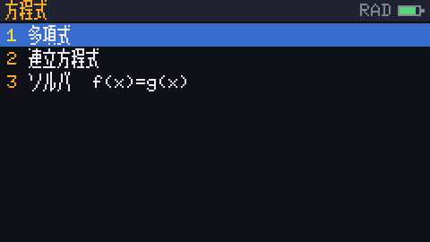
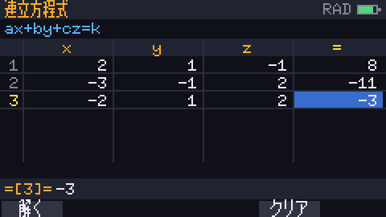
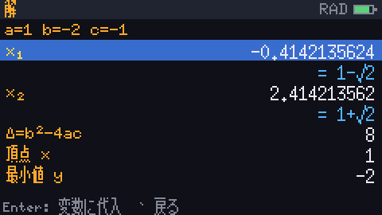
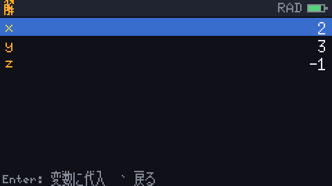
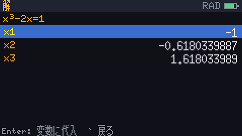

# 方程式

方程式は、3 種類の問題を解くアプリです。2〜4 次の多項式の方程式 (複素数解も求めます)、2〜4 元の連立 1 次方程式、そして f(x)=g(x) の形の方程式です。f(x)=g(x) はソルバが範囲内のすべての解を探します。

ホーム画面で「方程式」のアイコンを選ぶか、`5` を押すと起動します。

このページでは矢印を ↑ ↓ ← → と書きます。`fn`+`;` `.` `,` `/` のことです。ESC は `fn`+`` ` `` です。F1〜F6 は `fn`+`1`〜`6` です。共通のキーは [基本操作](../basics.md) を参照してください。

## 画面の見方

起動すると 3 項目のメニューが出ます。↑ ↓ と `Enter` で選ぶか、`1`〜`3` を押します。ESC でホーム画面に戻ります。

| 項目 | 画面 |
|---|---|
| 1 多項式 | 次数を選び、1 行の表に係数を入力します |
| 2 連立方程式 | 未知数の個数を選び、表に係数を入力します |
| 3 ソルバ  f(x)=g(x) | 方程式と範囲を入力欄に入力します |

### 係数の表 (多項式、連立方程式)

| 部分 | 内容 |
|---|---|
| ステータスバー (上) | 「多項式」または「連立方程式」 |
| 式の形 (青) | 方程式の形。`ax²+bx+c=0`、`ax³+bx²+cx+d=0`、`ax+by+cz=k` など |
| 列の見出し | 多項式: `a` `b` `c` …。連立方程式: `x` `y` (`z` `t`) と、右辺の定数の `=` |
| 行番号 | 連立方程式だけ。1 行が 1 つの式です |
| 下のバー | 選んでいるセルとその値 (`b=-2`、`y[2]=-1` など)。編集中は入力欄になります |
| ソフトキー (下) | F1 解く、F5 クリア |

### 結果の一覧

左にラベル、右に値を表示します。値に厳密な形 (分数、π、√) があるときは、次の行に `= 1-√2` のように青で表示します。最下行には `` Enter: 変数に代入  ` 戻る `` と表示されます。

## 操作

### 係数の表

| キー | 動作 |
|---|---|
| ↑ ↓ ← → | セルを動きます (`;` `.` `,` `/` だけでも動きます) |
| 数字、`-`、文字、`opt` / `alt` のキー | セルに新しい値を入力し始めます |
| `Enter` | 今の値を編集します。編集中に `Enter` を押すと値を決めて右に移ります (行の右端では次の行の先頭へ) |
| 編集中に ↑ ↓ | 値を決めて上 / 下に移ります |
| 編集中に ESC | 編集を取り消します |
| `BS` / `fn`+`BS` | セルを 0 にします |
| `fn`+`-` / `fn`+`=` | 最初の行 / 最後の行 |
| `ctrl`+`s` または `ctrl`+`e` | できるだけ分数で表示します (切り替え) |
| F1 (解く) | 解いて結果を表示します |
| F5 (クリア) | 係数をすべて 0 にします |
| ESC | 方程式のメニューに戻ります |

セルには `1/3`、`√(2)`、変数 `A` のような式も入力できます。値を決めたときに計算し、`Ans` は変わりません。`.` はカーソル移動になるので、小数は `0.5` のように `0` から入力してください。

### 結果の一覧

| キー | 動作 |
|---|---|
| ↑ ↓ | 行を選びます |
| 値の行で `Enter` | 値を変数に代入します。1 文字 (A〜Z、x、y など。`e` と `i` は不可) を入力して `Enter` を押すと、「保存しました」と表示されます |
| ESC または ← | 表または入力欄に戻ります |

### ソルバの入力欄

| キー | 動作 |
|---|---|
| ↑ ↓ | 方程式、下限 x、上限 x の欄を移ります |
| 文字の入力 | 欄を編集します (`ctrl`+`u` で消去) |
| `Enter` | 次の欄に移ります。上限 x の欄では解きます |
| F1 (解く) | 解きます |
| ESC | 方程式のメニューに戻ります |

## 使用例

### 2 次方程式 x²−2x−1=0

1. `1` (多項式) を押し、`1` (2次  ax²+bx+c=0) を押します。カーソルは `a` にあります。
2. `1` と入力して `Enter`、`-2` と入力して `Enter`、`-1` と入力して `Enter` を押します。
3. F1 (解く) を押します。

x₁ = -0.4142135624 (= 1-√2)、x₂ = 2.414213562 (= 1+√2) と表示されます。2 次のときは、判別式 `Δ=b²-4ac` (8)、`頂点 x` (1)、`最小値 y` (-2) も表示します (a<0 のときは `最大値 y`)。画面は [結果の一覧](#結果の一覧) を見てください。

複素数モードがオフでも、複素数解を表示します。x²+2x+5=0 の解は `-1+2i` と `-1-2i` です。

### 3 元連立 1 次方程式

次の連立方程式を解きます。
2x + y − z = 8、
−3x − y + 2z = −11、
−2x + y + 2z = −3

1. 方程式のメニューで `2` (連立方程式) を押し、`2` (3元 (x, y, z)) を押します。
2. 12 個の数を行ごとに、1 つずつ `Enter` を押しながら入力します: `2` `1` `-1` `8`、`-3` `-1` `2` `-11`、`-2` `1` `2` `-3`。`Enter` で右へ、行の右端では次の行へ移ります。
3. F1 (解く) を押します。

解がないときは「解なし」、解が無数にあるときは「解が無数にあります」と表示します。

### ソルバ: −3 から 3 の範囲で x³−2x=1

1. 方程式のメニューで `3` (ソルバ  f(x)=g(x)) を押します。方程式、下限 x、上限 x の欄が出ます。
2. `ctrl`+`u` で方程式の欄を消します。`x` と入力し、`opt`+`3` (³) を押して `-2x=1` と入力し、`Enter` を押します。
3. `ctrl`+`u` を押し、`-3` と入力して `Enter` を押します (下限 x)。
4. `ctrl`+`u` を押し、`3` と入力して `Enter` を押します (上限 x)。ソルバが解を探します。

-1、-0.6180339887、1.618033989 の 3 つの解が表示されます。範囲内に解がないときは「範囲内に解なし [-3, 3]」と表示します。

## 注意と制限

- **多項式**: 最高次の係数 `a` は 0 にできません (「最高次の係数は 0 にできません」)。解は 15 桁で求めます。2 次では `1+√2` のような厳密な解を表示します。3 次・4 次では、分数・π の倍数・(p/q)√n で表せる実数解に厳密な形を表示します。
- **連立方程式**: 未知数は 2〜4 個で、名前は x、y、z、t です。値の下に厳密な形 (分数) を表示します。
- **ソルバ**: 方程式は x の式です。`f(x)=g(x)` と書くか、`f(x)` だけ書くと f(x)=0 を解きます。範囲を 400 に分け、符号が変わるところと、曲線が 0 に接するところ (重解) を探します。解は 12 個まで求めます。範囲の 1/400 より近い 2 つの解は見つからないことがあります。そのようなときは範囲を狭めてください。下限 x は上限 x より小さくします (「下限 < 上限 にしてください」)。
- **表示形式**: 結果は、計算アプリで設定した表示形式 (F4 表示) に従います。
- **保存**: 次数ごと・未知数の個数ごとの係数と、ソルバの方程式と範囲は `/data/equation.json` に保存されます。複素数の係数は 0 として保存されます。

---

[← 目次](../README.md) · [基本操作](../basics.md)
