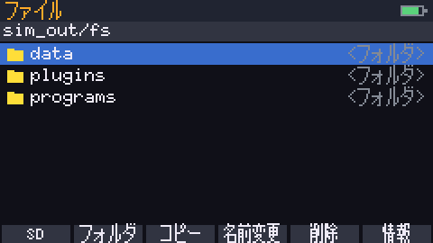
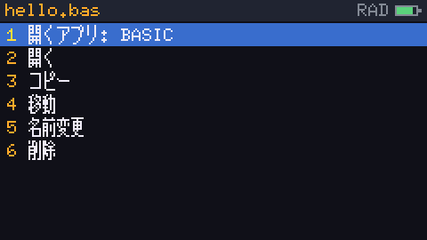
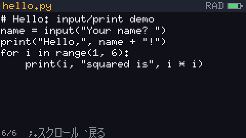
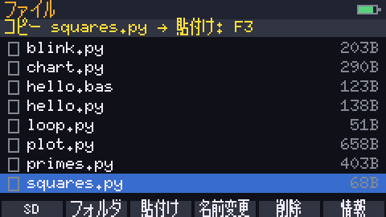
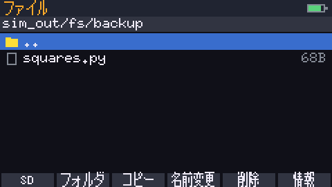

# ファイル

ファイルアプリは、本体のフラッシュと microSD カードのファイルを扱うファイルマネージャです。フォルダの閲覧、ファイルの表示、ファイルやフォルダのコピー・移動・名前変更・削除、フォルダの作成、SD カードのマウント・アンマウント、プラグインでファイルを開く操作ができます。

ホーム画面の **ファイル** のアイコン (11 番目のアプリ) を矢印で選び、`Enter` を押すと起動します。

このページでは矢印キーを ↑ ↓ ← → と書きます。`fn`+`;` `.` `,` `/` のことで、ファイルの一覧では `;` `.` `,` `/` だけでも矢印になります。F1〜F6 は `fn`+`1`〜`6` です。共通のキー操作は[基本操作](../basics.md)を見てください。

このページの画面は PC 上のシミュレータのもので、いちばん上のフォルダが `sim_out/fs` と表示されています。本機では `/` です。

## 画面の見方

| 場所 | 内容 |
|---|---|
| ステータスバー (上) | タイトル「ファイル」、SD カードをマウント中なら `SD`、電池残量 |
| パスの行 | 今のフォルダ。コピーや移動の途中は、黄色で `コピー 名前 → 貼付け: F3` (または `移動 …`) と表示します |
| 一覧 | `..` (親フォルダ。いちばん上のフォルダでは出ません)、フォルダ (黄色のフォルダのアイコンと `<フォルダ>`)、ファイル (サイズを B・K・M で表示) の順に並びます。空のフォルダでは「(空)」と表示します |
| ソフトキー (下) | F1 SD、F2 フォルダ、F3 コピー (コピー・移動の途中は 貼付け)、F4 名前変更、F5 削除、F6 情報 |

いちばん上のフォルダ `/` には、フラッシュのフォルダ (`data`、`programs`、`plugins` …) と、マウント中なら `sd` (SD カード) があります。

## 操作

### 一覧のキー

| キー | 動作 |
|---|---|
| ↑ ↓ | 選ぶ (端まで行くと反対側に戻る) |
| `fn`+`[` / `fn`+`]` | 8 行上 / 下へ |
| `Enter` または → | フォルダを開く。ファイルではファイルのメニューを出す。`..` では 1 つ上へ |
| ← または `BS` | 親フォルダへ |
| F1 (SD) | SD カードをマウント / アンマウントする |
| F2 (フォルダ) | ここにフォルダを作る (「新規フォルダ」) |
| F3 (コピー / 貼付け) | 選んだファイルやフォルダをコピーの対象にする。別のフォルダに移ってから押すと貼り付ける |
| F4 (名前変更) | 選んだファイルやフォルダの名前を変える |
| F5 (削除) または `fn`+`BS` | 選んだファイルやフォルダ (中身ごと) を削除する |
| F6 (情報) | 空き容量と今のフォルダを表示する (「ストレージ」) |
| ESC (`fn`+`` ` ``) | コピー・移動の途中なら取り消す。それ以外はホーム画面に戻る |

### ファイルのメニュー

ファイルを選んで `Enter` を押すと、ファイル名をタイトルにしたメニューが出ます。項目はファイルによって変わります。

| 項目 | 出るファイル | 動作 |
|---|---|---|
| **開くアプリ: *プラグイン名*** | プラグインが扱うファイル (BASIC プラグインがあるときの `.bas` など) | そのプラグインでファイルを開く |
| **開く** | すべて | ファイルを表示する (後述) |
| **実行** | `.py` | Python スクリプトとして実行する ([Python](python.md) アプリと同じ) |
| **編集** | `.py` とテキストファイル (`.txt` `.json` `.csv` `.md` `.cfg` `.ini` `.log`) | エディタで開く ([Python](python.md#エディタのキー) を参照)。エディタで `ctrl`+`r` を押すと、Python として実行します |
| **コピー** | すべて | F3 と同じ。貼り付けの対象として覚える |
| **移動** | すべて | 移動の対象として覚える。F3 で貼り付ける |
| **名前変更** | すべて | 名前を変える (「名前変更」の欄に今の名前が入っています) |
| **削除** | すべて | 「名前 を削除しますか?」と確認して削除する (`Enter` で削除) |

**開くアプリ** は、有効になっているプラグインのうち、`files` にそのファイルの拡張子を書いたものがあるときだけ出ます。[プラグイン](../plugins.md)と [BASIC](../basic.md) を見てください。

### ファイルの表示

**開く** を選ぶと、読み取り専用の画面でファイルを表示します。

- テキストファイル: 先頭の 16KB を、画面の幅で折り返して表示します。
- バイナリファイル (先頭 512 バイトに 0 のバイトがあるか、UTF-8 として読めないもの): 先頭 1024 バイトを 16 進ダンプで表示します。1 行 8 バイトで、オフセット・16 進・ASCII を並べます。タイトルの後ろに「(16進)」が付きます。

表示中は ↑ ↓ で 1 行、← → (または `fn`+`[` / `fn`+`]`) で 1 画面スクロールします。ESC か `Enter` で閉じます。最下行に `6/6` のように位置が出ます。

### コピー・移動・貼り付け

1. ファイルかフォルダを選んで F3 (コピー) を押すか、ファイルのメニューで **コピー** か **移動** を選びます。パスの行が黄色の `コピー 名前 → 貼付け: F3` になります。
2. コピー先のフォルダに移ります。
3. F3 (貼付け) を押します。「コピー中...」(または「移動中...」) と表示され、同じ名前でコピーされます。

- コピー先に同じ名前があると「名前 を上書きしますか?」と確認します。
- 元と同じフォルダで貼り付けると何もせず、コピーの対象を取り消します。
- フォルダは中身ごとコピーします。
- 同じファイルシステムの中の移動は名前の変更で行います。フラッシュと SD の間では、コピーしてから元を削除します。
- ESC でコピー・移動を取り消せます。

### 名前変更・削除・フォルダの作成

- **名前変更** (F4): 名前を直して `Enter` を押します。`/` を含む名前は使えません。
- **削除** (F5): 「名前 を削除しますか?」、フォルダでは「名前 (中身ごと) を削除しますか?」と確認します。`Enter` (または `y`) で削除し、ほかのキーで取り消します。
- **フォルダ** (F2): 「新規フォルダ」に名前を入力して `Enter` を押します。

### SD カード

- SD カードがマウントされていないときに F1 (SD) を押すと、「SD をマウント中...」と表示し、成功すると `/sd` に移ります。カードがないと「SD カードなし / マウント失敗」と表示します。
- マウント中に F1 を押すと、アンマウントします (「SD カード: アンマウントしました」)。`/sd` の中にいたときは `/` に戻ります。
- カードを抜く前にアンマウントしてください。
- 起動時に自動でマウントしたり (設定 → SD 自動マウント)、設定 → SD カードでマウントしたりもできます。[設定](settings.md)を見てください。

### ストレージの情報

F6 (情報) を押すと「ストレージ」の枠が出て、フラッシュと SD カードの空き容量と全体の容量 (カードがなければ「SD: 未マウント」)、RAM の空き、今のフォルダを表示します。

## 使用例

### スクリプトを SD カードにコピーする

1. microSD カードを入れます。ステータスバーに `SD` が出ていなければ、F1 (SD) を押してから ← で `/` まで戻ります。
2. `programs` を選んで `Enter` を押します。
3. スクリプト (たとえば `squares.py`) を選んで F3 (コピー) を押します。パスの行に `コピー squares.py → 貼付け: F3` と表示されます。

   

4. ← で `/` まで戻り、`sd` を選んで `Enter` を押します。
5. SD のスクリプト用フォルダに入れるため、`programs` を開きます (なければ先に F2 (フォルダ) で作ります)。
6. F3 (貼付け) を押します。スクリプトがコピーされます。`/sd/programs` のスクリプトは [Python](python.md) アプリの一覧にも出ます。

### フラッシュにバックアップ用のフォルダを作る

1. `/programs` で `squares.py` を選び、F3 (コピー) を押します。
2. ← を押して `/` に戻ります。
3. F2 (フォルダ) を押し、`backup` と入力して `Enter` を押します。
4. `backup` を選んで `Enter` を押し、F3 (貼付け) を押します。

   

### BASIC のプログラムを BASIC プラグインで開く

1. BASIC プラグインをインストールし ([BASIC](../basic.md) を参照)、`/programs` に `.bas` ファイルを置きます。
2. `.bas` ファイルを選んで `Enter` を押します。
3. **開くアプリ: BASIC** を選びます。そのファイルを開いた状態でプラグインが起動します。

## 注意と制限

- card-gcalc が使うフォルダ:

  | フォルダ | 内容 |
  |---|---|
  | `/programs` | フラッシュの Python スクリプト (と BASIC のプログラム) |
  | `/sd/programs` | SD カードのスクリプト |
  | `/data` | 設定と電卓のデータ (`*.json`) |
  | `/plugins`、`/sd/plugins` | プラグイン (1 つにつき 1 フォルダ) |
  | `/sd` | SD カード (マウント中のみ) |

- `/data` のファイルを消すと、設定や電卓のデータが初期状態に戻ります。まとめて消すときは、設定 → 全データ初期化を使ってください。
- フラッシュのファイルシステムは約 4.9MB です。空き容量は F6 (情報) で確認できます。
- フォルダを、そのフォルダ自身やその中のフォルダには貼り付けられません (「フォルダ自身の中には貼り付けられません」と表示します)。
- USB で PC とファイルをやり取りする方法は [PC との連携](../pc.md)を見てください。

---

[← 目次](../README.md) · [基本操作](../basics.md)
