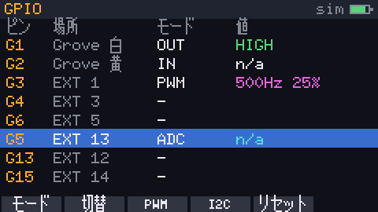
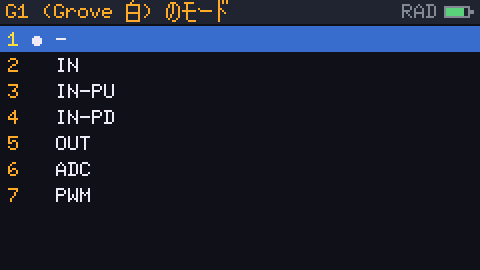
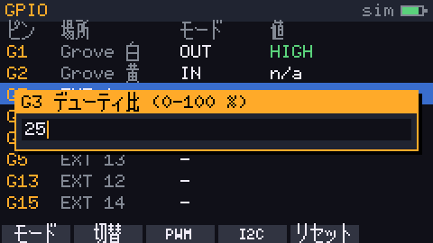

# GPIO

GPIO アプリは、Grove ポートと拡張ヘッダ (EXT) のピンを操作するパネルです。ピンごとに入力・出力・アナログ入力 (ADC)・PWM を選び、値をリアルタイムで見たり、出力を切り替えたり、I2C バスのデバイスを探したりできます。コードを書く必要はありません。

ホーム画面の **GPIO** のアイコン (12 番目のアプリ) を矢印で選び、`Enter` を押すと起動します。

このページでは矢印キーを ↑ ↓ ← → と書きます。`fn`+`;` `.` `,` `/` のことで、この画面では `;` `.` `,` `/` だけでも矢印になります。F1〜F6 は `fn`+`1`〜`6` です。共通のキー操作は[基本操作](../basics.md)を見てください。

## 画面の見方

| 場所 | 内容 |
|---|---|
| ステータスバー (上) | タイトル「GPIO」、電池残量。PC のシミュレータでは `sim` も出ます |
| 見出し | ピン、場所、モード、値 |
| ピンの行 | 1 行に 1 つのピン (下の表)。使っていないピンのモードは `-` です |
| 値 | IN 系: `HIGH` (緑) または `LOW`。OUT: 出力のレベル。ADC: `1.234 V` のような電圧と、右端の棒 (3.1 V で満杯)。PWM: `500Hz 25%` のような周波数とデューティ比 |
| ソフトキー (下) | F1 モード、F2 切替、F3 PWM、F4 I2C、F5 リセット |

値は 0.1 秒ごとに読み直すので、入力の変化がそのまま表示されます。

### ピン

| ピン | 場所 | コネクタ |
|---|---|---|
| G1 | Grove 白 | Grove ポートの白い線 (I2C の SCL にも使う) |
| G2 | Grove 黄 | Grove ポートの黄色い線 (I2C の SDA にも使う) |
| G3 | EXT 1 | 拡張ヘッダの 1 番ピン |
| G4 | EXT 3 | 拡張ヘッダの 3 番ピン |
| G6 | EXT 5 | 拡張ヘッダの 5 番ピン |
| G5 | EXT 13 | 拡張ヘッダの 13 番ピン |
| G13 | EXT 12 | 拡張ヘッダの 12 番ピン |
| G15 | EXT 14 | 拡張ヘッダの 14 番ピン |

拡張ヘッダのほかのピンは本体の中で使っているため (G40/G14/G39 は SD カード、G8/G9 は内部の I2C バス)、一覧にはありません。

Cardputer には拡張ヘッダがありません。G3〜G6・G13・G15 はキーボードの読み取りに使うので、一覧には G1 と G2 だけが出ます。

### モード

| モード | 意味 |
|---|---|
| `-` | 使わない。ピンを解放します (プルなしの入力にします) |
| `IN` | デジタル入力 (プルなし) |
| `IN-PU` | 内部プルアップ付きのデジタル入力 (何もつながないと HIGH) |
| `IN-PD` | 内部プルダウン付きのデジタル入力 (何もつながないと LOW) |
| `OUT` | デジタル出力。HIGH (3.3 V) または LOW (0 V) |
| `ADC` | アナログ入力。約 0〜3.1 V |
| `PWM` | PWM 出力。最初は 1000 Hz、50 % |

## 操作

| キー | 動作 |
|---|---|
| ↑ ↓ | ピンを選ぶ (端まで行くと反対側に戻る) |
| `Enter` または F1 (モード) | モードを選ぶ (「G1 (Grove 白) のモード」)。今のモードに丸印が付いています。`1`〜`7` を押すか、選んで `Enter` を押します |
| `Space` または F2 (切替) | 出力の HIGH と LOW を切り替える。OUT 以外のピンでは OUT にして HIGH にします |
| F3 (PWM) | PWM を設定する。周波数 (「G1 PWM 周波数 (Hz)」、1〜40000000) とデューティ比 (「G1 デューティ比 (0-100 %)」) を順に入力すると、ピンが PWM になります |
| `+` (または `=`) / `-` | PWM のとき: デューティ比を 5 % 上げる / 下げる |
| F4 (I2C) | I2C バスをスキャンする (後述) |
| F5 (リセット) | すべてのピンを解放する (モードはすべて `-` に戻る) |
| ESC (`fn`+`` ` ``) または ← | ホーム画面に戻る。すべてのピンを解放します |

周波数とデューティ比の欄には電卓の式も書けます。`2^10` や `100/3` も使えます。どちらの欄でも ESC で取り消せます。

### I2C スキャン

F4 (I2C) を押すと、2 つのバスを調べて、応答したアドレスを一覧にします。

- **Grove (SDA=G2, SCL=G1)**: 100 kHz で調べます。応答がなければ「デバイスなし」と表示します。スキャン後、G1 と G2 は入力になります。
- **内部 (SDA=G8, SCL=G9)**: 本体の内蔵デバイスです。0x34 はキーボードのコントローラです。Cardputer-Adv だけです。

よく使われるアドレスには名前が付きます。例: 0x3C OLED、0x76/0x77 BME280/BMP、0x44 SHT3x、0x38 AHT20、0x29 VL53L0X/TCS、0x48 ADS1115、0x23 BH1750、0x70 TCA9548A、0x68/0x69 BMI270 IMU。一覧は表示画面で開き、ESC で閉じます。PC のシミュレータでは「シミュレータでは使えません」と表示します。

## 使用例

### LED を点けたり消したりする

Grove の G1 (白) と GND の間に、抵抗 (330 Ω 程度) を直列につないだ LED を接続します。

1. アプリを開くと G1 が選ばれています。`Space` を押します。G1 が `OUT` `HIGH` になり、LED が点きます。
2. もう一度 `Space` を押します。値が `LOW` になり、LED が消えます。
3. ESC で終了します。G1 は解放されます。

自動で点滅させるには、[Python](python.md) アプリでサンプルの `blink.py` を実行します。

### 押しボタンを読む

Grove の G2 (黄) と GND の間に押しボタンをつなぎます。

1. ↓ を押して G2 を選びます。
2. `Enter` を押し、`3` (`IN-PU`) を押します。値は `HIGH` です。
3. ボタンを押します。押している間、値が `LOW` になります。

### PWM で LED の明るさを変える

最初の例と同じく、G1 に LED をつないでおきます。

1. G1 を選んで F3 (PWM) を押します。
2. `500` と入力して `Enter` を押します (周波数)。
3. `25` と入力して `Enter` を押します (デューティ比)。

   

4. 行に `PWM` `500Hz 25%` と表示されます。`+` か `-` で、デューティ比を 5 % ずつ変えられます。

### 電圧を測る

1. ピン (たとえば G3 (EXT 1)) を選んで `Enter` を押し、`6` (`ADC`) を押します。
2. ピンの電圧が表示され、3.1 V までの棒グラフが伸びます。

## 注意と制限

- ピンは 3.3 V で動きます。5 V の信号を直接つながないでください。ピンに流す電流は小さくします (LED には抵抗を入れます)。
- ADC で測れるのは約 0〜3.1 V です。それより高い電圧は抵抗で分圧してください。
- パネルの設定は残りません。アプリを終了する (ESC) か F5 を押すと、すべてのピンが解放されます。
- スクリプトからは `cardgcalc.pin_out()`、`pin_in()`、`analog()`、`pwm()`、`tone()`、`i2c_grove()` を使います。[cardgcalc モジュール API](../api.md) を見てください。
- PC のシミュレータにはハードウェアがありません。モードは選べますが、IN と ADC の値は `n/a` になります。

---

[← 目次](../README.md) · [基本操作](../basics.md)
