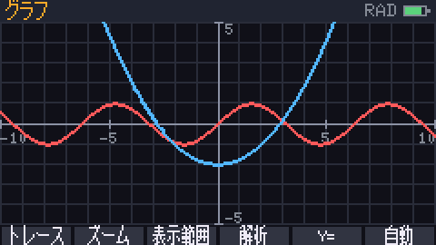
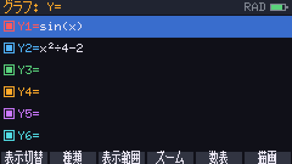
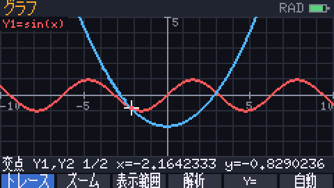
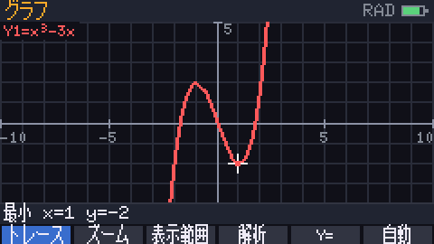
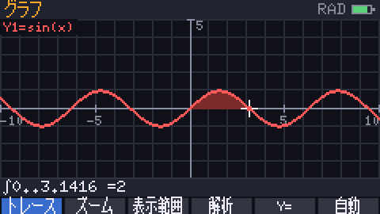
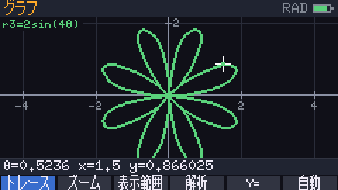

# グラフ

グラフアプリは、Y1〜Y6 の 6 つまでの関数を同時に描きます。関数ごとに、y=f(x)、極座標 r=f(θ)、媒介変数 x(t), y(t) のどれかを選べます。グラフのパン・ズーム・トレースができ、解析メニューで根、極小・極大、交点、傾き、積分を求められます。

ホーム画面で **グラフ** のアイコンを選ぶか、ホーム画面で `2` を押すと起動します。

このページでは矢印キーを ↑ ↓ ← → と書きます。実際のキーは `fn`+`;` `.` `,` `/` です。文字入力のない画面では、`;` `.` `,` `/` だけでも矢印として働きます。F1〜F6 は `fn`+`1`〜`6` です。共通のキー操作は [基本操作](../basics.md) を見てください。

## 画面構成

関数の一覧 (**グラフ: Y=**) と、グラフ画面 (**グラフ**) の 2 つの画面があります。

### 関数の一覧 (Y=)

| 場所 | 内容 |
|---|---|
| ステータスバー (上端) | タイトル「グラフ: Y=」、修飾キーの状態、角度単位 (RAD / DEG / GRA)、電池残量 |
| Y1〜Y6 の行 | 1 行に 1 つの関数。左の四角が塗られている関数を描画します。色は関数ごとに決まっています (Y1 赤、Y2 青、Y3 緑、Y4 オレンジ、Y5 紫、Y6 水色) |
| 行のラベル | y=f(x) は `Y1=`、極座標は `r1=`、媒介変数は `X1= … Y1= …` |
| ソフトキー (下端) | F1 表示切替、F2 種類、F3 表示範囲、F4 ズーム、F5 数表、F6 描画 |

行の編集中は、ソフトキーの代わりにキーの説明が表示されます。

### グラフ画面

| 場所 | 内容 |
|---|---|
| ステータスバー (上端) | タイトル「グラフ」、角度単位、電池残量 |
| 描画領域 | 格子、目盛ラベル付きの座標軸、関数ごとの色の曲線 |
| 左上 (トレース・解析中) | 対象の関数 (`Y1=sin(x)` など) を関数の色で表示 |
| 情報行 (ソフトキーの上) | トレースの座標や、解析の結果 |
| ソフトキー (下端) | F1 トレース、F2 ズーム、F3 表示範囲、F4 解析、F5 Y=、F6 自動。トレース中は F1 が強調表示されます |

## 操作

### 関数の一覧のキー

| キー | 動作 |
|---|---|
| ↑ ↓ | 行を選ぶ |
| `Enter` または → | 選んだ関数を編集する |
| 文字キー、または `opt` / `alt` の数式キー | その行に新しい式を入力し始める (元の式は置き換わります) |
| `Space` または F1 (表示切替) | その行を描画するかどうかを切り替える |
| F2 (種類) | 種類を切り替える: y=f(x) → r=f(θ) → x(t),y(t) → y=f(x) |
| F3 (表示範囲) | 表示範囲の設定を開く |
| F4 (ズーム) | ズームメニューを開き、そのあとグラフを描く |
| F5 (数表) | 同じ関数で数表アプリを開く ([数表](../apps/table.md)) |
| F6 (描画) | グラフを描く |
| `BS` または `fn`+`BS` | その行の式を消す (「Y1 を消去しますか?」と確認します。`Enter` で消去) |
| `fn`+`h` | キー一覧 |
| ESC (`fn`+`` ` ``) または ← | ホーム画面に戻る |

y=f(x) と r=f(θ) の行の編集中は、次のように操作します。

- `Enter` で確定します。↑ / ↓ で確定して前 / 次の行に移ります。ESC で取り消します。
- `opt` / `alt` で数式の記号を入れられます。`opt`+`s` は sin(、`opt`+`2` は ²、`opt`+`h` は θ、`opt`+`p` は π です。全体の一覧は `fn`+`h` で見られます。
- 確定するときに式を検査します。文法エラーのときはエラーを表示し、元の式に戻します。
- 式を変えた行は、自動的に描画する設定になります。

媒介変数の行では、`X1(t) =` と `Y1(t) =` の 2 つのダイアログが順に開きます。どちらも変数 `t` を使います。

変数は、y=f(x) では `x`、r=f(θ) では `θ` (`opt`+`h`)、媒介変数では `t` を使います。θ と t は現在の角度単位 (設定 → 角度単位) で扱います。計算アプリで保存した変数 (A〜Z) も式の中で使えます。

### グラフ画面のキー

| キー | 動作 |
|---|---|
| ← → ↑ ↓ | 表示範囲の幅・高さの 1/8 ずつパンする |
| `=` または `+` | 中央を基準に 2 倍に拡大する |
| `-` または `_` | 中央を基準に 1/2 に縮小する。トレース中の `-` は「xへ移動」で負の数を入力するのに使うので、`_` (`shift`+`-`) を使います |
| F1 (トレース) | トレースの開始・終了 |
| F2 (ズーム) | ズームメニュー |
| F3 (表示範囲) | 表示範囲の設定 |
| F4 (解析) | 解析メニュー |
| F5 (Y=) または ESC | 関数の一覧に戻る |
| F6 (自動) | 自動調整 (ズーム → 自動調整 と同じ) |

パン・ズームした表示範囲は、一覧に戻っても保たれます。

### トレース

グラフ画面で F1 を押します。曲線上に十字のカーソルが表示され、情報行に座標が表示されます。

| キー | 動作 |
|---|---|
| ← → | 1 ピクセル列 (y=f(x)) または T の刻み 1 つ分 (極座標・媒介変数) 動かす。画面の端を越えると表示範囲を 1/4 パンします |
| `shift` + ← → | 10 刻みずつ動かす (`shift`+`fn`+`,` / `shift`+`fn`+`/`) |
| ↑ ↓ | 前 / 次の描画中の関数に移る |
| 数字キーまたは `-` | 移動: 「xへ移動」(極座標・媒介変数では「tへ移動」) が、押した文字を入力した状態で開きます |
| `Enter` | カーソルの位置が中央になるように表示範囲を動かす |
| ESC または F1 | トレースを終える |

情報行には、y=f(x) では `Y1 x=… y=…`、極座標と媒介変数では `θ=… x=… y=…` や `t=… x=… y=…` と表示します (有効数字 7 桁まで)。「未定義」は、その点で関数が実数の値を持たないことを表します。

### ズームメニュー (F2)

↑ ↓ と `Enter`、または番号キーで選びます。

| # | 項目 | 動作 |
|---|---|---|
| 1 | 拡大 | 表示範囲を 1/2 にする。トレース中はカーソルが中央になります |
| 2 | 縮小 | 表示範囲を 2 倍にする。トレース中はカーソルが中央になります |
| 3 | 標準 | x −10〜10、y −5〜5、目盛 1 |
| 4 | 三角 | x はラジアンで −2π〜2π (目盛 π/2)、度で −360〜360 (目盛 90)、グラードで −400〜400 (目盛 100)。y は −1.6〜1.6 (目盛 0.5)。T の範囲も初期値に戻します |
| 5 | 整数 | 今の中心のまま、縦横とも 1 ピクセルを 1 にする (目盛 10) |
| 6 | 正方 | 縦横の 1 目盛が同じ長さになるように y の範囲を変える |
| 7 | 自動調整 | 今の x の範囲での y=f(x) の値から y の範囲を決める。極座標・媒介変数だけを描いているときは、縦横比をそろえて x と y の両方を決める。飛び離れた値は無視し、8 % の余白を付けます |

### 表示範囲 (F3)

表示範囲の値の一覧です。項目を選んで新しい値を入力します (`2π` のような式も使えます)。タイトルに「Xmin (現在 -10)」のように今の値が表示されます。

| 項目 | 意味 | 初期値 (ラジアン) |
|---|---|---|
| Xmin, Xmax | x の範囲 | −10, 10 |
| X目盛 | 縦の格子線の間隔 (0 で格子なし) | 1 |
| Ymin, Ymax | y の範囲 | −5, 5 |
| Y目盛 | 横の格子線の間隔 (0 で格子なし) | 1 |
| Tmin/θmin, Tmax/θmax | 極座標・媒介変数の t (θ) の範囲 | 0, 2π |
| Tstep/θstep | t (θ) の刻み | π/60 |
| 初期値に戻す | すべての値を初期値に戻す | |

度では T の範囲の初期値は 0〜360 (刻み 3)、グラードでは 0〜400 (刻み 3) です。最小 ≥ 最大、刻み ≤ 0、目盛が負になる値は「範囲が不正です」となり、受け付けません。ESC で一覧を閉じます。

### 解析メニュー (F4)

解析は、現在の関数を対象にします。現在の関数は、トレース中に ↑ ↓ で選んだ関数です。選び直すまでは、描画中の最初の関数です。対象は y=f(x) の関数だけです (それ以外では「y=f(x) の関数のみ対応」と表示します)。メニューのタイトルに「グラフ解析 Y1」のように対象の関数が表示されます。

| # | 項目 | 内容 |
|---|---|---|
| 1 | 根 | 表示中の x の範囲で f(x)=0 となる x をすべて求める。曲線が x 軸に接するだけの点も含みます |
| 2 | 最小 | 表示中の範囲の極小点をすべて求める |
| 3 | 最大 | 表示中の範囲の極大点をすべて求める |
| 4 | 交点 | 別の y=f(x) の関数との交点を求める。ほかに描画中の関数が 2 つ以上あるときは「交点の相手」で選びます |
| 5 | xでのy値 | x を入力すると、カーソルをそこへ動かし y を表示する (10 桁) |
| 6 | yでのx値 | y を入力すると、表示中の範囲で f(x)=y となる x をすべて求める |
| 7 | dy/dx | カーソルの位置での微分係数を表示する (必要なら中央からトレースを始めます) |
| 8 | ∫dx | 下端と上端を入力すると定積分を表示し、曲線と x 軸の間を塗りつぶす |

- 根、最小、最大、交点、yでのx値は、表示中の x の範囲だけを探します。解が画面の外にあるときは、先にパンやズームをしてください。見つからないときは「根: 表示範囲内になし」のように表示します。
- 解が複数あるときは、情報行に `根 2/3 x=… y=…` と表示します。← → で解を切り替えます。最初に表示するのは、カーソルにいちばん近い解です。
- 結果は有効数字 8 桁までで表示します (∫dx と xでのy値は 10 桁)。
- ほかのキーを押すと結果の表示を終え、その位置からトレースを続けます。ESC は結果の表示を消すだけです。

## 使用例

### 例 1: 2 つの関数の交点

初めてグラフアプリを開いたときは、Y1=sin(x) と Y2=x²÷4-2 が入力されています。

1. ホーム画面で `2` を押してグラフアプリを開きます。
2. 自分で入力するときは、Y1 を選んで `opt`+`s` `x` `)` `Enter`、Y2 を選んで `x` `opt`+`2` `/4-2` `Enter` と押します (`/` は ÷ として入力されます)。
3. F6 (描画) を押します。
4. F4 (解析) を押し、`4` (交点) を押します。関数が 2 つだけなので、相手は自動的に Y2 になります。
5. 情報行に `交点 Y1,Y2 1/2 x=-2.1642333 y=-0.8290236` と表示されます。→ を押すと、2 つ目の交点 x=2.9560183 を表示します。

### 例 2: 根と極小値

1. 関数の一覧で Y1 を選び、`x` `opt`+`3` `-3x` `Enter` と押します (Y1=x³-3x)。
2. Y2 を選び、`Space` で描画しない設定にします。
3. F6 (描画) を押します。
4. F4 を押し、`1` (根) を押します。カーソルにいちばん近い根 `根 2/3 x=0 y=0` が表示されます。← → で x=-1.7320508 と x=1.7320508 も見られます。
5. F4 を押し、`2` (最小) を押します。情報行に `最小 x=1 y=-2` と表示されます。

### 例 3: 定積分と塗りつぶし

sin(x) の 0 から π までの面積を求めます。

1. Y1=sin(x) の状態から始めます。Y2 を選び、`Space` で描画しない設定にします (Y1 は描画中の最初の関数なので、解析の対象になります)。
2. F6 (描画) を押し、F4 と `8` (∫dx) を押します。
3. 「∫dx 下端」で `0` `Enter` と押します。
4. 「∫dx 上端」で `opt`+`p` (π) `Enter` と押します。
5. 面積が塗りつぶされ、情報行に `∫0..3.1416 =2` と表示されます。

### 例 4: 極座標のグラフ

正葉曲線 r=2sin(4θ) を描きます。

1. Y1 と Y2 を `Space` で描画しない設定にします。
2. Y3 を選び、F2 (種類) を 1 回押します。ラベルが `r3=` に変わります。
3. `2` `opt`+`s` `4` `opt`+`h` `)` `Enter` と押します。
4. F6 (描画) を押します。標準の表示範囲では小さいので、F6 (自動) を押します。極座標・媒介変数の曲線では、自動調整は縦横比をそろえます。
5. F1 (トレース) を押し、`shift`+→ で 10 刻み進めると、情報行に `θ=0.5236 x=1.5 y=0.866025` と表示されます。

媒介変数の曲線も同じように描けます。F2 を 2 回押して行の表示を `X4=` にし、`Enter` を押して、たとえば `3cos(t)` と `2sin(t)` を入力すると楕円になります。

## 注意と制限

- **数値**: 表示範囲、トレースの位置、解析の結果は 10 進 15 桁の数です。0.1 のような x の刻みも誤差なく扱えます。ピクセルへの変換だけに通常の浮動小数点数を使います。
- **ピクセルの細かさ**: y=f(x) の曲線は、ピクセル列 (240 列) ごとに計算します。根、最小、最大、交点、yでのx値は、隣り合う列の間の符号の変化や増減の変化を見つけてから、精密に求めます。1 ピクセルより近い 2 つの解は見落とすことがあります。拡大して区別してください。
- **不連続点**: tan(x) の π/2 のような飛びは、線でつなぎません。
- **極座標・媒介変数**: 1 本の曲線は最大 720 点です。Tstep が (Tmax−Tmin)/719 より小さいときは、刻みを大きくして描きます。
- **未定義の値**: 実数の値を持たない点 (x<0 での √(x) など) は描きません。
- **保存**: 関数、表示範囲、数表の開始値と刻みは `/data/funcs.json` に保存します。再起動しても残ります。
- **数表**: 数表アプリも同じ Y1〜Y6 を使います。関数の一覧で F5 を押すと開きます。[数表](../apps/table.md) を見てください。
- **角度単位**: 極座標の θ、媒介変数の t、三角関数は、設定 → 角度単位 に従います。ズームの「三角」と T の範囲の初期値も同じです。

---

[← 目次](../README.md) · [基本操作](../basics.md)
