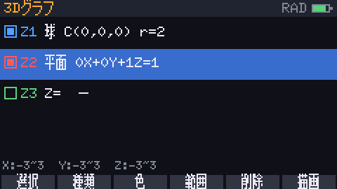
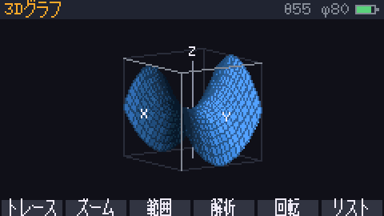
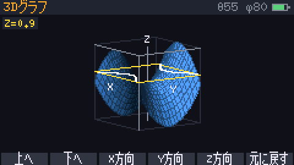
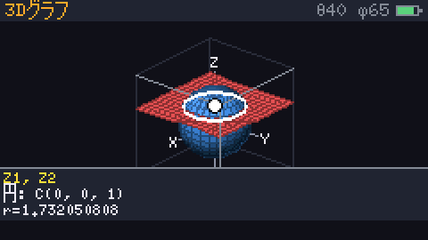
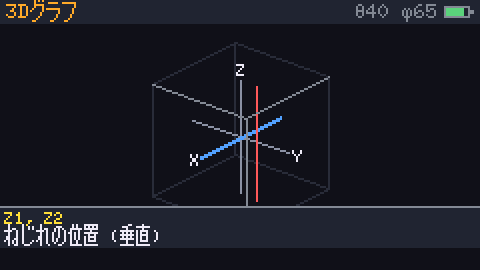
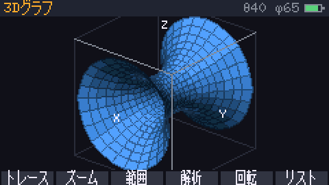

# 3Dグラフ

3Dグラフは、3 つまでのグラフ (Z1〜Z3) を立体の箱の中に描くアプリです。曲面 z=f(x,y)、パラメーター表示の曲面、直線、平面、球、円柱、円錐、回転体を描けます。視点の回転・ズーム、トレースのほか、断面、交点・交線、直線と平面の位置関係を調べられます。

ホーム画面で `3` を押すと開きます。

## 画面構成

主な画面は、Z1〜Z3 の **一覧** と **グラフ画面** の 2 つです。

### 一覧

| 部分 | 表示内容 |
|---|---|
| ステータスバー (上端) | アプリ名「3Dグラフ」と角度単位 (RAD / DEG / GRA) |
| Z1〜Z3 の行 | 色の枠、名前、グラフの内容。枠が塗りつぶされていれば、設定済みで描画の対象です。描画をオフにしたグラフは暗く表示します。未設定のグラフは種類と「—」を表示します |
| 範囲の行 | 表示範囲 (例: `X:-3~3  Y:-3~3  Z:-3~3`) |
| ソフトキー (下端) | F1 選択、F2 種類、F3 色、F4 範囲、F5 削除、F6 描画 |

一覧での表示例:

| 種類 | 一覧の表示 |
|---|---|
| Z= | `Z=(x²-y²)÷3` |
| パラメーター | `パラメーター: X=sin(s)cos(t), Y=…, Z=…` |
| 直線 | `直線 (0,0,0)+t(1,1,1)` または `直線 (-2,-2,-2)-(2,2,2)` |
| 平面 | `平面 1X+1Y+1Z=1`、`平面 (0,0,0)+s(1,0,0)+t(0,1,0)` または `平面 (1,0,0),(0,1,0),(0,0,1)` |
| 球 | `球 C(0,0,0) r=2` または `球 X²+Y²+Z²+0X+0Y+0Z+-4=0` |
| 円柱・円錐 | `円柱 r=1 Z:-2~2 C(0,0)` |
| X軸回転体・Y軸回転体 | `X軸回転体: y=1+x²÷5` |

### グラフ画面

| 部分 | 表示内容 |
|---|---|
| ステータスバー (上端) | 「3Dグラフ」と現在の視点の角度 (例: `θ55 φ80`) |
| グラフ領域 | 表示範囲の箱 (奥の辺は暗く、手前の辺は明るく表示)、原点を通る X・Y・Z 軸、軸ラベル X・Y・Z、グラフ |
| ソフトキー (下端) | F1 トレース、F2 ズーム、F3 範囲、F4 解析、F5 回転、F6 リスト。トレース中は、この行に座標を表示します |

- 面はグラフの色で塗り、向きに応じて陰影を付けます。メッシュ線は暗い色で描きます。
- すべて表示範囲の箱 (Xmin〜Xmax、Ymin〜Ymax、Zmin〜Zmax) で切り取ります。箱は常に立方体として描くので、軸ごとに縮尺が異なります。
- 直線は太い線で描きます。
- 軸は、原点が箱の中にあるときだけ描きます。原点が外にあるときは、ラベルを箱の角を基準に置きます。
- θ は Z 軸まわりの水平方向の角度、φ は Z 軸からの角度です (φ=0 で真上から見ます)。初期値は θ=40、φ=65 です。

## 操作

矢印 ↑ ↓ ← → は `fn`+`;` `.` `,` `/` です。一覧・メニュー・グラフ画面は文字を入力しない画面なので、`;` `.` `,` `/` だけでも矢印になります ([基本操作](../basics.md) を参照)。ESC (`fn`+`` ` ``) で戻ります。F1〜F6 は `fn`+`1`〜`6` です。

### 一覧のキー

| キー | 動作 |
|---|---|
| ↑ / ↓ | Z1〜Z3 を選ぶ (端で折り返す) |
| Enter または → | 選んだグラフを編集する (式または値) |
| F1 (選択) または Space | グラフの描画のオン・オフを切り替える |
| F2 (種類) | グラフの種類を選ぶ。別の種類を選ぶと、すぐにその入力が始まる |
| F3 (色) | 色を選ぶ: 青、赤、緑、マゼンタ、シアン、黄、オレンジ、白 |
| F4 (範囲) | 表示範囲を開く (後述) |
| F5 (削除)、`BS` または DEL (`fn`+`BS`) | 「Z1 を消去しますか?」の確認 (Enter か `y` ではい、ESC でいいえ) の後、グラフを消去する。色はそのままで、種類は Z= に戻る |
| F6 (描画) | オンで設定済みのグラフをすべて描く。対象がないときは「グラフがありません」と表示 |
| ESC または ← | ホーム画面に戻る |

### グラフの種類と入力

F2 を押し、↑ ↓ と Enter、または番号キーで種類を選びます。

| # | 種類 | 入力 |
|---|---|---|
| 1 | Z= | x・y の式 `Z1 = f(x,y)` を 1 つ |
| 2 | パラメーター | s・t の式 `X1(s,t) =`、`Y1(s,t) =`、`Z1(s,t) =` の 3 つ。範囲は表示範囲の Smin〜Smax、Tmin〜Tmax |
| 3 | 直線 | 形式: **点とベクトル** (X0、Y0、Z0、ベクトル l、ベクトル m、ベクトル n) または **2点** (X1、Y1、Z1、X2、Y2、Z2) |
| 4 | 平面 | 形式: **aX+bY+cZ=d** (a、b、c、d)、**点と2ベクトル** (X0、Y0、Z0、u1、u2、u3、v1、v2、v3) または **3点** (X1〜Z3) |
| 5 | 球 | 形式: **(X-a)²+(Y-b)²+(Z-c)²=r²** (a、b、c、r) または **X²+Y²+Z²+aX+bY+cZ+d=0** (a、b、c、d) |
| 6 | 円柱 | 半径、Zmin、Zmax、中心 X、中心 Y。軸は Z 軸に平行で、上下の面も閉じています |
| 7 | 円錐 | 半径、底面の Z、頂点の Z、中心 X、中心 Y。軸は Z 軸に平行で、底面も閉じています |
| 8 | X軸回転体 | `X軸回転体: y = f(x)`。x が Xmin〜Xmax の曲線 y=f(x) を X 軸のまわりに回転させた立体 |
| 9 | Y軸回転体 | `Y軸回転体: y = f(x)`。同じ曲線を Y 軸のまわりに回転させた立体 (各点は Y 軸から \|x\| の距離を回ります) |

式の入力 (Z=、パラメーター、X軸回転体・Y軸回転体):

- 1 行の入力ダイアログに入力します。Enter で確定、ESC で取り消しです。数式トークンは他のアプリと同じです。`opt`+`s` で `sin(`、`opt`+`2` で `²`、`opt`+`x` / `opt`+`y` で x / y が入り、`*` は ×、`/` は ÷ になります (`src/cardgcalc/keymap.py` または `fn`+`h` を参照)。
- Enter を押したときに式を検査します。構文エラーはその場で表示します。
- 計算できない点や、値が実数にならない点は描きません。
- 三角関数は、設定の角度単位に従います。

テンプレート (直線、平面、球、円柱、円錐):

1. 形式が複数ある種類では、まず形式を選びます。
2. 値の一覧が現在の値とともに表示され、最後に **設定** があります。値を選び (↑ ↓ と Enter、または番号キー)、数値か式 (`π`、`√(2)`、`1/3` など) を入力します。入力すると、次の値に移ります。
3. **設定** を選ぶと確定します。図形が決まらない値のときは「設定が正しくありません」と表示し、一覧に残ります。方向ベクトルが 0、3 点が一直線上、法線ベクトルが 0、半径が 0 以下、Zmin = Zmax、実数の点がない球の式のときがこれに当たります。

新しいテンプレートの初期値: 直線 (0,0,0)+t(1,1,1) または (-2,-2,-2)〜(2,2,2)、平面 X+Y+Z=1 (または XY 平面、3 点 (1,0,0)・(0,1,0)・(0,0,1))、原点中心で r=2 の球、r=1 で Z が -2〜2 の円柱、r=2・底面の Z が -2・頂点の Z が 2 の円錐。

### 表示範囲 (一覧で F4、グラフ画面で F3)

メニュー「3D 表示範囲」に次の項目があります。項目を選ぶと、新しい値を入力するか、オン・オフを切り替えます。

| 項目 | 初期値 | 意味 |
|---|---|---|
| Xmin、Xmax | -3、3 | 箱の X の範囲。X軸回転体・Y軸回転体の x の範囲も兼ねる |
| Xgrid | 20 | x 方向のメッシュの分割数 (Z=、X軸回転体、Y軸回転体) |
| Ymin、Ymax | -3、3 | 箱の Y の範囲 |
| Ygrid | 20 | y 方向のメッシュの分割数 (Z=) |
| Zmin、Zmax | -3、3 | 箱の Z の範囲 |
| Smin、Smax、Sgrid | 0、π、20 | s の範囲と分割数 (パラメーター) |
| Tmin、Tmax、Tgrid | 0、2π、24 | t の範囲と分割数 (パラメーター) |
| 角度 θ | 40 | 水平方向の視点の角度 (-180〜180) |
| 角度 φ | 65 | Z 軸からの角度 (0〜360) |
| ラベル | オン | X・Y・Z のラベルを表示 |
| 軸 | オン | 軸を表示 |
| 外枠 | オン | 表示範囲の箱を表示 |
| メッシュ線 | オン | 面にメッシュ線を表示 |
| 初期値に戻す | | 範囲・分割数・角度をすべて初期値に戻す (ラベル・軸・外枠・メッシュ線は変わりません) |

- 各 min は max より小さくします。分割数は 2〜50 の整数です。そうでないときは「範囲が不正です」と表示し、元の値に戻します。
- 分割数を増やすと面はなめらかになりますが、描画に時間がかかります。
- テンプレートのメッシュは固定です (直線 20 区間、平面 16×16、球 16×24、円柱・円錐・回転体は周方向 24 分割)。

### グラフ画面のキー

| キー | 動作 |
|---|---|
| ← / → | 水平方向に回転 (θ を −15° / +15°) |
| ↑ / ↓ | 傾きを変える (φ を −15° / +15°)。↑ でより上から、↓ でより下から見る |
| `+` (`shift`+`=`) / `-` | 拡大 / 縮小 (1.5 倍) |
| F1 (トレース) | トレース (後述) |
| F2 (ズーム) | ズームメニュー (後述) |
| F3 (範囲) | 表示範囲。角度 θ・φ には今の向きが表示されます。変更すると描き直す |
| F4 (解析) | 解析メニュー (後述) |
| F5 (回転) | 自動回転 (後述) |
| F6 (リスト) または ESC | 一覧に戻る。視点の角度は保存され、次回も使われる。ズームは元に戻る |

### ズームメニュー (F2)

| # | 項目 | 動作 |
|---|---|---|
| 1 | 拡大 | 1.5 倍に拡大 |
| 2 | 縮小 | 1/1.5 に縮小 |
| 3 | X 軸方向から見る | X 軸の方向から見る (θ=0、φ=90) |
| 4 | Y 軸方向から見る | Y 軸の方向から見る (θ=90、φ=90) |
| 5 | Z 軸方向から見る | 真上から見る (θ=-90、φ=0)。X が右、Y が上 |
| 6 | 元の表示 | θ=40、φ=65、ズーム 1 |

### トレース (F1)

黄色の十字がメッシュ上の点を示し、下端に `Z1  X=… Y=… Z=…` を表示します。座標は 10 進で計算し、有効数字 7 桁まで表示します (値が定まらないときは `?`)。

| キー | 動作 |
|---|---|
| ← / → | メッシュの 1 つ目の方向に移動 (Z=・回転体は x、パラメーターは s) |
| ↑ / ↓ | 2 つ目の方向に移動 (y、t、または周方向)。直線は ← → だけ |
| F2 / F3 | 次 / 前のグラフ (点はメッシュの中央から始まる) |
| Enter (または `=`、`x`、`s`) | 座標を入力。Z= は X と Y、パラメーターは S と T。その点の値を正確に計算する。他の種類では何もしない |
| F1 または ESC | トレースを終える |

### 解析メニュー (F4)

メニューのタイトルは「グラフ解析」です。

| # | 項目 | 内容 |
|---|---|---|
| 1 | 断面 | X=c・Y=c・Z=c の平面でグラフを切る |
| 2 | 交点・交線 | 直線・平面・球の交わり |
| 3 | 位置関係 | 直線・平面の位置関係 |

**断面**: `X = c`、`Y = c`、`Z = c` から選びます。切る平面を黄色の枠で、切り口を白い線で、平面と交わる直線を白い点で描きます。左上に値 (例: `Z=0.9`) を表示します。c は 0 から始まります (0 が範囲外なら範囲の中央)。

| キー | 動作 |
|---|---|
| F1 (上へ) / F2 (下へ) | 範囲の 1/20 (2 桁に丸めた値) ずつ平面を動かす。箱の端で止まる |
| F3 / F4 / F5 (X方向 / Y方向 / Z方向) | 軸の方向から見る |
| F6 (元に戻す) | 元の表示 |
| Enter、または数字・`-`・`.` | c の値を入力。箱の外の値は「範囲外です」 |
| ← → ↑ ↓ | 回転 |
| ESC | 終了 |

**交点・交線**: 描画中の直線・平面・球を対象にします。結果のパネルに組み合わせ (例: `Z1, Z2`) と結果を表示し、点や線をグラフ上にも白で描きます。

| 組み合わせ | 結果 |
|---|---|
| 直線と直線 | `点: (x, y, z)`、`無数 (同じ直線)` または `見つかりません` (平行・ねじれの位置) |
| 直線と平面 | `点: (x, y, z)`、`無数 (平面上の直線)` または `見つかりません` |
| 平面と平面 | `直線: (点)+t(方向)`、`無数 (同じ平面)` または `見つかりません` |
| 直線と球 | `点:` が 1 行か 2 行、または `見つかりません` |
| 平面と球 | `円: C(中心)` と `r=半径`、接するときは `点:` が 1 つ、または `見つかりません` |
| 球と球 | `未対応` |

結果は 10 進で計算し、有効数字 10 桁まで表示します。

**位置関係**: 描画中の直線・平面を対象にします。

| 組み合わせ | 結果 |
|---|---|
| 直線と直線 | `交わる`、`垂直に交わる`、`平行`、`同じ直線`、`ねじれの位置`、`ねじれの位置 (垂直)` |
| 直線と平面 | `交わる`、`垂直`、`平行`、`平面上にある` |
| 平面と平面 | `交わる`、`垂直`、`平行`、`同じ平面` |

結果画面のキー (交点・交線、位置関係とも):

| キー | 動作 |
|---|---|
| F1 (次へ) / F2 (前へ) | 次 / 前の組み合わせ (組み合わせが複数あるときだけ表示。Z1-Z2、Z1-Z3、Z2-Z3 の順) |
| ← → ↑ ↓ | 回転 |
| Enter または ESC | 閉じる |

対象のグラフが 2 つ未満のときは、「直線・平面・球が 2 つ必要です」(交点・交線) または「直線・平面が 2 つ必要です」(位置関係) と表示します。

### 自動回転 (F5)

方向を `左 → 右`、`右 → 左`、`上 → 下`、`下 → 上` から選びます。15° ずつ 2 周回転します。回転中はメッシュ線を省きます。キーを押すと止まります。

## 使用例

### 1. 曲面を描いて回転する

z=(x²−y²)/3 (鞍形の曲面) を描き、別の角度から見ます。

1. ホーム画面で `3` を押します。
2. Z1 を選んだまま Enter を押します。
3. `(x` `opt`+`2` `-y` `opt`+`2` `)/3` と入力します。`(x²-y²)÷3` と表示されます。
4. Enter を押し、F6 (描画) を押します。
5. → を 1 回、↓ を 1 回押します。ステータスバーは `θ55 φ80` になります。

続けて、高さ 0.9 の切り口を見ます。

6. F4 (解析)、`1` (断面)、`3` (`Z = c`) を押します。
7. F1 (上へ) を 3 回押します。平面が `Z=0.9` に移り、切り口を白で描きます。

ESC で断面を終えます。トレースするには F1 を押し、Enter で X に `1`、Enter、Y に `2`、Enter と入力します。下端に `Z1  X=1 Y=2 Z=-1` と表示されます。

### 2. 球と平面の交わりの円

球 x²+y²+z²=4 と平面 z=1 の交わりを求めます。

1. 一覧で Z1 を選び、F2 (種類)、`5` (球) を押します。
2. Enter で `(X-a)²+(Y-b)²+(Z-c)²=r²` を選びます。初期値の a=b=c=0、r=2 をそのまま使うので、`5` (設定) を押します。
3. ↓ で Z2 を選び、F2 (種類)、`4` (平面)、Enter (`aX+bY+cZ=d`) を押します。
4. `1` を押して `0`、Enter (a=0)。Enter を押して `0`、Enter (b=0)。c と d は初めから 1 です。`5` (設定) を押します。一覧に `球 C(0,0,0) r=2` と `平面 0X+0Y+1Z=1` が表示されます。
5. F6 (描画)、F4 (解析)、`2` (交点・交線) を押します。

結果は `円: C(0, 0, 1)` と `r=1.732050808` (√3) です。円とその中心を白で描きます。

### 3. 2 直線の位置関係

直線 1 は X 軸、直線 2 は (0,1,−2) と (0,1,2) を通る直線です。

1. 一覧で Z1 を選び (使用中なら先に F5 で消去)、F2 (種類)、`3` (直線)、Enter (点とベクトル) を押します。
2. `5` を押して `0`、Enter (ベクトル m = 0)。Enter を押して `0`、Enter (ベクトル n = 0)。`7` (設定) を押します。一覧に `直線 (0,0,0)+t(1,0,0)` と表示されます。
3. ↓、F2 (種類)、`3` (直線)、`2` (2点) を押します。
4. `1` を押して `0`、Enter (X1)。Enter を押して `1`、Enter (Y1)。Z1 は −2 のままです。
5. `4` を押して `0`、Enter (X2)。Enter を押して `1`、Enter (Y2)。Z2 は 2 のままです。`7` (設定) を押します。
6. F6 (描画)、F4 (解析)、`3` (位置関係) を押します。

結果は `ねじれの位置 (垂直)` です。ESC を押し、F4、`2` (交点・交線) を押すと、ねじれの位置の直線は交わらないので `見つかりません` と表示されます。

### 4. 回転体

y=1+x²/5 を、x が −3〜3 の範囲で X 軸のまわりに回転させます。

1. 一覧で空いているグラフを選び、F2 (種類)、`8` (X軸回転体) を押します。
2. `1+x` `opt`+`2` `/5` と入力し、Enter を押します。一覧に `X軸回転体: y=1+x²÷5` と表示されます。
3. F6 (描画) を押します。
4. F2 (ズーム)、`1` (拡大) を押します。

Y 軸のまわりに回転させるときは `9` (Y軸回転体) を選びます。Y軸回転体で x ≥ 0 の部分だけを使うときは、表示範囲の Xmin を 0 にします。

### 5. パラメーター表示の曲面

X=sin(s)cos(t)、Y=sin(s)sin(t)、Z=cos(s) で単位球を描きます (s は 0〜π、t は 0〜2π。S・T の初期値の範囲です)。

1. 一覧で F2 (種類)、`2` (パラメーター) を押します。
2. `X1(s,t) =` に `opt`+`s` `s)` `opt`+`c` `t)` と入力し、Enter を押します。
3. `Y1(s,t) =` に `opt`+`s` `s)` `opt`+`s` `t)` と入力し、Enter を押します。
4. `Z1(s,t) =` に `opt`+`c` `s)` と入力し、Enter を押します。
5. F6 (描画) を押します。

この例では、角度単位を Rad にしておきます (S・T の初期値の範囲はラジアンです)。

## 注意と制限

- グラフは 3 つ (Z1〜Z3) までです。
- グラフ、表示範囲、最後の視点の角度は `/data/graph3d.json` に保存し、次回に復元します。ズームは保存しません。
- 座標、トレースの値、解析の結果は 10 進数で計算します。メッシュは単精度の float で描くので、図そのものは近似です。
- 交点・交線は直線・平面・球のテンプレートだけ、位置関係は直線・平面だけが対象です。曲面、円柱、円錐、回転体は解析できません。球と球は「未対応」です。
- 円柱と円錐の軸は、常に Z 軸に平行です。
- 断面は描画したメッシュから求めるので、切り口の精度はメッシュの細かさで決まります。
- 描けないグラフがあると `Z2: 設定が正しくありません` のようなメッセージを表示し、ほかのグラフは描きます。
- 分割数を大きくする (最大 50×50) と、描画に時間とメモリがかかります。描画が遅いときは Xgrid・Ygrid を小さくします。

---

[← 目次](../README.md) ・ 共通のキー: [基本操作](../basics.md)
