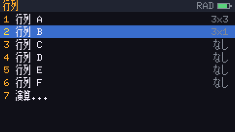
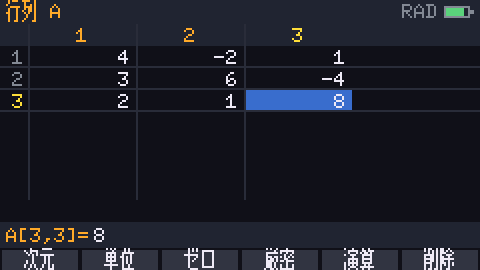
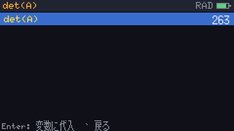
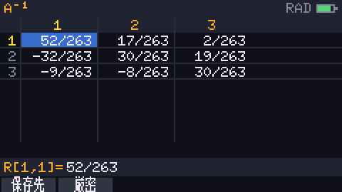
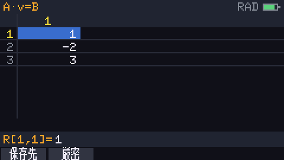

# 行列

行列は、A〜F の 6 つの行列 (それぞれ最大 6×6) を記憶し、計算するアプリです。行列式、逆行列、転置、ランク、RREF、和・差・積、累乗、トレース、X·v = Y の解を求められます。

ホーム画面で「行列」のアイコンを選ぶか、`7` を押すと起動します。

このページでは矢印を ↑ ↓ ← → と書きます。`fn`+`;` `.` `,` `/` のことです。一覧と行列の表では `;` `.` `,` `/` だけでも矢印になります。ESC は `fn`+`` ` `` です。F1〜F6 は `fn`+`1`〜`6` です。共通のキーは [基本操作](../basics.md) を参照してください。

## 画面の見方

### 行列の一覧

| 項目 | 内容 |
|---|---|
| 1〜6 行列 A … 行列 F | 行列と、右にそのサイズ (`3×3`、または `なし`) |
| 7 演算... | 演算のメニュー |

↑ ↓ と `Enter` で選ぶか、番号を押します。ESC でホーム画面に戻ります。

### 行列の編集画面

| 部分 | 内容 |
|---|---|
| ステータスバー (上) | 「行列 A」など |
| 列の見出し・行番号 | 1〜6。列は 4 列まで表示でき、それより多いと左右にスクロールします。端のオレンジの印は、まだ列があることを表します |
| セル | 値。幅に合わせて短く表示します。選んでいるセルに色が付きます |
| 下のバー | セルの名前と値 (`A[3,3]=8` など)。編集中は入力欄になります |
| ソフトキー (下) | F1 次元、F2 単位、F3 ゼロ、F4 厳密、F5 演算、F6 削除 |

### 結果の行列

結果が行列のときは、編集できない表で表示します。タイトルは演算の内容 (`A⁻¹`、`A の転置`、`rref(A)`、`A×B`、`A·v=B` など) で、セルの名前は `R[1,1]` などです。厳密表示 (分数) がオンになっています。

## 操作

### 行列の一覧

| キー | 動作 |
|---|---|
| 行列 A〜F で `Enter` | 編集画面を開きます。空の行列では、先に「行数 (1-6)」と「列数 (1-6)」を聞きます。「空欄 = 2」は、何も入力せずに `Enter` を押すとそのサイズになるという意味です |
| 演算... で `Enter` | 演算のメニューを開きます |

### 行列の編集画面

| キー | 動作 |
|---|---|
| ↑ ↓ ← → | セルを動きます |
| 数字、`-`、文字、`opt` / `alt` のキー | 新しい値を入力し始めます |
| `Enter` | 今の値を編集します。編集中に `Enter` を押すと値を決めて右に移り、行の右端では次の行の先頭に移ります |
| 編集中に ↑ ↓ | 値を決めて上 / 下に移ります |
| 編集中に ESC | 編集を取り消します |
| `BS` / `fn`+`BS` | セルを 0 にします |
| `fn`+`-` / `fn`+`=` | 最初の行 / 最後の行 |
| `ctrl`+`s` または `ctrl`+`e` | 厳密表示の切り替え (F4 と同じ) |
| ESC | 保存して一覧に戻ります |

| キー | 表示 | 動作 |
|---|---|---|
| F1 | 次元 | サイズを変えます。収まる値はそのまま残り、増えたセルは 0 になります |
| F2 | 単位 | 単位行列にします。正方行列でないときは、先に「3×3 の正方行列にしますか?」(行数 × 行数) と確認します |
| F3 | ゼロ | すべてのセルを 0 にします (「A を消去しますか?」と確認します) |
| F4 | 厳密 | できるだけ分数・π・√ で表示します |
| F5 | 演算 | 演算のメニューを開きます |
| F6 | 削除 | 行列を削除します (「行列 A を削除しますか?」と確認します)。行列は空になります |

セルには `1/3`、`√(2)`、変数などの式も入力できます。`Ans` は変わりません。`.` はカーソル移動になるので、小数は `0.5` のように `0` から入力してください。

### 演算のメニュー

演算を選んでから、行列 X (メニュー「X = ?」) を選びます。2 つの行列を使う演算では、さらに Y (「Y = ?」) を選びます。メニューには空でない行列と、一度計算したあとは直前の結果の行列「**結果**」が並びます。

| # | 演算 | 結果 |
|---|---|---|
| 1 | det(X) | 行列式 (数)。X は正方行列 |
| 2 | 逆行列 X⁻¹ | 逆行列。行列式が 0 なら「特異行列です」 |
| 3 | 転置 XT | 転置行列 |
| 4 | ランク | ランク (数) |
| 5 | RREF | 簡約階段形 |
| 6 | X + Y | 和 (同じサイズ) |
| 7 | X - Y | 差 (同じサイズ) |
| 8 | X × Y | 積 (X の列数 = Y の行数) |
| 9 | k × X | k を入力し、すべての要素を k 倍します |
| — | X ^ n | 整数 n を入力します。n=0 は単位行列、負の n は逆行列の累乗です |
| — | 解く X·v = Y | X·v = Y を解きます。Y は X と行数が同じ列ベクトル (n×1) です。X は正方行列でなくてもかまいません |
| — | トレース | 対角成分の和 (数)。X は正方行列 |

10〜12 番目の項目には番号キーがありません。↑ ↓ で選んでください (先頭で ↑ を押すとトレースに回ります)。

結果が数 (det、ランク、トレース) のときは、結果の一覧に表示します。`Enter` で値を変数 (1 文字。A〜Z、x、y など) に代入できます。ESC で戻ります。

結果の行列では:

| キー | 動作 |
|---|---|
| ↑ ↓ ← → | セルを動きます。下のバーに値を表示します |
| F1 (保存先) | 結果を A〜F のどれかにコピーします (「結果の保存先」)。コピー先の内容は確認なしで上書きされます |
| F2 (厳密) | 厳密表示と小数表示を切り替えます |
| ESC | 演算のメニューに戻ります |

## 使用例

### 行列を入力して行列式と逆行列を求める

A = [[4, −2, 1], [3, 6, −4], [2, 1, 8]]

1. `1` (行列 A) を押します。行数に `3` `Enter`、列数に `3` `Enter` を入力します。
2. 9 個の値を行ごとに、1 つずつ `Enter` を押しながら入力します: `4` `-2` `1` `3` `6` `-4` `2` `1` `8`。1 行ずつ順に埋まります (上の画面)。
3. F5 (演算) を押し、`1` (det(X))、`1` (行列 A) を押します。det(A) は `263` です。

4. ESC で演算のメニューに戻ります。`2` (逆行列 X⁻¹)、`1` (行列 A) を押します。

逆行列は `52/263` のような分数で表示されます。F2 (厳密) で小数表示に、F1 (保存先) でほかの行列に保存できます。

### A·v = b を解く

前の例の行列 A を使って、4x − 2y + z = 11、3x + 6y − 4z = −21、2x + y + 8z = 24 を解きます。

1. 行列の一覧が出るまで ESC を押し、`2` (行列 B) を押します。行数に `3` `Enter`、列数に `1` `Enter` を入力します。
2. `11` `Enter` `-21` `Enter` `24` `Enter` と入力し、ESC を押します。
3. `7` (演算...) を押します。↑ を 2 回押して「解く X·v = Y」を選び、`Enter` を押します。
4. X に `1` (行列 A)、Y に `2` (行列 B) を選びます。

解は x = 1、y = −2、z = 3 です。解がないときは「解なし」と表示します。解が無数にあるときは「解が無数にあります」と表示したあと、拡大係数行列 [X|Y] の RREF を表示します。

## 注意と制限

- **サイズ**: 最大 6 行 6 列です。行列は A〜F の 6 つと、直前の結果です。
- **精度**: 要素は 10 進 15 桁です。和・差・k × X・解では、丸めで残ったごく小さい値 (1E-13 未満) を 0 にします。
- **エラー**: サイズが演算に合わないと「次元エラー」、行列式が 0 の行列の逆行列は「特異行列です」、X ^ n の n が整数でないと「引数エラー」、解く で Y が列ベクトルでないと「Y は列ベクトル (n×1) にしてください」と表示します。
- **表示形式**: 数の結果は、計算アプリで設定した表示形式 (F4 表示) に従います。
- **保存**: A〜F と直前の結果は、編集画面やアプリを終えるときに `/data/matrix.json` に保存されます。

---

[← 目次](../README.md) · [基本操作](../basics.md)
