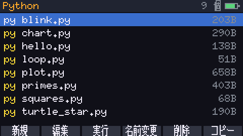
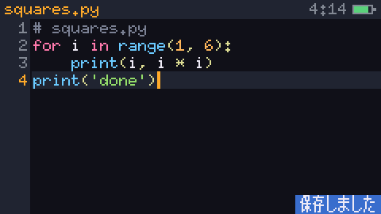
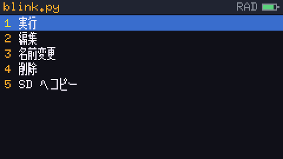
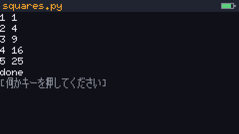
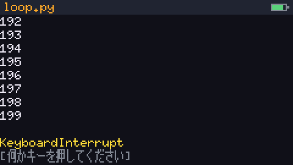

# Python

Python アプリでは、Python スクリプトの一覧を表示し、作成・編集・実行・名前変更・削除・コピーができます。スクリプトは本機の上で倍精度の float で動き、`cardgcalc` モジュールで画面・キーボード・GPIO を使えます。



ホーム画面の **Python** のアイコンを選ぶか、ホーム画面で `9` を押すと起動します。

このページでは矢印キーを ↑ ↓ ← → と書きます。`fn`+`;` `.` `,` `/` のことです。テキストを入力しない画面 (スクリプトの一覧やメニュー) では、`;` `.` `,` `/` だけでも矢印になります。F1〜F6 は `fn`+`1`〜`6` です。共通のキー操作は[基本操作](../basics.md)を見てください。

## 画面の見方

### スクリプトの一覧

| 場所 | 内容 |
|---|---|
| ステータスバー (上) | タイトル「Python」、スクリプトの数 (「9 個」)、電池残量 |
| 一覧 | 1 行に 1 つのスクリプト。`py`、ファイル名、右端にサイズ。SD カード上のスクリプトはサイズの前に `SD` が付きます |
| ソフトキー (下) | F1 新規、F2 編集、F3 実行、F4 名前変更、F5 削除、F6 コピー |

一覧には `/programs` (本体のフラッシュ) の `.py` ファイルと、その後に `/sd/programs` (SD カード、マウント中のみ) の `.py` ファイルが並びます。スクリプトがないときは「スクリプトなし。F1: 新規作成」と表示されます。

### エディタ



| 場所 | 内容 |
|---|---|
| ステータスバー (上) | ファイル名 (保存していない変更があると先頭に `*`)、カーソル位置 `行:桁`、電池残量 |
| 左端の欄 | 行番号 (下 3 桁)。カーソルのある行の番号は強調されます |
| 本文 | 色分けしたスクリプト。キーワードはピンク、組み込み関数は青、文字列は緑、数値はオレンジ、コメントは灰色です。カーソルのある行は背景が明るくなります。左端の細い線は、横にスクロールしていることを表します |
| メッセージ (右下) | 「保存しました」「元に戻す操作がありません」「1 行をカット」「見つかりません: …」などの短い通知 |

エディタにはソフトキーはありません。操作はすべて `ctrl` と `opt` のキーで行います。

### 出力コンソール

スクリプトを実行すると、画面はスクリプト名をタイトルにしたコンソールになります。`print()` の出力はここに表示され、`input()` はここで 1 行を読み込みます。スクリプトが終わると、最下行に「[何かキーを押してください]」と表示されます。

## 操作

### スクリプトの一覧のキー

| キー | 動作 |
|---|---|
| ↑ ↓ | スクリプトを選ぶ (端まで行くと反対側に戻る) |
| `Enter` または → | そのスクリプトの操作メニュー (後述) |
| F1 (新規) または `ctrl`+`n` | 新しいスクリプトを作り、エディタで開く |
| F2 (編集) または `e` | エディタで開く |
| F3 (実行)、`r` または `ctrl`+`r` | 実行する |
| F4 (名前変更) | 名前を変える |
| F5 (削除)、`BS` または `fn`+`BS` | 削除する (「hello.py を削除しますか?」と確認。`Enter` で削除) |
| F6 (コピー) | 本体のスクリプトを SD カードへ、SD のスクリプトを本体へコピーする |
| ESC (`fn`+`` ` ``) または ← | ホーム画面に戻る |



操作メニュー (`Enter`) には **実行**、**編集**、**名前変更**、**削除**、**SD へコピー** (SD 上のスクリプトでは **本体へコピー**) があります。番号を押すか、選んで `Enter` を押します。

- **新規**: 「新しいスクリプト名」を聞かれます。使える文字は英字・数字・`_`・`-`・`.` です。`.py` は省略すると自動で付きます。新しいスクリプトは必ず `/programs` に作られ、1 行目は `# 名前.py` というコメントです。同じ名前があると「名前.py は既に存在します」と表示されます。
- **名前変更**: 名前の規則は新規と同じです。フォルダは変わりません。
- **SD へコピー**: 必要なら SD カードをマウントし、`/sd/programs` を作ってコピーします。**本体へコピー** は `/programs` にコピーします。コピー先に同じ名前があると「… を上書きしますか?」と確認します。終わると「コピーしました → パス」と表示されます。

### エディタのキー

| キー | 動作 |
|---|---|
| ↑ ↓ ← → | カーソルを動かす。行頭で ← を押すと前の行の行末へ、行末で → を押すと次の行の行頭へ移ります |
| `fn`+`-` | 行頭へ。続けて押すと、最初の空白でない文字と 1 桁目を行き来します |
| `fn`+`=` | 行末へ |
| `ctrl`+`a` / `ctrl`+`e` | 1 桁目へ / 行末へ |
| `fn`+`[` / `fn`+`]` | 1 画面上へ / 下へ |
| `Enter` | 改行して自動インデント (後述) |
| `BS` | カーソルの前の 1 文字を消す。行頭の空白の中では、1 つ前のインデント位置 (4 の倍数) まで消します。1 桁目では前の行とつなげます |
| `fn`+`BS` | カーソル位置の 1 文字を消す (行末では次の行とつなげる) |
| `Tab` | 次の 4 の倍数の位置まで空白を入れる |
| `shift`+`Tab` | 行頭のインデントを 1 段 (最大 4 文字) 減らす |
| `ctrl`+`s` | 保存 |
| `ctrl`+`r` | (変更があれば) 保存して実行。スクリプトが終わるとエディタに戻ります |
| `ctrl`+`f` | 検索。文字列を入力して `Enter` を押します。カーソル位置から探し、末尾まで行くと先頭から続けます。大文字と小文字は区別します。前回の検索文字列が入った状態で開きます |
| `ctrl`+`n` | 次を検索 (まだ検索していなければ文字列を聞きます) |
| `ctrl`+`g` | 行へ移動。行番号を入力します (「1-24」のように範囲が表示されます) |
| `ctrl`+`k` | カーソルのある行をカット。続けて押すと、複数行をまとめてカットします |
| `ctrl`+`u` | カットした行を、カーソルのある行の上に貼り付ける |
| `ctrl`+`d` | カーソルのある行を複製 |
| `ctrl`+`z` | 元に戻す (40 回まで。同じ行での連続した入力は 1 回分です) |
| `opt`+英字 | スニペットを入れる (後述) |
| `fn`+`h` | エディタのキーの一覧 (「エディタのキー操作」) |
| ESC | エディタを閉じる。保存していない変更があると「変更を保存しますか?」と聞かれます: **保存**、**破棄**、**キャンセル** |

**自動インデント**: `Enter` で改行すると、今の行と同じだけ字下げします。`:` で終わる行 (`for …:`、`def …:` など) の次は、さらに 4 文字字下げします。カーソルの前にある行末の空白は取り除かれます。ブロックを終えるときは、新しい行の先頭で `BS` を 1 回押すと 1 段戻ります。

**スニペット** (`opt`+キーで文字列を入れます):

| キー | 文字列 | キー | 文字列 | キー | 文字列 |
|---|---|---|---|---|---|
| `d` | `def ` | `f` | `for i in range(` | `w` | `while ` |
| `i` | `if ` | `l` | `elif ` | `e` | `else:` |
| `r` | `return ` | `p` | `print(` | `m` | `import ` |
| `n` | `cardgcalc` | `t` | `True` | `a` | `False` |
| `c` | `class ` | `x` | `except ` | `y` | `try:` |

行のカットで使うクリップボードは、エディタで開くすべてのファイルで共通です。あるスクリプトでカットした行を、別のスクリプトに貼り付けられます。

### スクリプトの実行

| 場面 | 動作 |
|---|---|
| `print()` | コンソールに表示します。最後の 200 行を保持します |
| `input("プロンプト")` | プロンプトを表示して 1 行読み込みます。空のまま ESC を押すとスクリプトが止まります |
| 実行中に ESC または `ctrl`+`c` | スクリプトを中断します。`while True: pass` のようなループも止まります。黄色で「KeyboardInterrupt」と表示されます |
| エラー | トレースバックを赤で表示します |
| 画面に描画した | キーを押すまで絵を表示したままにします。文字も出力していれば、その後コンソールを表示します |
| スクリプトの終了 | 「[何かキーを押してください]」。↑ ↓ で 1 行、`fn`+`[` / `fn`+`]` で 1 画面ずつさかのぼれます。それ以外のキーで戻ります |

実行中は、スクリプトのあるフォルダが `sys.path` に入ります。`/programs` のスクリプトから、同じ `/programs` にある別のモジュールを `import` できます。スクリプトが読み込んだモジュールは、終了時に解放されます。

### サンプルスクリプト

`/programs` が空の状態で初めて Python アプリを開くと、次のサンプルが作られます。

| スクリプト | 内容 |
|---|---|
| `hello.py` | `input()` と `print()`。名前を聞いて、2 乗の表を表示します |
| `primes.py` | エラトステネスのふるいで 2000 までの素数を求め、かかった時間 (ms) を表示します |
| `plot.py` | `cardgcalc.plot()` で減衰する正弦波を描き、続いてボールが跳ねるアニメーション (ESC で止まる) |
| `turtle_star.py` | `turtle` モジュールで色付きの星を描きます |
| `blink.py` | Grove の G1 につないだ LED を 0.5 秒ごとに点滅させます (ESC で止まる) |
| `chart.py` | `matplotlib.pyplot` で折れ線・散布図・棒グラフを描きます |
| `ulab_demo.py` | `ulab` の配列と pyplot で、減衰する正弦波とヒストグラムを描きます |

スクリプトから使える関数 (`cardgcalc`、`turtle`、`matplotlib.pyplot`、`ulab`) は [cardgcalc モジュール API](../api.md) を見てください。

## 使用例

### スクリプトを作って保存し、実行する

1. スクリプトの一覧で F1 (新規) を押します。
2. `squares` と入力して `Enter` を押します。エディタが開き、`# squares.py` の 1 行が入っています。
3. ↓ を押して 2 行目に移ります。
4. `opt`+`f` (`for i in range(` が入ります) を押し、`1, 6):` と入力して `Enter` を押します。次の行は 4 文字字下げされます。
5. `opt`+`p` (`print(` が入ります) を押し、`i, i * i)` と入力して `Enter` を押します。
6. `BS` を押して字下げを戻し、`opt`+`p` を押して `'done')` と入力します。
7. `ctrl`+`s` を押します。「保存しました」と表示され、ファイル名の前の `*` が消えます。

   

8. `ctrl`+`r` を押します。スクリプトが実行されます。

   

9. 何かキーを押すとエディタに戻ります。ESC で一覧に戻ります。

### 止まらないスクリプトを中断する

1. F1 を押し、`loop` と入力して `Enter` を押してから ↓ を押します。
2. 次の行を入力します (各行の後に `Enter`。`while True:` の次の字下げは自動です)。
   ```python
   n = 0
   while True:
       n += 1
       print(n)
   ```
3. `ctrl`+`r` を押します。保存されて、数を数え始めます。
4. ESC (または `ctrl`+`c`) を押します。スクリプトが止まります。

   

5. 何かキーを押すとエディタに戻ります。

### スクリプトを SD カードにコピーする

1. microSD カードを入れます。
2. 一覧でスクリプトを選んで F6 (コピー) を押します。`Enter` を押して **SD へコピー** を選んでもかまいません。
3. 「コピーしました → /sd/programs/squares.py」と表示されます。一覧に、サイズの横に `SD` の付いたコピーが加わります。

## 注意と制限

- スクリプトは `/programs` (本体) と `/sd/programs` (SD カード) に保存されます。一覧に出るのは `.py` ファイルだけです。ほかのフォルダは[ファイル](files.md)アプリで扱います。
- RAM のヒープは約 176KB です。大きなリストや長いスクリプトでは `MemoryError` になることがあります。処理を分けるか、`ulab` の配列を使ってください。
- Python の数値は通常の倍精度 float で、電卓の 10 進 15 桁の数ではありません。
- 日本語は `print()` で表示できますが、キーボードからは入力できません。
- エディタのインデントは空白 (1 段 4 文字) です。`Tab` もタブ文字ではなく空白を入れます。
- PC からスクリプトを転送する方法は [PC との連携](../pc.md)、プラグインとして作るアプリは[プラグイン](../plugins.md)を見てください。

---

[← 目次](../README.md) · [基本操作](../basics.md)
