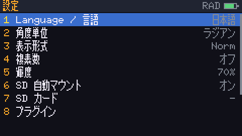
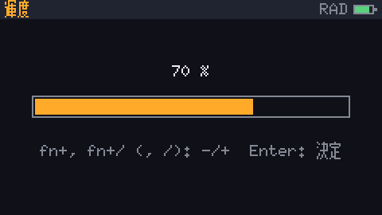
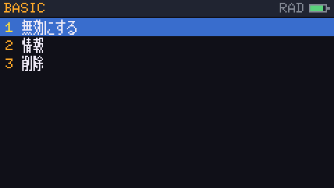
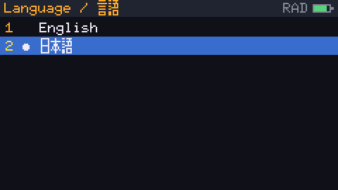
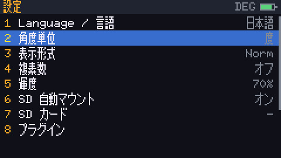

# 設定

設定アプリでは、すべてのアプリに共通の設定を変えます。表示言語、角度単位、表示形式、複素数、画面の輝度、SD カードです。プラグインの管理、メモリとバージョンの情報の表示、保存したデータの初期化もここで行います。

ホーム画面の **設定** のアイコン (13 番目のアプリ) を矢印で選び、`Enter` を押すと起動します。

このページでは矢印キーを ↑ ↓ ← → と書きます。`fn`+`;` `.` `,` `/` のことで、メニューでは `;` `.` `,` `/` だけでも矢印になります。共通のキー操作は[基本操作](../basics.md)を見てください。

## 画面の見方

設定は番号付きのメニューです。各行の左に項目、右に今の値が出ます。項目は 11 個あり、スクロールします。右端の棒が位置を表します。ソフトキーはありません。ステータスバーには、タイトル「設定」、角度単位 (RAD / DEG / GRA)、電池残量が出ます。

## 操作

| キー | 動作 |
|---|---|
| ↑ ↓ | 項目を選ぶ (端まで行くと反対側に戻る) |
| `fn`+`[` / `fn`+`]` | 1 画面上 / 下へ |
| `1`〜`9` | 1〜9 番の項目を直接開く |
| `Enter` または → | 選んだ項目を開く (オン・オフの項目は切り替える) |
| ESC (`fn`+`` ` ``) または ← | 戻る (下のメニューでは、変えずに取り消す) |

選択肢の一覧では、今の値に丸印 (●) が付いています。番号を押すか、選んで `Enter` を押します。変更はすぐに `/data/settings.json` に保存され、電源を切っても残ります。

### 項目

| # | 項目 | 値 | 内容 |
|---|---|---|---|
| 1 | Language / 言語 | English、日本語 | メニューや画面の表示言語。すぐに切り替わります |
| 2 | 角度単位 | ラジアン、度、グラジアン | 電卓アプリ (計算、グラフ、数表、方程式、3Dグラフ …) の三角関数の単位。ステータスバーに RAD / DEG / GRA と出ます。Python の `math` モジュールは常にラジアンです |
| 3 | 表示形式 | Norm、Fix *n*、Sci *n*、Eng *n* | 電卓アプリでの数の表示のしかた (後述) |
| 4 | 複素数 | オン、オフ | `Enter` で切り替えます。オンのときは結果が複素数になれます (`√(-4)` は `2i`)。オフのときは、実数にならない結果は「非実数エラー」になります |
| 5 | 輝度 | 5〜100 % | バックライトの明るさ (後述) |
| 6 | SD 自動マウント | オン、オフ | `Enter` で切り替えます。オンのときは、起動時に SD カードを `/sd` にマウントします |
| 7 | SD カード | マウント中、- | SD カードを今すぐマウント / アンマウントする |
| 8 | プラグイン | | プラグインの有効・無効、情報、削除 (後述) |
| 9 | メモリと容量 | | RAM と記憶容量の情報 (後述) |
| 10 | バージョン情報 | | バージョンなどの情報 (後述) |
| 11 | 全データ初期化 | | 保存した設定と電卓のデータをすべて消す (後述) |

最初の設定は、English、ラジアン、Norm、複素数オフ、70 %、SD 自動マウント オンです。

### 表示形式

| 形式 | 表示 | 聞かれる桁数 |
|---|---|---|
| Norm | 通常の表示 (10 桁まで) | なし |
| Fix | 小数点以下の桁数を固定 | 「小数点以下の桁数 (0-9)」 |
| Sci | 指数表示 (仮数 × 10ⁿ) | 「有効桁数 (1-10)」 |
| Eng | 工学表示 (指数が 3 の倍数) | 「有効桁数 (1-10)」 |

Fix・Sci・Eng を選ぶと、桁数を入力する欄が出ます。範囲外の値は範囲内に丸められます。ここで ESC を押すと、表示形式は元のままです。メニューには `Fix 2` のように表示されます。[計算](calc.md)アプリの「表示」ソフトキーでも、同じ設定を変えられます。

### 輝度

| キー | 動作 |
|---|---|
| ← または `-` | 暗くする (5 % 刻み、最小 5 %) |
| → または `+` (`=`) | 明るくする (最大 100 %) |
| `Enter` | 新しい明るさに決める |
| ESC | 元の明るさに戻す |

キーを押すと、すぐに画面の明るさが変わります。この画面では `,` と `/` だけでも ← と → になります。

### SD カード

- **SD カード** の値は、マウント中なら「マウント中」、そうでなければ「-」です。
- マウントしていないとき: `Enter` を押すと「SD をマウント中...」と表示し、「SD カード: マウント先 /sd」または「SD カードなし / マウント失敗」と表示します。
- マウント中: `Enter` でアンマウントします (「SD カード: アンマウントしました」)。カードを抜く前にアンマウントしてください。
- [ファイル](files.md)アプリの F1 (SD) でも同じことができます。

### プラグイン

**プラグイン** を開くと、インストールしたプラグイン (`/plugins` と、マウント中なら `/sd/plugins`) の一覧が出ます。右の列は「オン」「オフ」、または新しいファームウェアが必要なプラグインでは「API」です。プラグインがないときは「プラグインがありません。」と、置き場所のフォルダを表示します。

プラグインを選んで `Enter` を押すと、メニューが出ます。

| 項目 | 動作 |
|---|---|
| 無効にする / 有効にする | 無効にしたプラグインは、ホーム画面とファイルアプリの「開くアプリ」に出なくなります。インストールしたままです。新しいファームウェアが必要なプラグイン (`API` と表示) には出ません |
| 情報 | 名前とバージョン、説明、フォルダ、モジュール (`module.run()`)、API のバージョン (新しすぎると「新しいファームウェアが必要」)、開くファイル (扱う拡張子) |
| 削除 | 「プラグインを削除しますか?」とフォルダのパスを表示し、`Enter` でプラグインのフォルダごと削除します |

プラグインの作り方とインストールは[プラグイン](../plugins.md)を見てください。

### メモリと容量

次の情報を表示します。

- RAM: ヒープの空きと使用量
- 本体: 内部のファイルシステムの空き / 全体
- SD: SD カードの空き / 全体、または「未マウント」
- スクリプト: `/programs` にある `.py` ファイルの数
- バッテリー: 電池残量の目安 (%)

### バージョン情報

ファームウェアの名前とバージョン (`card-gcalc 0.2`)、「グラフ電卓 M5Stack Cardputer-Adv」(Cardputer では「M5Stack Cardputer」)、MicroPython のバージョン、ボード名、フォントのクレジット、CPU のクロックを表示します。

### 全データ初期化

「全データを初期化しますか?」と確認します (「設定・変数・関数・リスト・行列・履歴」、`Enter`: はい、ESC: いいえ)。はいを選ぶと、`/data` のファイルをすべて消して「全データを消去しました。」と表示します。

- すべての設定が最初の状態に戻ります。表示言語も English に戻り、無効にしたプラグインも有効に戻ります。
- 電卓の変数と Ans、計算の履歴、グラフの関数、統計のリスト、行列、そのほかの電卓アプリのデータが消えます。

`/programs` のスクリプト、プラグイン、SD カードのファイルは消えません。

## 使用例

### 表示を日本語にする

1. `1` (Language / 言語) を押します。

   

2. `2` (日本語) を押します。すぐにメニューが日本語になり、以後すべてのアプリが日本語で表示されます。
3. 英語に戻すときは、`1` (Language / 言語) を押してから `1` (English) を押します。

### 角度を度で計算する

1. `2` (角度単位) を押します。
2. `2` (度) を押します。行に「度」と表示され、ステータスバーが DEG になります。

   

3. ESC で戻って計算アプリを開くと、`sin(30)` が 0.5 になります。

### 小数点以下 2 桁で表示する

1. `3` (表示形式) を押してから、`2` (Fix) を押します。
2. 「小数点以下の桁数 (0-9)」に `2` と入力して `Enter` を押します。行に `Fix 2` と出ます。計算アプリで `1÷3` が `0.33` と表示されます。
3. 元に戻すときは、表示形式で Norm を選びます。

### プラグインを無効にする

1. `8` (プラグイン) を押します。
2. プラグイン (たとえば BASIC) を選んで `Enter` を押します。
3. `1` (無効にする) を押します。一覧の値が「オフ」になり、ホーム画面からアイコンが消えます。有効にするを選ぶと元に戻ります。

## 注意と制限

- 設定は `/data/settings.json` に、電卓のデータはそのほかの `/data/*.json` に保存されます。
- 輝度を 0 にはできません (最小 5 %)。画面が真っ暗になることはありません。
- 角度単位と表示形式が効くのは電卓アプリだけです。Python のスクリプトはラジアンで計算し、数は Python の書式で表示します。

---

[← 目次](../README.md) · [基本操作](../basics.md)
