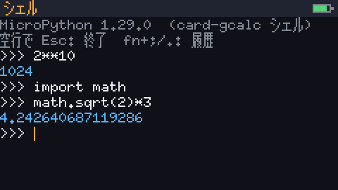
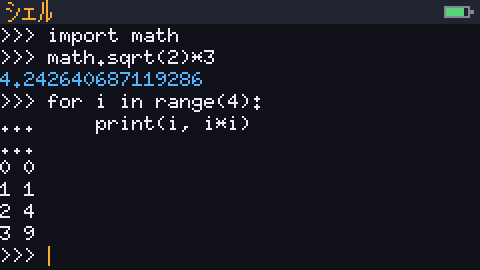

# シェル

シェルは、Python の対話環境 (REPL) です。Python の文や式を入力すると、すぐに実行します。スクリプトを書かずにコードを試したり、Python を計算機として使ったり、`cardgcalc` の関数を試したりできます。

ホーム画面の **シェル** のアイコンを選ぶか、ホーム画面で `0` を押すと起動します (10 番目のアプリ)。

このページでは矢印キーを ↑ ↓ ← → と書きます。`fn`+`;` `.` `,` `/` のことです。シェルは常に文字を入力する画面なので、`;` `.` `,` `/` だけを押すとその文字が入ります。矢印には `fn` を使ってください。共通のキー操作は[基本操作](../basics.md)を見てください。

## 画面の見方

| 場所 | 内容 |
|---|---|
| ステータスバー (上) | タイトル「シェル」、電池残量 |
| 最初の行 | MicroPython のバージョンと、ヒント「空行で Esc: 終了  fn+;/.: 履歴」 |
| コンソール | プロンプト `>>>` (続きの行は `...`) の後に入力した内容、青で結果、赤でエラー、黄色で「KeyboardInterrupt」 |
| 入力行 | 最下行。プロンプトの後ろにカーソルがあります |
| スクロール表示 (右上) | 過去の出力を見ているときに `-N-` (最下行から N 行上) |

ソフトキーはありません。コンソールは最後の 200 行を保持します。

## 操作

| キー | 動作 |
|---|---|
| `Enter` | 行を実行する。式なら値を表示し、`_` に入れます |
| ↑ / ↓ | 履歴の前の行 / 次の行 |
| ← / → | 行の中でカーソルを動かす |
| `fn`+`-` / `fn`+`=` | 行頭 / 行末 |
| `BS` / `fn`+`BS` | カーソルの前 / カーソル位置の文字を消す |
| `ctrl`+`u` | 行を消す |
| `fn`+`[` / `fn`+`]` | 出力を 1 画面上 / 下へスクロール。新しい出力があると (`Enter` の後など) 最下行に戻ります |
| ESC (`fn`+`` ` ``) | 行に文字があれば消す。空の行ではシェルを終了する |
| 空の行で `ctrl`+`d` | シェルを終了する |
| プロンプトで `ctrl`+`c` | 行を取り消す (「KeyboardInterrupt」と表示) |
| 実行中に ESC または `ctrl`+`c` | 実行を中断する (「KeyboardInterrupt」) |

### 複数行のブロック

`:` で終わる行 (`for`、`while`、`if`、`def` など) や、`\` で終わる行を入力すると、ブロックが始まります。

- プロンプトが `...` に変わり、次の行は最初から字下げされています。ブロックを始めた行より 4 文字深くなります。
- `:` で終わる行の次は、さらに 4 文字深くなります。それ以外は同じ深さのままです。字下げを減らすには `BS` で空白を 1 文字ずつ消します。
- 空白だけの行で `Enter` を押すと、ブロックが終わって実行されます。
- `ctrl`+`c` を押すと、ブロック全体を実行せずに取り消します。

### 履歴

- シェルを開いている間、最後の 30 件を覚えています。シェルを終了すると、履歴と変数はすべて消えます。
- ブロックは、最初の 1 行だけが履歴に入ります。呼び出すと新しいブロックが始まるので、中身はもう一度入力します。

### 出力とグラフィックス

- `print()` の出力やトレースバックは、コンソールに表示されます。
- `input()` はコンソールで 1 行読み込みます。
- 画面に描くコマンド (`cardgcalc.plot(...)` や `cardgcalc.circle(...)` など) を実行すると、キーを押すまで絵を表示し、その後コンソールに戻ります。

## 使用例

### 計算する

1. `2**10` と入力して `Enter` を押します。`1024` と表示されます。
2. `import math` と入力して `Enter` を押します。
3. `math.sqrt(2)*3` と入力して `Enter` を押します。`4.242640687119286` と表示されます。

4. `_ * 2` と入力して `Enter` を押すと、直前の結果を使って計算できます。

### for ループを実行する

1. `for i in range(4):` と入力して `Enter` を押します。プロンプトが `...` になり、4 文字字下げされた状態になります。
2. `print(i, i*i)` と入力して `Enter` を押します。次の `...` の行も同じだけ字下げされています。
3. その空の行で、もう一度 `Enter` を押します。ブロックが実行されます。

4. ↑ を 2 回押すと `math.sqrt(2)*3` が戻ってきます。直して `Enter` を押せます。

### グラフィックス API を試す

1. `import cardgcalc` と入力して `Enter` を押します。
2. `cardgcalc.plot(lambda x: x*x, -3, 3)` と入力して `Enter` を押します。画面いっぱいにグラフが描かれます。
3. 何かキーを押すと、シェルに戻ります。

## 注意と制限

- 数値は Python の float (倍精度) で、電卓の 10 進数ではありません。`0.1+0.2` は `0.30000000000000004` になります。
- `Tab` で空白を 4 個入れます。続きの行は自動で字下げされます。`Tab`、`Space`、`BS` で調整してください。
- RAM のヒープは約 176KB です。作った大きなオブジェクトは、シェルを終了するまでメモリに残ります。
- 長いプログラムは [Python](python.md) アプリでスクリプトにしてください。使える関数は [cardgcalc モジュール API](../api.md) にあります。

---

[← 目次](../README.md) · [基本操作](../basics.md)
