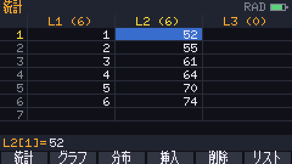
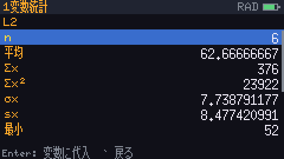
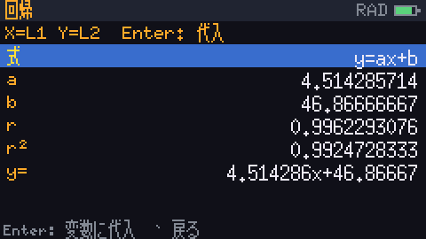
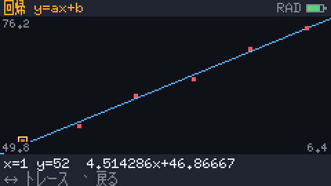
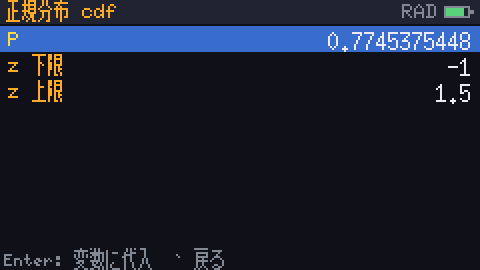

# 統計

統計アプリは、L1〜L3 の 3 つまでのデータリストを持ち、1 変数・2 変数の統計量と回帰式を求めます。散布図・ヒストグラム・箱ひげ図を描き、正規分布・二項分布・ポアソン分布の確率も計算できます。

ホーム画面で **統計** のアイコンを選ぶか、ホーム画面で `6` を押すと起動します。

このページでは矢印キーを ↑ ↓ ← → と書きます。実際のキーは `fn`+`;` `.` `,` `/` です。文字入力のない画面では、`;` `.` `,` `/` だけでも矢印として働きます。F1〜F6 は `fn`+`1`〜`6` です。共通のキー操作は [基本操作](../basics.md) を見てください。

## 画面構成

| 場所 | 内容 |
|---|---|
| ステータスバー (上端) | タイトル「統計」、修飾キーの状態、角度単位、電池残量 |
| 列の見出し | `L1 (6)`、`L2 (6)`、`L3 (0)`: リスト名と項目数。選んでいる列は黄色で表示します |
| 行 | 左に行番号、1 つのセルに 1 項目。いちばん長いリストの後ろに、新しいデータ用の空の行が 1 つあります |
| 下の行 | 選んでいるセルの名前と値 (`L2[1]=52` など)。編集中はここが入力欄になります |
| ソフトキー (下端) | F1 統計、F2 グラフ、F3 分布、F4 挿入、F5 削除、F6 リスト |

## 操作

### リスト編集のキー

| キー | 動作 |
|---|---|
| ↑ ↓ ← → | セルを移動する |
| `fn`+`[` / `fn`+`]` | 1 画面分上 / 下へ |
| `fn`+`-` / `fn`+`=` | 最初の行 / 最後の行へ |
| 文字キー (数字、`-`、変数の文字など) または `opt` / `alt` の数式キー | セルに新しい値を入力し始める |
| `Enter` | 今の値を編集する |
| `BS` または `fn`+`BS` | その項目を削除する (下の項目が上に詰まります) |
| `ctrl`+`s` または `ctrl`+`e` | 厳密表示 (分数・√・π) の切り替え |
| `fn`+`h` | キー一覧 |
| ESC (`fn`+`` ` ``) | ホーム画面に戻る |

値を入力するときは、次のように操作します。

- `Enter` で確定して下に移ります。↑ / ↓ で確定して上 / 下に移ります。ESC で取り消します。
- セルには `1/3`、`2π`、`√(2)` (`opt`+`q`) のような式も入力できます。確定するときに計算します。実数だけを受け付けます。
- リストの終わりより下に入力すると、間は 0 で埋めます。
- 小数は `0.5` のように 0 から入力してください。入力していないときに `.` だけを押すと、カーソルが下に移ります。

### ソフトキー

| キー | 動作 |
|---|---|
| F1 統計 | 統計メニュー: 1変数統計、2変数統計、回帰 |
| F2 グラフ | グラフメニュー: 散布図、散布図 + 回帰、ヒストグラム、箱ひげ図 (全リスト) |
| F3 分布 | 確率分布メニュー (正規分布、二項分布、ポアソン分布) |
| F4 挿入 | カーソルの位置に 0 を挿入する。下の項目は 1 つずつ下がります |
| F5 削除 | カーソルの位置の項目を削除する |
| F6 リスト | 選んでいる列のリストのメニュー |

どのメニューでも、↑ ↓ と `Enter`、または番号キーで選びます。ESC または ← で戻ります。

### F1 統計

**1変数統計**: データのリストを選び、次に度数のリスト (「なし (すべて1)」または L1〜L3) を選びます。

| 結果 | 意味 |
|---|---|
| n | データの個数 (度数の合計) |
| 平均 | 平均 |
| Σx, Σx² | 合計、2 乗の合計 |
| σx | 母標準偏差 |
| sx | 標本標準偏差 (n>1 のとき) |
| 最小, 最大 | 最小値、最大値 |
| Q1, 中央値, Q3 | 四分位数と中央値 |
| 四分位範囲 | Q3−Q1 |
| 範囲 | 最大−最小 |
| 最頻値 | いちばん多い値 (3 つまで) |

- Q1 と Q3 は、下半分と上半分の中央値です。n が奇数のときは、中央値を除いて半分に分けます。
- Q1、中央値、Q3、四分位範囲は、度数がすべて整数のときだけ表示します。
- どの値も同じ回数ずつ現れるときは、最頻値を表示しません。
- 度数は 0 以上にします (負なら「度数 < 0」)。度数 0 の項目は無視します。度数のリストは、データのリスト以上の長さが必要です (足りないと「次元エラー」)。

**2変数統計**: X のリストと Y のリストを選びます。長さが違うときは、短いほうの長さを使います。

| 結果 | 意味 |
|---|---|
| n | 組の個数 |
| 平均 x, 平均 y | 平均 |
| Σx, Σy, Σx², Σy², Σxy | 各種の合計 |
| σx, σy | 母標準偏差 |
| sx, sy | 標本標準偏差 (n>1 のとき) |
| r | 相関係数 |

**回帰**: X のリスト、Y のリスト、回帰の種類を選びます。

| # | 種類 | 条件 |
|---|---|---|
| 1 | 1次  y=ax+b | 2 点以上 |
| 2 | 2次  y=ax²+bx+c | 3 点以上 |
| 3 | 指数  y=a·e^(bx) | y>0 |
| 4 | 対数  y=a+b·ln(x) | x>0 |
| 5 | べき乗  y=a·x^b | x>0, y>0 |

結果には、式、係数 a・b (・c)、r、r²、係数を丸めた式 `y=` を表示します。2 次回帰では r を表示しません。指数・対数・べき乗の回帰は、ln(x) や ln(y) に変換したデータに直線を当てはめて求めます。r は変換後のデータの相関係数です。r² は、求めた曲線と元のデータから計算します。

**結果の画面**: ↑ ↓ で行を選び、`fn`+`[` / `]` で 1 画面ずつ動かします。数値の行で `Enter` を押すと「a を変数に代入」が開きます。文字 (A〜Z、x、y、θ など。e と i は不可) を入力して `Enter` を押すと、その変数に保存します。計算アプリやグラフの関数で使えます。ESC または ← で戻ります。

### F2 グラフ

| # | 項目 | 手順 |
|---|---|---|
| 1 | 散布図 | X と Y のリストを選ぶ |
| 2 | 散布図 + 回帰 | X と Y のリストと回帰の種類を選ぶ。点の上に回帰曲線を重ねて描きます |
| 3 | ヒストグラム | データのリストと度数のリストを選び、階級の幅を入力する |
| 4 | 箱ひげ図 (全リスト) | データのあるリストごとに、箱ひげ図を上から順に描く |

グラフの画面では、次のように操作します。

- ← → で、黄色で示す点・階級・箱を前 / 次に動かします (箱ひげ図では ↑ ↓ も使えます)。情報行にその値を表示します。
  - 散布図: `x=… y=…`。回帰があれば続けて回帰式
  - ヒストグラム: 階級 `[始まり, 終わり)` と度数 `n=…`
  - 箱ひげ図: `L1 最小|Q1|中央値|Q3|最大`
- ESC または `Enter` で戻ります。
- 小さな数字は、y の範囲の上端と下端 (左)、x の範囲の右端 (右下) です。

ヒストグラム: 「階級の幅」のダイアログに、始まりの値 (最小値) と、おすすめの幅を表示します。おすすめの幅は、階級の数がおよそ log₂(n)+1 になる値です。別の幅を入力するか、そのまま `Enter` を押します。各階級は始まりを含み、終わりを含みません。最大値は最後の階級に入ります。階級は 120 個までです。

### F3 分布

分布を選ぶと、初期値の入った入力画面が開きます。↑ ↓ で欄を移ります。`Enter` で次の欄に移り、最後の欄で計算します。F1 (計算) でいつでも計算できます。欄には式も入力できます。`BS` で 1 文字ずつ消せます。`ctrl`+`u` で欄を空にできます。

| # | 分布 | 欄 (初期値) | 結果 |
|---|---|---|---|
| 1 | 正規分布 pdf | x (0), μ (0), σ (1) | p(x): 確率密度 |
| 2 | 正規分布 cdf | 下限 (−1), 上限 (1), μ (0), σ (1) | P: 下限 ≤ X ≤ 上限 の確率。z 下限, z 上限: 標準化した値 |
| 3 | 逆正規分布 | 面積 (0.95), μ (0), σ (1), 裾 L/R/C (L) | P(X<x)=面積 となる x (L)、P(X>x)=面積 となる x (R)、μ を中心に P(x1<X<x2)=面積 となる x1, x2 (C) |
| 4 | 二項分布 pdf | x (3), n (10), p (0.5) | P(X=x) |
| 5 | 二項分布 cdf | x (3), n (10), p (0.5) | P(X≤x) |
| 6 | ポアソン分布 pdf | x (2), λ (3) | P(X=x) |
| 7 | ポアソン分布 cdf | x (2), λ (3) | P(X≤x) |

- 結果の画面で ESC を押すと入力画面に戻ります。入力した値は、アプリを閉じるまで残ります。入力画面で ESC を押すとメニューに戻ります。
- σ と λ は 0 より大きく、p は 0 以上 1 以下、n は 0 以上の整数にします。面積は 0 より大きく 1 より小さい値にします。
- 正規分布 cdf で片側だけの範囲を求めるときは、`alt`+`8` で `∞` を入力します (下限 `-∞`、上限 `∞`)。先に `ctrl`+`u` で欄を空にしてください。

### F6 リスト

選んでいる列のリストを操作します (タイトルは「リスト L2」のようになります)。

| # | 項目 | 動作 |
|---|---|---|
| 1 | 昇順ソート | 小さい順に並べ替える |
| 2 | 降順ソート | 大きい順に並べ替える |
| 3 | L2 をクリア | リストの項目をすべて消す (確認あり) |
| 4 | 全リストをクリア | L1〜L3 の項目をすべて消す (確認あり) |
| 5 | 数列で埋める... | 式の値でリストを置き換える: x の式 (x)、x 開始 (1)、x 終了 (10)、刻み (1)。F1 (生成) で実行 |
| 6 | L2 をコピー... | リストを別のリストにコピーする (コピー先の内容は置き換わります) |

例: 数列で埋める で `x²`、1、5、1 とすると、1, 4, 9, 16, 25 になります。項目は 1000 個程度までです。

## 使用例

### 例 1: データを入力して 1 変数統計を求める

6 人の勉強時間 (L1) とテストの点数 (L2) です。

| L1 | 1 | 2 | 3 | 4 | 5 | 6 |
|---|---|---|---|---|---|---|
| L2 | 52 | 55 | 61 | 64 | 70 | 74 |

1. ホーム画面で `6` を押して統計アプリを開きます。カーソルは L1 の 1 行目にあります。
2. `1` `Enter` `2` `Enter` `3` `Enter` `4` `Enter` `5` `Enter` `6` `Enter` と押します。
3. → で L2 に移り、`fn`+`-` で 1 行目に戻ります。
4. `52` `Enter` `55` `Enter` `61` `Enter` `64` `Enter` `70` `Enter` `74` `Enter` と押します。
5. F1 (統計)、`1` (1変数統計)、`2` (L2)、`1` (なし (すべて1)) と押します。
6. n=6、平均=62.66666667、σx=7.738791177、sx=8.477420991 などを表示します。↓ で下に進むと、Q1、中央値 (62.5)、Q3、最大も見られます。

### 例 2: 1 次回帰と散布図

例 1 のデータを使います。

1. F1 (統計)、`3` (回帰) と押します。
2. X のリストは `1` (L1)、Y のリストは `2` (L2)、種類は `1` (1次  y=ax+b) を選びます。
3. a=4.514285714、b=46.86666667、r=0.9962293076、r²=0.9924728333、y=4.514286x+46.86667 と表示されます。

   

4. 傾きを保存するには、`a` の行を選んで `Enter` を押し、`A` `Enter` と押します。
5. ESC で戻ります。F2 (グラフ)、`2` (散布図 + 回帰)、`1` `2` `1` (L1、L2、1次) と押します。
6. 点と回帰直線が描かれます。← → で点を順に選べます。

### 例 3: 正規分布の確率

点数が平均 60、標準偏差 10 の正規分布に従うとき、P(50 ≤ X ≤ 75) を求めます。

1. F3 (分布)、`2` (正規分布 cdf) と押します。
2. 下限: `ctrl`+`u` `50` `Enter`
3. 上限: `ctrl`+`u` `75` `Enter`
4. μ: `ctrl`+`u` `60` `Enter`
5. σ: `ctrl`+`u` `10` `Enter`。最後の欄で `Enter` を押すと計算します。
6. P=0.7745375448、z 下限=−1、z 上限=1.5 と表示されます。

逆に確率から値を求めるときは、逆正規分布を使います。面積 `0.9`、μ `60`、σ `10`、裾 `L` とすると、下から 90 % の人が入る点数 (x≈72.8) が求まります。

## 注意と制限

- **数値**: リストのデータと統計量は、すべて 10 進 15 桁の数です。小数のデータの合計も誤差なく求まります。正規分布の cdf と逆正規分布 (と、非常に大きな二項分布・ポアソン分布の項) だけは、内部で倍精度の float を使い、結果を 15 桁に丸めています。
- **データ**: 実数だけを扱います。リストの長さはメモリの許す限りです。数列で埋める は 1000 個程度までです。
- **保存**: リストは、アプリを終えたときと、リストメニューの操作のあとに `/data/stats.json` へ保存します。再起動しても残ります。
- **表示形式**: リストと結果の数値は、設定 → 表示形式 (Norm / Fix / Sci / Eng) に従います。
- **関数のグラフ**: 回帰式をほかの関数と一緒に描くときは、[グラフ](../apps/graph.md) アプリに式を入力します。たとえば a と b を A と B に保存してから、`Ax+B` と入力します。

---

[← 目次](../README.md) · [基本操作](../basics.md)
