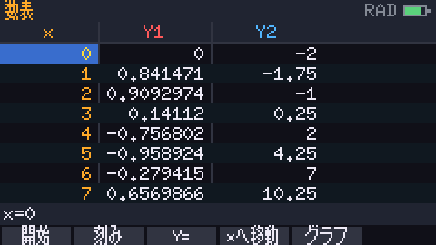
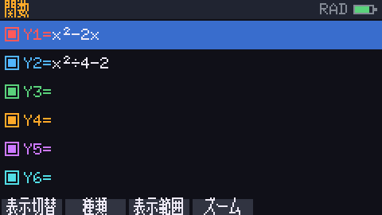
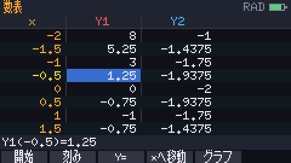
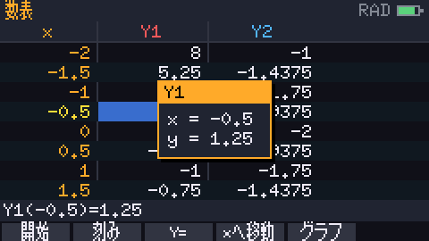

# 数表

数表は、y=f(x) の関数の値を、x を一定の刻みで変えながら一覧にするアプリです。グラフアプリと同じ関数 Y1〜Y6 を使います。開始値と刻みを指定でき、上下どちらにも際限なくスクロールできます。

ホーム画面で「数表」のアイコンを選ぶか、`4` を押すと起動します。グラフアプリの関数一覧で F5 (数表) を押しても開けます。

このページでは矢印を ↑ ↓ ← → と書きます。`fn`+`;` `.` `,` `/` のことです。数表の画面では `;` `.` `,` `/` だけでも矢印になります。ESC は `fn`+`` ` `` です。F1〜F6 は `fn`+`1`〜`6` です。共通のキーは [基本操作](../basics.md) を参照してください。

## 画面の見方

| 部分 | 内容 |
|---|---|
| ステータスバー (上) | タイトル「数表」、修飾キーの状態、角度単位、電池残量 |
| 見出し行 | `x` と、関数ごとの列 (`Y1`、`Y2` …)。関数の色で表示します。左右にまだ列があるときは `◀` / `▶` が出ます |
| 各行 | 左に x の値 (オレンジ)、右に関数の値。1 行おきに背景の色が変わります。選んでいるセルに色が付きます |
| 情報行 | 選んでいるセルの値。例: `x=0`、`Y1(-0.5)=1.25` |
| ソフトキー (下) | F1 開始、F2 刻み、F3 Y=、F4 xへ移動、F5 グラフ |

関数の列は、画面に 3 列まで表示できます。値は列の幅に合わせて短く表示し、情報行では 10 桁まで表示します。「未定義」は、その x で関数が実数の値を持たないことを表します (x<0 での √(x)、0 での割り算など)。

表示するのは、表示がオンで、式が空でなく、種類が y=f(x) の関数だけです。極座標と媒介変数の関数は表示しません。

## 操作

| キー | 動作 |
|---|---|
| ↑ ↓ | 1 行動かします。上端・下端を越えてもスクロールを続けます (開始値より前の x も表示できます) |
| ← → | x の列と関数の列の間を動きます |
| `fn`+`[` / `fn`+`]` | 1 ページ上 / 下へ動きます |
| `fn`+`-` | 最初の行 (x = 開始値) に戻ります |
| x の列で `Enter` | x へ移動します (F4 と同じ) |
| 関数のセルで `Enter` | x と y の値をメッセージで表示します |
| x の列で数字か `-` | 「xへ移動」を開き、入力した値から数表を始め直します |
| ESC | ホーム画面に戻ります (グラフから開いたときはグラフに戻ります) |

### ソフトキー

| キー | 表示 | 動作 |
|---|---|---|
| F1 | 開始 | 最初の x の値を入力します (「数表の開始値 (現在 0)」)。最初の行に戻ります |
| F2 | 刻み | 行と行の間の刻みを入力します (「数表の刻み (現在 1)」)。負の値も使えますが、0 は指定できません |
| F3 | Y= | 関数の一覧 (「関数」) を開き、Y1〜Y6 を編集します (下表) |
| F4 | xへ移動 | x の値を入力します。値が数表の上 (開始値 + n × 刻み) にあれば、その行に移動します。そうでなければ、その x から数表を始め直します |
| F5 | グラフ | 関数のグラフを描きます。ESC で数表に戻ります。グラフから数表を開いたときは、このキーは表示されません |

開始値、刻み、x の値には、`π/6` や `2^10` のような式も使えます。

### 関数の一覧 (F3)

グラフアプリと同じ一覧で、タイトルは「関数」です。

| キー | 動作 |
|---|---|
| ↑ ↓ | Y1〜Y6 を選びます |
| `Enter` または → | 選んだ式を編集します。`Enter` で確定、ESC で取り消します |
| 文字キーか `opt` / `alt` のキー | その行に新しい式を入力し始めます |
| F1 (表示切替) または `Space` | 数表に表示するかどうかを切り替えます |
| F2 (種類) | 関数の種類を切り替えます (数表で使うのは y=f(x) だけです) |
| F3 (表示範囲) / F4 (ズーム) | グラフの表示範囲を変えます |
| `BS` | 式を消します (「Y1 を消去しますか?」と確認します) |
| ESC または ← | 数表に戻ります |

この一覧の詳しい説明は [グラフ](graph.md) を参照してください。

## 使用例

### 開始値と刻みを変えた数表

1. F3 (Y=) を押します。Y1 を選んだ状態で関数の一覧が開きます。
2. `x` と入力し、`opt`+`2` (²) を押して `-2x` と入力し、`Enter` を押します。Y1 が `x²-2x` になります。

3. ESC で数表に戻ります。
4. F1 (開始) を押し、`-2` と入力して `Enter` を押します。
5. F2 (刻み) を押し、`0.5` と入力して `Enter` を押します。x の列が -2、-1.5、-1 … になります。
6. → で Y1 の列に移り、↓ を 3 回押して x = -0.5 の行にします。情報行に `Y1(-0.5)=1.25` と表示されます。

7. `Enter` を押すと、`x = -0.5` と `y = 1.25` がメッセージで表示されます。どれかのキーを押すと閉じます。

### x の値へ移動する

1. F4 (xへ移動) を押し、`10` と入力して `Enter` を押します。
2. 10 は数表の上 (-2 + 24 × 0.5) にあるので、x = 10 の行に移動します。Y1(10) は 80 です。
3. もう一度 F4 を押して `0.3` を入力します。0.3 は数表の上にないので、x = 0.3 から数表を始め直します (開始値が 0.3 になり、刻みは 0.5 のままです)。
4. `fn`+`-` を押すと、いつでも最初の行に戻ります。

## 注意と制限

- **x の値は正確**: x の値は 10 進 15 桁で、開始値 + 行番号 × 刻み で計算します。刻みが 0.1 なら、誤差がたまらず 0.1、0.2、0.3 … とちょうどの値になります。
- **関数は共通**: 数表とグラフは同じ Y1〜Y6 を使います。どちらで変えても、もう一方に反映されます。
- **エラー**: 構文エラーのある関数は、数表を開いたときにメッセージで知らせ、表示から外します。
- **角度単位**: 三角関数は角度単位 (設定アプリ、または計算アプリの F3) に従います。
- **変数**: 関数には `A` などの変数も使えます。そのときの変数の値で計算します。
- **保存**: 関数と、数表の開始値・刻みは `/data/funcs.json` に保存されます。

---

[← 目次](../README.md) · [基本操作](../basics.md)
