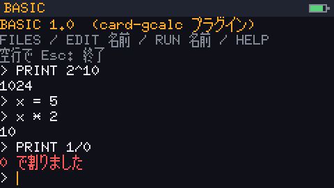
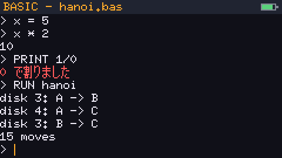
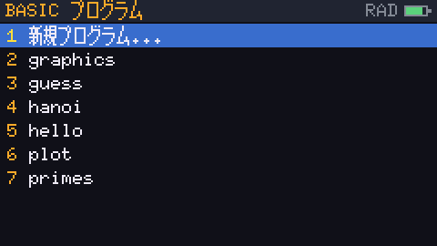
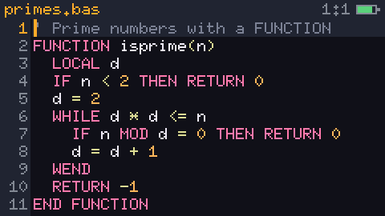
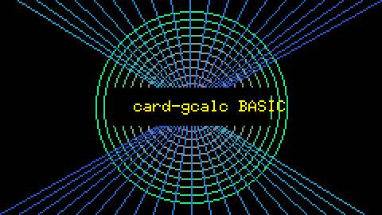

# BASIC

[← 目次](README.md)

サンプルプラグインの BASIC は、行番号を使わない構造化 BASIC のインタプリタです。IF〜END IF、FOR、WHILE、DO〜LOOP、SELECT CASE、再帰のできる SUB / FUNCTION、グラフィックス命令が使えます。ラベルや行番号を付けた GOTO / GOSUB も使えます。

| ダイレクトモード | プログラムの実行 |
|---|---|
|  |  |

## インストール

BASIC はプラグインなので、ファームウェアとは別に入れます。

- PC からリポジトリのツールで: `tools/plugin.sh install plugins/basic`
- リリースの `basic-plugin-*.zip` を展開し、`basic` フォルダを SD カードの `/plugins/` か本体の `/plugins/` にコピー

詳しくは [PC との連携](pc.md#プラグインのインストール) を参照してください。インストールすると、ホーム画面の設定の後ろに「BASIC」が加わります。

## 起動とダイレクトモード

ホーム画面で「BASIC」を選んで Enter を押すと、ダイレクトモードになります。`>` の後ろに命令や式を入力して Enter を押すと、すぐに実行します。

```
> PRINT 2^10
1024
> x = 5
> x * 2
10
```

- 式だけを入力すると、その値を表示します (`x * 2` は `PRINT x * 2` と同じ)。
- 読み込んだプログラムの変数、SUB、FUNCTION も使えます。プログラムを実行したあとで、変数の値を調べるのに便利です。
- ↑ ↓ で、前に入力した行を呼び出せます。
- 空の行で ESC (`fn`+`` ` ``) を押すか、`BYE` と入力すると終了します。

### コマンド

| コマンド | 動作 |
|---|---|
| `FILES` (`DIR`) | プログラムの一覧を開く。実行・編集・削除・新規作成ができる |
| `EDIT 名前` | プログラムをエディタで開く (無ければ作る)。名前を省略すると、読み込んでいるプログラム |
| `RUN [名前]` | プログラムを実行する。名前を省略すると、読み込んでいるプログラム |
| `LOAD 名前` | プログラムを読み込む (実行はしない) |
| `LIST` | 読み込んでいるプログラムを行番号付きで表示する |
| `NEW` | 読み込んでいるプログラムと変数を消す |
| `HELP` | 言語のまとめを表示する |
| `BYE` (`QUIT`、`EXIT`) | BASIC を終了する |

名前には拡張子 `.bas` を付けなくてもかまいません。`/` を含まない名前は `/programs` のファイルになります。SD カードのプログラムは `/sd/programs/名前` のように指定します。

## プログラムの作成と実行

### プログラムの一覧 (FILES)



- 「新規プログラム...」を選ぶと、名前を聞いてからエディタを開きます。
- プログラムを選ぶと、「実行」「編集」「削除」のメニューが出ます。
- SD カードの `/sd/programs` にあるプログラムには、右に「SD」と表示されます。

### エディタ

`EDIT 名前` か一覧の「編集」で、エディタが開きます。BASIC 用の色分け、自動インデント、スニペットが使えます。



| キー | 動作 |
|---|---|
| `ctrl`+`r` | 保存して実行する。終わったらキーを押すとエディタに戻る |
| `ctrl`+`s` | 保存する |
| ESC | エディタを閉じて、ダイレクトモードに戻る (プログラムは読み込まれる) |
| Enter | 改行。`FOR`、`WHILE`、`DO`、`SUB`、`FUNCTION`、`SELECT`、`CASE`、`ELSE`、`ELSEIF`、`IF … THEN` の行の後ろでは、自動で字下げする |

そのほかのエディタの操作 (検索、行ジャンプ、元に戻すなど) は [Python](apps/python.md) のエディタと同じです。

スニペット (`opt`+キー で挿入):

| キー | 挿入される文字列 | キー | 挿入される文字列 |
|---|---|---|---|
| `p` | `PRINT ` | `w` | `WHILE ` |
| `i` | `IF  THEN` | `o` | `DO` |
| `l` | `ELSE` | `c` | `SELECT CASE ` |
| `e` | `END IF` | `s` | `SUB ` |
| `f` | `FOR i = 1 TO ` | `u` | `FUNCTION ` |
| `n` | `NEXT` | `r` | `RETURN ` |
| `d` | `DIM ` | `g` | `GOSUB ` |
| `t` | `INPUT ` | | |

### 実行と中断

- 実行中のプログラムは、ESC か `ctrl`+`c` で中断できます。「Break in line 12」(日本語表示では「12 行目で中断」) のように、中断した行を表示します。
- エラーが起きると、「3 行目: 0 で割りました」のように行番号付きで表示します。
- グラフィックス命令で描いたプログラムは、終わったあと画面をそのまま表示して、キー入力を待ちます。
- `STOP` は中断と同じ扱いで、止まった行を表示します。`END` は何も表示せずに終わります。

### 保存場所とサンプル

プログラムは `/programs/*.bas` (と SD カードの `/sd/programs/*.bas`) に保存されます。初めて起動したときに、次のサンプルを `/programs` にコピーします。

| 名前 | 内容 |
|---|---|
| `hello` | PRINT と INPUT |
| `primes` | FUNCTION を使って素数を数える |
| `guess` | 数当てゲーム (INPUT、IF、DO〜LOOP) |
| `hanoi` | ハノイの塔 (再帰する SUB) |
| `graphics` | 図形と、跳ね回るボール (INKEY$) |
| `plot` | 関数のグラフ (PSET) |

[ファイル](apps/files.md) アプリで `.bas` ファイルを選んだときも、「開くアプリ: BASIC」から実行・編集できます。



## 言語リファレンス

### 書き方

- 大文字と小文字は区別しません (`print` も `PRINT` も同じ)。変数名も区別しません。
- `:` で、1 行に複数の命令を書けます。
- `'` か `REM` から行末まではコメントです。
- 行の先頭に行番号やラベル (`名前:`) を付けられます。付けなくてもかまいません。

### 値と変数

- 値は数 (整数か倍精度の実数) と文字列の 2 種類です。
- 整数どうしの `+ - *` は整数のまま計算します。桁数の制限はありません。`/` の結果は実数です。
- 実数は有効 10 桁で表示します (`0.1+0.2` は `0.3`、`1/3` は `0.3333333333`)。
- 16 進・2 進・8 進の数は `&HFF`、`&B101`、`&O17` と書けます。
- 文字列は `"..."` で囲みます。
- 変数は宣言せずに使えます。最初の値は、名前が `$` で終わる変数は `""`、それ以外は 0 です。
- 真は -1、偽は 0 です。IF などの条件では、0 以外を真とみなします。
- 変数はすべてグローバルです。SUB / FUNCTION の引数と、`LOCAL` で宣言した変数だけがローカルです。

### 配列

```basic
DIM a(10), m(3, 3), name$(5)
a(0) = 1: m(3, 3) = 9: name$(2) = "Bob"
```

- 添字は 0 から、DIM で指定した数までです (`DIM a(10)` は 11 個)。
- 範囲を超えると「添字が範囲外です」のエラーになります。
- 配列は使う前に DIM してください。DIM していない配列を使うと「配列が DIM されていません」のエラーになります。

### 演算子

優先順位の高い順です。

| 順位 | 演算子 | 内容 |
|---|---|---|
| 1 | `^` | べき乗 (`-2^2` は -4) |
| 2 | `-` `+` (単項) | 符号 |
| 3 | `*` `/` | 掛け算、割り算 |
| 4 | `\` | 整数除算 (0 の方向に切り捨て。`-7\2` は -3) |
| 5 | `MOD` | 余り (符号は割られる数と同じ。`-7 MOD 3` は -1) |
| 6 | `+` `-` | 足し算、引き算。`+` は文字列どうしの連結にも使える |
| 7 | `&` | 文字列として連結 (数は文字列に直す。`"a" & 1` は `"a1"`) |
| 8 | `=` `<>` `<` `>` `<=` `>=` | 比較 (文字列どうしも比べられる) |
| 9 | `NOT` | 否定 (ビットごと) |
| 10 | `AND` | 論理積 (ビットごと) |
| 11 | `OR` `XOR` | 論理和、排他的論理和 (ビットごと) |

数と文字列を `+` で足すと「型が違います」のエラーになります。`&` を使ってください。

### PRINT と INPUT

```basic
PRINT "x ="; x          ' ; は続けて表示
PRINT 1, 2, 3           ' , は次の桁 (10 文字ごと) へ
PRINT "no newline";     ' 最後の ; で改行しない
PRINT TAB(10); "*"; SPC(3); "*"
? "PRINT の省略形"
INPUT "Name"; n$        ' 「Name? 」と表示して文字列を読む
INPUT a, b              ' 「1, 2」のようにカンマで区切って入力
```

### 制御構造

```basic
IF x > 0 THEN
  PRINT "plus"
ELSEIF x < 0 THEN
  PRINT "minus"
ELSE
  PRINT "zero"
END IF

IF x = 0 THEN PRINT "zero" ELSE PRINT "non-zero"   ' 1 行の IF

FOR i = 1 TO 10 STEP 2     ' STEP は省略可 (1)。負の数も使える
  PRINT i;
NEXT                       ' NEXT i とも書ける

WHILE n > 0
  n = n \ 2
WEND

DO
  k$ = INKEY$
LOOP UNTIL k$ <> ""        ' DO WHILE c / DO UNTIL c / LOOP WHILE c も可

SELECT CASE score
  CASE 100: PRINT "perfect"
  CASE 80 TO 99: PRINT "good"
  CASE IS < 30: PRINT "try again"
  CASE 50, 60: PRINT "50 or 60"
  CASE ELSE: PRINT "ok"
END SELECT
```

- FOR の範囲が空のとき (`FOR i = 3 TO 1`) は、中身を 1 回も実行しません。
- ループを途中で抜けるには `EXIT FOR`、`EXIT WHILE`、`EXIT DO` を使います。

### SUB と FUNCTION

```basic
SUB greet(name$, times)
  LOCAL i
  FOR i = 1 TO times
    PRINT "Hello, "; name$
  NEXT
END SUB

FUNCTION fact(n)
  IF n <= 1 THEN RETURN 1
  RETURN n * fact(n - 1)
END FUNCTION

greet "Bob", 2           ' 呼び出し (CALL greet("Bob", 2) とも書ける)
PRINT fact(10)
```

- FUNCTION の値は `RETURN 式` か `関数名 = 式` で返します。
- `EXIT SUB`、`EXIT FUNCTION` で途中から戻れます。
- 再帰呼び出しができます。深さは FUNCTION で約 19 段、SUB で約 40 段までです (実機のスタックの大きさによる)。
- SUB / FUNCTION は、プログラムのどこに書いてもかまいません。

### ラベル、GOTO、GOSUB

```basic
start:
  INPUT "number"; n
  IF n < 0 THEN GOTO done
  GOSUB show
  GOTO start
show:
  PRINT n * n
  RETURN
done:
  PRINT "bye"
```

ラベルの代わりに行番号 (`10 PRINT ...`、`GOTO 10`) も使えます。

### そのほかの命令

| 命令 | 内容 |
|---|---|
| `LET x = 1` | 代入 (`LET` は省略できる) |
| `DATA 1, "a", 2.5` / `READ x, s$` / `RESTORE [ラベル]` | プログラム中のデータを順に読む |
| `CONST N = 10` | 定数を定める |
| `SWAP a, b` | 2 つの変数の値を入れ替える |
| `RANDOMIZE [n]` | 乱数を初期化する (n を指定すると、毎回同じ乱数の列になる) |
| `SLEEP 秒` | 待つ (小数も可。`SLEEP 0.5`) |
| `CLS` | テキスト画面を消す |
| `END` | プログラムを終える |
| `STOP` | 中断する (止まった行を表示) |

### グラフィックス

画面は 240×135 ドット、原点 (0, 0) は左上です。色は `RGB(r, g, b)` か、`"red"` などの色名で指定します (色名は [cardgcalc モジュール API](api.md#色) と同じ)。

| 命令 | 内容 |
|---|---|
| `GCLS [c]` | 画面を消す (色 c で塗りつぶす) |
| `COLOR c` | 以後の描画の色を決める |
| `PSET x, y[, c]` | 点を描く |
| `LINE x1, y1, x2, y2[, c]` | 直線 |
| `BOX x, y, w, h[, c[, fill]]` | 長方形。fill に 0 以外を指定すると塗りつぶす |
| `CIRCLE x, y, r[, c[, fill]]` | 円 |
| `GPRINT x, y, text[, c]` | 文字を描く |

```basic
GCLS
FOR i = 0 TO 11
  CIRCLE 120, 67, 5 + i * 5, RGB(255 - i * 20, 80 + i * 14, 120)
NEXT
GPRINT 84, 62, "card-gcalc BASIC", "yellow"
k$ = WAITKEY$
```

### キー入力

| 関数 | 内容 |
|---|---|
| `INKEY$` | 押されたキー。押されていなければ `""` (待たない) |
| `WAITKEY$` | キーが押されるまで待ち、そのキーを返す |
| `KEYDOWN("a")` | そのキーが今押されていれば -1、いなければ 0 |

返るキーの名前は `"a"`、`"ENTER"`、`"UP"`、`"F1"` など、[cardgcalc モジュール API](api.md#キーボード) の `get_key()` と同じです。`KEYDOWN("LEFT")` などは、`fn` を押さなくても `,` などのキーで反応します。

### 関数

| 種類 | 関数 |
|---|---|
| 数学 | `ABS(x)` `INT(x)` (以下の最大の整数) `FIX(x)` (0 の方向に切り捨て) `SGN(x)` `SQR(x)` `EXP(x)` `LOG(x)` (自然対数) `LOG10(x)` `SIN(x)` `COS(x)` `TAN(x)` `ATN(x)` `ATAN2(y, x)` `PI` |
| 丸め・比較 | `ROUND(x[, n])` (小数点以下 n 桁に四捨五入) `MIN(a, b, ...)` `MAX(a, b, ...)` |
| 乱数 | `RND` (0 以上 1 未満) |
| ビット演算 | `BAND(a, b)` `BOR(a, b)` `BXOR(a, b)` |
| 文字列 | `LEN(s$)` `LEFT$(s$, n)` `RIGHT$(s$, n)` `MID$(s$, start[, n])` `INSTR([start,] s$, t$)` (見つからなければ 0) `UCASE$(s$)` `LCASE$(s$)` `TRIM$(s$)` `LTRIM$(s$)` `RTRIM$(s$)` |
| 変換 | `STR$(x)` `VAL(s$)` (数にできなければ 0) `CHR$(n)` `ASC(s$)` `HEX$(n)` `BIN$(n)` |
| 文字列を作る | `SPACE$(n)` `STRING$(n, c$)` |
| PRINT 用 | `SPC(n)` (空白 n 個) `TAB(n)` (n 桁目まで空白) |
| 時間 | `TIMER` (秒、小数あり) `TICKS` (ミリ秒) |
| グラフィックス | `RGB(r, g, b)` |

文字列の位置は 1 から数えます (`MID$("hello", 2, 3)` は `"ell"`)。三角関数の角度はラジアンです。

### おもなエラー

| 表示 (英語) | 表示 (日本語) | 原因 |
|---|---|---|
| Division by zero | 0 で割りました | 0 で割った |
| Type mismatch | 型が違います | 数と文字列を混ぜて計算した |
| Subscript out of range | 添字が範囲外です | 配列の範囲を超えた |
| Label not found | ラベルが見つかりません | GOTO / GOSUB の行き先が無い |
| Out of DATA | DATA が足りません | READ するデータが残っていない |
| Array not dimensioned | 配列が DIM されていません | DIM していない配列を使った |
| Wrong number of arguments | 引数の数が違います | 関数・SUB の引数の数が合わない |
| Too many nested calls | 呼び出しが深すぎます | 再帰が深すぎる |
| Syntax error | 構文エラー | 書き方の誤り |

エラーの表示は、日本語表示のときは日本語になります。

## ほかの BASIC との違い

- 行番号は不要です。プログラムはエディタで普通のテキストとして書きます。
- `PRINT USING`、ファイル入出力 (`OPEN` など)、`ON ... GOTO` はありません。
- 変数の型は値で決まります。`%` や `!` などの型の記号はありません (`$` は「初期値が `""`」という意味だけです)。
- インタプリタの中心部分 (`plugins/basic/baslang.py`) は画面に依存しないので、PC の MicroPython で動かしてテストできます (`tests/test_basic.py`)。
