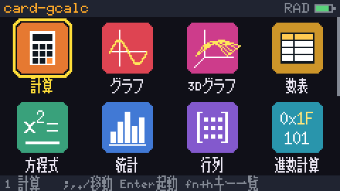
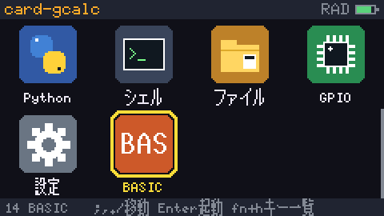
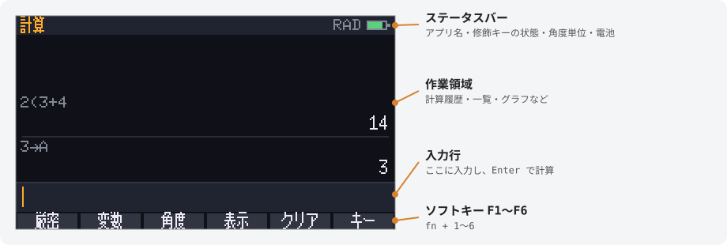
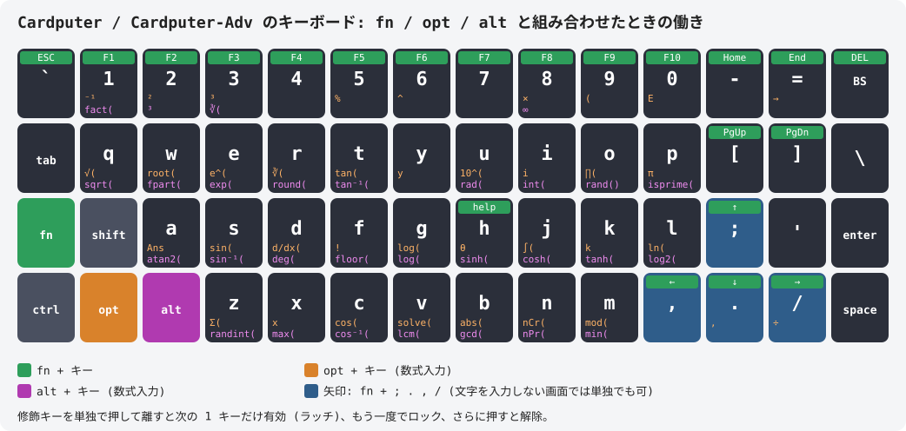
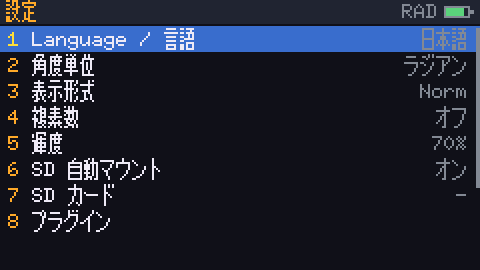
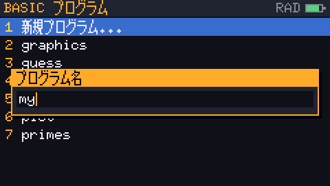
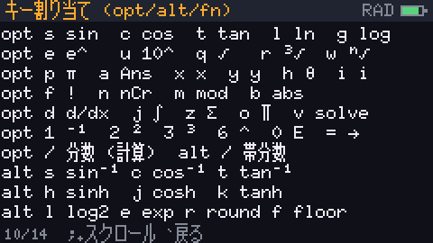

# 基本操作

[← 目次](README.md)

すべてのアプリに共通する操作を説明します。

## 起動とホーム画面

電源を入れると「card-gcalc」のロゴが少し表示され、ホーム画面になります。

| キー | 動作 |
|---|---|
| ↑ ↓ ← → | アプリを選ぶ (`;` `.` `,` `/` だけでも動きます) |
| Enter / Space | 選んだアプリを起動する |
| `1`〜`9`、`0` | 番号のアプリをすぐに起動する (`0` は 10 番のシェル) |
| `fn`+`h` | キー割り当ての一覧を表示する |

- 画面下の行には、選んでいるアプリの番号と名前が表示されます。
- アプリは 1 画面に 8 個並びます。3 段目以降は、↓ でスクロールします。右端の細い線がスクロール位置です。
- インストールしたプラグインは、設定の後ろに並びます ([プラグイン](plugins.md))。
- アプリを終えるには、アプリの最初の画面で ESC (`fn`+`` ` ``) を押します。ホーム画面に戻ります。

## 画面の見方

画面は 240×135 ドットです。多くのアプリは次の 4 つの部分でできています。

| 部分 | 内容 |
|---|---|
| ステータスバー | 左にアプリ名、右に修飾キーの状態、角度単位 (RAD / DEG / GRA)、電池残量を表示します |
| 作業領域 | 計算履歴、一覧、グラフなど、アプリごとの内容 |
| 入力行 | 式や値を入力する行 (ある画面だけ) |
| ソフトキー | 画面の最下段。F1〜F6 (`fn`+`1`〜`6`) で、表示されている機能を使います |

## キーボード

### fn と組み合わせるキー

| キー | 働き |
|---|---|
| `fn`+`;` `.` `,` `/` | ↑ ↓ ← → |
| `fn`+`` ` `` | ESC (戻る・取り消す) |
| `fn`+`1`〜`6` | F1〜F6 (ソフトキー) |
| `fn`+`7`〜`0` | F7〜F10 (使うアプリだけ) |
| `fn`+`BS` | DEL (カーソルの右の文字を消す) |
| `fn`+`-` / `fn`+`=` | 行頭 / 行末 (HOME / END) |
| `fn`+`[` / `fn`+`]` | 前のページ / 次のページ |
| `fn`+`h` | キー割り当ての一覧 (ホーム画面など) |

- 文字を入力しない画面 (ホーム画面、メニュー、グラフなど) では、`;` `.` `,` `/` だけでも矢印になります。
- 文字を入力する欄では、`;` `.` `,` `/` はその文字が入力されます。矢印には `fn` を使ってください。
- `` ` `` だけを押すと、入力欄にはバッククォート (`` ` ``) が入ります。ESC は必ず `fn`+`` ` `` です。

### 修飾キー

`shift` `ctrl` `opt` `alt` `fn` は、押したまま別のキーを押すほかに、次のようにも使えます。

| 操作 | 状態 | ステータスバーの表示 |
|---|---|---|
| 単独で押して離す | ラッチ: 次の 1 キーだけ有効 | 色付きの文字 (例: `opt`) |
| もう一度押す | ロック: 解除するまで有効 | 色の帯に黒い文字 |
| さらに押す | 解除 | 表示が消える |

ステータスバーでは `fn`、`SFT` (shift)、`ctl` (ctrl)、`opt`、`alt` と表示されます。片手で `opt`+`s` などを入力したいときに便利です。

## メニュー

一覧から選ぶ画面は、どのアプリでも同じ操作です。

| キー | 動作 |
|---|---|
| ↑ ↓ | 項目を選ぶ (端まで行くと反対側に回る) |
| Enter / → | 決定 |
| ESC / ← | 選ばずに戻る |
| `1`〜`9` | その番号の項目をすぐに選ぶ |
| `fn`+`[` / `fn`+`]` | 1 ページ分移動する |

項目の右側に表示されているのは、今の設定値です。

## 入力欄とダイアログ

式や名前を入力する欄では、次のキーが使えます。

| キー | 動作 |
|---|---|
| ← → | カーソルを動かす (`sin(` などは 1 文字として扱います) |
| `fn`+`-` / `fn`+`=` | 行頭 / 行末 |
| `BS` | カーソルの左を消す |
| `fn`+`BS` | カーソルの右を消す |
| `ctrl`+`u` | 入力をすべて消す |
| Enter | 確定 |
| ESC | 取り消す |

- 数式の欄では、`*` は `×`、`/` は `÷` として入力されます。
- 最初から値が入っている欄では、そのまま文字を打つと値が置き換わります。先に ← → を押すと、値を編集できます。

### メッセージと確認

- メッセージは、どれかのキーを押すと閉じます。
- 確認 (「削除しますか?」など) では、Enter (または `y`) で実行、ESC で取り消しです。

### テキストの表示

ヘルプやエラーの詳細など、長い文章を表示する画面です。

| キー | 動作 |
|---|---|
| ↑ ↓ | 1 行スクロール |
| ← → / `fn`+`[` `fn`+`]` | 1 ページスクロール |
| Enter / ESC | 閉じる |

左下に「表示中の最終行 / 全行数」が出ます。

## 数式の入力

計算、グラフ、数表、方程式など、数式を入力する欄では、`opt` と `alt` で関数や記号を入力できます。キーボードの図のオレンジ色が `opt`、紫色が `alt` です。

| キー | `opt` | `alt` |
|---|---|---|
| `s` / `c` / `t` | sin( cos( tan( | sin⁻¹( cos⁻¹( tan⁻¹( |
| `l` / `g` / `e` | ln( log( e^( | log2( log( exp( |
| `q` / `r` / `w` | √( ∛( root( | sqrt( round( fpart( |
| `u` | 10^( | rad( |
| `h` / `j` / `k` | θ ∫( k | sinh( cosh( tanh( |
| `p` / `a` / `x` / `y` / `i` | π Ans x y i | isprime( atan2( max( — int( |
| `f` / `n` / `m` / `b` | ! nCr( mod( abs( | floor( nPr( min( gcd( |
| `d` / `z` / `o` / `v` | d/dx( Σ( ∏( solve( | deg( randint( rand() lcm( |
| `1` / `2` / `3` / `6` / `0` | ⁻¹ ² ³ ^ E (×10ⁿ) | fact( ³ ∛( |
| `8` | × | ∞ (統計の分布の範囲) |
| `=` / `8` / `/` / `5` / `9` / `.` | → × ÷ % ( , (計算画面では `/` は分数) | — ∞ 帯分数 (計算画面) — — — |

`fn`+`h` で、この一覧を画面に表示できます。

式の書き方:

- 掛け算の記号は省略できます: `2x`、`3(x+1)`、`(a)(b)`、`2sin(π/6)`
- 式の最後の閉じ括弧は省略できます: `√(2` は `√(2)` と同じです。
- 変数への代入は `→` (`opt`+`=`): `3→A`。`A=…` とも書けます。
- 指数は `^` (`opt`+`6`) か `²` `³` `⁻¹`、10 のべき乗は `E` (`opt`+`0`): `1.5E-3`
- 積分・微分・総和など: `∫(x²,0,3)`、`d/dx(x³,2)`、`Σ(k²,k,1,10)`、`solve(x²-2,1)`
- 前の答えは `Ans` (`opt`+`a`) で使えます。

計算アプリなどの数は 10 進 15 桁で計算します。`0.1+0.2-0.3` は 0、`sin(π)` は 0 になります。詳しくは [計算](apps/calc.md) を参照してください。

## 保存されるデータ

| 内容 | 場所 |
|---|---|
| 設定、変数、グラフの式、統計のリスト、行列など | 本体の `/data` (自動で保存) |
| Python・BASIC のプログラム | 本体の `/programs`、SD カードの `/sd/programs` |
| プラグイン | 本体の `/plugins`、SD カードの `/sd/plugins` |

電源を切っても残ります。PC へのバックアップは [PC との連携](pc.md#バックアップと復元) を参照してください。`/data` の初期化は [設定](apps/settings.md) の「全データ初期化」で行えます。

## セーフモード

起動直後にロゴが出ている間に `G0` ボタンか `` ` `` キーを押し続けると、電卓を起動せずに MicroPython の REPL (USB) で止まります。プログラムの不具合で起動できなくなったときに使います ([PC との連携](pc.md#セーフモードと-main_userpy))。
