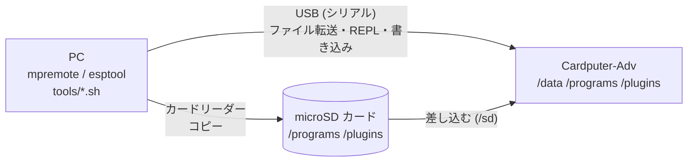

# PC との連携

[← 目次](README.md)

本体と PC は、USB ケーブルか SD カードでつなぎます。



| やりたいこと | 方法 |
|---|---|
| プログラムを PC で書いて本体で動かす | [mpremote](#mpremote-でファイルを転送する) で `/programs` に転送、または [SD カード](#sd-カードを使う) |
| データのバックアップ | [mpremote で /data をコピー](#バックアップと復元) |
| プラグインを入れる | [プラグインのインストール](#プラグインのインストール) |
| ファームウェアを更新する | [esptool で書き込む](#ファームウェアの書き込み) |
| PC でスクリプトを試す | [REPL](#repl) か [シミュレータ](#シミュレータ) |

## USB で接続する

本体の USB-C 端子を PC につなぎます。本体は USB シリアル (ESP32-S3 内蔵の USB-Serial/JTAG) として見えます。ドライバは不要です。

| OS | デバイス名の例 |
|---|---|
| macOS | `/dev/cu.usbmodem1101` |
| Linux | `/dev/ttyACM0` |
| Windows | `COM3` |

### 必要なソフト

Python 3 を入れてから、次の 2 つを入れます。

```sh
pip install mpremote esptool
```

- [mpremote](https://docs.micropython.org/en/latest/reference/mpremote.html): ファイルの転送、REPL、スクリプトの実行
- [esptool](https://docs.espressif.com/projects/esptool/): ファームウェアの書き込み

## mpremote でファイルを転送する

`mpremote` は、つながっている本体を自動で探します。複数つないでいるときは `mpremote connect /dev/cu.usbmodem1101 ...` のように指定します。

```sh
mpremote ls :/                         # 本体のファイル一覧
mpremote ls :/programs
mpremote cp hello.py :/programs/       # PC → 本体
mpremote cp :/programs/hello.py .      # 本体 → PC
mpremote cp -r mydir :/programs/       # フォルダごと
mpremote rm :/programs/old.py          # 削除
mpremote mkdir :/programs/lib          # フォルダを作る
mpremote soft-reset                    # 電卓を再起動する
```

- `:` で始まるパスが本体のパスです。
- mpremote が接続すると、動いている電卓は止まります。転送が終わったら `mpremote soft-reset` を実行するか、電源を入れ直してください。複数のコマンドは `+` でつなげて 1 回で実行できます (`mpremote cp a.py :/programs/ + soft-reset`)。
- 本体のファイルの変更は、[ファイル](apps/files.md) アプリにもすぐに反映されます。

### 本体のファイルの配置

| パス | 内容 |
|---|---|
| `/programs` | Python (`.py`) と BASIC (`.bas`) のプログラム。[Python](apps/python.md) アプリの一覧に出る |
| `/data` | 設定、変数、グラフの式、統計のリスト、行列などのデータ (JSON) |
| `/plugins` | プラグイン |
| `/sd` | SD カード (差してマウントしているとき) |
| `/boot.py` | MicroPython の起動スクリプト (変更しないでください) |
| `/main_user.py` | あれば、電卓の代わりに実行される ([下記](#セーフモードと-main_userpy)) |

フラッシュのファイルシステムは約 4.9MB です。

### プログラムを転送して実行する

1. PC でスクリプトを書きます。

   ```python
   # hello2.py
   import cardgcalc
   cardgcalc.cls()
   cardgcalc.text("Hello from PC", 10, 60, "yellow", font="large")
   cardgcalc.wait_key()
   ```

2. 本体に転送し、電卓を再起動します。

   ```sh
   mpremote cp hello2.py :/programs/ + soft-reset
   ```

3. 本体で [Python](apps/python.md) アプリを開き、`hello2` を選んで実行します。

BASIC のプログラム (`.bas`) も、同じように `/programs` に転送すると、BASIC の `FILES` に出ます。

## バックアップと復元

電卓のデータは `/data`、プログラムは `/programs` にあります。

```sh
# バックアップ (PC の backup フォルダへ)
mkdir backup
mpremote cp -r :/data :/programs backup/

# 復元
mpremote cp -r backup/data backup/programs :/ + soft-reset
```

ファームウェアを書き込んでも、ファイルシステムの領域は消えません。ファイルが消えるのは、フラッシュ全体を消去したとき (`esptool erase-flash`) です。[設定](apps/settings.md) の「全データ初期化」では `/data` だけが消え、プログラムとプラグインは残ります。

## SD カードを使う

microSD カードは FAT (FAT32) でフォーマットして使います。

- 本体に差すと `/sd` にマウントされます (設定の「SD 自動マウント」がオンのとき)。手動でのマウント・取り外しは [設定](apps/settings.md) か [ファイル](apps/files.md) アプリで行います。
- `/sd/programs` に置いたプログラムは、本体の `/programs` と同じように一覧に出ます。
- `/sd/plugins` に置いたプラグインも使えます。
- 抜く前には、ファイルアプリか設定で取り外し (アンマウント) をしてください。

PC のカードリーダーで、次のようにフォルダを作ってコピーします。

```
(SD カード)
  programs/
    hello2.py
    game.bas
  plugins/
    basic/
      plugin.json
      ...
```

## プラグインのインストール

プラグインは、`plugin.json` の入ったフォルダを `/plugins/` (本体) か `/sd/plugins/` (SD カード) に置くと使えます。入れたら、ホーム画面を開き直すか再起動してください。

**方法 1: リポジトリの `tools/plugin.sh` (USB)**

リポジトリを clone して `tools/setup.sh` を実行してある場合に使えます。

```sh
tools/plugin.sh install plugins/basic      # .mpy にコンパイルして転送し、再起動
tools/plugin.sh install-py plugins/basic   # .py のまま転送 (デバッグ用)
tools/plugin.sh build plugins/basic        # build/plugins/basic に .mpy を作るだけ
tools/plugin.sh remove basic               # 本体から削除
```

接続先は、最初に見つかった `/dev/cu.usbmodem*` です。ほかのポートを使うときは `PORT=/dev/ttyACM0 tools/plugin.sh install ...` のように指定します。

**方法 2: mpremote (USB)**

リリースの `basic-plugin-*.zip` などを展開してから:

```sh
mpremote mkdir :/plugins               # 初回だけ (すでにあればエラーになるが問題ない)
mpremote cp -r basic :/plugins/ + soft-reset
```

**方法 3: SD カード**

PC で SD カードの `/plugins/` に `basic` フォルダをコピーし、本体に差します。

**方法 4: ファイルアプリ**

SD カードに置いたプラグインのフォルダを、[ファイル](apps/files.md) アプリで本体の `/plugins` にコピーします。

削除は [設定](apps/settings.md) の「プラグイン」から行えます。

## REPL

`mpremote` (または `mpremote repl`) で、本体の MicroPython の REPL (`>>>`) につながります。電卓は止まります。

```
$ mpremote
Connected to MicroPython at /dev/cu.usbmodem1101
>>> 1 + 2
3
>>> import os; os.listdir("/programs")
['hello.py', 'primes.py', ...]
```

- `ctrl`+`]` (または `ctrl`+`x`) で mpremote を終了します。
- `ctrl`+`d` で、電卓を再起動します。

REPL や `mpremote run` からも `cardgcalc` モジュールを使えます。画面とキーボードは、最初に使ったときに初期化されます。

```python
import cardgcalc
cardgcalc.cls("blue")
cardgcalc.text("from PC", 10, 10, "yellow", font="large")
cardgcalc.show()     # REPL では自動で画面に反映されないので show() を呼ぶ
```

PC のスクリプトを、転送せずに本体で実行することもできます。

```sh
mpremote run myscript.py
```

`print()` の出力は PC の端末に出ます。終わったら `mpremote soft-reset` で電卓に戻ります。

## ファームウェアの書き込み

[リリース](https://github.com/MinoruInachi/card-gcalc/releases) の `card-gcalc-vX.Y.bin` (ファームウェア一式) をダウンロードし、アドレス 0x0 に書き込みます。

```sh
python3 -m esptool --chip esp32s3 --baud 921600 write-flash 0x0 card-gcalc-vX.Y.bin
```

- card-gcalc が入っている本体は、そのまま書き込めます (esptool が自動で書き込みモードにします)。
- 別のファームウェアが入っているときや、書き込みに失敗するときは、手動でダウンロードモードにします: 電源を切って USB を抜き、`G0` ボタンを押したまま USB をつなぎます。書き込みが終わったら、電源を入れ直します。
- ファイルシステム (FAT) の領域には書き込まないので、データ・プログラム・プラグインは残ります。
- ソースからビルドする方法は、リポジトリの [README](../README_ja.md#ビルドと書き込み) を参照してください。

フラッシュの配置:

| アドレス | 内容 |
|---|---|
| 0x0 | ブートローダー |
| 0x8000 | パーティションテーブル |
| 0x10000 | アプリ (MicroPython と card-gcalc、3MB) |
| (後半) | ファイルシステム (FAT、約 4.9MB) |

## セーフモードと /main_user.py

- **セーフモード**: 起動直後、ロゴが出ている間に `G0` ボタンか `` ` `` キーを押し続けると、電卓を起動せずに REPL で止まります。`/main_user.py` やプラグインの不具合で操作できなくなったときは、セーフモードで起動してから mpremote でファイルを直すか消してください。
- **/main_user.py**: このファイルがあると、起動時に電卓の代わりに実行されます。独自のアプリを自動で起動したいときに使います。電卓に戻すには、このファイルを消します (`mpremote rm :/main_user.py`)。

## 開発者向けのツール

リポジトリ ([README](../README_ja.md#開発)) には、開発用のツールがあります。

| ツール | 内容 |
|---|---|
| `tools/dev.sh push [files]` | `src/cardgcalc` (または指定したファイル) を本体の `/cardgcalc` にコピーする。ファームウェアに組み込まれたものより優先されるので、再ビルドせずに試せる |
| `tools/dev.sh clean` | 上のコピーを消す |
| `tools/dev.sh reset` / `repl` / `run file.py` | 再起動、REPL、スクリプトの実行 |
| `tools/plugin.sh` | プラグインのビルドと転送 (上記) |
| `tools/devsim.py` | 本体でキー操作のスクリプトを流し、画面を PNG で取り込む |
| `tools/sim.py`、`tools/simshot.py` | PC のシミュレータ (下記) |

### シミュレータ

PC の MicroPython (unix 版) で、電卓の画面とキー操作を再現できます。`tools/setup.sh` でビルドしたものを使います。

```sh
M=deps/micropython/ports/unix/build-standard/micropython
$M tools/sim.py cardgcalc.app:main '1 "1+2×3" ENTER @calc' sim_out
python3 tools/simshot.py sim_out 3     # sim_out/calc.png ができる
```

- 第 2 引数はキー操作のスクリプトです。`"..."` で文字を入力し、`ENTER` `ESC` `UP` `F1` `opt+s` などでキーを押し、`@名前` で画面を保存します (書き方は `tools/sim.py` の先頭を参照)。
- 長いキー操作のスクリプトは、ファイルに書いて `@@ファイル名` で渡すこともできます。
- シミュレータのファイルシステムは `sim_out/fs` です。プラグインは `tools/plugin.sh sim plugins/basic` でコピーできます。
- この説明書の画面写真も、シミュレータで作りました。
