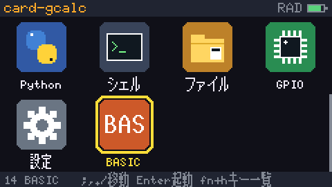
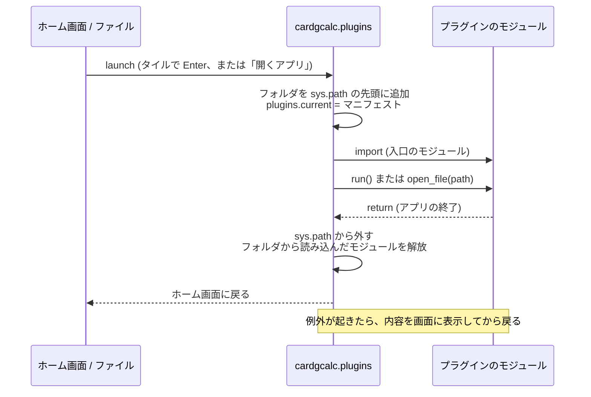
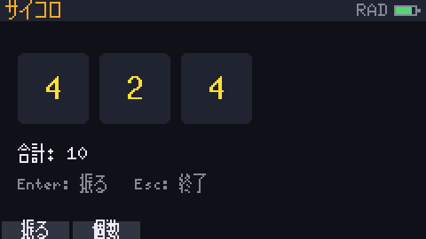
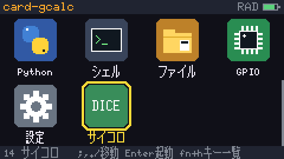
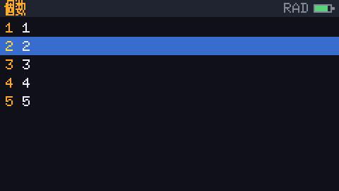

# プラグイン

[← 目次](README.md)

プラグインを使うと、ファームウェアを書き直さずにアプリを追加できます。プラグインは Python で書き、ファイルとして本体か SD カードに置くだけで使えます。サンプルとして [BASIC](basic.md) が付いています。



## プラグインの仕組み

プラグインは、`plugin.json` (マニフェスト) と Python のモジュールを入れたフォルダです。

```
/plugins/                   本体のフラッシュ
  dice/                     ← フォルダ名がプラグインの ID
    plugin.json             マニフェスト
    dice.py (.mpy)          入口のモジュール (run() を定義する)
    ...                     ほかのモジュールやデータ
/sd/plugins/                SD カード (同じ形で置ける)
```

- ホーム画面を表示するたびに、`/plugins` と `/sd/plugins` を探します。同じ ID のプラグインが両方にあるときは、本体のほうを使います。
- プラグインは、ホーム画面で組み込みアプリ (設定) の後ろに並びます。
- `plugin.json` の `files` に拡張子を書くと、[ファイル](apps/files.md) アプリでその拡張子のファイルを選んだとき、「開くアプリ」としてプラグインが使われます。
- [設定](apps/settings.md) の「プラグイン」で、有効・無効の切り替え、情報の表示、削除ができます。

プラグインを起動したときの流れ:



## 作ってみる: サイコロ

サイコロを振るだけの小さなプラグインを作ります。Enter で振り直し、F2 で個数を変え、ESC で終わります。



### 1. フォルダとマニフェスト

PC で `dice` というフォルダを作り、`plugin.json` を置きます。

```json
{
  "api": 1,
  "name": "Dice",
  "name_ja": "サイコロ",
  "version": "1.0",
  "glyph": "DICE",
  "color": [60, 140, 90],
  "files": [".dice"],
  "description": "Roll dice",
  "description_ja": "サイコロを振る"
}
```

`module` を書いていないので、入口のモジュールはフォルダ名と同じ `dice` になります。

### 2. 入口のモジュール

同じフォルダに `dice.py` を置きます。

```python
# Dice: a minimal card-gcalc plugin.
import random
from cardgcalc import hal, gfx, ui, plugins

T = plugins.translator({
    "Dice": "サイコロ",
    "Roll": "振る",
    "Count": "個数",
    "Total": "合計",
    "Enter: roll   Esc: quit": "Enter: 振る   Esc: 終了",
})


def draw(values):
    gfx.fill()
    ui.status_bar(T("Dice"))
    f = gfx.font("large")
    x = 10
    for v in values:
        gfx.round_rect(x, 30, 40, 40, gfx.PANEL)
        f.text(str(v), x + 15, 40, gfx.YELLOW)
        x += 46
    gfx.font("normal").text("%s: %d" % (T("Total"), sum(values)), 10, 82, gfx.FG)
    gfx.font("small").text(T("Enter: roll   Esc: quit"), 10, 100, gfx.DIM)
    ui.softkeys([T("Roll"), T("Count")])
    gfx.show()


def roll(n):
    return [random.randint(1, 6) for _ in range(n)]


def run(n=2):
    values = roll(n)
    while True:
        draw(values)
        k = hal.wait_key()
        if k.key == hal.ESC:
            return
        if k.key in (hal.ENTER, " ", "F1"):
            values = roll(n)
        elif k.key == "F2":
            i = ui.menu(T("Count"), ["1", "2", "3", "4", "5"], n - 1)
            if i is not None:
                n = i + 1
                values = roll(n)


def open_file(path):
    # A .dice file holds the number of dice, e.g. "3".
    try:
        with open(path) as f:
            n = int(f.read().strip())
    except (OSError, ValueError):
        ui.error("Bad file: " + path)
        return
    run(max(1, min(5, n)))
```

ポイント:

- `run()` がアプリの本体です。ESC が押されたら return して、ホーム画面に戻ります。
- 画面は `gfx` で描き、最後に `gfx.show()` で表示します。
- `ui.status_bar()` と `ui.softkeys()` を使うと、組み込みアプリと同じ見た目になります。
- `hal.wait_key()` はキーが押されるまで待ち、`Key` オブジェクトを返します。`k.key` には `"a"`、`"ENTER"`、`"ESC"`、`"F2"` などが入ります。
- `ui.menu()` は、組み込みアプリと同じメニューを表示し、選んだ番号 (ESC なら `None`) を返します。
- `open_file(path)` は、ファイルアプリから `.dice` ファイルを開いたときに呼ばれます。

### 3. インストール

次のどれかの方法で入れます。

| 方法 | 手順 |
|---|---|
| USB (リポジトリのツール) | `tools/plugin.sh install path/to/dice` (.mpy にコンパイルして転送し、再起動) |
| USB (mpremote) | `mpremote mkdir :/plugins` (初回だけ) のあと、`mpremote cp -r dice :/plugins/` を実行し、`mpremote soft-reset` |
| SD カード | PC で SD カードの `/plugins/` に `dice` フォルダをコピーし、本体に差す |

詳しくは [PC との連携](pc.md#プラグインのインストール) を参照してください。ホーム画面を開き直すと、設定の後ろに「サイコロ」が加わります。

| ホーム画面 | 個数の選択 |
|---|---|
|  |  |

## plugin.json

| キー | 必須 | 内容 |
|---|---|---|
| `api` | | 対象とするプラグイン API の版 (省略時 1)。ファームウェアの版 (`cardgcalc.plugins.API`、現在 1) より新しいと読み込まず、設定のプラグイン一覧に「API」と表示します |
| `name` | | ホーム画面の名前。省略するとフォルダ名 |
| `name_ja` | | 日本語表示のときの名前 |
| `version` | | 版。設定の情報画面に表示します |
| `module` | | 入口のモジュール名。省略するとフォルダ名 |
| `icon` | | 組み込みアイコンの名前: `calc` `graph` `graph3d` `table` `equation` `stats` `matrix` `basen` `python` `editor` `shell` `files` `gpio` `settings` `sequence` `units`。`glyph` より優先します |
| `glyph` | | タイルに描く 1〜4 文字。省略するとフォルダ名の先頭 3 文字 (大文字) |
| `color` | | タイルの色 `[r, g, b]` |
| `files` | | 担当する拡張子のリスト (例: `[".bas"]`)。大文字と小文字は区別しません |
| `description` / `description_ja` | | 設定の情報画面に表示する説明 |

JSON として読めないフォルダや、`plugin.json` が無いフォルダは無視します。

## 入口のモジュールの決まり

| 項目 | 内容 |
|---|---|
| `run()` | ホーム画面で起動したときに呼ばれます。アプリが終わったら return します |
| `open_file(path)` | ファイルアプリの「開くアプリ」から呼ばれます (`files` を書いたときだけ必要) |
| `sys.path` | 実行中は、プラグインのフォルダが先頭に入ります。同じフォルダのモジュールはそのまま import できます |
| `cardgcalc.plugins.current` | 自分のマニフェスト (dict)。`current["dir"]` がフォルダのパス、`current["id"]` がフォルダ名です |
| 終了後 | プラグインのフォルダから読み込んだモジュールは、`sys.modules` から消されます |
| 例外 | 捕まえなかった例外は、トレースバックを画面に表示してからホーム画面に戻ります |
| 修飾キー | 終了すると、ラッチ・ロック中の修飾キーは解除されます |

データファイルは、`current["dir"]` を使ってプラグインのフォルダから読めます。

```python
from cardgcalc import plugins
d = plugins.current["dir"]
with open(d + "/data.txt") as f:
    ...
```

## 本体のモジュール

プラグインは、ファームウェアのモジュールをそのまま使えます。主なものを挙げます。

| モジュール | 主な機能 |
|---|---|
| `cardgcalc` | スクリプト用の API ([cardgcalc モジュール API](api.md))。手軽に描画やキー入力ができます |
| `cardgcalc.hal` | ハードウェア: `W`・`H` (240・135)、`wait_key(timeout_ms=-1)` (`Key` を返す。タイムアウトで `None`)、`keyboard`、`display`、`rgb(r, g, b)`、キー名 `UP` `DOWN` `LEFT` `RIGHT` `ENTER` `ESC` `BS` `DEL` `TAB`、修飾キーのビット `SHIFT` `CTRL` `OPT` `ALT` `FN`、`IS_DEVICE` |
| `cardgcalc.gfx` | 描画: `fill(c)`、`fb()` (MicroPython の FrameBuffer)、`font(name)` (`.text(s, x, y, fg, bg)`、`.width(s)`、`.clip(s, w)`、`.h`)、`rect`、`line`、`round_rect`、`show()`。色 `BG` `PANEL` `FG` `DIM` `ACCENT` `SEL` `OK` `ERR` `YELLOW` など |
| `cardgcalc.ui` | 画面部品: `status_bar(title)`、`softkeys(labels)`、`menu(title, items, sel)`、`choose(title, options, current)`、`message(title, lines)`、`error(msg)`、`confirm(title)`、`input_line(title, text, math)`、`input_number(title, value)`、`text_view(title, lines)`、`busy(msg)`。画面の領域 `TOP` (12) と `BOT` (124) |
| `cardgcalc.console` | `Console(title)`: スクロールするテキスト画面。`print()`、`write(s, color)`、`input(prompt)`、`readline(prompt, history)`、`clear()`、`draw()`、`wait_end()` |
| `cardgcalc.editor` | `edit(path, syntax=None)`: エディタで開く。ctrl+r で終えたときは `"run"` を返す |
| `cardgcalc.runner` | `start(con)` / `stop()`: 中断キーの監視と描画の自動更新。`check()`: 中断キーが押されていれば KeyboardInterrupt |
| `cardgcalc.storage` | `PROGRAMS`、`PLUGINS`、`SD`、`sd_mounted()`、`exists(p)`、`isdir(p)`、`load_json(name)`、`save_json(name, obj)` (`/data` に保存) |
| `cardgcalc.settings` | `get(key)`、`set(key, value)`。`get("lang")` は `"en"` か `"ja"` |
| `cardgcalc.plugins` | `current`、`translator(table)`、`API` |

`ui` の関数は、渡した文字列を自動で翻訳します (下の「翻訳」を参照)。

### 長い処理と中断キー

計算に時間がかかるプラグインでは、`runner.start(con)` と `runner.stop()` で囲むと、ESC か `ctrl`+`c` で処理を中断できます (実機では `KeyboardInterrupt` が起きます)。

```python
from cardgcalc import runner
from cardgcalc.console import Console

con = Console("Work")
runner.start(con)
try:
    for i in range(1000000):
        ...
        if i % 1000 == 0:
            runner.check()   # 協調的に中断を調べる (シミュレータ用)
except KeyboardInterrupt:
    con.print("stopped")
finally:
    runner.stop()
con.wait_end()
```

`runner.start()` の間は `print()` の出力が `con` に表示され、`cardgcalc` モジュールで描いた内容は自動で画面に反映されます。

## 翻訳

`cardgcalc.plugins.translator(table)` は、プラグイン専用の翻訳関数を作ります。`table` は `{英語: 日本語}` の辞書です。

```python
from cardgcalc import plugins
T = plugins.translator({"Roll": "振る", "Line %d: %s": "%d 行目: %s"})
T("Roll")          # 日本語表示なら "振る"、英語表示なら "Roll"
```

- 表に無い文字列は、本体の翻訳表で探します。そこにも無ければ英語のまま返します。
- `"Bad file: /x.dice"` のように `": "` を含む文字列は、前の部分 (`"Bad file"`) が表にあれば、そこだけ翻訳します。
- `ui.menu()` などの項目に渡す文字列は、本体の翻訳表で自動的に翻訳されます。プラグイン専用の語は、`T()` を通してから渡してください。

## エディタを別の言語に使う

`cardgcalc.editor.edit(path, syntax)` の `syntax` に、次の属性を持つオブジェクトを渡すと、Python 以外の言語の色分け・スニペット・自動インデントに切り替えられます。BASIC プラグインがこの方法を使っています。

| 属性 | 内容 |
|---|---|
| `highlight(line, state)` | 1 行を `([(文字列, 色), ...], 次の行に持ち越す状態)` に分ける |
| `multiline` | 状態を次の行に持ち越すなら `True` (複数行の文字列やコメント) |
| `snippets` | `{キー: 文字列}`。`opt`+キーで挿入する |
| `indent_after(line)` | `line` の次の行を字下げするなら `True` |

色には `cardgcalc.editor` の `C_KW` (予約語)、`C_BI` (組み込み関数)、`C_STR` (文字列)、`C_NUM` (数)、`C_COM` (コメント)、`C_OP` (演算子)、`C_TXT` (その他) を使うと、Python の色分けとそろいます。`cardgcalc.editor.Syntax` を継承して、必要なところだけ変えることもできます。

```python
from cardgcalc import editor

class MySyntax(editor.Syntax):
    multiline = False
    snippets = {"p": "print "}

    def highlight(self, line, state=None):
        if line.lstrip().startswith("#"):
            return [(line, editor.C_COM)], None
        return [(line, editor.C_TXT)], None

    def indent_after(self, line):
        return line.rstrip().endswith("{")

r = editor.edit("/programs/test.my", MySyntax())
```

## .mpy にする

`.py` のままでも動きますが、`.mpy` (コンパイル済み) にすると、読み込みが速く、使う RAM も少なくなります。RAM のヒープは約 176KB なので、大きいプラグインは `.mpy` にしてください。

```sh
tools/plugin.sh build path/to/dice     # build/plugins/dice に .mpy を作る
```

`.mpy` は MicroPython v1.29 用の `mpy-cross` (`tools/setup.sh` でビルドされます) で作ります。ファームウェアの MicroPython の版が変わると、作り直しが必要になることがあります。

## 開発のこつ

- PC のシミュレータで試せます: `tools/plugin.sh sim path/to/dice` でシミュレータのファイルシステムにコピーし、`tools/sim.py` で動かします ([PC との連携](pc.md#シミュレータ))。
- 実機では、`tools/plugin.sh install-py path/to/dice` で `.py` のまま入れると、エラーの行番号がわかりやすくなります。
- 例外のトレースバックは、画面と USB のシリアル (REPL) の両方に出ます。
- `print()` の出力は USB のシリアルに出ます。デバッグに使えます。
